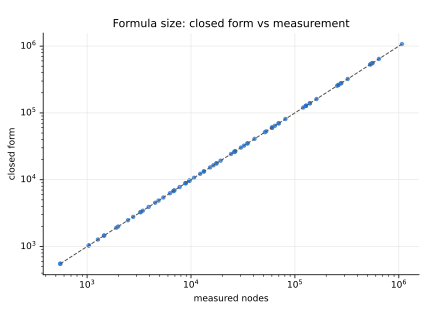
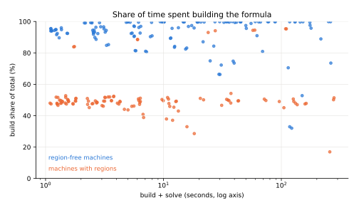
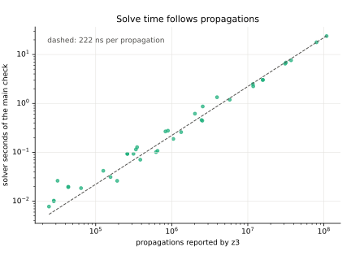
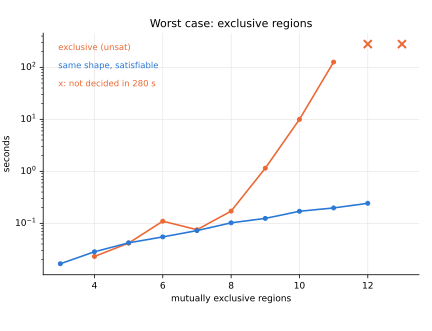
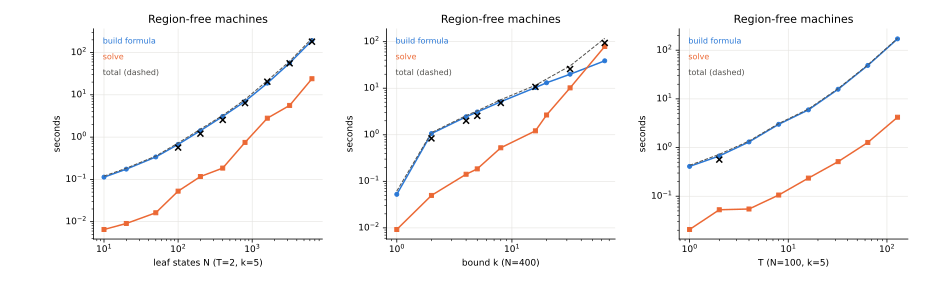
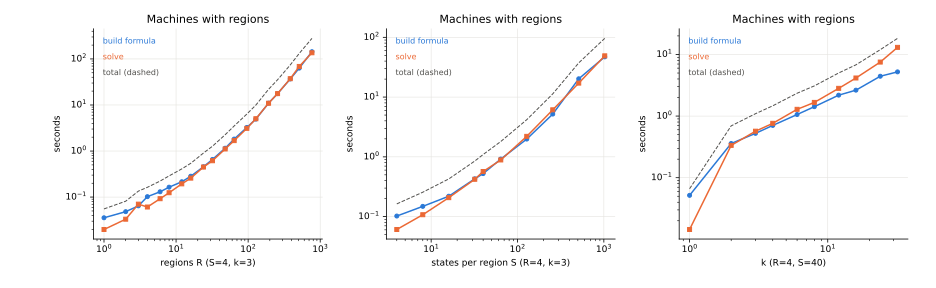

:orphan:

How BMC cost grows with states, regions and bounds
==================================================

You run ``pyfcstm bmc`` on a model, and the question is whether the query will
finish, where the time goes, and whether you can estimate that before you start.
This page answers with measurements on synthetic models, closed forms that were
checked against those measurements, and the places where no formula exists.

**What you can compute in advance and what you cannot.**

.. list-table:: Which quantities are predictable
   :header-rows: 1
   :widths: 24 20 56

   * - Quantity
     - Predictable?
     - How
   * - Formula size (Z3 nodes, Z3 boolean variables)
     - Yes
     - Exact closed form for region-free machines, fitted closed form with a
       stated error for machines with regions
       (:eq:`bmc-scaling-nodes-flat`, :eq:`bmc-scaling-nodes-regions`).
   * - Time to build the formula
     - Yes, roughly
     - Number of Z3 calls from a closed form, times a unit cost that you measure
       once on your machine (:eq:`bmc-scaling-compile-time`).
   * - Peak memory
     - Yes, roughly
     - Follows the formula size; see :ref:`memory <bmc-scaling-memory>`.
   * - Time to solve
     - No
     - No closed form exists. It is proportional to the number of solver
       propagations, and that number has no formula
       (:eq:`bmc-scaling-solve-time`).

Every number below comes from a synthetic model that a script generates, not
from your model. Treat the numbers as the shape of the cost, not as a promise.
A model with heavy arithmetic, bit operations or many interacting guards can
make the solving step much slower than any row here.

How the measurements were made
------------------------------

Two campaigns feed this page, and each table or figure says which one it uses.

.. list-table:: The two measurement campaigns
   :header-rows: 1
   :widths: 22 39 39

   * - Item
     - Original campaign
     - Retest
   * - Code
     - commit ``560b7dc4``
     - commit ``b054fbe3``
   * - Machine
     - Intel Xeon Platinum 8581C, Linux
     - the same machine type, shared with other jobs; load average sampled
       between about 10 and 20
   * - Software
     - Python 3.11.15, z3 4.15.4
     - Python 3.11.15, z3 4.15.4
   * - Concurrency
     - 56 processes at the same time
     - one process at a time
   * - Process model
     - one fresh process per point
     - one fresh process per point, after a warm-up compile of a two-state model
       inside that process
   * - Repeats
     - 3 runs and the median for points under 8 s, one run above
     - the same rule
   * - Data
     - ``data/original_measurements.jsonl``
     - ``data/timing.jsonl`` and the other ``data/*.jsonl`` files

The retest stopped after 15 of 99 planned timing points, because each remaining
point could take up to 300 s on a shared machine. Those 15 points are a spot
check of the original campaign, not a replacement. Every formula-size,
call-count, propagation and exclusive-region number comes from the retest data.
Every record in ``data/`` carries the commit, the machine, the Python and z3
versions, the number of repeats and the statistic that was kept. The tool
``tools/measure_bmc_scaling.py`` regenerates the files and checks the closed
forms:

.. code-block:: bash

   python tools/measure_bmc_scaling.py --help

Symbols
-------

.. list-table:: Symbols used on this page
   :header-rows: 1
   :widths: 12 88

   * - Symbol
     - Meaning
   * - :math:`R`
     - Number of regions of one owner.
   * - :math:`S`
     - Leaf states per region.
   * - :math:`T`
     - Transitions per state.
   * - :math:`D`
     - Nesting levels of regions.
   * - :math:`V`
     - Number of variables written by transitions.
   * - :math:`k`
     - BMC step bound: the query is ``check reach <= k: ...``.
   * - :math:`N`
     - Leaf states of a machine without regions.
   * - :math:`W`
     - Number of transitions that carry an assignment.
   * - :math:`P`
     - Propagations that Z3 reports for the main solver check.
   * - :math:`C_{\mathrm{ctx}}`
     - Throw-away Z3 contexts created while the formula is built.

The synthetic models
--------------------

The tool generates every model, so a point on a figure can be reproduced.

* ``flat``: a ring of :math:`N` leaf states. State ``Si`` moves to ``S(i+1)`` on
  ``d == 0``; the other :math:`T-1` transitions of each state are guarded back
  edges. With :math:`V>0`, every ring transition except the last increments
  :math:`V` variables, so :math:`W=N-1`.
* ``regions``: one owner ``Run`` with :math:`R` regions of :math:`S` leaf states
  each, built the same way inside each region.
* ``pigeonhole``: :math:`m` regions that each pick one of :math:`m-1` states; the
  query asks for all of them to differ.

The query asks for something that cannot happen within :math:`k` steps, so the
solver must prove "unreachable". That is the expensive, honest case: a
satisfiable query ends when the solver finds one witness.

.. literalinclude:: generate_regions.demo.sh
   :language: bash
   :caption: ``generate_regions.demo.sh``

.. literalinclude:: generate_regions.demo.sh.txt
   :language: text
   :caption: Output: two regions of three states, with the unreachable-target query

**What it shows.** Each region has the chain ``P0 -> P1 -> P2`` on ``d == 0``
and one back edge per state on ``d == 1``. The query asks for both regions to
reach ``P2``, which needs more than ``k = 2`` steps. **What you can conclude.**
The generator is small and deterministic: the same arguments give the same model.
**What you cannot conclude.** These models say nothing about how guards in your
own model interact.

Formula size: exact where it can be
-----------------------------------

The size of the Z3 formula depends only on the structure and on :math:`k`, so it
can be counted exactly. Count the distinct nodes of the formula DAG that
``compile_bmc_query`` returns as ``solve_formula``. For a ring of :math:`N`
states with two transitions per state and no variables, the count is:

.. math::
   :label: bmc-scaling-nodes-flat

   \mathrm{nodes}_{\mathrm{flat}}(N,k) = 21\,N k - 18\,N + 33\,k + 6

The form holds for :math:`k \ge 2` and for a query whose target state exists, which
needs :math:`N \ge k+3` for the query used here. When every ring transition
writes :math:`V` variables, the count becomes:

.. math::
   :label: bmc-scaling-nodes-flat-vars

   \mathrm{nodes}_{\mathrm{flat},V}(N,k) = 23\,N k - 20\,N + 4\,V k + 35\,k + 9

You can check the first closed form yourself with the public API. The script below
builds the ring for three sizes, compiles the query for four bounds, counts the
nodes through Z3's own Python interface, and compares with
:eq:`bmc-scaling-nodes-flat`.

.. literalinclude:: node_count.demo.py
   :language: python
   :caption: ``node_count.demo.py``

.. literalinclude:: node_count.demo.py.txt
   :language: text
   :caption: Output of ``node_count.demo.py``

**What each part does.** ``chain_machine`` writes the ring; ``count_nodes`` walks
the expression DAG once and counts each node by its Z3 id;
``compile_bmc_query(...).solve_formula`` is the formula the solver receives.
**What you see.** All 12 rows say ``True``: the measured count equals
:math:`21Nk-18N+33k+6` exactly. **What you can conclude.** For this family the
size is known without running the solver. **What you cannot conclude.** The
closed form says nothing about other models. The node counter is the same
technique as the maintenance tool uses; it is not a public pyfcstm function.

For machines with regions, the node count has non-integer fitted coefficients:

.. math::
   :label: bmc-scaling-nodes-regions

   \mathrm{nodes}_{\mathrm{reg}}(R,S,k) \approx 23\,R S k - 18\,R S + 22.3\,R k + 2.9\,R + 46.2\,k + 17.6

The Z3 solver allocates boolean variables for the first check, and their number
is exact for any :math:`T`:

.. math::
   :label: bmc-scaling-bool-vars

   \mathrm{boolvars}(N,T,k) = 1 + 8k + T(k-1) + N(4k-2) + 3\,N T (k-1)

Read together, the leading terms say the formula grows with the product of
states, transitions and bound, and that regions add up:

.. math::
   :label: bmc-scaling-size-order

   |\Phi_k| = \Theta(N\,T\,k) \quad\text{without regions},
   \qquad
   |\Phi_k| = \Theta(R\,S\,T\,k) \quad\text{with regions}

There is no :math:`R^2` term in the formula size. Regions are summed, not crossed.

.. list-table:: Which coefficients are exact and where they were checked
   :header-rows: 1
   :widths: 30 20 50

   * - Closed form
     - Coefficients
     - Check (from ``check_formulas.demo.sh.txt`` below)
   * - :eq:`bmc-scaling-nodes-flat`
     - integers, exact
     - 16 grid points equal; 60 further points up to :math:`N=6400` and
       :math:`k=128` equal
   * - :eq:`bmc-scaling-nodes-flat-vars`
     - integers, exact
     - 24 grid points equal
   * - :eq:`bmc-scaling-bool-vars`
     - integers, exact
     - 48 grid points equal, with :math:`T` in 1, 2, 4
   * - :eq:`bmc-scaling-nodes-regions`
     - fitted, not integers
     - 48 grid points with residual at most 11.2 nodes; 95 further points up to
       :math:`R=768`, :math:`S=1024`, :math:`k=48` with median error 0.12% and
       maximum 0.92%

The grid points are listed in ``data/formula_grid.jsonl``; the further points are
the original measurements and the retest. A power-law fit of the exact
:eq:`bmc-scaling-nodes-flat` data gives nodes :math:`\approx 14.6\,N^{0.98}k^{1.14}`.
That exponent above 1 for :math:`k` is an artifact of the negative
:math:`-18N` term, which makes the curve steeper at small :math:`k`. The true
growth in :math:`k` is linear.

   Measured Z3 node counts (horizontal) against :eq:`bmc-scaling-nodes-flat`
   (vertical) for region-free machines. Both axes are logarithmic. The figure
   shows that the points lie on the diagonal over three orders of magnitude; it
   does not show anything about time. Data: ``formula_grid.jsonl``,
   ``timing.jsonl`` and ``original_measurements.jsonl``; counts are
   deterministic, so each point is one run.

.. _bmc-scaling-memory:

**Memory.** Peak resident memory follows the node count. In the retest it was
107 MB at 8.9 thousand nodes, 857 MB at 557 thousand and 1429 MB at 1.07 million
nodes. In the original campaign the largest formula, 2.03 million nodes, needed
1395 MB. These are peak resident sizes of the whole process, measured in
``rss_mb``.

Time to build the formula
-------------------------

Building the formula is Python code that calls the Z3 C interface. The number
of those calls is deterministic, and it has a closed form with fitted
coefficients. For the ring with two transitions per state:

.. math::
   :label: bmc-scaling-calls-flat

   \mathrm{calls}_{\mathrm{flat}}(N,k) \approx 1680\,N k - 1578\,N + 1698\,k + 449

For machines with regions, there is a real :math:`R^2` term:

.. math::
   :label: bmc-scaling-calls-regions

   \mathrm{calls}_{\mathrm{reg}}(R,S,k) \approx R S\,(1754 k - 1418) + R\,(976 k + 440) + R^2\,(151 k - 96) + 2561 k + 439

In :eq:`bmc-scaling-calls-regions` the :math:`R^2` term exceeds the :math:`R S` term once :math:`R` is larger than
about :math:`1754\,S/151`, that is about 11.6 times :math:`S`. With :math:`S=4`
that happens near :math:`R=46`. Below that, building the formula looks linear in
the number of regions; above it, it bends upward. The formula size itself still
grows linearly (:eq:`bmc-scaling-size-order`), so the :math:`R^2` cost is paid in
Python work, not in formula nodes. The cause of the term has not been pinned down
(see :ref:`known room for improvement <bmc-scaling-room>`).

The counts were checked on the grid and on three large points.

.. literalinclude:: check_formulas.demo.sh.txt
   :language: text
   :caption: Output of ``check_formulas.demo.sh``: every closed form against the committed data

**What it shows.** Each line names a closed form, the number of points it was
compared with and the result. Lines that say "all equal" are exact; lines that
give an error are fitted. **What you can conclude.** The fitted call counts are
within 0.3% on the grid and within 3% on the large points. **What you cannot
conclude.** The region call-count grid stops at :math:`R=8`, :math:`S=24`,
:math:`k=8`; beyond it the error grows slowly, as the :math:`-2.2\%` and
:math:`-3.0\%` lines for :math:`R=96` and :math:`R=256` show.

**Variable writes.** A transition that assigns variables adds a different kind
of cost. During construction the compiler issues satisfiability checks, and each
check creates a fresh Z3 context (this is deliberate: it keeps an answer
independent of what the process solved before). The number of contexts is exact:

.. math::
   :label: bmc-scaling-contexts

   C_{\mathrm{ctx}} = 2\,W\,V\,(k-1)

The formula size hardly moves with :math:`V`, because :math:`4Vk` in
:eq:`bmc-scaling-nodes-flat-vars` is small, but the context count grows linearly
in :math:`V`. In the retest, :math:`N=100`, :math:`k=5` takes about 0.5 s to
build without variables and 4.9 s, 16.7 s and 65.6 s with :math:`V=4`, 16 and 64.
That is 1.3 to 1.4 ms per context. Together:

.. math::
   :label: bmc-scaling-compile-time

   t_{\mathrm{build}} \approx c_{\mathrm{call}}\cdot \mathrm{calls} + c_{\mathrm{ctx}}\cdot C_{\mathrm{ctx}}

Here :math:`c_{\mathrm{call}}` is the cost of one Z3 call and
:math:`c_{\mathrm{ctx}}` the cost of one context. In the retest, building the region machines with :math:`R=96` and :math:`R=256` (:math:`S=4`, :math:`k=3`) took 2.72 s and 14.8 s for 5.2 and 29.1 million calls, which is 0.52 and 0.51 microseconds per call. Building the ring with :math:`N=1600`, :math:`k=5` took 17.9 s for 10.9 million calls, which is 1.63 microseconds per call. So :math:`c_{\mathrm{call}}` belongs to the model family, not to the machine alone, and you should measure it on a small model of your own family.
The per-context cost is not constant everywhere: in the original campaign, which
had no warm-up and ran 56 processes at once, :math:`V=64` built in 89 s, and the
cause of the difference is not explained.

   Share of the total time that building the formula takes (vertical, linear
   axis, percent) against build plus solve time (horizontal, logarithmic axis,
   seconds), for original-campaign points above 1 s. Blue points are
   region-free machines and orange points are machines with regions. The figure
   shows that building the formula takes most of the time for region-free
   machines (median 96%, 134 points) and about half of it for machines with
   regions (median 49%, 113 points); it does not show which Python lines are
   responsible. Method: one fresh process per point,
   median of 3 runs below 8 s, 56 processes at once.

Time to solve: no formula
-------------------------

The solver time of the main check is close to proportional to the number of
propagations that Z3 reports:

.. math::
   :label: bmc-scaling-solve-time

   t_{\mathrm{solve}} \approx \tau\,P, \qquad \tau \approx 0.2\ \mu\mathrm{s}

In the retest the median was 222 ns per propagation, with 10th and 90th
percentiles of 176 ns and 365 ns. A fit on a logarithmic scale gives:

.. math::
   :label: bmc-scaling-propagation-fit

   \log t_{\mathrm{solve}} = \beta \log P + \alpha, \qquad \beta \approx 0.92

The coefficient of determination is 0.98 over 37 checks (those with more than
:math:`2\cdot 10^4` propagations). So :eq:`bmc-scaling-propagation-fit` is a good description of the
solver, but it is not a prediction: :math:`P` itself has no closed form and is
not monotone in the model size. For the ring with :math:`k=8`, :math:`N=400`
needs 1,329,691 propagations and :math:`N=800` only 621,198.

   Solver seconds of the main check (vertical) against propagations reported by
   Z3 (horizontal); both axes are logarithmic. The dashed line is the median
   cost per propagation. The figure shows proportionality; it does not let you
   predict :math:`P`. Method: 42 points, ``solve_law.jsonl``, each in a fresh
   process after a warm-up, one run per point; 37 of them have more than
   :math:`2\cdot 10^4` propagations.

What the literature allows you to say is only an upper bound or an existence
result. This table lists the sources that were read in full, and what each one
means for you.

.. list-table:: Bounds from the literature
   :header-rows: 1
   :widths: 40 32 28

   * - Statement
     - Source
     - What it means for a model
   * - Bounded LTL checking is in NP; the completeness threshold can be
       exponential in the number of state variables.
     - Biere et al., TACAS 1999; `Clarke, Kroening, Ouaknine, Strichman, VMCAI 2004
       <https://people.mpi-sws.org/~joel/publications/compbmc04.pdf>`_
     - Worst-case time has only an exponential bound.
   * - Reachability in a single hierarchical machine without variables is linear
       time; concurrency makes analysis exponentially harder.
     - `Alur and Yannakakis, TOPLAS 2001 <https://www.cis.upenn.edu/~alur/Fse98.pdf>`_
     - Regions that constrain each other have no polynomial guarantee.
   * - Intersection non-emptiness of DFAs that accept only finite languages is
       NP-complete.
     - `Rampersad and Shallit, IPL 2010, Theorem 1 <https://arxiv.org/pdf/0906.3220>`_
     - Reachability across several regions in a bounded number of steps is NP-hard
       in the worst case.
   * - A CDCL solver with random decisions and restarts has a polynomial bound on
       conflicts when a refutation of small width exists.
     - `Atserias, Fichte, Thurley, JAIR 2011, Corollary 18 <https://arxiv.org/abs/1401.3868>`_
     - The polynomial bound covers idealised or randomised decisions, not Z3's
       actual heuristics.
   * - The treewidth of an unrolled formula can be unbounded.
     - `Ferrara, Pan, Vardi, LPAR 2005, Theorem 2.4 <https://www.cs.rice.edu/~vardi/papers/lpar052.pdf>`_
     - Structural width gives no general polynomial bound for BMC.
   * - Solver run time can be predicted only with learned models.
     - Leyton-Brown et al., JACM 2009
     - No analytic predictor of CDCL or SMT run time is known.
   * - Z3 resource counters are reproducible for a fixed formula and version, but
       small input changes can have a large effect.
     - Wintersteiger, explanation in the F* issue tracker (issue 767)
     - The counters report one run; they do not predict another.

Worst case: exclusive regions
-----------------------------

The cost of solving depends on how strongly the regions constrain each other, not
on how many there are. Independent regions are cheap: in the original campaign,
768 regions of four states each finished in 280 s. The opposite is a pigeonhole
structure. Take :math:`m` regions, each of which can move into one of
:math:`m-1` states by its own input, and ask whether all regions can end in
different states. They cannot, and the solver has to prove it.

.. literalinclude:: pigeonhole.demo.sh
   :language: bash
   :caption: ``pigeonhole.demo.sh``

.. literalinclude:: pigeonhole.demo.sh.txt
   :language: text
   :caption: Output: three regions, two states each, and the all-different query

**What it shows.** Each region ``P0``, ``P1``, ``P2`` leaves ``W`` into one of
the states ``H0`` or ``H1``; the query demands that every region is in some
``H`` state and that no two regions share one. With three regions and two
states that is impossible. **What you can conclude.** The family is unsatisfiable
for every :math:`m`. **What you cannot conclude.** One structure of mutual
exclusion was measured; others may behave differently.

.. list-table:: Exclusive regions, unsatisfiable, retest
   :header-rows: 1
   :widths: 14 22 22 42

   * - Regions
     - Solve seconds
     - Conflicts
     - Result
   * - 8
     - 0.17
     - 5,422
     - unsat
   * - 9
     - 1.15
     - 28,060
     - unsat
   * - 10
     - 9.99
     - 170,696
     - unsat
   * - 11
     - 126
     - 1,612,287
     - unsat
   * - 12
     - 280
     - 3,178,719
     - unknown after the 280 s limit
   * - 13
     - 280
     - 3,164,362
     - unknown after the 280 s limit

The conflict count grows by a factor that is near 6 per added region once there
are 7 regions or more:

.. math::
   :label: bmc-scaling-conflict-growth

   \mathrm{conflicts}(m) \approx c\,\rho^{m}, \qquad \rho \approx 6

The control with the same structure but a satisfiable query (:math:`m` regions
and :math:`m` states) needs 0.24 s at 12 regions. The factor is a fit over the
decided points, not a theorem, and the two undecided rows show only that the
solver ran out of time.

   Solver seconds (vertical, logarithmic axis) against the number of mutually
   exclusive regions (horizontal). The orange line is the unsatisfiable
   structure and the crosses are runs that were not decided within 280 s. The
   blue line is the satisfiable control of the same shape. The figure shows that
   a few exclusive regions are enough to make proving impossibility expensive; it
   does not say that your regions are exclusive. Method: ``pigeonhole.jsonl``, one
   fresh process per point, one run per point.

What time to expect
-------------------

The table below is the largest size that finished inside each budget, taken from
the original campaign (commit ``560b7dc4``, 56 processes at once, one run for
points above 8 s). Every query is an unsatisfiable ``check reach``, and the time
is build plus solve. A size is "the largest measured", so the true limit lies
between it and the next measured size.

.. list-table:: Largest measured size per time budget
   :header-rows: 1
   :widths: 40 16 16 16 12

   * - Dimension (others fixed)
     - 10 s
     - 60 s
     - 300 s
     - First timeout
   * - Region-free, leaf states :math:`N` (:math:`T=2`, :math:`k=5`)
     - 800 (8 s)
     - 1600 (22 s)
     - 6400 (216 s)
     - 12800
   * - Region-free, bound :math:`k` (:math:`N=400`)
     - 8 (6 s)
     - 32 (30 s)
     - 64 (118 s)
     - 128
   * - Region-free, transitions per state :math:`T` (:math:`N=100`, :math:`k=5`)
     - 16 (6 s)
     - 64 (50 s)
     - 128 (175 s)
     - 256
   * - Region-free, written variables :math:`V` (:math:`N=50`, :math:`k=5`)
     - 8 (10 s)
     - 64 (45 s)
     - 256 (144 s)
     - none measured
   * - Regions :math:`R` (:math:`S=4`, :math:`k=3`)
     - 128 (10 s)
     - 256 (35 s)
     - 768 (280 s)
     - 1024
   * - States per region :math:`S` (:math:`R=4`, :math:`k=3`)
     - 128 (4 s)
     - 512 (37 s)
     - 1024 (96 s)
     - 2048
   * - Bound :math:`k` (:math:`R=4`, :math:`S=40`)
     - 16 (7 s)
     - 32 (18 s)
     - 32 (18 s)
     - none measured
   * - Bound :math:`k` (:math:`R=4`, :math:`S=200`)
     - none
     - none
     - 48 (258 s)
     - 64
   * - Transitions per state :math:`T` (:math:`R=4`, :math:`S=8`, :math:`k=3`)
     - 32 (4 s)
     - 128 (43 s)
     - 256 (163 s)
     - none measured
   * - Calls with ``where active(...)``, regions :math:`R` (:math:`S=4`, :math:`k=3`)
     - 32 (6 s)
     - 96 (60 s)
     - 128 (109 s)
     - 192
   * - Calls without ``where``, regions :math:`R` (:math:`S=4`, :math:`k=3`)
     - 64 (4 s)
     - 256 (37 s)
     - 512 (126 s)
     - 1024

The rows are printed by ``range_table.demo.sh``:

.. literalinclude:: range_table.demo.sh.txt
   :language: text
   :caption: Output of ``range_table.demo.sh``

   Build time (blue), solve time (orange) and their sum (dashed grey), in seconds,
   against leaf states :math:`N` (left), bound :math:`k` (middle) and transitions
   per state :math:`T` (right) for region-free machines. All axes are
   logarithmic. Black crosses are the retest totals of the same points. The figure
   shows that the total follows the build time at every size and that solving
   only catches up at large :math:`k`; it gives no closed form. Method: original
   campaign, one fresh process per point, 56 processes at once, median of 3 runs
   below 8 s and one run above (``original_measurements.jsonl``); crosses from
   ``timing.jsonl``.

   The same three curves for machines with regions, against regions :math:`R`
   (left, :math:`S=4`, :math:`k=3`), states per region :math:`S` (middle,
   :math:`R=4`, :math:`k=3`) and bound :math:`k` (right, :math:`R=4`,
   :math:`S=40`). All axes are logarithmic. The figure shows that build and solve
   time are of the same order for machines with regions and that both bend upward
   as :math:`R` grows; it does not separate the :math:`R^2` construction term
   from the linear terms. Method: as above; there are no retest points for
   machines with regions.

Nesting is limited by a fixed safety limit rather than by time. Owners nested 64
levels deep with two regions each (128 regions) finished in 8.7 s. At 96 levels
the witness replay stops at the simulator's group-initialization limit of 64
groups (and ``pyfcstm bmc`` ends with exit status 1 and an unexpected-error
traceback instead of a verdict). Region-free composite nesting reached 62 levels
in 0.1 s; at 64 levels the compilation stops with ``macro-step expansion exceeded
the stack-depth safety limit.`` These nesting points are original-campaign points
with satisfiable queries at :math:`k=2`.

**Retest spot check.** The 13 retest points that have an original counterpart,
with the ratio retest over original:

.. literalinclude:: compare_retest.demo.sh.txt
   :language: text
   :caption: Output of ``compare_retest.demo.sh``

The retest is faster in every point, with ratios between 0.75 and 0.94 and a
median of 0.82. The original ran 56 processes at once, so each point shared
memory bandwidth and caches with others; the retest ran alone, but on a machine
that other jobs shared. Two further retest points did not finish: :math:`N=12800`
exceeded the 420 s limit on the process, and :math:`N=400`, :math:`k=128` ended
with ``unknown`` after the 250 s solver limit. Neither contradicts the original
timeouts. Because every point is a single run, a ratio is a rough check and not
a correction factor.

How to keep a query computable
------------------------------

The task steps are in :doc:`/how_to/bmc/index`; this is the reasoning behind
them.

* **Count first, then run.** Count leaf states, transitions per state, written
  variables and :math:`k`. With :eq:`bmc-scaling-nodes-flat` and
  :eq:`bmc-scaling-calls-flat` you can estimate the formula and the build time.
  Memory follows the nodes.
* **Limit the variables that transitions write.** Each written variable adds
  contexts in proportion to :math:`W\,(k-1)` (:eq:`bmc-scaling-contexts`). Write
  only the variables the property needs.
* **Deepen the bound step by step.** Start with a small :math:`k`. The formula
  size grows linearly with it, and the solving step is the part that bends at
  large :math:`k` (for :math:`N=400`, the share of time spent solving rose from
  5% at :math:`k=2` to 63% at :math:`k=64` in the retest).
* **Plan for a timeout.** Use the solver time limit and treat ``unknown`` or a
  timeout as an expected outcome, not as an error in the model.
* **Watch for mutually exclusive regions.** A handful of regions that exclude
  each other can cost more than hundreds of independent ones
  (:eq:`bmc-scaling-conflict-growth`). Shrink the exclusive part of the
  property or verify those regions separately.

.. _bmc-scaling-room:

Known room for improvement
--------------------------

The maintainers collected optimisation ideas in `issue #600
<https://github.com/HansBug/pyfcstm/issues/600>`_. None of them is part of the
behaviour described here, and the page does not promise any of them. The ideas
that matter for this page's measurements are: skipping the satisfiability checks
that run on an empty constraint set during construction (the source of the
contexts counted above), building one step of the transition relation and
renaming it for the others, caching a compiled query, using fewer intermediate
Z3 objects, finding where the :math:`R^2` construction term comes from, and
trying other solver configurations or encodings for the exclusive-region case.

What this page does not do
--------------------------

* It does not predict solving time; no closed form exists, and the literature
  table lists why.
* It does not cover real models: all measurements use synthetic models whose
  guards depend on one input.
* Its timings are single runs on a shared machine, with the original campaign
  running 56 processes at once.
* The cause of the :math:`R^2` construction term and of the changing cost of one
  context are not explained.
* Only one exclusive-region structure was measured.
* It does not measure ``max_group_reentries``, multi-threaded solving or
  witness decoding and replay.

Equation ledger
---------------

.. list-table:: From equation to code, check and data
   :header-rows: 1
   :widths: 20 24 20 20 16

   * - Label
     - Claim
     - Implementation
     - Check and working command
     - Data trace
   * - ``bmc-scaling-nodes-flat``
     - Node count of the ring, no variables
     - ``compile_bmc_query``, ``BmcPropertyFormula.solve_formula``
     - ``check-formulas``; ``node_count.demo.py``
     - ``formula_grid.jsonl``, ``timing.jsonl``
   * - ``bmc-scaling-nodes-flat-vars``
     - Node count with written variables
     - same
     - ``check-formulas``
     - ``formula_grid.jsonl``
   * - ``bmc-scaling-nodes-regions``
     - Node count with regions (fitted)
     - same
     - ``check-formulas``
     - ``formula_grid.jsonl``, ``original_measurements.jsonl``
   * - ``bmc-scaling-bool-vars``
     - Z3 boolean variables of the first check
     - ``solve_bmc_property``, ``z3.Solver.statistics``
     - ``check-formulas``
     - ``formula_grid.jsonl``
   * - ``bmc-scaling-size-order``
     - Order of the formula size
     - reading of the four equations above
     - ``generate`` for a model
     - same
   * - ``bmc-scaling-calls-flat``
     - Z3 calls to build the ring
     - ``compile_bmc_query`` under ``cProfile``
     - ``check-formulas``
     - ``formula_grid.jsonl``, ``unit_cost.jsonl``
   * - ``bmc-scaling-calls-regions``
     - Z3 calls with regions, with an :math:`R^2` term
     - same
     - ``check-formulas``
     - same
   * - ``bmc-scaling-contexts``
     - Contexts created per written variable
     - ``pyfcstm.solver.logical.is_sat``
     - ``check-formulas``
     - ``variables.jsonl``, ``formula_grid.jsonl``
   * - ``bmc-scaling-compile-time``
     - Build time model
     - ``compile_bmc_query``
     - ``check-formulas`` (cost per context)
     - ``variables.jsonl``, ``unit_cost_time.jsonl``
   * - ``bmc-scaling-solve-time``
     - Solve time per propagation
     - ``solve_bmc_property``
     - ``check-formulas``
     - ``solve_law.jsonl``
   * - ``bmc-scaling-propagation-fit``
     - Logarithmic fit of solve time
     - same
     - ``check-formulas``
     - ``solve_law.jsonl``
   * - ``bmc-scaling-conflict-growth``
     - Conflicts per added exclusive region
     - ``solve_bmc_property``
     - ``check-formulas``; ``pigeonhole.demo.sh``
     - ``pigeonhole.jsonl``

Where to go next
----------------

* :doc:`/how_to/bmc/index` for the commands that set time limits and bounds.
* :doc:`/explanations/bmc_solving/index` for what the solver result means.
* :doc:`/reference/bmc_query/index` for the query language used by every
  measurement here.
