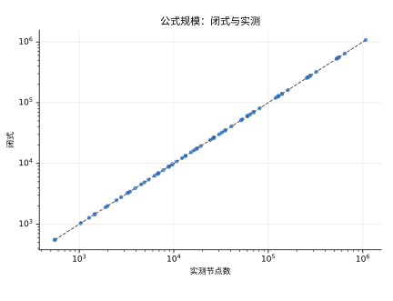
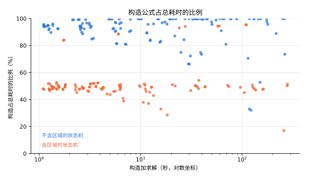
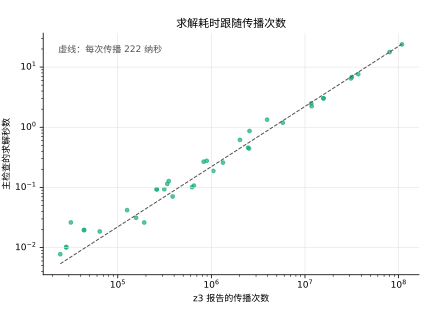
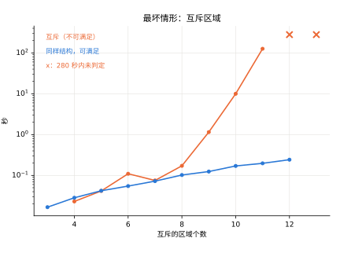
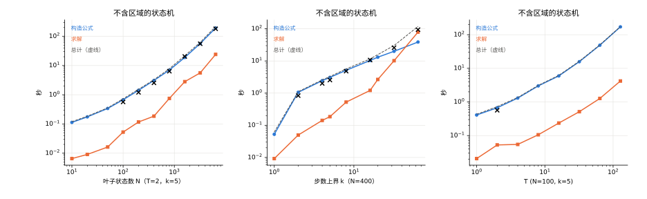
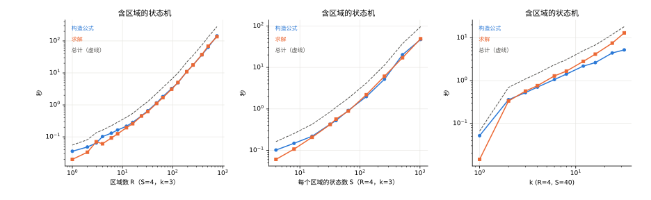

:orphan:

BMC 的代价怎样随状态、区域与上界增长
====================================

你对一个模型运行 ``pyfcstm bmc`` 时，想知道三件事：查询能不能算完，时间花在哪，能不能在开始之前就估出来。本页用合成模型上的实测、与实测逐点核对过的闭式，以及明确没有公式的部分来回答。

**哪些量可以提前算出来，哪些不能。**

.. list-table:: 哪些量可以预测
   :header-rows: 1
   :widths: 24 20 56

   * - 量
     - 能否预测
     - 做法
   * - 公式规模（Z3 节点数、Z3 布尔变量数）
     - 能
     - 不含区域的状态机有精确闭式；含区域（region）的状态机有带误差说明的拟合闭式
       （\ :eq:`bmc-scaling-nodes-flat`\ 、\ :eq:`bmc-scaling-nodes-regions`\ ）。
   * - 构造公式的耗时
     - 能，量级上
     - 先由闭式得到 Z3 调用次数，再乘以你在自己机器上测一次的单位成本
       （\ :eq:`bmc-scaling-compile-time`\ ）。
   * - 峰值内存
     - 能，量级上
     - 随公式规模增长，见 :ref:`内存 <bmc-scaling-memory>`\ 。
   * - 求解耗时
     - 不能
     - 没有闭式。它与求解器的传播次数成正比，而传播次数本身没有公式
       （\ :eq:`bmc-scaling-solve-time`\ ）。

下面每个数字都来自脚本生成的合成模型，不是你的模型。请把数字当作代价的形状，而不是承诺。含有复杂算术、位运算或大量相互作用的条件的模型，求解步骤可能比这里任何一行都慢得多。

测量是怎样做的
--------------

本页用到两批测量，每张表和每张图都会说明用的是哪一批。

.. list-table:: 两批测量
   :header-rows: 1
   :widths: 22 39 39

   * - 项目
     - 原始测量
     - 重测
   * - 代码
     - 提交 ``560b7dc4``
     - 提交 ``b054fbe3``
   * - 机器
     - Intel Xeon Platinum 8581C，Linux
     - 同型号机器，与其他作业共用；负载没有记录
   * - 软件
     - Python 3.11.15，z3 4.15.4
     - Python 3.11.15，z3 4.15.4
   * - 并发
     - 同时运行 56 个进程
     - 一次只运行一个进程
   * - 进程方式
     - 每个点一个全新进程
     - 每个点一个全新进程，进程内先编译一个两状态模型作预热
   * - 重复
     - 以第一次运行为准：看起来快（约 8 秒或更短）的点跑 3 次取中位数，更慢的点跑 1 次；次数记录在 ``reps`` 里，18 个超时的点没有该字段
     - 同样的规则，阈值是第一次运行总耗时 8 秒；次数记录在 ``repeats`` 里
   * - 数据
     - ``data/original_measurements.jsonl``
     - ``data/timing.jsonl`` 与其他 ``data/*.jsonl`` 文件

重测在计划的 99 个计时点中只完成了 15 个，因为剩下的每个点在共用机器上最多要跑 300 秒。这 15 个点是对原始测量的抽查，不能代替原始测量。所有关于公式规模、调用次数、传播次数和互斥区域的数字都来自重测数据。重测的记录带有提交、机器、Python 与 z3 版本、重复次数和保留的统计量（唯一超时的重测点没有重复次数）。原始记录带有提交、机器字符串、写着软件版本与并发数的 ``conditions`` 字符串以及 ``reps``\ ；它们没有单独的 Python、z3 字段，也没有统计量字段。工具 ``tools/measure_bmc_scaling.py`` 可以重新生成这些文件并检验闭式：

.. code-block:: bash

   python tools/measure_bmc_scaling.py --help

符号
----

.. list-table:: 本页使用的符号
   :header-rows: 1
   :widths: 12 88

   * - 符号
     - 含义
   * - :math:`R`
     - 一个拥有者（owner）的区域数。
   * - :math:`S`
     - 每个区域的叶子状态数。
   * - :math:`T`
     - 每个状态的转换数。
   * - :math:`D`
     - 区域的嵌套层数。
   * - :math:`V`
     - 被转换写入的变量数。
   * - :math:`k`
     - BMC 的步数上界：查询写作 ``check reach <= k: ...``\ 。
   * - :math:`N`
     - 不含区域的状态机的叶子状态数。
   * - :math:`W`
     - 带赋值的转换数。
   * - :math:`P`
     - Z3 为主检查报告的传播次数。
   * - :math:`C_{\mathrm{ctx}}`
     - 构造公式期间创建的一次性 Z3 上下文数。

合成模型
--------

所有模型都由工具生成，所以图上的每个点都可以复现。

* ``flat``\ ：由 :math:`N` 个叶子状态组成的环。状态 ``Si`` 在 ``d == 0`` 时转到 ``S(i+1)``\ ；每个状态的其余 :math:`T-1` 条转换是带条件的回边。当 :math:`V>0` 时，除最后一条以外的每条环上转换把 :math:`V` 个变量各加 1，因此 :math:`W=N-1`\ 。
* ``regions``\ ：一个拥有者 ``Run``\ ，含 :math:`R` 个区域，每个区域有 :math:`S` 个叶子状态，区域内部按同样方式构造。
* ``pigeonhole``\ ：\ :math:`m` 个区域，每个区域从 :math:`m-1` 个状态里选一个；查询要求它们互不相同。

查询要求一件在 :math:`k` 步内不会发生的事，所以求解器必须证明“不可达”。这是代价最高、也最诚实的情形：可满足的查询在求解器找到一条见证（witness）时就结束了。

生成器是维护工具的 ``generate`` 命令，它是仓库里的一个脚本而不是 ``pyfcstm`` 命令，所以文档检查不会运行它。下面是两个区域、每个三个状态时的命令和输出，前一部分是模型，\ ``// query`` 之后是目标不可达的查询。

.. code-block:: bash

   python tools/measure_bmc_scaling.py generate regions --R 2 --S 3 --k 2

.. code-block:: text

   input int d;
   state Root {
       [*] -> Run;
       state Run {
           region R0 {
               [*] -> P0;
               state P0;
               state P1;
               state P2;
               P0 -> P1 : if [d == 0];
               P0 -> P0 : if [d == 1];
               P1 -> P2 : if [d == 0];
               P1 -> P0 : if [d == 1];
               P2 -> P1 : if [d == 1];
           }
           region R1 {
               [*] -> P0;
               state P0;
               state P1;
               state P2;
               P0 -> P1 : if [d == 0];
               P0 -> P0 : if [d == 1];
               P1 -> P2 : if [d == 0];
               P1 -> P1 : if [d == 1];
               P2 -> P1 : if [d == 1];
           }
       }
   }

   // query
   check reach <= 2: active("Root.Run{R0: P2, R1: P2}");

**它展示了什么。** 每个区域都有 ``d == 0`` 上的链 ``P0 -> P1 -> P2``\ ，以及 ``d == 1`` 上每个状态一条回边。查询要求两个区域都到达 ``P2``\ ，这需要多于 ``k = 2`` 步。\ **可以得出的结论。** 生成器很小且是确定的：相同参数得到相同模型。\ **不能得出的结论。** 这些模型无法说明你自己模型里的条件会怎样相互作用。

公式规模：能精确的地方就精确
----------------------------

Z3 公式的规模只取决于结构和 :math:`k`\ ，所以可以精确计数。数一数 ``compile_bmc_query`` 返回的 ``solve_formula`` 这个公式有向无环图里互不相同的节点。对每个状态有两条转换、没有变量的 :math:`N` 个状态的环，节点数为：

.. math::
   :label: bmc-scaling-nodes-flat

   \mathrm{nodes}_{\mathrm{flat}}(N,k) = 21\,N k - 18\,N + 33\,k + 6

这个闭式在 :math:`k \ge 2` 且查询的目标状态存在时成立；对这里用的查询，目标状态存在要求 :math:`N \ge k+3`\ 。当环上每条转换都写 :math:`V` 个变量时，节点数变为：

.. math::
   :label: bmc-scaling-nodes-flat-vars

   \mathrm{nodes}_{\mathrm{flat},V}(N,k) = 23\,N k - 20\,N + 4\,V k + 35\,k + 9

你可以用公开接口自己核对第一个闭式。下面的脚本对三种规模建环，对四个上界编译查询，通过 Z3 自带的 Python 接口数节点，并把节点数与 :eq:`bmc-scaling-nodes-flat` 的值并排打印。

.. testcode::

   from pyfcstm.bmc import compile_bmc_query
   from pyfcstm.model import load_state_machine_from_text

   print("N k nodes closed-form")
   for n in (8, 12, 16):
       ring = "".join(
           "state S%d; S%d -> S%d : if [d == 0]; S%d -> S0 : if [d == 1];" % (i, i, (i + 1) % n, i)
           for i in range(n)
       )
       model = load_state_machine_from_text("input int d; state Root { [*] -> S0; %s }" % ring)
       for k in (2, 3, 4, 5):
           query = 'check reach <= %d: active("Root.S%d");' % (k, k + 2)
           seen, todo = set(), [compile_bmc_query(model, query).solve_formula]
           while todo:
               node = todo.pop()
               if node.get_id() not in seen:
                   seen.add(node.get_id())
                   todo.extend(node.children())
           print(n, k, len(seen), 21 * n * k - 18 * n + 33 * k + 6)

.. testoutput::

   N k nodes closed-form
   8 2 264 264
   8 3 465 465
   8 4 666 666
   8 5 867 867
   12 2 360 360
   12 3 645 645
   12 4 930 930
   12 5 1215 1215
   16 2 456 456
   16 3 825 825
   16 4 1194 1194
   16 5 1563 1563

**每一部分做什么。** ``ring`` 一行写出各个状态及其两条转换；\ ``while`` 循环遍历一次表达式有向无环图，按 Z3 的 id 给每个节点计数；\ ``compile_bmc_query(...).solve_formula`` 是求解器收到的公式。\ **你看到什么。** 12 行的最后两列都相等：实测节点数与 :math:`21Nk-18N+33k+6` 完全相等。\ **可以得出的结论。** 对这一族模型，不必运行求解器就知道公式规模。\ **不能得出的结论。** 闭式对其他模型没有任何说明。节点计数用的是维护工具里同样的做法，它不是 pyfcstm 的公开函数。

含区域的状态机，节点数的拟合系数不是整数：

.. math::
   :label: bmc-scaling-nodes-regions

   \mathrm{nodes}_{\mathrm{reg}}(R,S,k) \approx 23\,R S k - 18\,R S + 22.3\,R k + 2.9\,R + 46.2\,k + 17.6

Z3 求解器在第一次检查时分配的布尔变量数，对任意 :math:`T` 都是精确的：

.. math::
   :label: bmc-scaling-bool-vars

   \mathrm{boolvars}(N,T,k) = 1 + 8k + T(k-1) + N(4k-2) + 3\,N T (k-1)

把闭式放在一起看，在每个状态的转换数固定时，公式规模随状态数与上界的乘积增长，而区域之间是相加的：

.. math::
   :label: bmc-scaling-size-order

   |\Phi_k| = \Theta(N\,k) \quad\text{without regions},
   \qquad
   |\Phi_k| = \Theta(R\,S\,k) \quad\text{with regions},
   \qquad T \text{ fixed}

公式规模里没有 :math:`R^2` 项。区域是相加，不是相乘。

**节点数对** :math:`T` **不是线性的。** Z3 布尔变量数对 :math:`T` 精确线性（\ :eq:`bmc-scaling-bool-vars`\ ），节点数则不然：\ :math:`T` 每翻一倍，节点数乘以的倍数随 :math:`T` 上升，从 :math:`T` 小时的约 1.4 到 1.7，升到实测最大 :math:`T` 处的约 3.3 到 3.7。这是二次项在 :math:`T` 大时接管的表现。本页的闭式都对应 :math:`T=2`\ ；本页没有给出对 :math:`T` 的闭式，增长的原因也没有考察。

.. list-table:: 节点数对每个状态的转换数（原始测量，不可满足的查询）
   :header-rows: 1
   :widths: 10 25 15 25 15

   * - :math:`T`
     - 节点数，不含区域（\ :math:`N=100`\ 、\ :math:`k=5`\ ）
     - 倍数
     - 节点数，含区域（\ :math:`R=4`\ 、\ :math:`S=8`\ 、\ :math:`k=3`\ ）
     - 倍数
   * - 1
     - 5,263
     - 
     - 1,523
     - 
   * - 2
     - 8,871
     - 1.69
     - 2,069
     - 1.36
   * - 4
     - 16,503
     - 1.86
     - 3,275
     - 1.58
   * - 8
     - 33,999
     - 2.06
     - 5,907
     - 1.80
   * - 16
     - 78,835
     - 2.32
     - 13,079
     - 2.21
   * - 32
     - 205,167
     - 2.60
     - 32,277
     - 2.47
   * - 64
     - 608,655
     - 2.97
     - 85,157
     - 2.64
   * - 128
     - 2,030,730
     - 3.34
     - 310,939
     - 3.65
   * - 256
     - 没有测
     - 
     - 1,152,649
     - 3.71

这些行就是下文 ``check-formulas`` 输出里 ``nodes against T`` 开头的各行；倍数是与上一行的比值。

.. list-table:: 哪些系数是精确的，在哪里核对过
   :header-rows: 1
   :widths: 30 20 50

   * - 闭式
     - 系数
     - 核对（见下文 ``check-formulas`` 输出）
   * - :eq:`bmc-scaling-nodes-flat`
     - 整数，精确
     - 16 个网格点全部相等；另有 60 个点（最大到 :math:`N=6400`\ 、\ :math:`k=128`\ ）全部相等
   * - :eq:`bmc-scaling-nodes-flat-vars`
     - 整数，精确
     - 24 个网格点全部相等
   * - :eq:`bmc-scaling-bool-vars`
     - 整数，精确
     - 48 个网格点全部相等，\ :math:`T` 取 1、2、4
   * - :eq:`bmc-scaling-nodes-regions`
     - 拟合，不是整数
     - 48 个网格点的残差最大 11.5 个节点；另有 95 个点（最大到 :math:`R=768`\ 、\ :math:`S=1024`\ 、\ :math:`k=48`\ ），中位误差 0.12%，最大 0.94%

网格点列在 ``data/formula_grid.jsonl`` 里；另外的点来自原始测量和重测。对 :eq:`bmc-scaling-nodes-flat` 的精确数据做幂律拟合，得到节点数 :math:`\approx 14.6\,N^{0.98}k^{1.14}`\ 。\ :math:`k` 的指数大于 1 是假象，来自负的 :math:`-18N` 项，它让曲线在 :math:`k` 小时更陡。对 :math:`k` 的真实增长是线性的。

   Z3 实测节点数（横轴）对 :eq:`bmc-scaling-nodes-flat`\ （纵轴），对象是不含区域的状态机，两个坐标轴都是对数坐标。这张图说明点在三个数量级上都落在对角线上；它不说明任何关于耗时的事。数据：\ ``formula_grid.jsonl``\ 、\ ``timing.jsonl`` 与 ``original_measurements.jsonl``\ ；节点数是确定的，因此每个点只跑一次。

.. _bmc-scaling-memory:

**内存。** 峰值常驻内存随节点数增长。重测里，8.9 千个节点时为 107 MB，55.7 万个节点时为 857 MB，107 万个节点时为 1429 MB。原始测量里最大的公式有 203 万个节点（不含区域，\ :math:`N=100`\ 、\ :math:`T=128`\ 、\ :math:`k=5`\ ），需要 1395 MB。这些是整个进程的峰值常驻内存，记录在 ``rss_mb`` 里。

构造公式的耗时
--------------

构造公式是调用 Z3 C 接口的 Python 代码。调用次数是确定的，并且有系数为拟合值的闭式。对每个状态两条转换的环：

.. math::
   :label: bmc-scaling-calls-flat

   \mathrm{calls}_{\mathrm{flat}}(N,k) \approx 1680\,N k - 1578\,N + 1698\,k + 449

含区域的状态机有一个真实的 :math:`R^2` 项：

.. math::
   :label: bmc-scaling-calls-regions

   \mathrm{calls}_{\mathrm{reg}}(R,S,k) \approx R S\,(1754 k - 1418) + R\,(976 k + 440) + R^2\,(151 k - 96) + 2561 k + 439

在 :eq:`bmc-scaling-calls-regions` 中，当 :math:`R` 大于约 :math:`1754\,S/151`\ ，即约 :math:`S` 的 11.6 倍（\ :math:`k` 很大时）时，\ :math:`R^2` 项超过 :math:`R S` 项。\ :math:`k` 取有限值时，交叉点是 :math:`S\,(1754k-1418)/(151k-96)`\ ，区域扫描所用的 :math:`S=4`\ 、\ :math:`k=3` 时为 :math:`R=43`\ 。低于它，构造公式的耗时看起来对区域数是线性的；高于它，曲线向上弯。在 :math:`T` 固定时，公式规模本身对 :math:`R` 仍是线性增长（\ :eq:`bmc-scaling-size-order`\ ），所以 :math:`R^2` 的代价花在 Python 的工作上，不在公式节点上。这一项的来源还没有定位清楚（见 :ref:`已知的优化空间 <bmc-scaling-room>`\ ）。

调用次数在网格和三个大点上核对过。

下面的命令把每个闭式与已提交的数据文件比较。它是只读取 ``data/*.jsonl`` 的维护命令，所以每次运行的输出相同；但它是仓库里的脚本而不是 ``pyfcstm`` 命令，文档检查不会运行它。输出是从仓库根目录下的一次运行复制来的，所以数据目录写的是完整路径。每一行是一次比较，数字来自 ``data/`` 里的点，这些点按上面两次测量的对照表所述的方式测得。

.. code-block:: bash

   python tools/measure_bmc_scaling.py check-formulas --data docs/source/explanations/bmc_scaling/data

.. code-block:: text

   flat nodes, grid: 16 points, all equal to the closed form
   flat nodes, out of sample: 60 points up to N=6400, k=128, 0 differ
   flat nodes with written variables, grid: 24 points, all equal
   z3 boolean variables, grid: 48 points (T in 1,2,4), all equal
   power-law fit of the 60 out-of-sample flat points: nodes = 14.6 * N^0.98 * k^1.14
   region nodes, grid: 48 points, max |residual| = 11.5 nodes
   region nodes, out of sample: 95 points up to R=768, S=1024, k=48; median error 0.12%, max 0.94%
   contexts 2*W*V*(k-1), W=N-1: 34 points, all equal
   flat z3 calls, grid: 16 points, max relative error 0.24%
   region z3 calls, grid: 48 points, max relative error 0.28%
   z3 calls {'R': 96, 'S': 4} k=3: measured 5212124, closed form 5097658 (-2.2%)
   z3 calls {'R': 256, 'S': 4} k=3: measured 29080930, closed form 28202938 (-3.0%)
   z3 calls {'N': 1600, 'T': 2} k=5: measured 10933762, closed form 10924139 (-0.1%)
   solve time vs propagations (>2e4): 37 checks, exponent 0.92, R^2 0.98, ns per propagation p10 176 median 222 p90 365
   pigeonhole conflict ratio per added region: 5: x2.4, 6: x3.4, 7: x4.1, 8: x6.5, 9: x5.2, 10: x6.1, 11: x9.4
   pigeonhole conflict ratio from 7 regions on: geometric mean x6.0
   context cost N=100 V=4 k=5: 3168 contexts, build 4.9 s (0.5 s without variables), 1.37 ms per context
   context cost N=100 V=16 k=5: 12672 contexts, build 16.7 s (0.5 s without variables), 1.27 ms per context
   context cost N=100 V=64 k=5: 50688 contexts, build 65.6 s (0.5 s without variables), 1.28 ms per context
   nodes against T, flat {'N': 100} k=5: T=1: 5263, T=2: 8871 (x1.69), T=4: 16503 (x1.86), T=8: 33999 (x2.06), T=16: 78835 (x2.32), T=32: 205167 (x2.60), T=64: 608655 (x2.97), T=128: 2030730 (x3.34)
   nodes against T, regions {'R': 4, 'S': 8} k=3: T=1: 1523, T=2: 2069 (x1.36), T=4: 3275 (x1.58), T=8: 5907 (x1.80), T=16: 13079 (x2.21), T=32: 32277 (x2.47), T=64: 85157 (x2.64), T=128: 310939 (x3.65), T=256: 1152649 (x3.71)
   build seconds per z3 call {'R': 96, 'S': 4} k=3: 2.72 s for 5212124 calls, 0.52 microseconds per call
   build seconds per z3 call {'R': 256, 'S': 4} k=3: 14.84 s for 29080930 calls, 0.51 microseconds per call
   build seconds per z3 call {'N': 1600, 'T': 2} k=5: 17.88 s for 10933762 calls, 1.63 microseconds per call
   share of build time, original points above 1 s, flat: 134 points, median 96%, range 32% to 100%
   share of build time, original points above 1 s, regions: 113 points, median 49%, range 17% to 95%
   context cost, original campaign, N=100 V=4 k=5: build 19.3 s, 3168 contexts, 6.09 ms per context
   context cost, original campaign, N=100 V=4 k=5: build 19.6 s, 3168 contexts, 6.19 ms per context
   context cost, original campaign, N=100 V=16 k=5: build 76.4 s, 12672 contexts, 6.03 ms per context
   context cost, original campaign, N=100 V=16 k=5: build 78.1 s, 12672 contexts, 6.16 ms per context
   context cost, original campaign, N=100 V=64 k=5: build 87.9 s, 50688 contexts, 1.73 ms per context
   context cost, original campaign, N=100 V=64 k=5: build 88.8 s, 50688 contexts, 1.75 ms per context
   closed forms agree with the data in docs/source/explanations/bmc_scaling/data

**它展示了什么。** 每一行写出一个闭式、与它比较的点数以及结果。写着“all equal”的行是精确的；给出误差的行是拟合的。\ **可以得出的结论。** 拟合的调用次数在网格上误差在 0.3% 以内，在大点上误差在 3.1% 以内。\ **不能得出的结论。** 区域调用次数的网格只到 :math:`R=8`\ 、\ :math:`S=24`\ 、\ :math:`k=8`\ ；超出以后误差缓慢增大，\ :math:`R=96` 与 :math:`R=256` 的 :math:`-2.2\%` 和 :math:`-3.0\%` 两行就是例子。

**变量写入。** 带赋值的转换会增加另一种代价。构造期间编译器会发出可满足性检查，每次检查都新建一个 Z3 上下文（这是有意为之：它让答案不依赖进程先前求解过什么）。上下文的个数是精确的：

.. math::
   :label: bmc-scaling-contexts

   C_{\mathrm{ctx}} = 2\,W\,V\,(k-1)

公式规模几乎不随 :math:`V` 变化，因为 :eq:`bmc-scaling-nodes-flat-vars` 里的 :math:`4Vk` 很小，但上下文个数随 :math:`V` 线性增长。重测里，\ :math:`N=100`\ 、\ :math:`k=5` 在没有变量时构造 0.5 到 0.6 秒（两条记录），\ :math:`V=4`\ 、16、64 时分别是 4.9 秒、16.7 秒、65.6 秒，折合每个上下文 1.3 到 1.4 毫秒。合起来：

.. math::
   :label: bmc-scaling-compile-time

   t_{\mathrm{build}} \approx c_{\mathrm{call}}\cdot \mathrm{calls} + c_{\mathrm{ctx}}\cdot C_{\mathrm{ctx}}

其中 :math:`c_{\mathrm{call}}` 是一次 Z3 调用的成本，\ :math:`c_{\mathrm{ctx}}` 是一个上下文的成本。重测里，构造 :math:`R=96` 与 :math:`R=256`\ （\ :math:`S=4`\ 、\ :math:`k=3`\ ）的区域状态机，分别用了 2.72 秒和 14.8 秒，对应 520 万与 2910 万次调用，折合每次调用 0.52 微秒与 0.51 微秒；构造 :math:`N=1600`\ 、\ :math:`k=5` 的环用了 17.9 秒，对应 1090 万次调用，折合每次调用 1.63 微秒。所以 :math:`c_{\mathrm{call}}` 属于模型的类别，而不只取决于机器，你应当在自己这一类的小模型上测一次。两批测量的每个上下文成本不同。对 :math:`N=100`\ 、\ :math:`k=5`\ ，原始测量在 :math:`V=4` 时构造用了 19.3 到 19.6 秒，\ :math:`V=16` 时 76.4 到 78.1 秒，\ :math:`V=64` 时 87.9 到 88.8 秒，折合 :math:`V=4` 与 16 时每个上下文约 6 毫秒，\ :math:`V=64` 时 1.7 毫秒；原始测量的曲线趋平，重测仍是线性，原始测量在 :math:`V=4` 与 16 时约比重测慢 3.9 到 4.7 倍，在 :math:`V=64` 时约慢 1.3 到 1.4 倍。原始测量同时运行 56 个进程且没有预热，二者是否是原因没有测试，这个差别没有查清。请使用与 :eq:`bmc-scaling-contexts` 吻合的重测数字，把原始测量的数字当作悲观情形。

   构造公式占总耗时的比例（纵轴，线性坐标，百分数）对构造加求解的耗时（横轴，对数坐标，秒），取原始测量中大于 1 秒的点。蓝点是不含区域的状态机，橙点是含区域的状态机。这张图说明不含区域的状态机大部分时间花在构造公式上（中位数 96%，134 个点），含区域的状态机约一半（中位数 49%，113 个点）；它不说明具体是哪些 Python 代码行造成的。方法：每个点一个全新进程，小于 8 秒取 3 次中位数，同时运行 56 个进程。

求解耗时：没有公式
------------------

主检查的求解耗时与 Z3 报告的传播次数近似成正比：

.. math::
   :label: bmc-scaling-solve-time

   t_{\mathrm{solve}} \approx \tau\,P, \qquad \tau \approx 0.2\ \mu\mathrm{s}

重测里每次传播的中位数是 222 纳秒，第 10 与第 90 百分位分别为 176 纳秒与 365 纳秒。对数坐标上的拟合给出：

.. math::
   :label: bmc-scaling-propagation-fit

   \log t_{\mathrm{solve}} = \beta \log P + \alpha, \qquad \beta \approx 0.92

在 37 次检查（传播次数多于 :math:`2\cdot 10^4` 的那些）上，决定系数是 0.98。所以 :eq:`bmc-scaling-propagation-fit` 很好地描述了求解器，但它不是预测：\ :math:`P` 本身没有闭式，也不随模型规模单调。对 :math:`k=8` 的环，\ :math:`N=400` 需要 1,329,691 次传播，而 :math:`N=800` 只要 621,198 次。

   主检查的求解秒数（纵轴）对 Z3 报告的传播次数（横轴），两个坐标轴都是对数坐标。虚线是每次传播成本的中位数。这张图说明两者成正比；它不能让你预测 :math:`P`\ 。方法：42 个点，\ ``solve_law.jsonl``\ ，每个点在预热后的全新进程里跑一次；其中 37 个点的传播次数多于 :math:`2\cdot 10^4`\ 。

文献能让你说的，只有上界或存在性结论。下表只列出写本页时核对过原文的出处，结论按原文的说法给出，并说明对模型意味着什么。本页不引用任何关于求解耗时的通用解析预测器的出处。

.. list-table:: 文献给出的边界
   :header-rows: 1
   :widths: 40 32 28

   * - 结论
     - 出处
     - 对模型意味着什么
   * - LTL 性质的完备阈值可以由 Büchi 自动机得到一个过近似；以该阈值为准，标准的基于 SAT 的有界模型检查对状态变量数是双指数的。
     - `Clarke、Kroening、Ouaknine、Strichman，“Completeness and Complexity of Bounded Model Checking” <https://people.mpi-sws.org/~joel/publications/compbmc04.pdf>`_
     - 把 BMC 跑到完备，只有双指数的界；它对某个固定的小 :math:`k` 什么也没说。
   * - 层次状态机（顺序嵌套，没有变量也没有并发）的可达性，可在与层次结构大小成线性的时间内判定，并且是 P 完全的。
     - `Alur 与 Yannakakis，“Model Checking of Hierarchical State Machines” <https://www.cis.upenn.edu/~alur/Fse98.pdf>`_\ （期刊论文的作者预印本）
     - 这个保证只覆盖嵌套；对一起运行的区域和对变量都没有给出任何结论。
   * - 只接受有限语言的 DFA，求交是否非空是 NP 完全问题。
     - `Rampersad 与 Shallit，“Detecting patterns in finite regular and context-free languages” <https://arxiv.org/abs/0906.3220>`_\ ，定理 1
     - 这是我们的读法，不是论文的主张：在有界步数内到达多个区域的联合配置与该问题相似，所以一般不应期待有多项式方法。
   * - 带单位传播、子句学习、重启与内部随机性的 DPLL 求解器，以高概率在 :math:`O(n^{2k+2})` 次冲突与重启内表现得像宽度为 :math:`k` 的归结。
     - `Atserias、Fichte、Thurley，“Clause-Learning Algorithms with Many Restarts and Bounded-Width Resolution”，JAIR 40，2011 <https://arxiv.org/abs/1401.3868>`_\ （摘要）
     - 多项式界针对这种理想化的求解器模型，不针对 Z3 的启发式。
   * - 即使并发系统的转移关系树宽有界，它的展开也可以有无界的树宽（定理 2.4）。
     - `Ferrara、Pan、Vardi，“Treewidth in Verification: Local vs. Global” <https://www.cs.rice.edu/~vardi/papers/lpar052.pdf>`_
     - 结构宽度不能给 BMC 一个通用的多项式界。
   * - 在问题与 Z3 都不变时，Z3 的资源限制是“completely deterministic”的，但输入的小改动可能对所需资源有很大影响。
     - Wintersteiger，在 `F* 议题 767 <https://github.com/FStarLang/FStar/issues/767>`_ 中
     - 这些计数描述的是一次运行，不能预测另一次。

最坏情形：互斥的区域
--------------------

求解的代价取决于区域之间互相约束的强弱，而不是区域的个数。互不相干的区域很便宜：原始测量里，768 个各有四个状态的区域在 280 秒内算完。反面是鸽巢结构：取 :math:`m` 个区域，每个区域由自己的输入进入 :math:`m-1` 个状态中的一个，问所有区域能否落在互不相同的状态里。这不可能，求解器必须证明这一点。

模型和查询来自维护工具的 ``generate`` 命令，它是仓库里的脚本而不是 ``pyfcstm`` 命令，文档检查不会运行它。下面是三个区域、两个状态时的命令和输出，\ ``// query`` 之后是要求互不相同的查询。

.. code-block:: bash

   python tools/measure_bmc_scaling.py generate pigeonhole --holes 2 --pigeons 3

.. code-block:: text

   input int d0;
   input int d1;
   input int d2;
   state Root {
       region P0 {
           [*] -> W;
           state W;
           state H0;
           state H1;
           W -> H0 : if [d0 == 0];
           W -> H1 : if [d0 == 1];
       }
       region P1 {
           [*] -> W;
           state W;
           state H0;
           state H1;
           W -> H0 : if [d1 == 0];
           W -> H1 : if [d1 == 1];
       }
       region P2 {
           [*] -> W;
           state W;
           state H0;
           state H1;
           W -> H0 : if [d2 == 0];
           W -> H1 : if [d2 == 1];
       }
   }

   // query
   check reach <= 2: (((((active("Root.P0.H0") || active("Root.P0.H1")) && (active("Root.P1.H0") || active("Root.P1.H1"))) && ((active("Root.P2.H0") || active("Root.P2.H1")) && !(active("Root.P0.H0") && active("Root.P1.H0")))) && ((!(active("Root.P0.H0") && active("Root.P2.H0")) && !(active("Root.P1.H0") && active("Root.P2.H0"))) && (!(active("Root.P0.H1") && active("Root.P1.H1")) && !(active("Root.P0.H1") && active("Root.P2.H1"))))) && !(active("Root.P1.H1") && active("Root.P2.H1")));

**它展示了什么。** 每个区域 ``P0``\ 、\ ``P1``\ 、\ ``P2`` 从 ``W`` 进入 ``H0`` 或 ``H1``\ ；查询要求每个区域都处于某个 ``H`` 状态，且任意两个区域不处于同一个。三个区域、两个状态时这不可能。\ **可以得出的结论。** 这一族对每个 :math:`m` 都不可满足。\ **不能得出的结论。** 只测了一种互斥结构，别的结构可能表现不同。

这张表来自 ``data/pigeonhole.jsonl``\ （重测，每行一个全新进程，每行只跑一次；\ ``区域数`` 是该记录的鸽子数，比它的洞数多 1）。\ ``求解秒数`` 是记录的 ``t_solve`` 字段，\ ``冲突数`` 是查询自己那次检查（\ ``checks`` 的倒数第二项；两个未判定的行取它们唯一的一项）的 ``conflicts`` 统计。下面 ``check-formulas`` 的输出只打印相邻冲突数的比值。

.. list-table:: 互斥区域，不可满足，重测
   :header-rows: 1
   :widths: 14 22 22 42

   * - 区域数
     - 求解秒数
     - 冲突数
     - 结果
   * - 8
     - 0.17
     - 5,422
     - unsat
   * - 9
     - 1.15
     - 28,060
     - unsat
   * - 10
     - 9.99
     - 170,696
     - unsat
   * - 11
     - 126
     - 1,612,287
     - unsat
   * - 12
     - 280
     - 3,178,719
     - 280 秒限制到时仍为 unknown
   * - 13
     - 280
     - 3,164,362
     - 280 秒限制到时仍为 unknown

从 7 个区域起，每多一个区域，冲突数增长的倍数接近 6：

.. math::
   :label: bmc-scaling-conflict-growth

   \mathrm{conflicts}(m) \approx c\,\rho^{m}, \qquad \rho \approx 6

对照组结构相同但查询可满足（\ :math:`m` 个区域、\ :math:`m` 个状态），12 个区域只需 0.24 秒。这个倍数是对已判定的点的拟合，不是定理；两个未判定的行只说明求解器超时了。

   求解秒数（纵轴，对数坐标）对互斥区域个数（横轴）。橙线是不可满足的结构，叉号是 280 秒内没有判定的运行；蓝线是同样形状、可满足的对照组。这张图说明只要几个互斥的区域，证明不可能就已经很贵；它不说明你的区域是互斥的。方法：\ ``pigeonhole.jsonl``\ ，每个点一个全新进程，每个点只跑一次。

该预期多少时间
--------------

下表是每个时间预算内跑完的最大规模，取自原始测量（提交 ``560b7dc4``\ ，同时运行 56 个进程，8 秒以上的点只跑一次）。每个查询都是不可满足的 ``check reach``\ ，耗时是构造加求解。每个规模都是“实测的最大值”，所以真正的极限落在它与下一个实测规模之间。这张表是下面那条 ``range-table`` 命令输出的转录。

.. list-table:: 每个时间预算内实测的最大规模
   :header-rows: 1
   :widths: 40 16 16 16 12

   * - 维度（其余固定）
     - 10 秒
     - 60 秒
     - 300 秒
     - 首次超时
   * - 不含区域，叶子状态数 :math:`N`\ （\ :math:`T=2`\ 、\ :math:`k=5`\ ）
     - 800 (8 s)
     - 1600 (22 s)
     - 6400 (216 s)
     - 12800
   * - 不含区域，上界 :math:`k`\ （\ :math:`N=400`\ ）
     - 8 (6 s)
     - 32 (30 s)
     - 64 (118 s)
     - 128
   * - 不含区域，每个状态的转换数 :math:`T`\ （\ :math:`N=100`\ 、\ :math:`k=5`\ ）
     - 16 (6 s)
     - 64 (50 s)
     - 128 (175 s)
     - 256
   * - 不含区域，被写入的变量数 :math:`V`\ （\ :math:`N=50`\ 、\ :math:`k=5`\ ）
     - 8 (10 s)
     - 64 (45 s)
     - 256 (144 s)
     - 没有测到
   * - 区域数 :math:`R`\ （\ :math:`S=4`\ 、\ :math:`k=3`\ ）
     - 128 (10 s)
     - 256 (35 s)
     - 768 (280 s)
     - 1024
   * - 每个区域的状态数 :math:`S`\ （\ :math:`R=4`\ 、\ :math:`k=3`\ ）
     - 128 (4 s)
     - 512 (37 s)
     - 1024 (96 s)
     - 2048
   * - 上界 :math:`k`\ （\ :math:`R=4`\ 、\ :math:`S=40`\ ）
     - 16 (7 s)
     - 32 (18 s)
     - 32 (18 s)
     - 没有测到
   * - 上界 :math:`k`\ （\ :math:`R=4`\ 、\ :math:`S=200`\ ）
     - 无
     - 无
     - 48 (258 s)
     - 64
   * - 每个状态的转换数 :math:`T`\ （\ :math:`R=4`\ 、\ :math:`S=8`\ 、\ :math:`k=3`\ ）
     - 32 (4 s)
     - 128 (43 s)
     - 256 (162 s)
     - 没有测到
   * - 带 ``where active(...)`` 的调用，区域数 :math:`R`\ （\ :math:`S=4`\ 、\ :math:`k=3`\ ）
     - 32 (6 s)
     - 96 (60 s)
     - 128 (109 s)
     - 192
   * - 不带 ``where`` 的调用，区域数 :math:`R`\ （\ :math:`S=4`\ 、\ :math:`k=3`\ ）
     - 64 (4 s)
     - 256 (37 s)
     - 512 (126 s)
     - 1024

这些行是维护工具的 ``range-table`` 命令的输出，该命令读取已提交的 ``data/*.jsonl`` 文件；它是仓库里的脚本而不是 ``pyfcstm`` 命令，文档检查不会运行它。上面的表就是它的输出，经过转录。

.. code-block:: bash

   python tools/measure_bmc_scaling.py range-table --data docs/source/explanations/bmc_scaling/data

   构造耗时（蓝）、求解耗时（橙）及两者之和（灰色虚线），单位为秒，横轴依次是叶子状态数 :math:`N`\ （左）、上界 :math:`k`\ （中）和每个状态的转换数 :math:`T`\ （右），对象是不含区域的状态机，所有坐标轴都是对数坐标。黑色叉号是同样的点在重测中的总耗时。这张图说明总耗时在每个规模上都跟随构造耗时，求解只在 :math:`k` 很大时才追上来；它不给出闭式。方法：原始测量，每个点一个全新进程，同时运行 56 个进程，小于 8 秒取 3 次中位数，更大的点跑 1 次（\ ``original_measurements.jsonl``\ ）；叉号来自 ``timing.jsonl``\ 。

   含区域的状态机的同样三条曲线，横轴依次是区域数 :math:`R`\ （左，\ :math:`S=4`\ 、\ :math:`k=3`\ ）、每个区域的状态数 :math:`S`\ （中，\ :math:`R=4`\ 、\ :math:`k=3`\ ）和上界 :math:`k`\ （右，\ :math:`R=4`\ 、\ :math:`S=40`\ ），所有坐标轴都是对数坐标。这张图说明含区域的状态机的构造与求解耗时量级相同，并且随 :math:`R` 增大都向上弯；它不能把 :math:`R^2` 构造项与线性项分开。方法同上；含区域的状态机没有重测点。

嵌套受固定的安全上限限制，而不是受时间限制。拥有者嵌套 64 层、每层两个区域（共 128 个区域）用了 8.7 秒。到 96 层时，见证回放在仿真器的分组初始化上限 64 处停止（\ ``pyfcstm bmc`` 以退出码 1 结束，打印意外错误的回溯，而不是给出结论）。不含区域的复合状态嵌套 62 层用了 0.1 秒；64 层时编译以 ``macro-step expansion exceeded the stack-depth safety limit.`` 停止。这些嵌套点是原始测量里 :math:`k=2` 的可满足查询。

**重测抽查。** 有原始对应点的 13 个重测点，列出重测与原始的比值：

下表是维护工具的 ``compare-retest`` 命令的输出，该命令读取已提交的 ``data/*.jsonl`` 文件；它是仓库里的脚本而不是 ``pyfcstm`` 命令，文档检查不会运行它。输出是从仓库里的一次运行复制来的。\ ``original`` 与 ``retest`` 是上面所述两次测量的总耗时，单位为秒。

.. code-block:: bash

   python tools/measure_bmc_scaling.py compare-retest --data docs/source/explanations/bmc_scaling/data

.. code-block:: text

   configuration                       original    retest  ratio
   {"N": 100, "T": 2} k=5                  0.7s      0.6s   0.79
   {"N": 200, "T": 2} k=5                  1.5s      1.2s   0.79
   {"N": 400, "T": 2} k=5                  3.3s      2.6s   0.78
   {"N": 800, "T": 2} k=5                  7.7s      6.4s   0.82
   {"N": 1600, "T": 2} k=5                21.7s     20.4s   0.94
   {"N": 3200, "T": 2} k=5                62.1s     55.6s   0.90
   {"N": 6400, "T": 2} k=5               216.4s    180.6s   0.83
   {"N": 400, "T": 2} k=2                  1.1s      0.8s   0.75
   {"N": 400, "T": 2} k=4                  2.5s      2.0s   0.79
   {"N": 400, "T": 2} k=8                  5.6s      4.8s   0.85
   {"N": 400, "T": 2} k=16                11.5s     10.7s   0.93
   {"N": 400, "T": 2} k=32                30.1s     25.8s   0.86
   {"N": 400, "T": 2} k=64               117.8s     94.0s   0.80

重测的每个点都更快，比值在 0.75 到 0.94 之间，中位数 0.82。原始测量同时运行 56 个进程，每个点都与其他进程共用内存带宽和缓存；重测只有自己一个进程，但机器仍与其他作业共用。另有两个重测点没有跑完：\ :math:`N=12800` 超过了进程的 420 秒限制，\ :math:`N=400`\ 、\ :math:`k=128` 在 250 秒求解限制后以 ``unknown`` 结束。两者都与原始测量的超时不矛盾。每个点都只跑一次，所以比值只是粗略的核对，不是修正系数。

怎样让查询算得动
----------------

具体的操作步骤在 :doc:`/how_to/bmc/index_zh`\ ；这里是它们背后的道理。

* **先数，再跑。** 数叶子状态、每个状态的转换数、被写入的变量和 :math:`k`\ 。用 :eq:`bmc-scaling-nodes-flat` 与 :eq:`bmc-scaling-calls-flat` 可以估出公式规模和构造耗时，内存随节点数增长。
* **限制被转换写入的变量。** 每个被写入的变量按 :math:`W\,(k-1)` 的比例增加上下文（\ :eq:`bmc-scaling-contexts`\ ）。只写性质需要的变量。
* **逐步加深上界。** 先用小的 :math:`k`\ 。公式规模随它线性增长，在 :math:`k` 大时发生弯曲的是求解步骤（\ :math:`N=400` 时，重测里求解所占时间的比例从 :math:`k=2` 的 5% 升到 :math:`k=64` 的 63%）。
* **为超时做准备。** 使用求解时间限制，把 ``unknown`` 或超时当作预期内的结果，而不是模型的错误。
* **留意互斥的区域。** 少数几个互相排斥的区域，代价可能超过数百个互不相干的区域（\ :eq:`bmc-scaling-conflict-growth`\ ）。缩小性质里互斥的部分，或者把这些区域分开验证。

.. _bmc-scaling-room:

已知的优化空间
--------------

维护者把优化想法收集在 `议题 #600 <https://github.com/HansBug/pyfcstm/issues/600>`_ 里。其中没有一项属于本页描述的行为，本页也不承诺其中任何一项。与本页测量有关的想法有：跳过构造期间对空约束集发出的可满足性检查（上文计数的上下文就来自它）、只构造转换关系的一步并改名复用到其余各步、缓存编译好的查询、减少 Z3 中间对象、找出 :math:`R^2` 构造项的来源，以及对互斥区域的情形尝试其他求解配置或编码。

本页没有做的事
--------------

* 不预测求解耗时；没有闭式，文献表列出了原因。
* 不涉及真实模型：所有测量用的合成模型，其条件只依赖一个输入。
* 耗时是在共用机器上的单次测量，原始测量还同时运行了 56 个进程。
* :math:`R^2` 构造项的来源，以及单个上下文成本为什么变化，都没有查清。
* 只测了一种互斥区域结构。
* 没有测 ``max_group_reentries``\ 、多线程求解，以及见证的解码与回放（replay）。

公式台账
--------

.. list-table:: 从公式到代码、检验与数据
   :header-rows: 1
   :widths: 20 24 20 20 16

   * - 标签
     - 主张
     - 实现
     - 检验与可运行命令
     - 数据追溯
   * - ``bmc-scaling-nodes-flat``
     - 环的节点数，无变量
     - ``compile_bmc_query``\ 、\ ``BmcPropertyFormula.solve_formula``
     - ``check-formulas``\ ；\ 公式规模一节的节点计数脚本
     - ``formula_grid.jsonl``\ 、\ ``timing.jsonl``
   * - ``bmc-scaling-nodes-flat-vars``
     - 带被写入变量的节点数
     - 同上
     - ``check-formulas``
     - ``formula_grid.jsonl``
   * - ``bmc-scaling-nodes-regions``
     - 含区域的节点数（拟合）
     - 同上
     - ``check-formulas``
     - ``formula_grid.jsonl``\ 、\ ``original_measurements.jsonl``
   * - ``bmc-scaling-bool-vars``
     - 第一次检查的 Z3 布尔变量数
     - ``solve_bmc_property``\ 、\ ``z3.Solver.statistics``
     - ``check-formulas``
     - ``formula_grid.jsonl``
   * - ``bmc-scaling-size-order``
     - :math:`T` 固定时公式规模的量级
     - 上面四个公式的读法
     - ``check-formulas``\ （\ ``nodes against T`` 各行）
     - ``original_measurements.jsonl``
   * - ``bmc-scaling-calls-flat``
     - 构造环所需的 Z3 调用数
     - ``cProfile`` 下的 ``compile_bmc_query``
     - ``check-formulas``
     - ``formula_grid.jsonl``\ 、\ ``unit_cost.jsonl``
   * - ``bmc-scaling-calls-regions``
     - 含区域的 Z3 调用数，带 :math:`R^2` 项
     - 同上
     - ``check-formulas``
     - 同上
   * - ``bmc-scaling-contexts``
     - 每个被写入变量创建的上下文数
     - ``pyfcstm.solver.logical.is_sat``
     - ``check-formulas``
     - ``variables.jsonl``\ 、\ ``formula_grid.jsonl``
   * - ``bmc-scaling-compile-time``
     - 构造耗时模型
     - ``compile_bmc_query``
     - ``check-formulas``\ （每个上下文的成本）
     - ``variables.jsonl``\ 、\ ``unit_cost_time.jsonl``
   * - ``bmc-scaling-solve-time``
     - 每次传播的求解耗时
     - ``solve_bmc_property``
     - ``check-formulas``
     - ``solve_law.jsonl``
   * - ``bmc-scaling-propagation-fit``
     - 求解耗时的对数拟合
     - 同上
     - ``check-formulas``
     - ``solve_law.jsonl``
   * - ``bmc-scaling-conflict-growth``
     - 每多一个互斥区域的冲突数倍数
     - ``solve_bmc_property``
     - ``check-formulas``\ ；\ 最坏情形一节的鸽巢模型
     - ``pigeonhole.jsonl``

接下来读什么
------------

* :doc:`/how_to/bmc/index_zh`\ ：设置时间限制与上界的命令。
* :doc:`/explanations/bmc_solving/index_zh`\ ：求解结果的含义。
* :doc:`/reference/bmc_query/index_zh`\ ：这里每个测量所用的查询语言。
