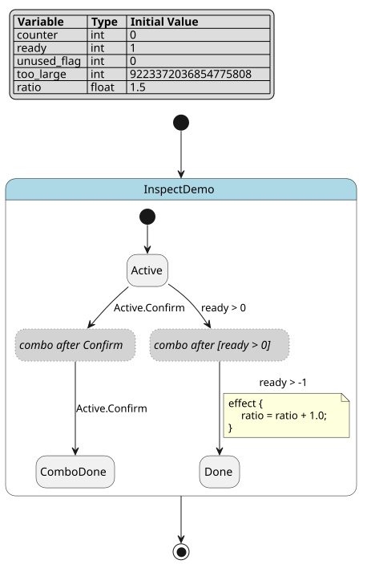

.. _sec-explanations-diagnostics:

Diagnostics explanation
=======================

Inspect diagnostics are designed to answer three questions:

1. What does the current model contain?
2. Which parts look invalid, risky, unused, unreachable, redundant, or
   target-sensitive?
3. What structured context should a human, CI job, IDE, or LLM repair loop use
   next?

This page explains the mechanism. It is not the field catalog; use
:doc:`../../reference/inspect_report/index` for report schemas and
:doc:`../../reference/diagnostics_codes/index` for the complete code registry.
Use :doc:`../../how_to/inspect/index` when you need a copyable command.

The inspect pipeline in one pass
--------------------------------

``pyfcstm inspect`` is a report pipeline wrapped around normal FCSTM loading.
A successful run has already passed the read, decode, parse, and model-building
boundary. Only then can inspect build the structural report and attach
``diagnostics``.

.. list-table:: Pipeline stages and boundaries
   :header-rows: 1
   :widths: 20 36 24 20

   * - Stage
     - What happens
     - Successful output
     - Failure boundary
   * - Read and decode
     - The CLI reads bytes and decodes source text.
     - Source text for excerpts.
     - Missing file, permission error, or decode failure exits non-zero.
   * - Parse and build model
     - The DSL parser and model importer resolve states, variables, events,
       imports, transitions, and lifecycle actions.
     - ``StateMachine`` object.
     - Grammar or model-validation errors exit non-zero.
   * - Inspect structure
     - ``inspect_model`` walks the model and builds states, transitions,
       variables, events, metrics, and derived graphs.
     - ``ModelInspect`` core fields.
     - Internal bugs should surface; they are not diagnostic entries.
   * - Static analyzers
     - Analyzer modules add warnings and infos from structural, combo, numeric,
       data-flow, type-shape, redundancy, and design-health facts.
     - Static ``diagnostics[]`` entries.
     - Internal analyzer bugs surface as failures; lookup-only registry codes
       are not analyzer failures.
   * - Optional verify adapter
     - With ``--enable-verify``, bounded eligible verification algorithms run
       and their results are normalized.
     - Additional verify-backed entries.
     - Forbidden policies exit non-zero before a report is produced.
   * - Renderer
     - The selected renderer emits human text, full JSON, ``llm-json``, or
       ``llm-md``.
     - stdout or output file.
     - Write errors exit non-zero.

The important design point is that diagnostics are report facts, not parser
errors. A syntax error does not become ``diagnostics[0]``; it prevents the report
from existing.

What the static analyzers can see
---------------------------------

Default inspect is static. It sees the model graph, authored and expanded
transitions, resolved events, variables, lifecycle actions, action references,
combo provenance, and lightweight expression facts. It does not execute the
runtime and it does not ask an external event source what will happen in
production.

.. list-table:: Analyzer families
   :header-rows: 1
   :widths: 22 38 40

   * - Source family
     - Examples of facts it can see
     - Typical diagnostic shape
   * - ``structural.py``
     - Reachable states, leaf exits, initial targets, hierarchy shape.
     - Missing entry, unreachable state, deadlock leaf, deep hierarchy.
   * - ``combo.py``
     - Authored combo trigger terms and generated relay provenance.
     - Duplicate events, implied or contradictory guard prefixes, relay naming.
   * - ``numeric.py``
     - Literal ranges, float-bitwise operations, constant division or shift
       risks for target profiles.
     - Target-specific C/C++ deployment warnings.
   * - ``data_flow.py`` and ``use_def.py``
     - Reads, writes, guard-affect paths, abstract-action uncertainty.
     - Unreferenced, unwritten-read, write-only, or never-changing variables.
   * - ``design_health.py``
     - Ratios, large composites, aspect coverage, dead named actions.
     - Maintainability warnings rather than semantic proof failures.
   * - ``type_shape.py``
     - Arithmetic-vs-boolean expression category facts.
     - Type-shape errors or partial static warnings.
   * - ``transition_info.py``
     - Self assignments, unconditional transitions, redundant transition keys.
     - No-op, redundant, or unconditional fall-through diagnostics.

The analyzers attach ``span`` when they can point to a concrete source object
and attach ``refs`` when a consumer needs structured follow-up data. That is
why a good repair loop should branch on ``code`` and ``refs`` rather than scrape
English messages.

Figure-guided trace of the demo model
-------------------------------------

   The diagram shows the expansion that source prose alone hides. ``Confirm +
   Confirm`` and ``[ready > 0] + [ready > -1]`` become relay pseudo states. The
   diagnostics still point back to the authored line and carry combo origin
   references so a repair can edit the source trigger, not the generated relay.

Trace 1: repeated combo event
-----------------------------

Authored source:

.. code-block:: fcstm

   Active -> ComboDone :: Confirm + Confirm;

The model importer expands the combo trigger into two generated edges. That is
legal: a combo trigger is an ordered chain, so two terms produce two hops. The
static combo analyzer then compares resolved event identities and sees that term
0 and term 1 both resolve to ``InspectDemo.Active.Confirm``.

The resulting diagnostic is ``W_COMBO_DUPLICATE_EVENT``. Its ``span`` points at
the second ``Confirm`` term. Its ``refs`` include ``origin_id``, term indexes,
term text, trigger span, transition span, and the span of the first matching
term. The human renderer uses the same span to print:

.. code-block:: text

   Active -> ComboDone :: Confirm + Confirm;
                                      ^^^^^^^

The recommendation is not “delete generated pseudo states.” The smallest source
repair is to inspect whether the second term was meant to be another event, and
only then reduce or replace the duplicated term.

Trace 2: target-specific numeric range
--------------------------------------

Authored source:

.. code-block:: fcstm

   def int too_large = 9223372036854775808;

The literal is valid FCSTM source, and Python can represent that integer. The
numeric analyzer is not claiming the Python generated runtime overflows. It is
checking the C-family deployment profile used by default generated C and C++
templates, where the carrying type is ``PYFCSTM_GENERATED_INT64``.

The diagnostic ``W_NUMERIC_LITERAL_OUT_OF_TARGET_RANGE`` therefore carries
``refs.target_templates`` with ``c``, ``c_poll``, ``cpp``, and ``cpp_poll``. It
also carries the minimum and maximum range text and a runtime note. A CI gate
that deploys only the Python template may record this warning as irrelevant to
that target; a release gate that ships C or C++ output should treat it as a real
portability risk.

Trace 3: optional topological verify feedback
---------------------------------------------

The tutorial model has leaf states with no outgoing edge. Default inspect
already reports ``W_LEAF_NO_OUTGOING_TRANSITION`` from static structure. When the command adds
``--enable-verify``, the inspect adapter can also run closed structural topology
algorithms. The same model then reports facts such as ``W_TOPOLOGICAL_NOEXIT``
and ``I_TOPOLOGICAL_NON_TERMINATING``.

These are modeled-exit and graph-termination signals, not claims that an
ordinary non-root leaf cannot execute another cycle. In pyfcstm, when a runtime
cycle has no submitted transition, a non-root non-pseudo leaf can remain active
and execute its ``during`` actions; that is legal stoppage. A root leaf is
special: pyfcstm supplies synthetic root-exit behavior on the next active
cycle. An explicit self-loop is different: it re-enters the state with
``exit -> transition effect -> enter -> during`` semantics. A ``State -> [*]``
transition exits the source state to its parent boundary; if the source is a
direct child of root, this ends the machine, otherwise parent-level
continuation determines what happens next. Add an exit transition only when
leaving or termination is intended; do not add a self-loop merely to silence
``W_LEAF_NO_OUTGOING_TRANSITION``.

``W_TOPOLOGICAL_NOEXIT`` reports that a graph region has no structural route to
the root exit, while ``I_TOPOLOGICAL_NON_TERMINATING`` reports that topology
does not force termination. Neither diagnostic changes the runtime's legal
ordinary stay-active fallback, and neither is a substitute for an explicit
liveness property when a model must leave or terminate.

This does not mean inspect ran a state-space search. The adapter iterates
registry metadata and keeps only closed structural and SMT-local algorithms
within the selected complexity and call-count policy. Inspect does not parse
``.fbmcq`` queries or load :mod:`pyfcstm.bmc`. The result is useful extra
model-derived feedback, not a proof over all event schedules and abstract
handlers.

Ordered regions in inspect
--------------------------

A state that owns regions runs them one after another in declaration order,
on one shared set of variables, inside a single cycle. A region later in the
order therefore sees what an earlier region wrote in the same cycle, while an
earlier region sees what a later region wrote only one cycle late. That is
defined behavior, described in
:doc:`How a cycle runs a model with regions </explanations/region_semantics/index>`,
so inspect does not call it an error. It reports the two situations where the
order is easy to get wrong without noticing: ``I_REGION_BACKWARD_READ`` (an
information) and ``W_REGION_BLIND_OVERWRITE`` (a warning). Both are judged on
the model as written, and both are emitted by the Python inspect pipeline only;
the registry lists them with the emit tier ``partial_static_pipeline`` because
the jsfcstm editor does not emit them.

Trace 4: a region reads what a later region writes
--------------------------------------------------

The tutorial controller declares ``Safety`` before ``Motion``. ``Safety`` writes
``permit``, and ``Motion`` reads it in its guards. Swapping the two regions
gives ``controller_swapped.fcstm``, where ``Motion`` comes first. The same
command reports nothing for the first order and one information for the second:

.. code-block:: console

   $ pyfcstm inspect -i controller.fcstm
   ...
     diagnostics: 0 errors / 4 warnings / 0 infos
   ...
   $ pyfcstm inspect -i controller_swapped.fcstm
   ...
     diagnostics: 0 errors / 4 warnings / 1 infos
   ...
   [INFO] I_REGION_BACKWARD_READ
     Region 'Controller.Running.Motion' reads variable 'permit', which is produced by the later region 'Controller.Running.Safety'; it sees the value from the previous cycle.
     --> controller_swapped.fcstm:16:13
       |
    15 |             state On { during { motor = 1; } }
    16 |             Off -> On : if [permit != 0 && requested != 0];
       |             ^^^^^^^^^^^^^^^^^^^^^^^^^^^^^^^^^^^^^^^^^^^^^^^
    17 |             On -> Off : if [permit == 0 || requested == 0];
       |
      = source: inspect-static
   ...
   $ pyfcstm inspect -i controller_swapped.fcstm --format json
   ...
         "code": "I_REGION_BACKWARD_READ",
   ...
         "refs": {
           "owner_path": "Controller.Running",
           "reader_region": "Controller.Running.Motion",
           "target": "permit",
           "target_kind": "variable",
           "writer_regions": [
             "Controller.Running.Safety"
           ]
         },
   ...
   $ pyfcstm simulate -i controller.fcstm -e "\
   cycle --input fault=0 --input requested=0; \
   cycle /Start --input fault=0 --input requested=1; \
   cycle --input fault=0 --input requested=1; \
   cycle --input fault=1 --input requested=1; \
   cycle --input fault=1 --input requested=1"
   ...
   Cycle: 4
   Current State: Controller.Running{Safety: Watching, Motion: Off}
   Variables:
     __forced_0 = 0
     motor = 0
     permit = 0
   ...
   $ pyfcstm simulate -i controller_swapped.fcstm -e "\
   cycle --input fault=0 --input requested=0; \
   cycle /Start --input fault=0 --input requested=1; \
   cycle --input fault=0 --input requested=1; \
   cycle --input fault=1 --input requested=1; \
   cycle --input fault=1 --input requested=1"
   ...
   Cycle: 4
   Current State: Controller.Running{Motion: On, Safety: Watching}
   Variables:
     __forced_0 = 0
     motor = 1
     permit = 0
   ...
   Cycle: 5
   Current State: Controller.Running{Motion: Off, Safety: Watching}
   Variables:
     __forced_0 = 0
     motor = 0
     permit = 0

Read the output in four steps:

1. The first command is ``controller.fcstm``: its summary counts ``0 infos``,
   because the producer runs first and no region reads a value that is one cycle
   old.
2. In ``controller_swapped.fcstm`` the guard on line 16 reads ``permit`` while
   ``Safety``, which writes it, comes later. The span points at the reading
   transition, not at the write.
3. The ``--format json`` command shows the machine-readable form. ``refs`` carries ``reader_region``, the
   ``writer_regions`` that sit later in the order, and ``target_kind``, which is
   ``variable`` here and ``active`` when the earlier region asks about a state
   with ``active("...")`` instead.
4. The two runs show what the information stands for. In cycle 4 the fault is
   already present. In ``controller.fcstm`` ``Safety`` lowers ``permit`` first,
   so ``Motion`` leaves ``On`` and ``motor`` is ``0`` at the end of that cycle.
   In ``controller_swapped.fcstm`` ``Motion`` still reads ``permit = 1`` and
   ``motor`` stays ``1`` until cycle 5.

The severity is ``info`` on purpose. Reading the previous cycle's value is
sometimes exactly the intent, for example when a region reacts to a condition
one cycle after the producer set it. The two recommended actions are
``confirm_order`` (keep the order) and ``reorder_regions`` (declare the producer
first); the ``do_not`` entry says not to treat the finding as a defect. Reads
that follow a write of the same variable in the same action chain read the
region's own fresh value and are not reported.

What the information does not say: it does not say the model is wrong, that the
reader ever executes with a stale value that matters, or that reordering is
safe. Reordering changes what every other region between the two sees as well.

Trace 5: a later region overwrites the value without looking
------------------------------------------------------------

.. literalinclude:: region_blind_overwrite.fcstm
   :language: fcstm
   :caption: region_blind_overwrite.fcstm

.. code-block:: console

   $ pyfcstm inspect -i region_blind_overwrite.fcstm
   ...
   [WARN] W_REGION_BLIND_OVERWRITE
     Region 'Drive.Limiter' overwrites variable 'speed' in every cycle without using the value written by the earlier region 'Drive.Planner'; that earlier write is lost whenever it runs.
     --> region_blind_overwrite.fcstm:14:22
   ...
   $ pyfcstm inspect -i region_blind_overwrite.fcstm --format json
   ...
         "code": "W_REGION_BLIND_OVERWRITE",
   ...
         "refs": {
           "owner_path": "Drive",
           "previous_region": "Drive.Planner",
           "previous_write_span": {
             "column": 22,
             "end_column": 32,
             "end_line": 8,
             "line": 8
           },
           "region": "Drive.Limiter",
           "variable": "speed"
         },
   ...
   $ pyfcstm simulate -i region_blind_overwrite.fcstm -e "cycle --input fault=0; cycle --input fault=0"
   ...
   Cycle: 1
   Current State: Drive{Planner: Plan, Limiter: Clamp}
   Variables:
     speed = 0
   ...
   Cycle: 2
   Current State: Drive{Planner: Plan, Limiter: Clamp}
   Variables:
     speed = 0

``Planner`` writes ``speed = 5`` and ``Limiter``, which runs after it, writes
``speed = 0`` without reading ``speed``. The two simulated cycles show the
consequence: ``speed`` is ``0`` at the end of each cycle, so the write of
``Planner`` never has an effect. The warning points at the overwriting
statement (line 14) and ``previous_write_span`` points at the lost write
(line 8).

The warning is deliberately narrow, because writing one variable from several
regions is legitimate ("a default in front, an override behind"). It is
reported only when the loss is certain. All of these must hold:

.. list-table:: When ``W_REGION_BLIND_OVERWRITE`` is reported
   :header-rows: 1
   :widths: 34 66

   * - Condition
     - Why the loss is then certain
   * - Every non-pseudo leaf state of the later region writes the variable
       unconditionally at the top level of its ``during`` actions (or of a
       ``>> during before`` aspect ahead of them)
     - Whichever state the region rests in, the variable is overwritten in
       every cycle.
   * - Nothing in the later region reads the variable ahead of that write: no
       guard, effect, ``enter``, ``exit``, right-hand side, ``if`` condition or
       earlier statement, and no state that does not write it
     - The new value cannot depend on the old one.
   * - The later region cannot finish (no ``[*]`` exit), has no nested owner
       and no abstract or ``ref`` action
     - A finished region stops writing, and a handler could read the variable.
   * - Nothing that runs after the earlier write reads the variable: later
       statements of the same block, other ``during`` actions of that leaf,
       ``>> during after`` aspects, regions in between, and no abstract action in
       the earlier region
     - No consumer sees the earlier value before it is replaced.

Aspects declared on the owner or further out run once around the whole group of
regions, so they neither use the earlier value nor shield it, and the rule
ignores them.

The contrast script feeds four versions of ``Limiter`` to the same inspection
through :func:`pyfcstm.diagnostics.inspect_model`, the function behind
``pyfcstm inspect``:

.. testcode::

   from pyfcstm.diagnostics import inspect_model
   from pyfcstm.model import load_state_machine_from_text

   template = """
   input int fault;
   output int speed = 0;
   state Drive {
       region Planner { [*] -> Plan; state Plan { during { speed = 5; } } }
       region Limiter { [*] -> Clamp; state Clamp { during { %s } } }
   }
   """
   for body in [
       "speed = 0;",
       "speed = speed - 1;",
       "if [fault != 0] { speed = 0; }",
       "if [speed > 3] { speed = 0; } else { speed = 1; }",
   ]:
       report = inspect_model(load_state_machine_from_text(template % body))
       codes = sorted({item.code for item in report.diagnostics if item.code.startswith("W_REGION")})
       print("%-50s %s" % (body, codes))

.. testoutput::

   speed = 0;                                         ['W_REGION_BLIND_OVERWRITE']
   speed = speed - 1;                                 []
   if [fault != 0] { speed = 0; }                     []
   if [speed > 3] { speed = 0; } else { speed = 1; }  []

Only the first version is reported. ``speed = speed - 1`` uses the old value,
the conditional write does not overwrite in every cycle, and the last version
reads ``speed`` before writing it. Each of those is a combination of the
earlier values that may be intended, and the warning stays silent. This also
means a silent inspect does not prove that no write is lost: a lost write
behind a condition, or behind an abstract action, is not found.

What the written machine and the running machine each judge
-----------------------------------------------------------

Some FCSTM constructs are syntactic sugar. ``active("...")`` is replaced by a
hidden flag variable, a forced transition is expanded into relay states and a
hidden variable, and history is lowered into hidden variables and guarded
initial transitions. The model as written keeps the text the author wrote; the
machine that runs is what the simulator, generated code and BMC execute.
Inspect uses both, and which one a finding uses follows from what the finding
is about.

.. list-table:: Which machine a finding is judged on
   :header-rows: 1
   :widths: 34 66

   * - Finding
     - Judged on
   * - The inspect report itself (states, transitions, regions, variables) and
       every finding about what was written, including
       ``I_REGION_BACKWARD_READ``, ``W_REGION_BLIND_OVERWRITE`` and
       ``W_FORCED_GUARD_UNSAT``
     - The model as written. A finding names ``active("Panel.Switch.Pressed")``
       and not a hidden flag, and points at the declaration the author wrote.
   * - With ``--enable-verify``: ``W_DEAD_GUARD``, ``W_GUARD_TAUTOLOGY``,
       ``W_EFFECT_SMT_NO_OP``, ``I_EFFECT_GUARD_CONTRADICT``,
       ``W_TRANSITION_SHADOWED``, ``I_ENTER_DURING_CONTRADICT``,
       ``W_COMPOSITE_INIT_INCOMPLETE``, ``I_NONTRIVIAL_SCC``,
       ``W_TOPOLOGICAL_NOEXIT``, ``I_TOPOLOGICAL_NON_TERMINATING`` and
       ``W_EVENT_UNREACHABLE_EMIT``
     - The machine that runs. A model that uses history, ``active()`` or a
       forced declaration and the text it exports give the same findings.

.. literalinclude:: region_written_vs_running.fcstm
   :language: fcstm
   :caption: region_written_vs_running.fcstm

.. code-block:: console

   $ pyfcstm inspect -i region_written_vs_running.fcstm
   ...
     diagnostics: 0 errors / 3 warnings / 1 infos
   ...
   [INFO] I_REGION_BACKWARD_READ
     Region 'Panel.Lamp' reads state activity 'Panel.Switch.Pressed', which is produced by the later region 'Panel.Switch'; it sees the value from the previous cycle.
     --> region_written_vs_running.fcstm:13:9
   ...
   $ pyfcstm inspect -i region_written_vs_running.fcstm --enable-verify --max-complexity-tier smt_linear
   ...
     diagnostics: 0 errors / 6 warnings / 3 infos
   ...
   [WARN] W_DEAD_GUARD
     A transition guard is unsatisfiable under model variable type and runtime-definedness constraints.
     --> region_written_vs_running.fcstm:14:9
   ...
   $ pyfcstm inspect -i region_written_vs_running.fcstm --enable-verify --max-complexity-tier smt_linear --format json
   ...
         "code": "W_DEAD_GUARD",
   ...
             "guard": "__active_Panel_Switch_Pressed != 0 && !(__active_Panel_Switch_Pressed != 0)",
   ...

The model asks about ``Panel.Switch.Pressed`` from the earlier region
``Lamp``. Line 14 asks for ``active(...) && !active(...)`` of the same state.
Without ``--enable-verify`` inspect reports the backward read, naming the state
path. With it, the solver reads the lowered machine, where the query is the hidden
flag ``__active_Panel_Switch_Pressed``, so the contradictory guard is a
``W_DEAD_GUARD`` and its ``guard`` text shows the flag. A finding of the machine
that runs may therefore name a hidden variable or a generated pseudo state. Each
such finding points at the declaration, history or queried state it was
lowered from, so the repair still edits the written text. A condition on
``active("...")`` is judged like any condition over its flag instead of being
skipped.

Branches, owner completion and ``owner_never_completes``
--------------------------------------------------------

The structural algorithms (reachability of states and transitions, topology,
strongly connected components) read a composite state through its branches. A
state that owns regions has one branch per region. A composite state without
regions has one branch, so a model without regions is the plain special case.
Three rules follow from how the runtime leaves a composite state:

* An ordinary transition that leaves a composite state is taken only once the
  state is complete, which needs every branch over. It counts as reachable only
  when each branch can reach its ``[*]`` exit.
* A forced transition leaves from every leaf below its source, so it is always
  reachable together with the owner. The exits that the expansion of
  ``!S -> T`` adds below ``S`` do not count as a child leaving on its own.
* A history default entered through ``Owner.[H]`` starts a branch like the
  initial transition does.

When no branch of an owner can finish, its ordinary outgoing transitions never
run. Inspect reports the transition with ``W_UNREACHABLE_TRANSITION`` and the
reason ``owner_never_completes`` in ``unreachable_transition_reasons``, and the
state it leads to with ``W_UNREACHABLE_STATE``:

.. literalinclude:: region_never_completes.fcstm
   :language: fcstm
   :caption: region_never_completes.fcstm

.. code-block:: console

   $ pyfcstm inspect -i region_never_completes.fcstm
   ...
   [WARN] W_UNREACHABLE_STATE
     State 'Line.Stopped' is unreachable from the root entry path.
     --> region_never_completes.fcstm:19:5
   ...
   [WARN] W_UNREACHABLE_TRANSITION
     Authored transition 'Line.Work' -> 'Line.Stopped' is unreachable for reasons: owner_never_completes.
     --> region_never_completes.fcstm:20:5
   ...
   $ pyfcstm simulate -i region_never_completes.fcstm -e "\
   cycle --input fault=0; \
   cycle --input fault=1; \
   cycle --input fault=1; \
   cycle --input fault=1"
   ...
   Cycle: 1
   Current State: Line.Work{Safety: Watch, Motion: Spin}
   ...
   Cycle: 2
   Current State: Line.Work{Safety: [done], Motion: Spin}
   ...
   Cycle: 4
   Current State: Line.Work{Safety: [done], Motion: Spin}
   ...

``Safety`` can finish when ``fault`` is non-zero, but ``Motion`` has no ``[*]``
exit. The run confirms the static answer: ``Safety`` becomes ``[done]`` in
cycle 2 and the owner stays in ``Work`` forever. Adding ``Spin -> [*]`` to ``Motion`` lets both regions finish, and the same input then moves the machine to ``Stopped``:

.. testcode::

   from pyfcstm.diagnostics import inspect_model
   from pyfcstm.model import load_state_machine_from_text
   from pyfcstm.simulate import SimulationRuntime

   machine = load_state_machine_from_text("""
   input int fault;
   output int motor = 0;
   state Line {
       [*] -> Work;
       state Work {
           region Safety { [*] -> Watch; state Watch; Watch -> [*] : if [fault != 0]; }
           region Motion {
               [*] -> Spin;
               Spin -> [*] : if [fault != 0];
               state Spin { during { motor = 1; } }
           }
       }
       state Stopped;
       Work -> Stopped : if [fault != 0];
   }
   """)
   print([item.code for item in inspect_model(machine).diagnostics if item.code.startswith("W_UNREACHABLE")])
   runtime = SimulationRuntime(machine, input_source={"fault": 0})
   for fault in (0, 1, 1):
       runtime.cycle(inputs={"fault": fault})
       print(runtime.configuration)

.. testoutput::

   []
   Line.Work{Safety: Watch, Motion: Spin}
   Line.Stopped
   Line.Stopped

The last script is the one change this rule makes for models **without** regions: a composite state none of whose children can leave never takes its ordinary outgoing transitions.

.. testcode::

   from pyfcstm.diagnostics import inspect_model
   from pyfcstm.model import load_state_machine_from_text

   machine = load_state_machine_from_text("""
   input int fault;
   state Line {
       [*] -> Work;
       state Work { [*] -> Spin; state Spin; }
       state Stopped;
       Work -> Stopped : if [fault != 0];
   }
   """)
   for item in inspect_model(machine).diagnostics:
       if item.code.startswith("W_UNREACHABLE"):
           print(item.code, item.message)

.. testoutput::

   W_UNREACHABLE_STATE State 'Line.Stopped' is unreachable from the root entry path.
   W_UNREACHABLE_TRANSITION Authored transition 'Line.Work' -> 'Line.Stopped' is unreachable for reasons: owner_never_completes.

The simulator already behaved this way; earlier reports treated such a state
as something the machine could simply leave.

Known over-approximations
-------------------------

Three limits of the structural analysis are known. The first two lean in the
direction of missing a problem, so treat a silent report as "no finding", not as
proof.

.. list-table:: Known over-approximations
   :header-rows: 1
   :widths: 30 40 30

   * - Limit
     - Effect
     - Shown below
   * - A composite state that is entered only through history keeps its ordinary
       initial child reachable.
     - ``W_UNREACHABLE_STATE`` is not reported for a child that the initial
       transition would enter but that history never does.
     - Case 1.
   * - ``pyfcstm.verify`` judges the machine that runs, where a forced
       declaration is a relay, and ignores the guard of the declaration when
       it follows structure.
     - A state behind a composite that only a forced declaration can take
       elsewhere may still be listed as reachable.
     - Case 2.
   * - A forced declaration expands to one transition per leaf, and is
       reported as one declaration.
     - One expansion that starts from an unreachable state marks the whole
       declaration, so a flagged declaration does not say every expansion is
       dead.
     - Not shown: no run in this page produces it.

Case 1, a state that only history skips:

.. testcode::

   from pyfcstm.diagnostics import inspect_model
   from pyfcstm.model import load_state_machine_from_text
   from pyfcstm.simulate import SimulationRuntime

   machine = load_state_machine_from_text("""
   input int go;
   state Plant {
       [*] -> Idle;
       state Idle;
       state Mode {
           [*] -> Cold;
           [H] -> Warm;
           state Cold;
           state Warm;
       }
       Idle -> Mode.[H] : if [go != 0];
   }
   """)
   print([item.code for item in inspect_model(machine).diagnostics if item.code.startswith("W_UNREACHABLE")])
   runtime = SimulationRuntime(machine, input_source={"go": 0})
   for go in (0, 1):
       runtime.cycle(inputs={"go": go})
       print(runtime.configuration)

.. testoutput::

   []
   Plant.Idle
   Plant.Mode.Warm

Case 2, a forced declaration whose guard can never hold:

.. testcode::

   from pyfcstm.diagnostics import inspect_model
   from pyfcstm.model import load_state_machine_from_text

   machine = load_state_machine_from_text("""
   input int fault;
   state Line {
       [*] -> Work;
       state Work { [*] -> Spin; state Spin; }
       state Stopped;
       !Work -> Stopped : if [fault != 0 && fault == 0];
   }
   """)
   for verify in (False, True):
       report = inspect_model(machine, enable_verify=verify, max_complexity_tier="smt_linear")
       codes = {item.code for item in report.diagnostics if item.code.startswith(("W_UNREACHABLE", "W_DEAD_GUARD"))}
       print(verify, sorted(codes))

.. testoutput::

   False []
   True ['W_DEAD_GUARD', 'W_UNREACHABLE_TRANSITION']

In case 1 the first entry into ``Mode`` goes through ``[H] -> Warm``, so
``Cold`` is never entered, and the simulation ends in ``Warm``. Inspect
reports no unreachable state. In case 2 the guard can never hold, so ``Stopped``
cannot be entered, yet ``W_UNREACHABLE_STATE`` does not list it; the
unsatisfiable guard is found only by the verify findings (``W_UNREACHABLE_TRANSITION``
and ``W_DEAD_GUARD``). Use the verify findings together with the reachability
list when a model leans on forced transitions or history.

Severity, risk, and emit tier
-----------------------------

Severity answers how the current diagnostic should be prioritized. Emit tier
answers where the diagnostic can come from. They are related but not the same.

.. list-table:: Reading severity and tier together
   :header-rows: 1
   :widths: 20 40 40

   * - Fact
     - What it means
     - What it does not mean
   * - ``error``
     - The model cannot be safely constructed or used for the requested path.
     - Every error appears inside a successful JSON report.
   * - ``warning``
     - The report is successful, but a structural, design, numeric, or verify
       fact needs review.
     - The warning is automatically a release blocker for every target.
   * - ``info``
     - A non-blocking observation may help explain intent or topology.
     - The model is necessarily healthy or unhealthy.
   * - ``static_pipeline``
     - Default inspect can emit the code from static facts.
     - The code was proven by an SMT solver.
   * - ``verify_pipeline``
     - Optional verify integration may emit the code.
     - It runs without ``--enable-verify`` or despite policy rejection.
   * - ``lookup_api``
     - Explicit resolver APIs own the code.
     - It is expected in ordinary CLI inspect output.
   * - ``catalog_only``
     - The registry preserves a compatibility contract.
     - Current normal pyfcstm paths should emit it.

This split keeps CI filters honest. A filter can decide to fail on all
``error`` diagnostics, fail on target-relevant warnings, and merely record infos;
it can also decide not to expect verify-only codes in a default static report.

Why diagnostics help LLM repair loops
-------------------------------------

An LLM prompt that contains only prose has to guess the edit target. An inspect
LLM report gives it a safer packet:

* a stable ``code`` that selects a known repair strategy;
* a ``severity`` that helps prioritize;
* a precise ``location`` and source excerpt when source text is available;
* ``refs`` that carry the state, variable, event, guard, target profile, or
  provenance object;
* registry ``recommended_actions`` and ``do_not`` rules;
* a global repair protocol that asks for the smallest source edit.

The packet is guidance, not permission for broad rewrites. If two diagnostics
point to the same line, the repair loop should inspect provenance first and
avoid stacking every suggested action mechanically.

Counterexamples and limits
--------------------------

These examples are intentionally negative. They keep the boundary between
inspect, verify, generated code, and repair tooling clear.

.. list-table:: What inspect does not promise
   :header-rows: 1
   :widths: 28 72

   * - Counterexample
     - Correct interpretation
   * - Invalid DSL file
     - A missing brace exits with ``Failed to parse input DSL file``. There is
       no successful report and no ``diagnostics`` array to inspect.
   * - Duplicate state name
     - Model validation exits with ``Invalid state machine model``. Treat it as
       a process failure, even if the registry contains related ``E_*`` codes.
       Pass ``--collect-errors`` to get a report that lists every ``E_*``
       instead; the command still exits non-zero.
   * - ``--collect-errors``
     - The report then carries the model errors alongside the warnings, and the
       model behind it may be internally inconsistent. It does not mean the
       model is usable, and it does not turn the errors into warnings.
   * - C-family numeric warning
     - It can be a real C/C++ deployment risk while remaining non-applicable to
       Python generated runtimes.
   * - ``W_GUARD_VARS_NEVER_CHANGE``
     - The static data-flow analyzer found no DSL write path. It did not prove
       an abstract handler will never mutate external state.
   * - ``--enable-verify``
     - The command can add bounded topology or bounded SMT findings. It does
       not silently enable BMC search or unbounded path exploration.
   * - LLM repair report
     - The report makes a repair prompt more grounded. It does not prove that
       the LLM's patch is correct without tests or human review.

Operational boundary summary
----------------------------

Use this matrix when deciding where to handle an outcome.

.. list-table:: Outcome ownership
   :header-rows: 1
   :widths: 24 24 28 24

   * - Outcome
     - Where it appears
     - Owner
     - First response
   * - Missing input file
     - stderr and exit status
     - CLI wrapper or calling process
     - Fix path or working directory.
   * - Parse or model error
     - stderr and exit status
     - DSL author or importer
     - Fix source before expecting a report.
   * - Static warning
     - ``diagnostics[]`` in a successful report
     - Model author or reviewer
     - Inspect ``code``, ``span``, and ``refs``.
   * - Verify policy rejection
     - stderr and exit status
     - CI or command author
     - Use allowed policy or a separate explicit verification workflow.
   * - Target warning
     - ``diagnostics[]`` plus target refs
     - Deployment owner
     - Decide relevance by generated target family.
   * - LLM repair guidance
     - ``llm-json`` or ``llm-md``
     - Repair loop and reviewer
     - Apply smallest justified edit and verify afterwards.

A good inspect workflow therefore has two gates: first prove the command
produced a report, then decide what its diagnostics mean for the consumer.

Practical reading order
-----------------------

Read each diagnostic in order: ``code`` for category, ``severity`` for
priority, ``span`` or ``location`` for source, then ``refs`` for target,
variable, event, or provenance scope. Read prose last so you do not act without
target scope or author intent.

If a diagnostic has no source range, do not treat that as a tool defect first.
Check whether it comes from a lookup API, compatibility contract, generated object,
or no safe single source object; the code reference lists source object and refs.

The same order is useful when reviewing an LLM patch: if it cannot name the
``code``, source range, and ``refs`` field it used, it has not followed the
report. In short: prove the report exists, decide whether the item applies to
the current target, then edit source; this page explains reading behavior
instead of repeating reference tables.
