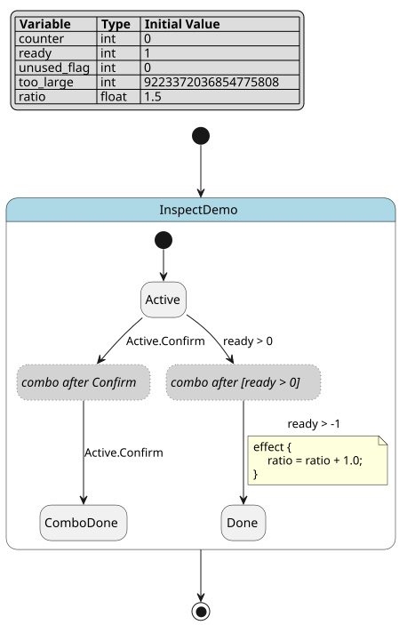

.. _sec-explanations-diagnostics-zh:

诊断解释
========

检查诊断用于回答三个问题：

1. 当前模型里有什么？
2. 哪些部分无效、有风险、未使用、不可达、冗余，或对目标配置敏感？
3. 人、持续集成、IDE 或大语言模型修复循环下一步应该使用哪些结构化上下文？

本页解释机制，不承担字段总表职责。完整报告结构见
:doc:`../../reference/inspect_report/index_zh`；完整诊断码见
:doc:`../../reference/diagnostics_codes/index_zh`；要复制命令时看
:doc:`../../how_to/inspect/index_zh`。

本页术语在这里交接一次：检查（inspect）、诊断（diagnostic）、静态分析（static analysis）、验证（verify）、发射层级（emit tier）、结构化引用（refs）、源码范围（span）、大语言模型（LLM）。后文普通叙述使用中文；命令、路径、字段、诊断码和格式名保持原样。

一次检查管线里发生什么
----------------------

``pyfcstm inspect`` 是包在正常 FCSTM 加载流程外的一条报告管线。一次成功运行已经通过读取、解码、解析和模型构建边界。只有到这一步之后，检查才能构建结构报告并附加 ``diagnostics``\ 。

.. list-table:: 管线阶段和边界
   :header-rows: 1
   :widths: 20 36 24 20

   * - 阶段
     - 做什么
     - 成功产物
     - 失败边界
   * - 读取和解码
     - 命令读取字节并解码源码文本。
     - 用于源码摘录的文本。
     - 文件缺失、权限错误或解码失败会非零退出。
   * - 解析和建模
     - 解析器和模型导入器解析状态、变量、事件、导入、转换和生命周期动作。
     - ``StateMachine`` 对象。
     - 语法或模型校验错误会非零退出。
   * - 检查结构
     - ``inspect_model`` 遍历模型并构建状态、转换、变量、事件、指标和派生图。
     - ``ModelInspect`` 核心字段。
     - 内部缺陷应直接暴露，不伪装成诊断条目。
   * - 静态分析器
     - 分析器根据结构、组合、数值、数据流、类型形状、冗余和设计健康事实添加警告或信息。
     - 静态 ``diagnostics[]`` 条目。
     - 内部缺陷应作为失败暴露；只属于查找 API 或兼容契约的注册表条目不是分析器失败。
   * - 可选验证适配器
     - 使用 ``--enable-verify`` 时，运行封闭且在策略预算内的结构与局部 SMT 算法，并归一化结果。
     - 额外验证支持条目。
     - 文档选项以外的策略值会在报告产生前由 Click 拒绝。
   * - 渲染器
     - 根据格式输出人类可读文本、完整 JSON、``llm-json`` 或 ``llm-md``\ 。
     - 标准输出或输出文件。
     - 写入失败会非零退出。

关键点是：诊断是成功报告中的事实，不是解析错误。缺右括号不会成为 ``diagnostics[0]``\ ；它会让报告根本不存在。

默认静态分析能看见什么
----------------------

默认检查是静态的。它能看到模型图、作者写的转换、展开后的转换、解析后的事件、变量、生命周期动作、动作引用、组合来源和轻量表达式事实。它不执行运行时，也不会询问生产环境里的外部事件源。

.. list-table:: 分析器家族
   :header-rows: 1
   :widths: 22 38 40

   * - 来源
     - 能看到的事实
     - 常见诊断形状
   * - ``structural.py``
     - 可达状态、叶状态出口、初始目标和层级形状。
     - 缺入口、不可达、死锁叶状态和层级过深。
   * - ``combo.py``
     - 作者写的组合触发项和生成中继的来源。
     - 重复事件、被蕴含或矛盾的守卫前缀、中继命名。
   * - ``numeric.py``
     - 字面量范围、浮点位运算、常量除法或移位在目标配置上的风险。
     - 面向 C/C++ 部署的目标特定警告。
   * - ``data_flow.py`` 和 ``use_def.py``
     - 读取、写入、守卫影响路径和抽象动作不确定性。
     - 未引用、未写入读取、只写或永不变化的变量。
   * - ``design_health.py``
     - 比例、大组合状态、切面覆盖和死亡命名动作。
     - 可维护性警告，不是语义证明失败。
   * - ``type_shape.py``
     - 算术表达式和布尔表达式的类别事实。
     - 类型形状错误或部分静态警告。
   * - ``transition_info.py``
     - 自赋值、无条件转换和冗余转换键。
     - 空操作、冗余或无条件下落诊断。

分析器能定位具体源码对象时会附加 ``span``\ ；消费方需要继续判断时会附加 ``refs``\ 。因此修复循环应该按 ``code`` 和 ``refs`` 分支，而不是抓英文消息。

结合图理解示例模型
------------------

   这张图展示源码文字不直观的展开结果。``Confirm + Confirm`` 和
   ``[ready > 0] + [ready > -1]`` 会变成中继伪状态。诊断仍指向作者写的行，并携带组合来源引用，所以修复应该编辑源触发器，而不是编辑生成中继。

轨迹一：重复组合事件
--------------------

作者写的源码是：

.. code-block:: fcstm

   Active -> ComboDone :: Confirm + Confirm;

模型导入器会把组合触发器展开成两条生成边。这是合法的：组合触发器是有序链，两个项就会产生两跳。组合分析器随后比较解析后的事件身份，发现第 0 项和第 1 项都解析为 ``InspectDemo.Active.Confirm``\ 。

于是产生 ``W_COMBO_DUPLICATE_EVENT``\ 。它的 ``span`` 指向第二个 ``Confirm``\ ；``refs`` 包含 ``origin_id``、项序号、项文本、触发器范围、转换范围和第一个匹配项的范围。人类可读渲染器用同一个范围打印：

.. code-block:: text

   Active -> ComboDone :: Confirm + Confirm;
                                      ^^^^^^^

正确修复方向不是“删除生成的伪状态”。最小源修复是先判断第二个项是否本来想写成另一个事件，再决定删除或替换重复项。

轨迹二：目标特定的数值范围
--------------------------

作者写的源码是：

.. code-block:: fcstm

   def int too_large = 9223372036854775808;

这个字面量对 FCSTM 源码来说是合法的，Python 也能表示这个整数。数值分析器并不是说 Python 生成运行时会溢出；它检查的是默认 C 和 C++ 模板使用的 C 系列部署配置，其中承载类型是 ``PYFCSTM_GENERATED_INT64``\ 。

因此 ``W_NUMERIC_LITERAL_OUT_OF_TARGET_RANGE`` 的 ``refs.target_templates`` 会列出 ``c``、``c_poll``、``cpp`` 和 ``cpp_poll``\ 。它还带最小值、最大值和运行时说明。只部署 Python 模板的门禁可以把这个警告记录为与目标无关；发布 C 或 C++ 输出的门禁则应把它当作真实可移植性风险。

轨迹三：可选拓扑验证反馈
------------------------

教程模型里有没有出边的叶状态。默认检查已经能从静态结构报告 ``W_LEAF_NO_OUTGOING_TRANSITION``\ 。当命令增加 ``--enable-verify`` 后，检查适配器还可以运行封闭的结构拓扑算法；同一个模型会额外报告 ``W_TOPOLOGICAL_NOEXIT`` 和 ``I_TOPOLOGICAL_NON_TERMINATING`` 之类事实。

这些诊断描述的是建模出口和图上的终止性，并不是说普通的非根非伪叶不能再执行一个周期。在 pyfcstm 中，一个运行时周期没有转换提交时，非根非伪叶可以保持活动并执行它的 ``during`` 动作；这是合法驻停。根叶状态是特例：pyfcstm 会在下一个活动周期使用合成的根退出行为。显式 self-loop 则不同：它会以 ``exit -> transition effect -> enter -> during`` 的生命周期重新进入状态。``State -> [*]`` 转换会让源状态退出并到达其父状态边界；如果源状态直接挂在 root 下则结束机器，否则由父状态层级的后续转换决定下一步。只有确实需要离开或结束时才添加出口转换；不要仅为消除 ``W_LEAF_NO_OUTGOING_TRANSITION`` 而添加 self-loop。

``W_TOPOLOGICAL_NOEXIT`` 报告图区域没有通向根退出点的结构路径，``I_TOPOLOGICAL_NON_TERMINATING`` 报告拓扑不能保证终止。两者都不会改变普通非根叶的合法驻停 fallback；如果模型必须离开或终止，应使用明确的活性性质，而不是把驻停本身当作错误。

这不等于检查运行了状态空间搜索。适配器遍历注册表元数据，只保留封闭且复杂度和调用次数都在策略内的结构与局部 SMT 算法。inspect 不解析 ``.fbmcq`` 查询，也不加载 :mod:`pyfcstm.bmc`。结果是有用的模型派生反馈，不是对所有事件调度和抽象处理器的完整证明。

检查里的有序区域
----------------

拥有者（owner）是带有区域（region）的状态。它在一个周期内按书写顺序依次推进各区域，所有区域共用同一组变量。因此顺序靠后的区域能读到靠前区域在同一周期写入的值，而靠前的区域只能在下一个周期读到靠后区域的写入。这是明确定义的行为，见\ :doc:`含区域的模型怎样执行一个周期 </explanations/region_semantics/index_zh>`\ ，所以检查不把它当成错误。检查只报告两种容易在不知不觉中写错顺序的情形：\ ``I_REGION_BACKWARD_READ``\ （提示级）和\ ``W_REGION_BLIND_OVERWRITE``\ （警告级）。两者都按书写的模型判断，并且只由 Python 的检查管线发出；注册表把它们的发射层级记为 ``partial_static_pipeline``\ ，原因是 jsfcstm 编辑器不发出它们。

轨迹四：区域读取靠后区域写入的值
--------------------------------

教程里的控制联锁模型先写 ``Safety`` 再写 ``Motion``\ 。\ ``Safety`` 写 ``permit``\ ，\ ``Motion`` 在条件里读它。把两个区域对调就得到 ``controller_swapped.fcstm``\ ，其中 ``Motion`` 在前。同一条命令对前一种顺序不报 ``I_REGION_BACKWARD_READ``\ ，对后一种报一条。两种顺序下都会打印同样的四条警告，三条 ``W_DURING_CONST_ASSIGN`` 和一条 ``W_LEAF_NO_OUTGOING_TRANSITION``\ ；它们与区域的顺序无关，所以只有 ``infos`` 的数量变化：

.. code-block:: console

   $ pyfcstm inspect -i controller.fcstm
   ...
     diagnostics: 0 errors / 4 warnings / 0 infos
   ...
   [WARN] W_DURING_CONST_ASSIGN
   ...
   [WARN] W_DURING_CONST_ASSIGN
   ...
   [WARN] W_DURING_CONST_ASSIGN
   ...
   [WARN] W_LEAF_NO_OUTGOING_TRANSITION
   ...
   $ pyfcstm inspect -i controller_swapped.fcstm
   ...
     diagnostics: 0 errors / 4 warnings / 1 infos
   ...
   [WARN] W_DURING_CONST_ASSIGN
   ...
   [WARN] W_DURING_CONST_ASSIGN
   ...
   [WARN] W_DURING_CONST_ASSIGN
   ...
   [WARN] W_LEAF_NO_OUTGOING_TRANSITION
   ...
   [INFO] I_REGION_BACKWARD_READ
     Region 'Controller.Running.Motion' reads variable 'permit', which is produced by the later region 'Controller.Running.Safety'; it sees the value from the previous cycle.
     --> controller_swapped.fcstm:16:13
       |
    15 |             state On { during { motor = 1; } }
    16 |             Off -> On : if [permit != 0 && requested != 0];
       |             ^^^^^^^^^^^^^^^^^^^^^^^^^^^^^^^^^^^^^^^^^^^^^^^
    17 |             On -> Off : if [permit == 0 || requested == 0];
       |
      = source: inspect-static
   ...
   $ pyfcstm inspect -i controller_swapped.fcstm --format json
   ...
         "code": "I_REGION_BACKWARD_READ",
   ...
         "refs": {
           "owner_path": "Controller.Running",
           "reader_region": "Controller.Running.Motion",
           "target": "permit",
           "target_kind": "variable",
           "writer_regions": [
             "Controller.Running.Safety"
           ]
         },
   ...
   $ pyfcstm simulate -i controller.fcstm -e "\
   cycle --input fault=0 --input requested=0; \
   cycle /Start --input fault=0 --input requested=1; \
   cycle --input fault=0 --input requested=1; \
   cycle --input fault=1 --input requested=1; \
   cycle --input fault=1 --input requested=1"
   ...
   Cycle: 4
   Current State: Controller.Running{Safety: Watching, Motion: Off}
   Variables:
     __forced_0 = 0
     motor = 0
     permit = 0
   ...
   $ pyfcstm simulate -i controller_swapped.fcstm -e "\
   cycle --input fault=0 --input requested=0; \
   cycle /Start --input fault=0 --input requested=1; \
   cycle --input fault=0 --input requested=1; \
   cycle --input fault=1 --input requested=1; \
   cycle --input fault=1 --input requested=1"
   ...
   Cycle: 4
   Current State: Controller.Running{Motion: On, Safety: Watching}
   Variables:
     __forced_0 = 0
     motor = 1
     permit = 0
   ...
   Cycle: 5
   Current State: Controller.Running{Motion: Off, Safety: Watching}
   Variables:
     __forced_0 = 0
     motor = 0
     permit = 0

按四步读这段输出：

1. 第一条命令是 ``controller.fcstm``\ ：它的摘要里是 ``0 infos``\ ，因为生产者先运行，没有区域读到过期一个周期的值。
2. 在 ``controller_swapped.fcstm`` 里，第 16 行的条件读取 ``permit``\ ，而写它的 ``Safety`` 排在后面。源码范围指向读取它的转换，不是写入处。
3. ``--format json`` 那条命令给出机器可读的形式，\ ``refs`` 里有：\ ``reader_region``\ 、排在后面的 ``writer_regions``\ ，以及 ``target_kind``\ 。这里是 ``variable``\ ；靠前的区域用 ``active("...")`` 询问某个状态时则是 ``active``\ 。
4. 两次运行展示了这条提示代表什么。周期 4 里故障已经出现。在 ``controller.fcstm`` 中 ``Safety`` 先把 ``permit`` 置 0，\ ``Motion`` 离开 ``On``\ ，该周期结束时 ``motor`` 为 ``0``\ 。在 ``controller_swapped.fcstm`` 中 ``Motion`` 仍读到 ``permit = 1``\ ，\ ``motor`` 一直保持 ``1`` 到周期 5。

严重级别刻意定为 ``info``\ 。读取上一周期的值有时正是本意，例如一个区域有意比生产者晚一个周期响应某个条件。两条建议动作是 ``confirm_order``\ （保持顺序）和 ``reorder_regions``\ （先声明生产者）；\ ``do_not`` 条目写明不要把它当成缺陷。读取之前在同一动作链里已经写过同一个变量时，读到的是该区域自己的新值，不会报告。

这条提示不说明什么：它不说明模型有错，不说明读取方真的会用到有影响的过期值，也不说明对调顺序是安全的。对调还会改变夹在两者之间的其他区域所看到的内容。

轨迹五：靠后的区域不看旧值就覆盖
--------------------------------

.. literalinclude:: region_blind_overwrite.fcstm
   :language: fcstm
   :caption: region_blind_overwrite.fcstm

.. code-block:: console

   $ pyfcstm inspect -i region_blind_overwrite.fcstm
   ...
   [WARN] W_REGION_BLIND_OVERWRITE
     Region 'Drive.Limiter' overwrites variable 'speed' in every cycle without using the value written by the earlier region 'Drive.Planner'; that earlier write is lost whenever it runs.
     --> region_blind_overwrite.fcstm:14:22
   ...
   $ pyfcstm inspect -i region_blind_overwrite.fcstm --format json
   ...
         "code": "W_REGION_BLIND_OVERWRITE",
   ...
         "refs": {
           "owner_path": "Drive",
           "previous_region": "Drive.Planner",
           "previous_write_span": {
             "column": 22,
             "end_column": 32,
             "end_line": 8,
             "line": 8
           },
           "region": "Drive.Limiter",
           "variable": "speed"
         },
   ...
   $ pyfcstm simulate -i region_blind_overwrite.fcstm -e "cycle --input fault=0; cycle --input fault=0"
   ...
   Cycle: 1
   Current State: Drive{Planner: Plan, Limiter: Clamp}
   Variables:
     speed = 0
   ...
   Cycle: 2
   Current State: Drive{Planner: Plan, Limiter: Clamp}
   Variables:
     speed = 0

``Planner`` 写 ``speed = 5``\ ，排在它后面的 ``Limiter`` 写 ``speed = 0`` 而不读 ``speed``\ 。两个仿真周期显示了后果：每个周期结束时 ``speed`` 都是 ``0``\ ，\ ``Planner`` 的写入从不产生效果。警告指向覆盖语句（第 14 行），\ ``previous_write_span`` 指向被丢掉的写入（第 8 行）。

警告刻意收得很窄，因为多个区域写同一个变量本身是正当的（“前面给默认值，后面覆盖”）。只有确定会丢失时才报告，下面各项必须同时成立：

.. list-table:: ``W_REGION_BLIND_OVERWRITE`` 的报告条件
   :header-rows: 1
   :widths: 34 66

   * - 条件
     - 为什么此时一定丢失
   * - 靠后区域的每个非伪状态叶子都在 ``during`` 动作（或排在它们之前的 ``>> during before`` 切面）的最外层无条件写这个变量
     - 无论区域停在哪个状态，变量在每个周期都被覆盖。
   * - 靠后区域里没有任何东西先于这次写入读取该变量：条件、效果、\ ``enter``\ 、\ ``exit``\ 、右侧表达式、\ ``if`` 条件、更早的语句都不读，也没有不写它的状态
     - 新值不可能依赖旧值。
   * - 靠后区域不能完成（没有 ``[*]`` 出口），不含嵌套的拥有者，也没有抽象动作或 ``ref`` 动作
     - 已完成的区域不再写入，而处理函数可能读取这个变量。
   * - 排在先前写入之后运行的东西都不读该变量：同一块里后面的语句、该叶子的其他 ``during`` 动作、\ ``>> during after`` 切面、夹在中间的区域，且靠前的区域没有抽象动作
     - 在被替换之前没有任何使用者看到先前的值。

声明在拥有者或更外层的切面每周期只围绕整组区域运行一次，既不使用先前的值也不保护它，规则忽略它们。

对照脚本把四个版本的 ``Limiter`` 交给同一项检查，它通过 :func:`pyfcstm.diagnostics.inspect_model` 调用，这个函数就是 ``pyfcstm inspect`` 背后的实现：

.. testcode::

   from pyfcstm.diagnostics import inspect_model
   from pyfcstm.model import load_state_machine_from_text

   template = """
   input int fault;
   output int speed = 0;
   state Drive {
       region Planner { [*] -> Plan; state Plan { during { speed = 5; } } }
       region Limiter { [*] -> Clamp; state Clamp { during { %s } } }
   }
   """
   for body in [
       "speed = 0;",
       "speed = speed - 1;",
       "if [fault != 0] { speed = 0; }",
       "if [speed > 3] { speed = 0; } else { speed = 1; }",
   ]:
       report = inspect_model(load_state_machine_from_text(template % body))
       codes = sorted({item.code for item in report.diagnostics if item.code.startswith("W_REGION")})
       print("%-50s %s" % (body, codes))

.. testoutput::

   speed = 0;                                         ['W_REGION_BLIND_OVERWRITE']
   speed = speed - 1;                                 []
   if [fault != 0] { speed = 0; }                     []
   if [speed > 3] { speed = 0; } else { speed = 1; }  []

只有第一个版本被报告。\ ``speed = speed - 1`` 用到了旧值，有条件的写入并非每个周期都覆盖，最后一个版本先读 ``speed`` 再写。这些都可能是有意把前后的值结合起来，警告因此保持沉默。这也意味着检查没有报告并不能证明没有写入丢失：藏在条件之后或抽象动作之后的丢失不会被发现。

书写的机器与运行的机器各判断什么
--------------------------------

FCSTM 的一些结构是语法糖。\ ``active("...")`` 被替换成隐藏的标志变量，强制转换被展开成中继状态和隐藏变量，历史（history）被降级成隐藏变量和带条件的初始转换。书写的模型保留作者写下的文字；运行的机器才是仿真器、生成代码和有界模型检查（BMC）真正执行的东西。检查两者都用，某条发现用哪一个，取决于它说的是什么。

.. list-table:: 一条发现按哪台机器判断
   :header-rows: 1
   :widths: 34 66

   * - 发现
     - 判断依据
   * - 检查报告本身（状态、转换、区域、变量），以及所有关于书写内容的发现，包括 ``I_REGION_BACKWARD_READ``\ 、\ ``W_REGION_BLIND_OVERWRITE`` 和 ``W_FORCED_GUARD_UNSAT``
     - 书写的模型。发现里出现的是 ``active("Panel.Switch.Pressed")`` 而不是隐藏标志，并指向作者写下的声明。
   * - 加上 ``--enable-verify`` 后的 ``W_DEAD_GUARD``\ 、\ ``W_GUARD_TAUTOLOGY``\ 、\ ``W_EFFECT_SMT_NO_OP``\ 、\ ``I_EFFECT_GUARD_CONTRADICT``\ 、\ ``W_TRANSITION_SHADOWED``\ 、\ ``I_ENTER_DURING_CONTRADICT``\ 、\ ``W_COMPOSITE_INIT_INCOMPLETE``\ 、\ ``I_NONTRIVIAL_SCC``\ 、\ ``W_TOPOLOGICAL_NOEXIT``\ 、\ ``I_TOPOLOGICAL_NON_TERMINATING`` 和 ``W_EVENT_UNREACHABLE_EMIT``
     - 运行的机器。使用历史、\ ``active()`` 或强制声明的模型，与它导出的文本给出相同的发现。

.. literalinclude:: region_written_vs_running.fcstm
   :language: fcstm
   :caption: region_written_vs_running.fcstm

.. code-block:: console

   $ pyfcstm inspect -i region_written_vs_running.fcstm
   ...
     diagnostics: 0 errors / 3 warnings / 1 infos
   ...
   [INFO] I_REGION_BACKWARD_READ
     Region 'Panel.Lamp' reads state activity 'Panel.Switch.Pressed', which is produced by the later region 'Panel.Switch'; it sees the value from the previous cycle.
     --> region_written_vs_running.fcstm:13:9
   ...
   $ pyfcstm inspect -i region_written_vs_running.fcstm --enable-verify --max-complexity-tier smt_linear
   ...
     diagnostics: 0 errors / 6 warnings / 3 infos
   ...
   [WARN] W_DEAD_GUARD
     A transition guard is unsatisfiable under model variable type and runtime-definedness constraints.
     --> region_written_vs_running.fcstm:14:9
   ...
   $ pyfcstm inspect -i region_written_vs_running.fcstm --enable-verify --max-complexity-tier smt_linear --format json
   ...
         "code": "W_DEAD_GUARD",
   ...
             "guard": "__active_Panel_Switch_Pressed != 0 && !(__active_Panel_Switch_Pressed != 0)",
   ...

模型里靠前的区域 ``Lamp`` 询问 ``Panel.Switch.Pressed``\ ，第 14 行对同一个状态问 ``active(...) && !active(...)``\ 。不加 ``--enable-verify`` 时，检查报告一条向后读取，写出的是状态路径。加上它之后，求解器读的是降级后的机器，查询在那里是隐藏标志 ``__active_Panel_Switch_Pressed``\ ，所以自相矛盾的条件成为 ``W_DEAD_GUARD``\ ，它的 ``guard`` 文本里出现的就是这个标志。因此运行的机器的发现可能写出隐藏变量或生成的伪状态。每条这样的发现都指回它降级前的声明、历史或被查询的状态，修复时改的仍是书写的文本。\ ``active("...")`` 上的条件与任何关于其标志的条件一样被判断，不会被跳过。

分支、拥有者完成与 ``owner_never_completes``
---------------------------------------------

结构算法（状态与转换的可达性、拓扑、强连通分量）通过分支来读一个复合状态。拥有区域的状态每个区域一条分支；不含区域的复合状态只有一条分支，所以不含区域的模型是最普通的特例。下面三条规则来自运行时离开复合状态的方式：

* 离开复合状态的普通转换，只有在该状态完成后才会被采用，这要求所有分支都结束。只有每条分支都能到达自己的 ``[*]`` 出口时，它才算可达。
* 强制转换从源状态之下的每个叶子离开，所以总是与拥有者一起可达。\ ``!S -> T`` 展开后加在 ``S`` 之下的出口，不算子状态自行离开。
* 经 ``Owner.[H]`` 进入的历史默认目标，与初始转换一样是一条分支的起点。

当拥有者没有任何一条分支能结束时，它的普通外出转换永远不会运行。检查用 ``W_UNREACHABLE_TRANSITION`` 报告该转换，并在 ``unreachable_transition_reasons`` 里给出原因 ``owner_never_completes``\ ，它指向的状态用 ``W_UNREACHABLE_STATE`` 报告：

.. literalinclude:: region_never_completes.fcstm
   :language: fcstm
   :caption: region_never_completes.fcstm

.. code-block:: console

   $ pyfcstm inspect -i region_never_completes.fcstm
   ...
   [WARN] W_UNREACHABLE_STATE
     State 'Line.Stopped' is unreachable from the root entry path.
     --> region_never_completes.fcstm:19:5
   ...
   [WARN] W_UNREACHABLE_TRANSITION
     Authored transition 'Line.Work' -> 'Line.Stopped' is unreachable for reasons: owner_never_completes.
     --> region_never_completes.fcstm:20:5
   ...
   $ pyfcstm simulate -i region_never_completes.fcstm -e "\
   cycle --input fault=0; \
   cycle --input fault=1; \
   cycle --input fault=1; \
   cycle --input fault=1"
   ...
   Cycle: 1
   Current State: Line.Work{Safety: Watch, Motion: Spin}
   ...
   Cycle: 2
   Current State: Line.Work{Safety: [done], Motion: Spin}
   ...
   Cycle: 4
   Current State: Line.Work{Safety: [done], Motion: Spin}
   ...

``fault`` 非零时 ``Safety`` 能完成，但 ``Motion`` 没有 ``[*]`` 出口。运行证实了静态结论：\ ``Safety`` 在周期 2 变成 ``[done]``\ ，拥有者永远停在 ``Work``\ 。给 ``Motion`` 加上 ``Spin -> [*]`` 后两个区域都能完成，同样的输入就把机器带到 ``Stopped``\ ：

.. testcode::

   from pyfcstm.diagnostics import inspect_model
   from pyfcstm.model import load_state_machine_from_text
   from pyfcstm.simulate import SimulationRuntime

   machine = load_state_machine_from_text("""
   input int fault;
   output int motor = 0;
   state Line {
       [*] -> Work;
       state Work {
           region Safety { [*] -> Watch; state Watch; Watch -> [*] : if [fault != 0]; }
           region Motion {
               [*] -> Spin;
               Spin -> [*] : if [fault != 0];
               state Spin { during { motor = 1; } }
           }
       }
       state Stopped;
       Work -> Stopped : if [fault != 0];
   }
   """)
   print([item.code for item in inspect_model(machine).diagnostics if item.code.startswith("W_UNREACHABLE")])
   runtime = SimulationRuntime(machine, input_source={"fault": 0})
   for fault in (0, 1, 1):
       runtime.cycle(inputs={"fault": fault})
       print(runtime.configuration)

.. testoutput::

   []
   Line.Work{Safety: Watch, Motion: Spin}
   Line.Stopped
   Line.Stopped

最后一个脚本是这条规则给\ **不含**\ 区域的模型带来的唯一变化：所有子状态都无法离开的复合状态，永远不会采用它的普通外出转换。

.. testcode::

   from pyfcstm.diagnostics import inspect_model
   from pyfcstm.model import load_state_machine_from_text

   machine = load_state_machine_from_text("""
   input int fault;
   state Line {
       [*] -> Work;
       state Work { [*] -> Spin; state Spin; }
       state Stopped;
       Work -> Stopped : if [fault != 0];
   }
   """)
   for item in inspect_model(machine).diagnostics:
       if item.code.startswith("W_UNREACHABLE"):
           print(item.code, item.message)

.. testoutput::

   W_UNREACHABLE_STATE State 'Line.Stopped' is unreachable from the root entry path.
   W_UNREACHABLE_TRANSITION Authored transition 'Line.Work' -> 'Line.Stopped' is unreachable for reasons: owner_never_completes.

仿真器本来就是这样运行的；早先的报告把这样的状态当成机器可以随意离开的状态。

已知的过近似
------------

结构分析有三处已知的限制。前两处偏向漏报，所以没有报告时只能理解为“没有发现”，不是证明。

.. list-table:: 已知的过近似
   :header-rows: 1
   :widths: 30 40 30

   * - 限制
     - 影响
     - 下方演示
   * - 只经历史进入的复合状态，其普通初始子状态仍被视为可达。
     - 初始转换会进入、历史却从不进入的子状态，不会得到 ``W_UNREACHABLE_STATE``\ 。
     - 情形 1。
   * - ``pyfcstm.verify`` 判断的是运行的机器，其中强制声明是中继，按结构判断时不看声明的条件。
     - 一个复合状态之后的状态，如果只有强制声明能把机器从复合状态带到别处，仍可能被列为可达。
     - 情形 2。
   * - 强制声明会展开成每个叶子一条转换，报告时按一条声明算。
     - 只要有一个展开从不可达状态出发，整条声明都被标记，所以被标记的声明不表示每个展开都不可达。
     - 未演示：本页没有任何运行能产生它。

情形 1，只被历史跳过的状态：

.. testcode::

   from pyfcstm.diagnostics import inspect_model
   from pyfcstm.model import load_state_machine_from_text
   from pyfcstm.simulate import SimulationRuntime

   machine = load_state_machine_from_text("""
   input int go;
   state Plant {
       [*] -> Idle;
       state Idle;
       state Mode {
           [*] -> Cold;
           [H] -> Warm;
           state Cold;
           state Warm;
       }
       Idle -> Mode.[H] : if [go != 0];
   }
   """)
   print([item.code for item in inspect_model(machine).diagnostics if item.code.startswith("W_UNREACHABLE")])
   runtime = SimulationRuntime(machine, input_source={"go": 0})
   for go in (0, 1):
       runtime.cycle(inputs={"go": go})
       print(runtime.configuration)

.. testoutput::

   []
   Plant.Idle
   Plant.Mode.Warm

情形 2，条件永远不成立的强制声明：

.. testcode::

   from pyfcstm.diagnostics import inspect_model
   from pyfcstm.model import load_state_machine_from_text

   machine = load_state_machine_from_text("""
   input int fault;
   state Line {
       [*] -> Work;
       state Work { [*] -> Spin; state Spin; }
       state Stopped;
       !Work -> Stopped : if [fault != 0 && fault == 0];
   }
   """)
   for verify in (False, True):
       report = inspect_model(machine, enable_verify=verify, max_complexity_tier="smt_linear")
       codes = {item.code for item in report.diagnostics if item.code.startswith(("W_UNREACHABLE", "W_DEAD_GUARD"))}
       print(verify, sorted(codes))

.. testoutput::

   False []
   True ['W_DEAD_GUARD', 'W_UNREACHABLE_TRANSITION']

情形 1 中第一次进入 ``Mode`` 走的是 ``[H] -> Warm``\ ，所以 ``Cold`` 从不会被进入，仿真也停在 ``Warm``\ ，检查却没有报告不可达状态。情形 2 中条件永远不成立，\ ``Stopped`` 无法进入，\ ``W_UNREACHABLE_STATE`` 却没有列出它；不可满足的条件只由验证类发现（\ ``W_UNREACHABLE_TRANSITION`` 和 ``W_DEAD_GUARD``\ ）找出。模型依赖强制转换或历史时，请把验证类发现和可达性列表放在一起看。

严重级别、风险和发射层级
------------------------

严重级别回答“当前条目应如何排序处理”；发射层级回答“它可能从哪里来”。两者有关，但不是一回事。

.. list-table:: 联合阅读严重级别和层级
   :header-rows: 1
   :widths: 20 40 40

   * - 事实
     - 含义
     - 不表示什么
   * - ``error``
     - 模型无法安全构建或用于请求路径。
     - 每个错误都会出现在成功 JSON 报告里。
   * - ``warning``
     - 报告成功，但结构、设计、数值或验证事实需要评审。
     - 它自动阻塞每个目标的发布。
   * - ``info``
     - 非阻塞观察能帮助解释意图或拓扑。
     - 模型必然健康或不健康。
   * - ``static_pipeline``
     - 默认检查可以从静态事实发射该诊断。
     - 该事实由 SMT 求解器证明。
   * - ``verify_pipeline``
     - 可选验证集成可能发射该诊断。
     - 未启用验证时也会运行。
   * - ``lookup_api``
     - 显式解析 API 拥有该诊断。
     - 它应出现在普通命令行检查输出里。
   * - ``catalog_only``
     - 注册表保留兼容契约。
     - 当前正常路径应该发射它。

这个拆分能让持续集成过滤更诚实：可以所有 ``error`` 都失败，目标相关警告才失败，信息只记录；也可以不期待默认静态报告里出现验证专属诊断。

为什么诊断有助于大语言模型修复
------------------------------

只有散文的提示会迫使模型猜编辑位置。大语言模型报告提供更安全的数据包：

* 稳定 ``code``\ ，用于选择已知修复策略；
* ``severity``\ ，用于排序优先级；
* 可用时给出精确 ``location`` 和源码摘录；
* ``refs`` 携带状态、变量、事件、守卫、目标配置或来源对象；
* 注册表里的 ``recommended_actions`` 和 ``do_not``\ ；
* 全局修复协议，要求保留作者意图并做最小源编辑。

这个数据包是指导，不是允许大改。两条诊断指向同一行时，修复循环应先检查来源，不要机械叠加所有建议动作。

反例和能力边界
--------------

下面都是负例，用来保持检查、验证、生成代码和修复工具之间的边界清晰。

.. list-table:: 检查不承诺什么
   :header-rows: 1
   :widths: 28 72

   * - 反例
     - 正确理解
   * - 无效 DSL 文件
     - 缺右括号会以 ``Failed to parse input DSL file`` 退出。没有成功报告，也没有 ``diagnostics`` 数组。
   * - 重复状态名
     - 模型校验会以 ``Invalid state machine model`` 退出。即使注册表有相关 ``E_*`` 代码，也应把它当作进程失败。
       加上 ``--collect-errors``\ 可以改为得到一份列出全部 ``E_*``\ 的报告，命令仍以非零码退出。
   * - ``--collect-errors``
     - 此时报告会把模型错误与警告一并带出，其背后的模型可能自身并不一致。这既不表示模型可用，也不会把错误降级成警告。
   * - C 系列数值警告
     - 它可以是真实 C/C++ 部署风险，同时不适用于 Python 生成运行时。
   * - ``W_GUARD_VARS_NEVER_CHANGE``
     - 静态数据流没有发现 DSL 写入路径；它没有证明抽象处理器绝不会改变外部状态。
   * - ``--enable-verify``
     - 命令可以添加有界拓扑或本地 SMT 发现；它不会悄悄启用 BMC 搜索或无界路径探索。
   * - 大语言模型修复报告
     - 报告能让修复提示更有依据，但不能替代测试和人工评审来证明补丁正确。

结果归属速查
------------

决策时先判断结果属于哪一层。

.. list-table:: 结果归属
   :header-rows: 1
   :widths: 24 24 28 24

   * - 结果
     - 出现在哪里
     - 负责人
     - 首个响应
   * - 输入文件缺失
     - 标准错误和退出状态
     - 命令包装或调用进程
     - 修正路径或工作目录。
   * - 解析或模型错误
     - 标准错误和退出状态
     - DSL 作者或导入器
     - 先修源码，再期待报告。
   * - 静态警告
     - 成功报告里的 ``diagnostics[]``
     - 模型作者或评审者
     - 查看 ``code``、``span`` 和 ``refs``\ 。
   * - 验证策略拒绝
     - 标准错误和退出状态
     - 持续集成或命令作者
     - 使用允许策略，或改用单独显式验证流程。
   * - 目标警告
     - ``diagnostics[]`` 加目标引用
     - 部署负责人
     - 按生成目标家族判断相关性。
   * - 修复指导
     - ``llm-json`` 或 ``llm-md``
     - 修复循环和评审者
     - 应用最小合理编辑，然后验证。

一个稳健的检查流程因此有两道门：先确认命令确实产生报告，再根据具体的人、持续集成、IDE、大语言模型或部署消费方解释报告里的诊断。

实际阅读顺序
------------

遇到一条诊断时，建议按固定顺序读：先看 ``code`` 判断类别，再看 ``severity`` 判断优先级，然后看 ``span`` 或 ``location`` 找到源码，接着读 ``refs`` 判断目标、变量、事件或来源，最后才读自然语言建议。这样做能避免两个常见错误：只看消息文本而忽略目标范围，或只看建议动作而忽略作者原意。

如果诊断没有源码范围，也不要立即当作工具缺陷。先确认该诊断是否来自查找 API、兼容契约、生成对象，或当前实现确实没有一个安全的单点源码对象。完整诊断码参考页会说明每个代码的源码对象和结构化引用。

这个顺序也适合评审大语言模型补丁。补丁如果没有解释它使用了哪一个 ``code``、哪一段源码范围、哪一个 ``refs`` 字段，就不能算已经按检查报告修复。

简短地说：先判断报告是否存在，再判断条目是否适用于当前目标，最后才决定如何修改源码。

这也是本页区别于参考表的核心：它解释为什么要这样读。
