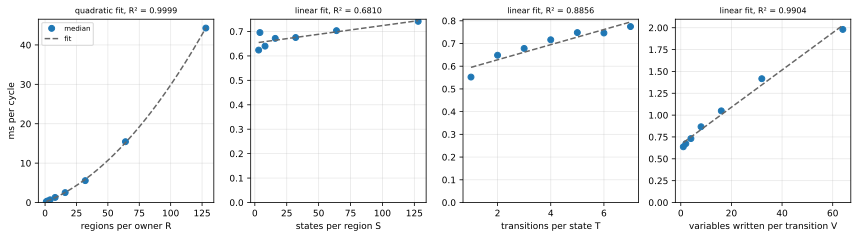
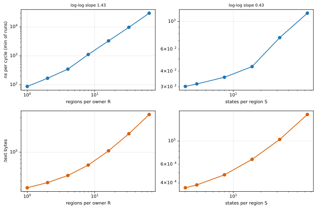
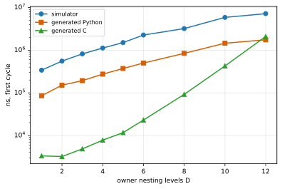
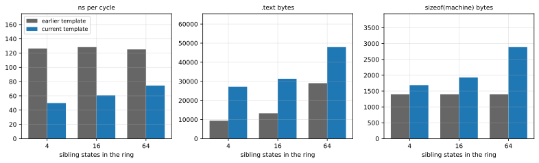

What regions cost in models, simulation and generated runtimes
==============================================================

A region lets one owner state run several ordered sub-machines in the same
cycle.  This page answers three questions that a modeler asks before choosing
regions: how much smaller is the model than the flat machine you would write
without them, how much does one cycle cost in the simulator and in generated
code, and how large can a model grow before it stops being practical.  It
reports exact counts where they can be derived, fitted curves where only a
curve can be given, and measurements where only a measurement exists, and it
marks which is which.  For the meaning of the execution order itself, read
:doc:`/explanations/region_semantics/index`; for the syntax, read
:doc:`/reference/region_model/index`.

Short answers
-------------

* **Model size.**  For regions that do not read each other, the region form
  has :math:`\sum S` leaf states and the flat machine has :math:`\prod S`.
  This is exact and is checked on 20 small models.  The saving is in the model,
  not in the time per cycle: in the simulator the flat machine was faster on
  17 of the 20 checked models and slower only where it has 3840 or more
  transitions.
* **Simulator.**  Time per cycle is dominated by the number of regions
  :math:`R`; the fit is quadratic with a small second-order term.  It does not
  depend on the states per region :math:`S`, grows slowly with the transitions
  per state :math:`T`, and is linear in the variables written :math:`V`.
  Nesting :math:`D` levels costs about :math:`D` times one level; the memo of
  the simulator keeps the first entry polynomial.
* **Generated Python.**  The generated runtime was 2.6 to 8.4 times faster than
  the simulator on the same models (median 5.0).  It is still far from what a
  hand-written specialisation would do (see the :ref:`known gap <region-perf-python>`).
* **Generated C.**  Time per cycle grows faster than linearly in :math:`R`
  (log-log slope 1.43 over :math:`R = 1..64`), the size of one machine grows
  almost quadratically (slope 1.9 between :math:`R = 16` and :math:`R = 64`),
  and the first cycle that enters nested owners grows by a factor of 2.0 to 2.2
  per level.  The capacity macros are exact functions of the model size.

How to read the numbers
-----------------------

Every statement below carries one of three labels.

.. list-table::
   :header-rows: 1
   :widths: 16 34 50

   * - Label
     - What it means
     - How to check it
   * - Exact
     - A formula derived from the definition, under stated assumptions.
     - Substitute small parameters and compare with the counts the tool prints.
       The page includes a script that does this on the public API.
   * - Fit
     - A least-squares curve through measured points, with its range and
       :math:`R^2`.  It describes the range that was measured and nothing else.
     - Re-fit :file:`data/e2.jsonl` and the other data files with
       ``python tools/measure_region_performance.py fit``.
   * - Measured
     - One number from one machine, one commit and one repeat count.
     - Rerun the tool.  Expect different absolute numbers on other hardware.

All measurements come from commit ``b054fbe3`` on an Intel Xeon Platinum 8581C
at 2.1 GHz with Python 3.11.15 and gcc 13.3.0 (``-O2 -std=c99``).  The machine
is shared with other users, and the pinning of every process to one core is
likewise stated here by the author: the data records carry no core field.
Simulator and Python figures are the median of 7
timed batches after a warm-up; C figures are the minimum of 7 runs; each
process is pinned to one core (self-reported).  The same model, ``R=4 S=8 T=2 D=1 V=1``, was
measured once in each sweep, which gives a noise estimate: the simulator
values differ by 7 %, the generated Python values by 2 % and the C values by
16 %.  Differences smaller than that are not findings.  The models are
synthetic, built by ``sweep_model`` in the tool; they are not a sample of real
projects.

Symbols
-------

.. list-table::
   :header-rows: 1
   :widths: 14 86

   * - Symbol
     - Meaning
   * - :math:`R`
     - Number of regions of one owner
   * - :math:`S`
     - Number of states of each region
   * - :math:`T`
     - Number of transitions of each state
   * - :math:`D`
     - Number of nested owner levels
   * - :math:`V`
     - Number of variables written by each transition
   * - :math:`k`
     - Step bound of bounded model checking (used on :doc:`/explanations/bmc_scaling/index`)
   * - :math:`N`
     - Number of leaf states of a machine without regions
   * - :math:`W`
     - Number of transitions with assignments (used on the bounded model checking pages)
   * - :math:`Q_{\mathrm{reg}}`, :math:`Q_{\mathrm{flat}}`
     - Leaf states of the region form and of the flat expansion
   * - :math:`M_{\mathrm{reg}}`, :math:`M_{\mathrm{flat}}`
     - Ordinary transitions (not counting initial transitions) of the two forms
   * - :math:`P`
     - Number of scopes of a model: all states, owners and root included, plus all regions

The flat expansion is an ordinary machine, so :math:`N = Q_{\mathrm{flat}}`
whenever the two are compared.

Model size: regions against the flat expansion
----------------------------------------------

The counts (exact)
~~~~~~~~~~~~~~~~~~

Take one owner with :math:`R` regions.  Region :math:`i` has :math:`S_i`
leaf states and every state of it has :math:`T_i` outgoing transitions.  The
transitions of one region are guarded by values that only that region reads,
and the guards of one state exclude each other.  Under these assumptions
(called independent regions here) the two forms have these sizes.

.. math::
   :label: region-perf-states

   Q_{\mathrm{reg}} = \sum_{i=1}^{R} S_i,
   \qquad
   Q_{\mathrm{flat}} = \prod_{i=1}^{R} S_i

.. math::
   :label: region-perf-transitions

   M_{\mathrm{reg}} = \sum_{i=1}^{R} S_i T_i,
   \qquad
   M_{\mathrm{flat}} = \Bigl(\prod_{i=1}^{R} S_i\Bigr)\Bigl(\prod_{i=1}^{R} (T_i + 1) - 1\Bigr)

The first line counts the states of every region once, and a flat machine needs
one state per tuple of region states.  In the second line, one cycle of the
region form lets every region either fire one of its :math:`T_i` transitions
or stay and run its ``during`` action, so a flat state needs one transition
for each of the :math:`\prod (T_i + 1)` outcomes.  The outcome in which every
region stays is the ``during`` of the flat state, not a transition, hence the
:math:`-1`.  With :math:`S_i = S` and :math:`T_i = T` the formulas become the
following.

.. math::
   :label: region-perf-uniform

   \frac{Q_{\mathrm{flat}}}{Q_{\mathrm{reg}}} = \frac{S^{R}}{R\,S},
   \qquad
   \frac{M_{\mathrm{flat}}}{M_{\mathrm{reg}}} = \frac{S^{R-1}\bigl((T+1)^{R} - 1\bigr)}{R\,T}

For :math:`R = 4`, :math:`S = 4` and :math:`T = 2`, equation
:eq:`region-perf-states` gives 16 and 256 leaf states and equation
:eq:`region-perf-transitions` gives 32 and 20480 transitions.  The
figure shows the same growth on a logarithmic axis.

.. figure:: fig_model_size_en.plot.py.svg
   :alt: Leaf states and transitions of the region form and of the flat expansion against the number of regions
   :align: center
   :width: 96%

   Leaf states (left) and transitions (right) for :math:`T = 1` and
   :math:`S = 2, 3, 4`.  Markers are counts read from the models that the tool
   generated; solid lines are :math:`R\,S` and :math:`R\,S\,T`, dashed lines are
   :math:`S^R` and :math:`S^R(2^R-1)`.  The y axis is logarithmic.  The figure
   proves that the region form grows linearly while the flat form grows
   exponentially under the stated assumptions; it proves nothing about regions
   that read each other.  Source: :file:`data/e1.jsonl`; counts are exact, no
   repeats are involved.

Checking the counts and the equivalence
~~~~~~~~~~~~~~~~~~~~~~~~~~~~~~~~~~~~~~~

The script below loads a region model and its flat expansion for
:math:`R = 2`, :math:`S = 3`, :math:`T = 1` through the public API, counts
leaf states and ordinary transitions, and runs both on the same 200 random
input vectors.

.. testcode::

   import random

   from pyfcstm.dsl import INIT_STATE
   from pyfcstm.model import load_state_machine_from_text
   from pyfcstm.simulate import SimulationRuntime

   def load(path):
       with open(path) as handle:
           return load_state_machine_from_text(handle.read())

   def size(model):
       states = list(model.walk_states())
       leaves = [s for s in states if s.is_leaf_state]
       owners = list(states)
       for state in states:
           owners += list(state.regions.values())
       transitions = [t for owner in owners for t in owner.transitions if t.from_state is not INIT_STATE]
       return len(leaves), len(transitions)

   def run(model, inputs):
       runtime = SimulationRuntime(model, input_source={"x0": 0, "x1": 0}, history_size=1)
       trace = []
       for values in inputs:
           runtime.cycle(inputs=values)
           trace.append(dict(runtime.vars))
       return trace

   regions = load("product_r2_s3.fcstm")
   flat = load("expanded_r2_s3.fcstm")
   print("regions: %d leaf states, %d transitions" % size(regions))
   print("flat:    %d leaf states, %d transitions" % size(flat))

   rng = random.Random(7)
   inputs = [{"x0": rng.randint(0, 1), "x1": rng.randint(0, 1)} for _ in range(200)]
   a, b = run(regions, inputs), run(flat, inputs)
   print("same variables after every one of %d cycles: %s" % (len(inputs), a == b))
   print("variables after the last cycle:", a[-1])

.. testoutput::

   regions: 6 leaf states, 6 transitions
   flat:    9 leaf states, 27 transitions
   same variables after every one of 200 cycles: True
   variables after the last cycle: {'c0': 96, 'u0': 200, 'c1': 92, 'u1': 200}

The two counts are 6 and 9 leaf states and 6 and 27 transitions, which equals
the formulas: :math:`2 \cdot 3 = 6`, :math:`3^2 = 9`, :math:`2 \cdot 3 \cdot 1 = 6` and :math:`3^2 (2^2 - 1) = 27`.  The variables ``c0``, ``u0``, ``c1`` and
``u1`` agree after every one of the 200 cycles.  This shows agreement on one
random sequence for one model; the full grid is in the next listing.

The two models are :file:`product_r2_s3.fcstm` (region form) and
:file:`expanded_r2_s3.fcstm` (flat form); the first is shown in full and the
second as its first 19 lines, which hold the nine states and the first
transitions.

.. literalinclude:: product_r2_s3.fcstm
   :language: fcstm
   :caption: product_r2_s3.fcstm

.. literalinclude:: expanded_r2_s3.fcstm
   :language: fcstm
   :caption: expanded_r2_s3.fcstm (first 19 lines of 45)
   :lines: 1-19

Recorded values of the measurement of the 20 grid points, printed from the committed data file :file:`data/e1.jsonl`. They are not rerun by the documentation check, because the timing columns depend on the machine; the machine, commit and repetition counts are the first lines of the record.

.. code-block:: text
   :caption: Recorded from data/e1.jsonl

   measured on: b054fbe3 | INTEL(R) XEON(R) PLATINUM 8581C CPU @ 2.10GHz | Python 3.11.15
   each pair was run for 200 cycles on 5 random input sequences; timing is the median of 5 batches

    R  S  T | leaf states        | transitions            | formula | same vars | ms per cycle
            |  regions    flat   |  regions        flat   | matches |           |  regions   flat
    1  2  1 |        2       2   |        2           2   | True    | True      |    0.18    0.13
    2  2  1 |        4       4   |        4          12   | True    | True      |    0.34    0.20
    3  2  1 |        6       8   |        6          56   | True    | True      |    0.59    0.32
    4  2  1 |        8      16   |        8         240   | True    | True      |    0.66    0.39
    1  3  1 |        3       3   |        3           3   | True    | True      |    0.18    0.13
    2  3  1 |        6       9   |        6          27   | True    | True      |    0.32    0.19
    3  3  1 |        9      27   |        9         189   | True    | True      |    0.49    0.26
    4  3  1 |       12      81   |       12        1215   | True    | True      |    0.75    0.45
    1  4  1 |        4       4   |        4           4   | True    | True      |    0.18    0.13
    2  4  1 |        8      16   |        8          48   | True    | True      |    0.35    0.20
    3  4  1 |       12      64   |       12         448   | True    | True      |    0.50    0.33
    4  4  1 |       16     256   |       16        3840   | True    | True      |    0.66    1.59
    1  3  2 |        3       3   |        6           6   | True    | True      |    0.20    0.14
    2  3  2 |        6       9   |       12          72   | True    | True      |    0.37    0.22
    3  3  2 |        9      27   |       18         702   | True    | True      |    0.57    0.40
    4  3  2 |       12      81   |       24        6480   | True    | True      |    0.76    2.90
    1  4  2 |        4       4   |        8           8   | True    | True      |    0.20    0.15
    2  4  2 |        8      16   |       16         128   | True    | True      |    0.39    0.23
    3  4  2 |       12      64   |       24        1664   | True    | True      |    0.58    0.47
    4  4  2 |       16     256   |       32       20480   | True    | True      |    0.78    8.06

   coupled models (leaf states, transitions):
     regions_reader_after_writer    3, 2
     regions_reader_before_writer   3, 2
     flat_naive                     2, 2
     flat_substituted               2, 2

   cycles with different variables, out of 1000 compared:
     regions_reader_before_writer   vs regions_reader_after_writer     600 (first at cycle: 1)
     flat_naive                     vs regions_reader_after_writer     600 (first at cycle: 1)
     flat_substituted               vs regions_reader_after_writer       0 (first at cycle: none)
     flat_naive                     vs regions_reader_before_writer      0 (first at cycle: none)
     flat_substituted               vs regions_reader_before_writer    600 (first at cycle: 1)

All 20 grid points match the formulas, and all 20 pairs gave the same
variables after every cycle on 5 random sequences of 200 cycles each.  The
last two columns show the cost: **the region form is not faster per cycle than
the flat form until the flat form has thousands of transitions.**  At
:math:`R = 2`, :math:`S = 3`, :math:`T = 1` the region form takes 0.32 ms and
the flat form 0.19 ms; at :math:`R = 4`, :math:`S = 4`, :math:`T = 1` (3840
flat transitions) the order flips, 0.66 ms against 1.59 ms, and at
:math:`R = 4`, :math:`S = 4`, :math:`T = 2` (20480 flat transitions) it is 0.78
ms against 8.06 ms.  The flat form has to test :math:`\prod (T_i+1) - 1` transitions per state and
the region form carries overhead per region (inference from the counts; the
simulator was not profiled for this comparison).  Nobody writes a 20480-transition machine by hand, which
is the practical meaning of the size saving.

When the regions read each other
~~~~~~~~~~~~~~~~~~~~~~~~~~~~~~~~

Equations :eq:`region-perf-states` to :eq:`region-perf-uniform` need
independent regions.  If a later region reads a variable that an earlier
region writes in the same cycle, the later region sees the new value, and a
flat machine whose guards are evaluated at the start of the cycle does not
reproduce that.  The next script uses four small models: region ``W`` writes
``p = x0`` in its ``during`` action, region ``V`` switches on ``p``, and the
two region forms differ in which region is written first.  The flat forms are
the naive expansion (the guard reads ``p``) and the expansion with the
guard rewritten to read ``x0``, which is what ``W`` writes.

.. testcode::

   import random

   from pyfcstm.model import load_state_machine_from_text
   from pyfcstm.simulate import SimulationRuntime

   def run(label, inputs):
       with open("coupled_%s.fcstm" % label) as handle:
           model = load_state_machine_from_text(handle.read())
       runtime = SimulationRuntime(model, input_source={"x0": 0}, history_size=1)
       trace = []
       for value in inputs:
           runtime.cycle(inputs={"x0": value})
           trace.append((runtime.vars["c"], runtime.vars["d"]))
       return trace

   rng = random.Random(3)
   inputs = [rng.randint(0, 1) for _ in range(200)]
   labels = ["regions_reader_after_writer", "regions_reader_before_writer", "flat_naive", "flat_substituted"]
   traces = {label: run(label, inputs) for label in labels}

   print("x0 :", " ".join(str(v) for v in inputs[:8]))
   for label in labels:
       print("%-30s c after cycles 1-8: %s" % (label, " ".join(str(c) for c, _ in traces[label][:8])))
   pairs = [
       ("regions_reader_before_writer", "regions_reader_after_writer"),
       ("flat_naive", "regions_reader_after_writer"),
       ("flat_substituted", "regions_reader_after_writer"),
       ("flat_naive", "regions_reader_before_writer"),
   ]
   for left, right in pairs:
       differing = sum(1 for x, y in zip(traces[left], traces[right]) if x != y)
       print("%-30s differs from %-30s in %3d of 200 cycles" % (left, right, differing))

.. testoutput::

   x0 : 0 0 1 1 0 0 1 1
   regions_reader_after_writer    c after cycles 1-8: 0 0 1 1 2 2 3 3
   regions_reader_before_writer   c after cycles 1-8: 0 0 0 1 1 2 2 3
   flat_naive                     c after cycles 1-8: 0 0 0 1 1 2 2 3
   flat_substituted               c after cycles 1-8: 0 0 1 1 2 2 3 3
   regions_reader_before_writer   differs from regions_reader_after_writer    in  97 of 200 cycles
   flat_naive                     differs from regions_reader_after_writer    in  97 of 200 cycles
   flat_substituted               differs from regions_reader_after_writer    in   0 of 200 cycles
   flat_naive                     differs from regions_reader_before_writer   in   0 of 200 cycles

Read the output this way.

* ``regions_reader_after_writer`` and ``flat_naive`` differ in 97 of 200
  cycles: the naive flat machine is one cycle late, because its guard reads the
  value of ``p`` from the previous cycle.
* ``regions_reader_before_writer`` equals ``flat_naive`` in all 200 cycles:
  when the reader is declared before the writer, it also reads the old value,
  and no rewriting is needed.
* ``flat_substituted`` equals ``regions_reader_after_writer`` in all 200
  cycles: replacing ``p`` in the guard by what ``W`` assigns restores
  equivalence.  The data file records the same on 1000 cycles (600 differing
  cycles for each of the three inequivalent pairs, 0 for each of the two equal
  pairs).

The conclusion is limited.  A flat expansion exists for this pair, and the
guard stays small because ``W`` assigns a single input.  What the experiment
does not show is how large the rewritten guards become when the writer
computes a long expression or when several regions form a chain of readers;
the tool does not measure that, and the size would grow with the substituted
expressions (inference, not measured).  The models are in
:file:`coupled_regions_reader_after_writer.fcstm`,
:file:`coupled_regions_reader_before_writer.fcstm`,
:file:`coupled_flat_naive.fcstm` and :file:`coupled_flat_substituted.fcstm`.

Simulator cost per cycle
------------------------

What was measured
~~~~~~~~~~~~~~~~~

The tool generates one family of models (``sweep_model``): ``D`` nested owners,
every owner has ``R`` regions, a ring region has ``S`` states, each state has
``T`` outgoing transitions guarded by ``a == 1`` to ``a == T`` and every
transition writes ``V`` variables.  One parameter changes at a time around the
base ``R=4 S=8 T=2 D=1 V=1``.  The input ``a`` follows a fixed pseudo-random
sequence, so about :math:`T/(T+1)` of the cycles fire a transition.  The
simulator runs with ``history_size=1`` so that the history does not grow.  The
small model below shows the shape; :file:`sweep_r2_s3_t1.fcstm` is
``R=2 S=3 T=1 D=1 V=1``.

.. literalinclude:: sweep_r2_s3_t1.fcstm
   :language: fcstm
   :caption: sweep_r2_s3_t1.fcstm

Recorded values of the simulator measurements, printed from the committed data files :file:`data/e2.jsonl` and :file:`data/fits.json`. They are not rerun by the documentation check, because they depend on the machine that measured them; the first lines of the record give the machine, the commit and the batch counts.

.. code-block:: text
   :caption: Recorded from data/e2.jsonl

   measured on: commit b054fbe3; INTEL(R) XEON(R) PLATINUM 8581C CPU @ 2.10GHz; Python 3.11.15
   each point: median of 7 timed batches after a warm-up; first cycle: minimum of fresh runs
   base model: R=4 S=8 T=2 D=1 V=1; one parameter changes per sweep

   R sweep (R): us per cycle / first cycle us
     R=1: 234/500  R=2: 395/618  R=4: 683/1044  R=8: 1284/1964  R=16: 2511/3476  R=32: 5552/7551  R=64: 15436/18297  R=128: 44288/49382
     linear R2 0.9711, slope 338.645 us per unit | quadratic R2 0.9999, x^2 term 1.7141 us | power exponent 1.06 (R2 0.982)

   S sweep (S): us per cycle / first cycle us
     S=3: 624/889  S=4: 696/1051  S=8: 640/877  S=16: 672/1157  S=32: 675/951  S=64: 703/1036  S=128: 741/1209
     linear R2 0.6810, slope 0.714 us per unit | quadratic R2 0.6851, x^2 term -0.0017 us | power exponent 0.03 (R2 0.589)

   T sweep (T): us per cycle / first cycle us
     T=1: 552/895  T=2: 648/911  T=3: 678/902  T=4: 716/1069  T=5: 748/1056  T=6: 746/917  T=7: 775/907
     linear R2 0.8856, slope 33.297 us per unit | quadratic R2 0.9741, x^2 term -6.0759 us | power exponent 0.17 (R2 0.979)

   V sweep (V): us per cycle / first cycle us
     V=1: 637/916  V=2: 674/1229  V=4: 731/981  V=8: 867/1080  V=16: 1049/1202  V=32: 1417/1453  V=64: 1981/1957
     linear R2 0.9904, slope 21.310 us per unit | quadratic R2 0.9995, x^2 term -0.1211 us | power exponent 0.27 (R2 0.927)

   D_chain sweep (D): us per cycle / first cycle us
     D=1: 212/340  D=2: 262/556  D=3: 316/821  D=4: 361/1125  D=5: 435/1510  D=6: 494/2271  D=8: 595/3214  D=10: 763/5884  D=12: 931/7201
     linear R2 0.9901, slope 64.293 us per unit | quadratic R2 0.9982, x^2 term 1.8475 us | power exponent 0.60 (R2 0.950)

   D_branch sweep (D): us per cycle / first cycle us
     D=1: 354/510  D=2: 559/1004  D=3: 781/2120  D=4: 1000/2427  D=5: 1255/3279  D=6: 1514/4464  D=8: 2091/7589  D=10: 2899/11585  D=12: 3543/17332
     linear R2 0.9881, slope 291.746 us per unit | quadratic R2 0.9989, x^2 term 9.7317 us | power exponent 0.94 (R2 0.982)

Fits
~~~~

   Median time per cycle of ``SimulationRuntime.cycle`` against :math:`R`,
   :math:`S`, :math:`T` and :math:`V`.  Axes are linear and start at zero;
   dashed lines are the fits named in each title.  Each point is the median of 7
   batches of at least 20 cycles after 50 warm-up cycles.  The figure proves
   that :math:`S` has almost no effect (the points stay within 0.62 to 0.74 ms
   over a 43-fold change) while :math:`R` and :math:`V` do.  Source:
   :file:`data/e2.jsonl`.

The fits in equation :eq:`region-perf-sim-fit` are Fit statements and hold
for the measured ranges, :math:`R = 1..128` and :math:`V = 1..64`, at the base
model.

.. math::
   :label: region-perf-sim-fit

   t_{\mathrm{sim}}(R) \approx 96 + 126\,R + 1.71\,R^{2}\ \mu\mathrm{s}
   \quad (R^2 = 0.9999),
   \qquad
   t_{\mathrm{sim}}(V) \approx 664 + 21.3\,V\ \mu\mathrm{s}
   \quad (R^2 = 0.990)

Read these as follows.

* The first term shows a per-region cost of about 126 µs at small
  :math:`R`, and the quadratic term adds 1.71 µs per region squared; at
  :math:`R = 128` the quadratic part is 28 ms of the measured 44 ms.  A purely
  linear fit has :math:`R^2 = 0.971` and misses the curvature.
* The quadratic term is measured; the cause is not.  The memoisation key of the
  simulator is built from the whole configuration, so a larger configuration
  makes every check more expensive (inference from reading
  :file:`pyfcstm/simulate/runtime.py`; it was not profiled).
* The per-transition effect :math:`T` is small: 33 µs per additional
  transition per state, linear :math:`R^2 = 0.886`, so treat it as "weak" and
  not as a rate.
* The two forms of growth can be added in a rough estimate, but the tool varies
  one parameter at a time, so interactions (for example :math:`R` and :math:`V`
  together) are not measured.

Nesting depth and memoisation
~~~~~~~~~~~~~~~~~~~~~~~~~~~~~

The simulator entering a chain of nested owners decides at every level whether
a candidate can reach a stable position, and an enclosing level asks the same
question again.  The simulator remembers each answer for the rest of the cycle
(``_memo_get`` and ``_memo_put`` in :file:`pyfcstm/simulate/runtime.py`), so
the question is paid for once.  The claim to test is that nesting does not make
the first entry exponential.

.. figure:: fig_depth_en.plot.py.svg
   :alt: Simulator time per cycle and first-cycle time against the number of nested owner levels
   :align: center
   :width: 96%

   Left: steady time per cycle against :math:`D`.  Right: time of the first cycle
   (the cycle that enters every owner) against :math:`D`.  Both y axes are
   logarithmic.  ``R=1`` is a pure chain of owners; ``R=2`` has a nested region
   and a ring region at every level.  Steady: median of 7 batches; first cycle:
   minimum of 5 fresh runtimes.  The figure proves that the first entry grows
   polynomially in this family: from :math:`D = 1` to :math:`D = 12` the chain's
   first cycle grows from 340 µs to 7.2 ms, a factor of 21, while the
   exponential alternative would be a factor of about 2000.  Source:
   :file:`data/e2.jsonl`.

The steady time fits :math:`174 + 40\,D + 1.85\,D^{2}` µs for the chain
(:math:`R^2 = 0.998`, :math:`D = 1..12`).  The data support "memoisation keeps
the first entry polynomial in this family"; they do not show that no model can
make it exponential.

.. _region-perf-python:

Generated Python runtime
------------------------

This experiment generates the Python runtime of every
sweep model with ``pyfcstm generate --template python`` and times
``cycle(inputs=...)`` on the same input sequence.

Recorded values of the generated Python measurements, printed from :file:`data/e2.jsonl`, :file:`data/e3.jsonl` and :file:`data/fits.json`. They are not rerun by the documentation check, because they depend on the machine that measured them.

.. code-block:: text
   :caption: Recorded from data/e2.jsonl and data/e3.jsonl

   measured on: commit b054fbe3; INTEL(R) XEON(R) PLATINUM 8581C CPU @ 2.10GHz; Python 3.11.15
   each point: median of 7 timed batches; same models and same input sequence as the simulator

   R sweep (R): generated Python us per cycle, and simulator/generated ratio
     R=1: 40 (5.8x)  R=2: 69 (5.7x)  R=4: 131 (5.2x)  R=8: 273 (4.7x)  R=16: 614 (4.1x)  R=32: 1458 (3.8x)  R=64: 4800 (3.2x)  R=128: 17081 (2.6x)
     linear R2 0.9448 | quadratic R2 1.0000, x^2 term 0.9177 us
   S sweep (S): generated Python us per cycle, and simulator/generated ratio
     S=3: 127 (4.9x)  S=4: 134 (5.2x)  S=8: 130 (4.9x)  S=16: 135 (5.0x)  S=32: 132 (5.1x)  S=64: 135 (5.2x)  S=128: 133 (5.6x)
     linear R2 0.1552 | quadratic R2 0.3437, x^2 term -0.0008 us
   T sweep (T): generated Python us per cycle, and simulator/generated ratio
     T=1: 108 (5.1x)  T=2: 129 (5.0x)  T=3: 141 (4.8x)  T=4: 150 (4.8x)  T=5: 153 (4.9x)  T=6: 158 (4.7x)  T=7: 167 (4.6x)
     linear R2 0.9121 | quadratic R2 0.9746, x^2 term -1.3360 us
   V sweep (V): generated Python us per cycle, and simulator/generated ratio
     V=1: 129 (4.9x)  V=2: 140 (4.8x)  V=4: 145 (5.0x)  V=8: 173 (5.0x)  V=16: 222 (4.7x)  V=32: 303 (4.7x)  V=64: 478 (4.1x)
     linear R2 0.9992 | quadratic R2 0.9994, x^2 term -0.0050 us
   D_chain sweep (D): generated Python us per cycle, and simulator/generated ratio
     D=1: 40 (5.3x)  D=2: 45 (5.8x)  D=3: 53 (6.0x)  D=4: 62 (5.8x)  D=5: 68 (6.4x)  D=6: 72 (6.8x)  D=8: 86 (6.9x)  D=10: 96 (8.0x)  D=12: 111 (8.4x)
     linear R2 0.9965 | quadratic R2 0.9973, x^2 term -0.0545 us
   D_branch sweep (D): generated Python us per cycle, and simulator/generated ratio
     D=1: 71 (5.0x)  D=2: 111 (5.0x)  D=3: 153 (5.1x)  D=4: 197 (5.1x)  D=5: 241 (5.2x)  D=6: 302 (5.0x)  D=8: 413 (5.1x)  D=10: 536 (5.4x)  D=12: 688 (5.1x)
     linear R2 0.9896 | quadratic R2 0.9998, x^2 term 1.7943 us

   ratio over all 47 points: median 5.0, min 2.6, max 8.4
   final variables equal to the simulator's after 1024 cycles: 47 of 47 points

   generated machine.py bytes and import ms, by R:
     R=1: 136721 bytes, 14.5 ms
     R=2: 190883 bytes, 20.8 ms
     R=4: 299207 bytes, 25.4 ms
     R=8: 516083 bytes, 43.5 ms
     R=16: 951907 bytes, 76.6 ms
     R=32: 1825459 bytes, 142.7 ms
     R=64: 3573103 bytes, 340.8 ms
     R=128: 7079885 bytes, 912.8 ms

.. figure:: fig_python_vs_simulator_en.plot.py.svg
   :alt: Generated Python and simulator time per cycle on the same sweeps
   :align: center
   :width: 100%

   Time per cycle of the simulator and of the generated Python runtime on the
   same models.  The y axis is logarithmic; :math:`R`, :math:`S` and :math:`V`
   are on logarithmic x axes.  Medians of 7 batches.  The figure proves that
   the generated runtime has the same shape as the simulator and is faster by a
   roughly constant factor, with the factor shrinking from 5.8 to 2.6 as
   :math:`R` grows from 1 to 128.  Source: :file:`data/e2.jsonl` and
   :file:`data/e3.jsonl`.

* The generated runtime is faster in all 47 points (2.6 to 8.4 times, median
  5.0) and its variables equal the simulator's after 1024 cycles in all 47.
* The quadratic term is smaller than the simulator's but present:
  :math:`58 + 15.5\,R + 0.918\,R^{2}` µs (:math:`R^2 = 1.000`, :math:`R = 1..128`).
* The generated ``machine.py`` grows with the model: 137 KB at :math:`R = 1`,
  3.6 MB at :math:`R = 64` and 7.1 MB at :math:`R = 128`, and importing it takes
  15 ms, 341 ms and 913 ms.  A model with hundreds of regions is therefore a
  deployment cost before it is a cycle cost.
* Nesting is cheap here: the chain's first cycle is 86 µs at :math:`D = 1` and
  1.75 ms at :math:`D = 12`.

The known gap is `issue #596 <https://github.com/HansBug/pyfcstm/issues/596>`_:
the generated module still carries a general frame-stack interpreter and the
two-stage "try on a copy, then run" structure.  The issue reports a
hand-written specialisation of the six-state ring that it profiles at about
2.98 million cycles per second, against about 11 thousand for the template on
that ring; those figures come from the issue and were not remeasured here.  The numbers on this
page therefore describe today's generator and will improve when the issue is
addressed.

Generated C runtime
-------------------

Time per cycle
~~~~~~~~~~~~~~

The C measurements use the same models, ``gcc -O2 -std=c99``, one pinned core,
the minimum of 7 runs of 2000 or more cycles (the driver picks the count so
that a run lasts about 0.25 s), and the same input sequence from a table in the
driver.

Recorded values of the generated C measurements, printed from :file:`data/e2.jsonl` to :file:`data/e4.jsonl` and :file:`data/e4_baseline.jsonl`. They are not rerun by the documentation check: the measurement needs a C compiler, one pinned core and about an hour, and the numbers depend on the machine that measured them.

.. code-block:: text
   :caption: Recorded from data/e4.jsonl and data/e4_baseline.jsonl

   measured on: commit b054fbe3; INTEL(R) XEON(R) PLATINUM 8581C CPU @ 2.10GHz; Python 3.11.15; gcc (Ubuntu 13.3.0-6ubuntu2~24.04.1) 13.3.0 (-O2 -std=c99, pinned to one core)
   each point: minimum of 7 runs of 2000+ cycles

   R sweep (R): ns per cycle | .text bytes | sizeof bytes | first cycle us
     R=1       87.7 |   32329 |     14968 |       3.1
     R=2      168.1 |   38060 |     33800 |       2.8
     R=4      347.1 |   47748 |     92200 |       4.6
     R=8     1109.2 |   66428 |    284824 |       6.7
     R=16    3279.9 |  104560 |    981112 |      11.1
     R=32    9660.6 |  179976 |   3617848 |      21.4
     R=64   29617.3 |  331616 |  13867960 |      52.0
     power exponent of ns per cycle 1.43 (R2 0.991); quadratic R2 0.9999; linear R2 0.967

   S sweep (S): ns per cycle | .text bytes | sizeof bytes | first cycle us
     S=3      302.4 |   35961 |     35800 |       4.3
     S=4      316.8 |   38264 |     45544 |       4.5
     S=8      358.1 |   47748 |     92200 |       4.8
     S=16     435.7 |   66938 |    222376 |       5.2
     S=32     742.9 |  103506 |    630184 |       5.7
     S=64    1165.5 |  178514 |   2035624 |       7.1
     power exponent of ns per cycle 0.43 (R2 0.923); quadratic R2 0.9944; linear R2 0.994

   T sweep (T): ns per cycle | .text bytes | sizeof bytes | first cycle us
     T=1      347.0 |   42020 |     92200 |       5.4
     T=2      402.5 |   47748 |     92200 |       5.3
     T=3      416.9 |   53604 |     92200 |       5.6
     T=4      513.3 |   59460 |     92200 |       5.9
     T=5      474.5 |   65060 |     92200 |       5.9
     T=6      502.7 |   70660 |     92200 |       4.8
     T=7      486.5 |   76772 |     92200 |       5.0
     power exponent of ns per cycle 0.19 (R2 0.862); quadratic R2 0.8854; linear R2 0.721

   V sweep (V): ns per cycle | .text bytes | sizeof bytes | first cycle us
     V=1      365.7 |   47748 |     92200 |       4.7
     V=2      332.7 |   50916 |     95864 |       4.7
     V=4      326.4 |   55852 |    103192 |       4.8
     V=8      347.0 |   65884 |    117848 |       4.7
     V=16     525.0 |   84450 |    147160 |       4.9
     V=32     543.6 |  110602 |    205784 |       5.3
     V=64     576.1 |  177138 |    323032 |       5.0
     power exponent of ns per cycle 0.15 (R2 0.729); quadratic R2 0.8806; linear R2 0.724

   D_chain sweep (D): ns per cycle | .text bytes | sizeof bytes | first cycle us
     D=1       86.6 |   32329 |     14968 |       3.3
     D=2      132.2 |   34171 |     19960 |       3.2
     D=3      199.7 |   35181 |     25720 |       4.8
     D=4      247.2 |   36404 |     32248 |       7.8
     D=5      307.8 |   37554 |     39544 |      11.7
     D=6      409.6 |   38782 |     47608 |      23.0
     D=8      605.4 |   41670 |     66040 |      92.2
     D=10     813.6 |   44230 |     87544 |     427.1
     D=12    1176.6 |   47498 |    112120 |    2093.5
     power exponent of ns per cycle 1.05 (R2 0.966); quadratic R2 0.9973; linear R2 0.959

   the base model R=4 S=8 T=2 D=1 V=1 appears in several sweeps; its ns per cycle:
     347.1 358.1 402.5 365.7  (spread 16%)

   generated Python / generated C time per cycle, same model:
     R sweep: median 246x, min 151x, max 459x
     S sweep: median 337x, min 116x, max 423x
     T sweep: median 321x, min 293x, max 343x
     V sweep: median 445x, min 353x, max 830x

   default capacity macros against the model size (scopes = all states + regions):
     63 models: ARENA_CAPACITY == max(24, 12*scopes) in 63, TRAIL_CAPACITY == 16 + 4*scopes in 63
     D=1 S=8 R=1  scopes=11   ARENA_CAPACITY=132    TRAIL_CAPACITY=60
     D=4 S=8 R=1  scopes=17   ARENA_CAPACITY=204    TRAIL_CAPACITY=84
     D=1 S=8 R=8  scopes=74   ARENA_CAPACITY=888    TRAIL_CAPACITY=312
     D=4 S=8 R=8  scopes=269  ARENA_CAPACITY=3228   TRAIL_CAPACITY=1092
     D=1 S=8 R=64 scopes=578  ARENA_CAPACITY=6936   TRAIL_CAPACITY=2328
     D=4 S=8 R=64 scopes=2285 ARENA_CAPACITY=27420  TRAIL_CAPACITY=9156

   region-free ring, earlier template vs current template:
     n=4   ns/cycle  126.4 ->   49.9 | .text   9377 ->  27156 | sizeof  1400 ->  1688
     n=16  ns/cycle  128.4 ->   60.6 | .text  13267 ->  31342 | sizeof  1400 ->  1928
     n=64  ns/cycle  125.1 ->   74.4 | .text  29027 ->  47918 | sizeof  1400 ->  2888

   Time per cycle (top) and :file:`.text` bytes (bottom) of the generated C
   against :math:`R` (left) and :math:`S` (right).  All axes are logarithmic.
   Minimum of 7 runs.  The figure proves that time grows faster than linearly
   in :math:`R` (slope 1.43, :math:`R = 1..64`; the last doubling alone gives
   slope 1.6) and that, unlike the simulator and the generated Python, C time
   depends on :math:`S` (302 ns at :math:`S = 3`, 1166 ns at :math:`S = 64`).
   Source: :file:`data/e4.jsonl`.

* Fit: :math:`-207 + 142\,R + 5.07\,R^{2}` ns, :math:`R^2 = 0.9999`,
  :math:`R = 1..64`.  The negative constant means the fit must not be used below
  :math:`R = 1` or far outside the range.
* Against the generated Python on the same models, C is 246 times faster
  (median over the :math:`R` sweep; 151 to 459), 337 times over :math:`S`, 321
  over :math:`T` and 445 over :math:`V`.
* :math:`T` shows a visible rise beyond the noise estimate of 16 % (347 ns at
  :math:`T = 1`, 513 ns at :math:`T = 4`, 487 ns at :math:`T = 7`, about 40 to
  48 % more; the power-law fit has exponent 0.19 and :math:`R^2 = 0.86`), so no
  rate is given.  :math:`V` stays within the noise estimate up to :math:`V = 8`
  (326 to 366 ns) and rises from :math:`V = 16` (525 to 576 ns); no rate is
  given for it either.

Code size, RAM and capacity macros
~~~~~~~~~~~~~~~~~~~~~~~~~~~~~~~~~~

The default capacities are functions of the model size, readable in
``_plan_capacity`` in :file:`pyfcstm/render/c_kernel.py`.  With :math:`|Q|` the
number of states (root and owners included) and :math:`|\mathcal{R}|` the
number of regions, let :math:`P = |Q| + |\mathcal{R}|`.  Equation
:eq:`region-perf-capacity` gives the two defaults.

.. math::
   :label: region-perf-capacity

   \mathtt{ARENA\_CAPACITY} = \max(24,\ 12\,P),
   \qquad
   \mathtt{TRAIL\_CAPACITY} = 16 + 4\,P

The generator uses 8 and 4 instead for a model without regions and pseudo
states whose states are all leaves or the root.  The equations hold exactly
for all 63 models of the capacity grid (the listing above prints the counts).
:math:`P` is linear in :math:`R`, :math:`S` and :math:`D`, so the two macros
are too.  The storage of one machine, ``STORAGE_BYTES``, is the sum of a fixed part,
a configuration entry per arena slot and a smaller entry per trail slot, and
one configuration entry itself grows with :math:`P` (``context_size`` in the
same file; inference from reading it).  The measured size therefore grows
almost quadratically.

.. figure:: fig_c_capacity_en.plot.py.svg
   :alt: Capacity macros and size of one generated C machine against model size
   :align: center
   :width: 100%

   Left: ``ARENA_CAPACITY`` against the number of regions in the model for
   :math:`D = 1, 2, 4` (:math:`S = 8`).  Middle: ``TRAIL_CAPACITY`` against
   :math:`R` for :math:`S = 3, 8, 32`.  Right: ``sizeof`` of one machine in KiB
   against :math:`R`.  All axes are logarithmic.  The values are read from
   the generated header and from the compiled driver; no repeats are involved.
   The figure proves that capacities are linear in model size while ``sizeof``
   has slope 1.9 between :math:`R = 16` and :math:`R = 64`: 0.94 MiB at
   :math:`R = 16`, 3.5 MiB at :math:`R = 32` and 13.2 MiB at :math:`R = 64`.
   The slope of a size is a Fit; the capacity equations are exact.

Consequences for a deployment:

* One machine with 4 regions of 8 states is 90 KiB; with 8 regions it is 278 KiB;
  with 16 regions it is 958 KiB.  Keep large machines in static storage or on the
  heap, and read ``sizeof`` before placing one.
* The default capacities are derived from model size, not from a proven bound
  on the work of one cycle.  A machine whose defaults are too small reports the
  named macro in the error and is rebuilt with a larger value; a machine whose
  defaults are larger than needed pays for the difference in RAM.  Issue
  `#598 <https://github.com/HansBug/pyfcstm/issues/598>`_ reports that the
  default is far above the measured need on random region models (median
  about 44 times, one model below it); this page did not remeasure that.
* How to set the macros is in :doc:`/how_to/generation/index`.

First entry of nested owners
~~~~~~~~~~~~~~~~~~~~~~~~~~~~

   Time of the first cycle (the cycle that enters every nested owner) of the
   ``R=1`` chain against :math:`D` for the three engines.  The y axis is
   logarithmic.  Simulator and Python: minimum of 5 fresh runs; C: minimum of 7
   runs.  The figure proves that the C runtime has no memo: its first cycle is
   3.3 µs at :math:`D = 1` and 2.1 ms at :math:`D = 12`, a factor of 2.0 to 2.2
   per level (4.6 from :math:`D = 8` to 10 and 4.9 from 10 to 12).  At
   :math:`D = 12` it is slower than the generated Python (1.7 ms).  Source:
   :file:`data/e2.jsonl`, :file:`data/e3.jsonl` and :file:`data/e4.jsonl`.

Later cycles are unaffected: the steady time of the same C chain is 87 ns at
:math:`D = 1` and 1177 ns at :math:`D = 12`.  The cost is paid when the machine
enters the owners, and an application that enters them once at start-up and
never leaves can accept it.  Reentering a nested owner repeatedly would pay it
again; the sweep did not measure that case.

Against the template before regions
~~~~~~~~~~~~~~~~~~~~~~~~~~~~~~~~~~~

   Time per cycle, :file:`.text` and ``sizeof`` of the ``c`` template before
   regions (commit ``ab9cae94``) and the current one on a region-free ring of 4,
   16 and 64 sibling states.  Minimum of 7 runs, same compiler flags.  The
   figure proves that region-free models run 1.7 to 2.5 times faster
   (125 to 128 ns against 50 to 74 ns) and pay for it in code size (:file:`.text`
   9.4 KB to 27.2 KB at 4 states) and RAM (1400 to 1688 bytes).  It says
   nothing about models with other structure; `issue #598
   <https://github.com/HansBug/pyfcstm/issues/598>`_ lists the families where
   the new template is slower, which were not remeasured here.  Source:
   :file:`data/e4_baseline.jsonl`.

Summary
-------

.. list-table::
   :header-rows: 1
   :widths: 18 16 30 36

   * - Stage
     - Label
     - Grows with
     - Measured range
   * - Model size
     - Exact
     - Regions: sum of :math:`S`; flat: product of :math:`S`
     - 6 and 9 leaf states at :math:`R = 2, S = 3`; 16 and 256 at :math:`R = 4, S = 4`
   * - Simulator, per cycle
     - Fit
     - :math:`R` (quadratic), :math:`V` (linear); not :math:`S`
     - 234 µs at :math:`R = 1`, 44 ms at :math:`R = 128`; 637 µs to 1.98 ms for :math:`V = 1..64`
   * - Simulator, nesting
     - Fit
     - :math:`D` (quadratic, memoised)
     - First cycle 340 µs to 7.2 ms for :math:`D = 1..12` (chain)
   * - Generated Python, per cycle
     - Fit
     - :math:`R` (quadratic), :math:`V`; not :math:`S`
     - 40 µs at :math:`R = 1`, 17 ms at :math:`R = 128`; 5.0 times faster than the simulator
   * - Generated Python, size
     - Measured
     - :math:`R`, :math:`S` (linear in states)
     - 137 KB at :math:`R = 1`, 7.1 MB and 913 ms import at :math:`R = 128`
   * - Generated C, per cycle
     - Fit
     - :math:`R` (slope 1.43), :math:`S`
     - 88 ns at :math:`R = 1`, 29.6 µs at :math:`R = 64`
   * - Generated C, RAM
     - Exact (macros), Fit (size)
     - :math:`P` (macros), almost :math:`P^2` (size)
     - 15 KB at :math:`R = 1`, 13.2 MiB at :math:`R = 64`
   * - Generated C, nesting
     - Measured
     - :math:`D`, 2.0 to 2.2 times per level on the first cycle
     - 3.3 µs at :math:`D = 1`, 2.1 ms at :math:`D = 12`

Advice for modelers
-------------------

* **Choose regions for the model, not for speed.**  With independent regions
  the model text stays linear in :math:`R` while the flat machine is exponential
  (:eq:`region-perf-uniform`).  A hand-written flat machine of the same
  behaviour was faster per cycle in the simulator up to 1664
  transitions (17 of 20 checked models), so regions do not save simulator time.
* **Regions that read each other keep their order.**  A later region that reads
  what an earlier one wrote sees the new value (one cycle earlier than the
  reverse order).  A flat rewrite has to substitute the writes into the guards,
  so the saving in model size is smaller than equation
  :eq:`region-perf-uniform` suggests, and the rewritten form must be rechecked.
* **Count scopes before choosing a C target.**  RAM is almost quadratic in
  :math:`P`; with the default capacities 16 regions of 8 states need about 1 MiB
  per machine.  Set the macros as described in :doc:`/how_to/generation/index`
  only after you know your model's need; a smaller value is an error at run
  time, not silent misbehaviour.
* **Keep nesting shallow in C if the entry time matters.**  Each level multiplies
  the first cycle by 2.0 to 2.2 once the depth passes 4; steady time does not.
* **Write fewer variables per transition if cycles matter.**  :math:`V` is the
  one parameter with a clean linear cost in the simulator (21 µs per variable)
  and in Python (5.5 µs per variable).
* **Prefer the generated Python or C runtime to the simulator for repeated
  execution**, and prefer C when the cycle time or the footprint is a hard
  requirement.

Limits of these numbers
-----------------------

The numbers will go out of date.  Issues `#596
<https://github.com/HansBug/pyfcstm/issues/596>`_ and `#598
<https://github.com/HansBug/pyfcstm/issues/598>`_ describe optimisations that
are expected to change the generated runtimes, and the simulator can change
too.  Every statement here is tied to a commit, and the tool regenerates all
of the data and, with it, every table and figure.

* The models are synthetic.  No claim is made about a real project's ratio of
  guards to assignments.
* One parameter changes at a time; interactions are not measured.
* The machine is shared.  The noise estimate above applies to every number.
* Only x86-64 Linux with gcc was measured.  32-bit, ARM, MSVC and macOS
  numbers are not given.
* The C stack need was not measured.
* The bounded model checking cost is on a separate page,
  :doc:`/explanations/bmc_scaling/index`.

To rerun and redraw, from the repository root with the generated templates
packaged (``make tpl``) and ``gcc`` available:

.. code-block:: bash

   python tools/measure_region_performance.py e1 --out docs/source/explanations/region_performance/data/e1.jsonl --core 3
   python tools/measure_region_performance.py e2 --out docs/source/explanations/region_performance/data/e2.jsonl --core 3
   python tools/measure_region_performance.py e3 --out docs/source/explanations/region_performance/data/e3.jsonl --core 3 \
       --sim-data docs/source/explanations/region_performance/data/e2.jsonl
   python tools/measure_region_performance.py e4 --out docs/source/explanations/region_performance/data/e4.jsonl --core 3 --part speed capacity
   python tools/measure_region_performance.py fit --data-dir docs/source/explanations/region_performance/data \
       --out docs/source/explanations/region_performance/data/fits.json

The baseline comparison needs the earlier template extracted from commit
``ab9cae94`` and ``--part baseline --old-template <directory>``.  The whole
run takes about an hour on the machine above.  After new data is in place, the
figures are regenerated by the documentation build:
``make -f all.mk build`` from :file:`docs/source` runs the plot scripts, which read
only the data files.  The text tables on this page are recorded values: they are
copied from the data files and have to be refreshed by hand after new data is in
place.  This command block is shown for orientation and is not itself a generated
output.
