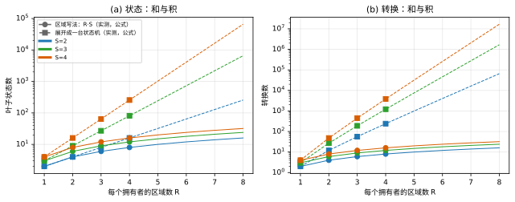
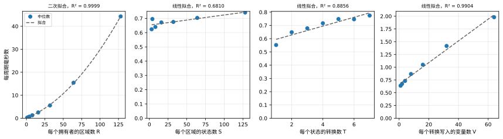
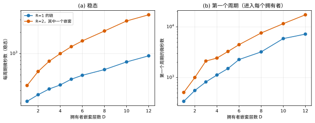
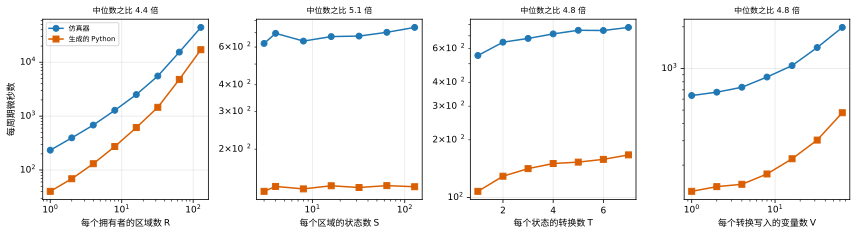
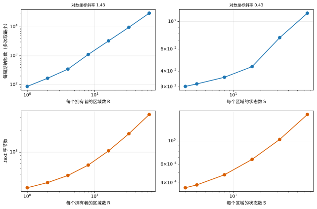
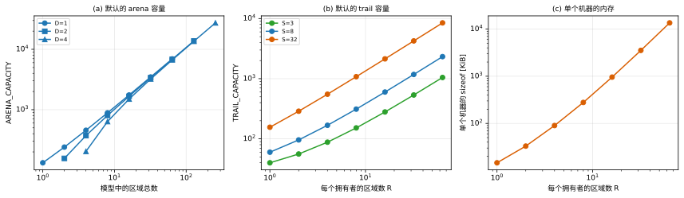
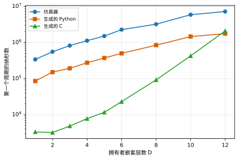
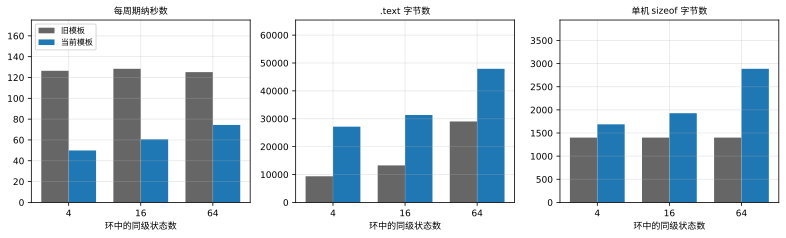

区域在模型、仿真与生成运行时里的代价
====================================

区域让一个拥有者（owner）状态在同一个周期里按顺序运行若干子状态机。建模者在选用区域之前会问三个问题：与不用区域时手写的那台扁平状态机相比，模型小多少；仿真器和生成代码每个周期花多少时间；模型长到多大还能用。本页对这三个问题给出结论，能推导的给精确式，只能给曲线的给拟合，只有测量的给测量值，并逐条标明属于哪一种。执行顺序本身的含义见 :doc:`/explanations/region_semantics/index_zh`\ ，写法见 :doc:`/reference/region_model/index_zh`\ 。

简短回答
--------

* **模型规模**\ ：对互不读取的区域，区域写法有 :math:`\sum S` 个叶子状态，展开成一台状态机（flat expansion）后有 :math:`\prod S` 个。这是精确式，并在 20 个小模型上核对过。节省的是模型，不是每个周期的时间：在这 20 个模型里，仿真器上有 17 个是展开式更快，只有展开式带 3840 条及以上转换时才更慢。
* **仿真器**\ ：每个周期的时间主要由区域数 :math:`R` 决定，拟合是带小二次项的二次式。它不随每个区域的状态数 :math:`S` 变化，随每个状态的转换数 :math:`T` 缓慢增长，对写入的变量数 :math:`V` 是线性的。嵌套 :math:`D` 层约为一层的 :math:`D` 倍，仿真器的记忆化让第一次进入保持多项式增长。
* **生成的 Python**\ ：在相同模型上，生成的运行时比仿真器快 2.6 到 8.4 倍（中位数 5.0）。它离手写的专用实现仍然很远（见\ :ref:`已知差距 <region-perf-python>`\ ）。
* **生成的 C**\ ：每个周期的时间随 :math:`R` 超线性增长（:math:`R = 1..64` 上对数坐标斜率 1.43），单个机器的大小近似二次增长（:math:`R = 16` 到 :math:`R = 64` 之间斜率 1.9），进入嵌套拥有者的第一个周期每多一层乘 2.0 到 2.2。容量宏是模型规模的精确函数。

怎样读这些数字
--------------

下面每条结论都带有三种标签之一。

.. list-table::
   :header-rows: 1
   :widths: 16 34 50

   * - 标签
     - 含义
     - 怎样核对
   * - 精确式
     - 在写明的假设下，由定义推出的公式。
     - 代入小参数，与工具打印的计数比较。本页附有在公开接口上做这件事的脚本。
   * - 拟合
     - 穿过测量点的最小二乘曲线，附范围与 :math:`R^2`\ 。它只描述测量过的范围。
     - 用 ``python tools/measure_region_performance.py fit`` 对 :file:`data/e2.jsonl` 等数据文件重新拟合。
   * - 测量值
     - 来自一台机器、一个提交、一个重复次数的数字。
     - 重新运行工具。换硬件后绝对数值会不同。

全部测量取自提交 ``b054fbe3``\ ，机器为主频 2.1 GHz 的 Intel Xeon Platinum 8581C，Python 3.11.15，gcc 13.3.0（``-O2 -std=c99``\ ）。这台机器与其他用户共享，而每个进程绑定到一个核心也只是作者的自述：数据记录里没有核心字段。仿真器与 Python 的数字是预热之后 7 个计时批次的中位数；C 的数字是 7 次运行的最小值；每个进程绑定到一个核心（自述）。同一个模型 ``R=4 S=8 T=2 D=1 V=1`` 在每组扫描里各测了一次，由此得到噪声估计：仿真器的值相差 7 %，生成的 Python 相差 2 %，C 相差 16 %。小于这个幅度的差别不算发现。模型都是合成的，由工具里的 ``sweep_model`` 生成，不是真实项目的样本。

符号
----

.. list-table::
   :header-rows: 1
   :widths: 14 86

   * - 符号
     - 含义
   * - :math:`R`
     - 一个拥有者的区域数
   * - :math:`S`
     - 每个区域的状态数
   * - :math:`T`
     - 每个状态的转换数
   * - :math:`D`
     - 拥有者嵌套层数
   * - :math:`V`
     - 每个转换写入的变量数
   * - :math:`k`
     - 有界模型检查的步数上界（用于 :doc:`/explanations/bmc_scaling/index_zh`\ ）
   * - :math:`N`
     - 不含区域时的叶子状态数
   * - :math:`W`
     - 带赋值的转换数（用于有界模型检查的页面）
   * - :math:`Q_{\mathrm{reg}}`\ ，\ :math:`Q_{\mathrm{flat}}`
     - 区域写法与展开式的叶子状态数
   * - :math:`M_{\mathrm{reg}}`\ ，\ :math:`M_{\mathrm{flat}}`
     - 两种写法的普通转换数（不含初始转换）
   * - :math:`P`
     - 模型的作用域数：全部状态（含根与拥有者）加全部区域

展开式本身就是普通状态机，所以比较时 :math:`N = Q_{\mathrm{flat}}`\ 。

模型规模：区域写法与展开式
--------------------------

计数（精确式）
~~~~~~~~~~~~~~

取一个有 :math:`R` 个区域的拥有者。区域 :math:`i` 有 :math:`S_i` 个叶子状态，其中每个状态有 :math:`T_i` 条转换。同一个区域的转换只由该区域读取的值作条件，同一个状态的条件互斥。在这些假设下（下文称区域互相独立），两种写法的规模如下。

.. math::
   :label: region-perf-states

   Q_{\mathrm{reg}} = \sum_{i=1}^{R} S_i,
   \qquad
   Q_{\mathrm{flat}} = \prod_{i=1}^{R} S_i

.. math::
   :label: region-perf-transitions

   M_{\mathrm{reg}} = \sum_{i=1}^{R} S_i T_i,
   \qquad
   M_{\mathrm{flat}} = \Bigl(\prod_{i=1}^{R} S_i\Bigr)\Bigl(\prod_{i=1}^{R} (T_i + 1) - 1\Bigr)

第一行把每个区域的状态各数一次，而展开式对每个区域状态元组需要一个状态。第二行里，区域写法的一个周期让每个区域要么触发它的 :math:`T_i` 条转换之一，要么留在原地并执行 ``during`` 动作，所以展开式的一个状态需要为 :math:`\prod (T_i + 1)` 种结果各写一条转换。所有区域都留在原地的那一种是展开状态自己的 ``during``\ ，不是转换，所以减 1。取 :math:`S_i = S`\ 、\ :math:`T_i = T`\ ，公式变为下式。

.. math::
   :label: region-perf-uniform

   \frac{Q_{\mathrm{flat}}}{Q_{\mathrm{reg}}} = \frac{S^{R}}{R\,S},
   \qquad
   \frac{M_{\mathrm{flat}}}{M_{\mathrm{reg}}} = \frac{S^{R-1}\bigl((T+1)^{R} - 1\bigr)}{R\,T}

当 :math:`R = 4`\ 、\ :math:`S = 4`\ 、\ :math:`T = 2` 时，公式 :eq:`region-perf-states` 给出 16 与 256 个叶子状态，公式 :eq:`region-perf-transitions` 给出 32 与 20480 条转换。图中用对数坐标画出同样的增长。

   :math:`T = 1`\ 、\ :math:`S = 2, 3, 4` 时的叶子状态数（左）与转换数（右）。标记点是从工具生成的模型里读出的计数；实线是 :math:`R\,S` 与 :math:`R\,S\,T`\ ，虚线是 :math:`S^R` 与 :math:`S^R(2^R-1)`\ 。纵轴为对数坐标。在所述假设下，这张图证明区域写法线性增长而展开式指数增长；它不能说明互相读取的区域。数据来源：:file:`data/e1.jsonl`\ ；计数是精确的，不涉及重复。

核对计数与等价性
~~~~~~~~~~~~~~~~

下面的脚本通过公开接口加载 :math:`R = 2`\ 、\ :math:`S = 3`\ 、\ :math:`T = 1` 的区域模型及其展开式，数出叶子状态与普通转换，并在同样的 200 组随机输入上运行两者。

.. testcode::

   import random

   from pyfcstm.dsl import INIT_STATE
   from pyfcstm.model import load_state_machine_from_text
   from pyfcstm.simulate import SimulationRuntime

   def load(path):
       with open(path) as handle:
           return load_state_machine_from_text(handle.read())

   def size(model):
       states = list(model.walk_states())
       leaves = [s for s in states if s.is_leaf_state]
       owners = list(states)
       for state in states:
           owners += list(state.regions.values())
       transitions = [t for owner in owners for t in owner.transitions if t.from_state is not INIT_STATE]
       return len(leaves), len(transitions)

   def run(model, inputs):
       runtime = SimulationRuntime(model, input_source={"x0": 0, "x1": 0}, history_size=1)
       trace = []
       for values in inputs:
           runtime.cycle(inputs=values)
           trace.append(dict(runtime.vars))
       return trace

   regions = load("product_r2_s3.fcstm")
   flat = load("expanded_r2_s3.fcstm")
   print("regions: %d leaf states, %d transitions" % size(regions))
   print("flat:    %d leaf states, %d transitions" % size(flat))

   rng = random.Random(7)
   inputs = [{"x0": rng.randint(0, 1), "x1": rng.randint(0, 1)} for _ in range(200)]
   a, b = run(regions, inputs), run(flat, inputs)
   print("same variables after every one of %d cycles: %s" % (len(inputs), a == b))
   print("variables after the last cycle:", a[-1])

.. testoutput::

   regions: 6 leaf states, 6 transitions
   flat:    9 leaf states, 27 transitions
   same variables after every one of 200 cycles: True
   variables after the last cycle: {'c0': 96, 'u0': 200, 'c1': 92, 'u1': 200}

两个计数是 6 与 9 个叶子状态、6 与 27 条转换，与公式相同：:math:`2 \cdot 3 = 6`\ 、\ :math:`3^2 = 9`\ 、\ :math:`2 \cdot 3 \cdot 1 = 6` 与 :math:`3^2 (2^2 - 1) = 27`\ 。变量 ``c0``\ 、\ ``u0``\ 、\ ``c1`` 与 ``u1`` 在 200 个周期的每一个之后都一致。这只说明一个模型在一组随机序列上一致；完整网格见下一个清单。

两个模型分别是 :file:`product_r2_s3.fcstm`\ （区域写法，完整给出）与 :file:`expanded_r2_s3.fcstm`\ （展开式，只给前 19 行，其中有九个状态和最先几条转换）。

.. literalinclude:: product_r2_s3.fcstm
   :language: fcstm
   :caption: product_r2_s3.fcstm

.. literalinclude:: expanded_r2_s3.fcstm
   :language: fcstm
   :caption: expanded_r2_s3.fcstm（45 行中的前 19 行）
   :lines: 1-19

20 个网格点的测量记录，打印自入库的数据文件 :file:`data/e1.jsonl`\ 。文档检查不重新运行它们，因为计时列取决于机器；记录的前几行给出机器、提交和重复次数。

.. code-block:: text
   :caption: 记录自 data/e1.jsonl

   measured on: b054fbe3 | INTEL(R) XEON(R) PLATINUM 8581C CPU @ 2.10GHz | Python 3.11.15
   each pair was run for 200 cycles on 5 random input sequences; timing is the median of 5 batches

    R  S  T | leaf states        | transitions            | formula | same vars | ms per cycle
            |  regions    flat   |  regions        flat   | matches |           |  regions   flat
    1  2  1 |        2       2   |        2           2   | True    | True      |    0.18    0.13
    2  2  1 |        4       4   |        4          12   | True    | True      |    0.34    0.20
    3  2  1 |        6       8   |        6          56   | True    | True      |    0.59    0.32
    4  2  1 |        8      16   |        8         240   | True    | True      |    0.66    0.39
    1  3  1 |        3       3   |        3           3   | True    | True      |    0.18    0.13
    2  3  1 |        6       9   |        6          27   | True    | True      |    0.32    0.19
    3  3  1 |        9      27   |        9         189   | True    | True      |    0.49    0.26
    4  3  1 |       12      81   |       12        1215   | True    | True      |    0.75    0.45
    1  4  1 |        4       4   |        4           4   | True    | True      |    0.18    0.13
    2  4  1 |        8      16   |        8          48   | True    | True      |    0.35    0.20
    3  4  1 |       12      64   |       12         448   | True    | True      |    0.50    0.33
    4  4  1 |       16     256   |       16        3840   | True    | True      |    0.66    1.59
    1  3  2 |        3       3   |        6           6   | True    | True      |    0.20    0.14
    2  3  2 |        6       9   |       12          72   | True    | True      |    0.37    0.22
    3  3  2 |        9      27   |       18         702   | True    | True      |    0.57    0.40
    4  3  2 |       12      81   |       24        6480   | True    | True      |    0.76    2.90
    1  4  2 |        4       4   |        8           8   | True    | True      |    0.20    0.15
    2  4  2 |        8      16   |       16         128   | True    | True      |    0.39    0.23
    3  4  2 |       12      64   |       24        1664   | True    | True      |    0.58    0.47
    4  4  2 |       16     256   |       32       20480   | True    | True      |    0.78    8.06

   coupled models (leaf states, transitions):
     regions_reader_after_writer    3, 2
     regions_reader_before_writer   3, 2
     flat_naive                     2, 2
     flat_substituted               2, 2

   cycles with different variables, out of 1000 compared:
     regions_reader_before_writer   vs regions_reader_after_writer     600 (first at cycle: 1)
     flat_naive                     vs regions_reader_after_writer     600 (first at cycle: 1)
     flat_substituted               vs regions_reader_after_writer       0 (first at cycle: none)
     flat_naive                     vs regions_reader_before_writer      0 (first at cycle: none)
     flat_substituted               vs regions_reader_before_writer    600 (first at cycle: 1)

20 个网格点全部与公式一致，20 对模型在每组 200 个周期的 5 组随机序列上、每个周期之后变量都相同。最后两列显示代价：\ **展开式有几千条转换之前，区域写法每个周期并不比展开式快。**\ 在 :math:`R = 2`\ 、\ :math:`S = 3`\ 、\ :math:`T = 1` 时，区域写法用 0.32 ms，展开式用 0.19 ms；在 :math:`R = 4`\ 、\ :math:`S = 4`\ 、\ :math:`T = 1`\ （展开式 3840 条转换）时次序反过来，0.66 ms 对 1.59 ms；在 :math:`R = 4`\ 、\ :math:`S = 4`\ 、\ :math:`T = 2`\ （展开式 20480 条转换）时是 0.78 ms 对 8.06 ms。展开式每个状态要测试 :math:`\prod (T_i+1) - 1` 条转换，区域写法每个区域带一份额外开销（由计数作出的推断，没有为这次比较剖析仿真器）。没有人会手写 20480 条转换的状态机，这就是规模节省的实际含义。

区域互相读取时
~~~~~~~~~~~~~~

公式 :eq:`region-perf-states` 到 :eq:`region-perf-uniform` 要求区域互相独立。如果后面的区域读取前面的区域在同一周期写入的变量，后面的区域看到的是新值，而条件在周期开始时求值的展开式不能重现这一点。下一个脚本用四个小模型：区域 ``W`` 在 ``during`` 动作里写 ``p = x0``\ ，区域 ``V`` 按 ``p`` 切换，两个区域写法的差别在于先写哪个区域。展开式有两种：朴素展开（条件读 ``p``\ ），以及把条件改写成读 ``x0`` 的展开（这正是 ``W`` 写给 ``p`` 的值）。

.. testcode::

   import random

   from pyfcstm.model import load_state_machine_from_text
   from pyfcstm.simulate import SimulationRuntime

   def run(label, inputs):
       with open("coupled_%s.fcstm" % label) as handle:
           model = load_state_machine_from_text(handle.read())
       runtime = SimulationRuntime(model, input_source={"x0": 0}, history_size=1)
       trace = []
       for value in inputs:
           runtime.cycle(inputs={"x0": value})
           trace.append((runtime.vars["c"], runtime.vars["d"]))
       return trace

   rng = random.Random(3)
   inputs = [rng.randint(0, 1) for _ in range(200)]
   labels = ["regions_reader_after_writer", "regions_reader_before_writer", "flat_naive", "flat_substituted"]
   traces = {label: run(label, inputs) for label in labels}

   print("x0 :", " ".join(str(v) for v in inputs[:8]))
   for label in labels:
       print("%-30s c after cycles 1-8: %s" % (label, " ".join(str(c) for c, _ in traces[label][:8])))
   pairs = [
       ("regions_reader_before_writer", "regions_reader_after_writer"),
       ("flat_naive", "regions_reader_after_writer"),
       ("flat_substituted", "regions_reader_after_writer"),
       ("flat_naive", "regions_reader_before_writer"),
   ]
   for left, right in pairs:
       differing = sum(1 for x, y in zip(traces[left], traces[right]) if x != y)
       print("%-30s differs from %-30s in %3d of 200 cycles" % (left, right, differing))

.. testoutput::

   x0 : 0 0 1 1 0 0 1 1
   regions_reader_after_writer    c after cycles 1-8: 0 0 1 1 2 2 3 3
   regions_reader_before_writer   c after cycles 1-8: 0 0 0 1 1 2 2 3
   flat_naive                     c after cycles 1-8: 0 0 0 1 1 2 2 3
   flat_substituted               c after cycles 1-8: 0 0 1 1 2 2 3 3
   regions_reader_before_writer   differs from regions_reader_after_writer    in  97 of 200 cycles
   flat_naive                     differs from regions_reader_after_writer    in  97 of 200 cycles
   flat_substituted               differs from regions_reader_after_writer    in   0 of 200 cycles
   flat_naive                     differs from regions_reader_before_writer   in   0 of 200 cycles

按下面的方式读输出。

* ``regions_reader_after_writer`` 与 ``flat_naive`` 在 200 个周期里有 97 个不同：朴素展开慢一个周期，因为它的条件读的是上一个周期的 ``p``\ 。
* ``regions_reader_before_writer`` 与 ``flat_naive`` 在 200 个周期里完全相同：读取者声明在写入者之前时，它读到的也是旧值，不需要改写。
* ``flat_substituted`` 与 ``regions_reader_after_writer`` 在 200 个周期里完全相同：把条件里的 ``p`` 换成 ``W`` 的赋值，等价性就恢复了。数据文件在 1000 个周期上记录了同样的结果（三对不等价的各有 600 个周期不同，两对相等的各为 0）。

结论是有限的。这一对模型存在展开式，而且条件很小，因为 ``W`` 只赋了一个输入。实验没有说明：当写入者计算很长的表达式，或者几个区域形成读取链时，改写后的条件会变得多大；工具没有测这一点，大小会随代入的表达式增长（推断，未测量）。模型在 :file:`coupled_regions_reader_after_writer.fcstm`\ 、\ :file:`coupled_regions_reader_before_writer.fcstm`\ 、\ :file:`coupled_flat_naive.fcstm` 与 :file:`coupled_flat_substituted.fcstm` 中。

仿真器每个周期的代价
--------------------

测了什么
~~~~~~~~

工具生成一族模型（``sweep_model``\ ）：``D`` 层嵌套的拥有者，每个拥有者有 ``R`` 个区域，环形区域有 ``S`` 个状态，每个状态有 ``T`` 条转换，条件为 ``a == 1`` 到 ``a == T``\ ，每条转换写入 ``V`` 个变量。围绕基准点 ``R=4 S=8 T=2 D=1 V=1`` 每次只改变一个参数。输入 ``a`` 沿用一个固定的伪随机序列，所以约有 :math:`T/(T+1)` 的周期会触发转换。仿真器以 ``history_size=1`` 运行，使历史不增长。下面的小模型展示形状；:file:`sweep_r2_s3_t1.fcstm` 就是 ``R=2 S=3 T=1 D=1 V=1``\ 。

.. literalinclude:: sweep_r2_s3_t1.fcstm
   :language: fcstm
   :caption: sweep_r2_s3_t1.fcstm

模拟器测量的记录值，打印自入库的数据文件 :file:`data/e2.jsonl` 与 :file:`data/fits.json`\ 。文档检查不重新运行它们，因为它们取决于测量时的机器；记录的前几行给出机器、提交和批次数。

.. code-block:: text
   :caption: 记录自 data/e2.jsonl

   measured on: commit b054fbe3; INTEL(R) XEON(R) PLATINUM 8581C CPU @ 2.10GHz; Python 3.11.15
   each point: median of 7 timed batches after a warm-up; first cycle: minimum of fresh runs
   base model: R=4 S=8 T=2 D=1 V=1; one parameter changes per sweep

   R sweep (R): us per cycle / first cycle us
     R=1: 234/500  R=2: 395/618  R=4: 683/1044  R=8: 1284/1964  R=16: 2511/3476  R=32: 5552/7551  R=64: 15436/18297  R=128: 44288/49382
     linear R2 0.9711, slope 338.645 us per unit | quadratic R2 0.9999, x^2 term 1.7141 us | power exponent 1.06 (R2 0.982)

   S sweep (S): us per cycle / first cycle us
     S=3: 624/889  S=4: 696/1051  S=8: 640/877  S=16: 672/1157  S=32: 675/951  S=64: 703/1036  S=128: 741/1209
     linear R2 0.6810, slope 0.714 us per unit | quadratic R2 0.6851, x^2 term -0.0017 us | power exponent 0.03 (R2 0.589)

   T sweep (T): us per cycle / first cycle us
     T=1: 552/895  T=2: 648/911  T=3: 678/902  T=4: 716/1069  T=5: 748/1056  T=6: 746/917  T=7: 775/907
     linear R2 0.8856, slope 33.297 us per unit | quadratic R2 0.9741, x^2 term -6.0759 us | power exponent 0.17 (R2 0.979)

   V sweep (V): us per cycle / first cycle us
     V=1: 637/916  V=2: 674/1229  V=4: 731/981  V=8: 867/1080  V=16: 1049/1202  V=32: 1417/1453  V=64: 1981/1957
     linear R2 0.9904, slope 21.310 us per unit | quadratic R2 0.9995, x^2 term -0.1211 us | power exponent 0.27 (R2 0.927)

   D_chain sweep (D): us per cycle / first cycle us
     D=1: 212/340  D=2: 262/556  D=3: 316/821  D=4: 361/1125  D=5: 435/1510  D=6: 494/2271  D=8: 595/3214  D=10: 763/5884  D=12: 931/7201
     linear R2 0.9901, slope 64.293 us per unit | quadratic R2 0.9982, x^2 term 1.8475 us | power exponent 0.60 (R2 0.950)

   D_branch sweep (D): us per cycle / first cycle us
     D=1: 354/510  D=2: 559/1004  D=3: 781/2120  D=4: 1000/2427  D=5: 1255/3279  D=6: 1514/4464  D=8: 2091/7589  D=10: 2899/11585  D=12: 3543/17332
     linear R2 0.9881, slope 291.746 us per unit | quadratic R2 0.9989, x^2 term 9.7317 us | power exponent 0.94 (R2 0.982)

拟合
~~~~

   ``SimulationRuntime.cycle`` 每个周期的中位数时间随 :math:`R`\ 、\ :math:`S`\ 、\ :math:`T` 与 :math:`V` 的变化。坐标轴为线性并从零开始；虚线是各标题所写的拟合。每个点是 50 个预热周期之后 7 个批次的中位数，每批至少 20 个周期。这张图证明 :math:`S` 几乎没有影响（变化 43 倍，点仍在 0.62 到 0.74 ms 之内），而 :math:`R` 与 :math:`V` 有影响。数据来源：:file:`data/e2.jsonl`\ 。

公式 :eq:`region-perf-sim-fit` 中的拟合是拟合型结论，只在测过的范围内成立，即基准模型上 :math:`R = 1..128` 与 :math:`V = 1..64`\ 。

.. math::
   :label: region-perf-sim-fit

   t_{\mathrm{sim}}(R) \approx 96 + 126\,R + 1.71\,R^{2}\ \mu\mathrm{s}
   \quad (R^2 = 0.9999),
   \qquad
   t_{\mathrm{sim}}(V) \approx 664 + 21.3\,V\ \mu\mathrm{s}
   \quad (R^2 = 0.990)

按下面的方式读。

* 一次项说明 :math:`R` 较小时每个区域约 126 µs，二次项每区域平方再加 1.71 µs；在 :math:`R = 128` 时，二次部分是实测 44 ms 中的 28 ms。纯线性拟合的 :math:`R^2 = 0.971`\ ，抓不住曲率。
* 二次项是测出来的，原因没有测。仿真器的记忆化键由整个配置构成，配置越大，每次检查越贵（读 :file:`pyfcstm/simulate/runtime.py` 得到的推断，没有剖析）。
* 每个状态转换数 :math:`T` 的影响很小：每多一条转换约 33 µs，线性 :math:`R^2 = 0.886`\ ，只能当作“影响较弱”，不能当作速率。
* 两种增长可以相加作粗略估计，但工具每次只改变一个参数，所以相互作用（例如 :math:`R` 与 :math:`V` 同时增大）没有测。

嵌套层数与记忆化
~~~~~~~~~~~~~~~~

仿真器进入一串嵌套的拥有者时，在每一层判断候选能否到达稳定位置，外层会再问同一个问题。仿真器把每个答案记到周期结束（:file:`pyfcstm/simulate/runtime.py` 中的 ``_memo_get`` 与 ``_memo_put``\ ），所以这个问题只付一次代价。要检验的说法是：嵌套不会让第一次进入变成指数增长。

   左：稳态每个周期的时间随 :math:`D` 的变化。右：第一个周期（进入每个拥有者的周期）的时间随 :math:`D` 的变化。两条纵轴都是对数坐标。``R=1`` 是纯拥有者链；``R=2`` 在每一层有一个嵌套区域和一个环形区域。稳态：7 个批次的中位数；第一个周期：5 个全新运行时的最小值。这张图证明在这一族模型里第一次进入是多项式增长：链的第一个周期从 :math:`D = 1` 的 340 µs 增长到 :math:`D = 12` 的 7.2 ms，只有 21 倍，而指数增长对应的倍数约为 2000。数据来源：:file:`data/e2.jsonl`\ 。

链的稳态时间拟合为 :math:`174 + 40\,D + 1.85\,D^{2}` µs（:math:`R^2 = 0.998`\ ，:math:`D = 1..12`\ ）。这些数据支持“在这一族模型里记忆化让第一次进入保持多项式增长”；不能说明没有任何模型会让它变成指数增长。

.. _region-perf-python:

生成的 Python 运行时
--------------------

这个实验用 ``pyfcstm generate --template python`` 为每个扫描模型生成 Python 运行时，并在相同的输入序列上给 ``cycle(inputs=...)`` 计时。

生成的 Python 运行时测量的记录值，打印自 :file:`data/e2.jsonl`\ 、\ :file:`data/e3.jsonl` 与 :file:`data/fits.json`\ 。文档检查不重新运行它们，因为它们取决于测量时的机器。

.. code-block:: text
   :caption: 记录自 data/e2.jsonl 与 data/e3.jsonl

   measured on: commit b054fbe3; INTEL(R) XEON(R) PLATINUM 8581C CPU @ 2.10GHz; Python 3.11.15
   each point: median of 7 timed batches; same models and same input sequence as the simulator

   R sweep (R): generated Python us per cycle, and simulator/generated ratio
     R=1: 40 (5.8x)  R=2: 69 (5.7x)  R=4: 131 (5.2x)  R=8: 273 (4.7x)  R=16: 614 (4.1x)  R=32: 1458 (3.8x)  R=64: 4800 (3.2x)  R=128: 17081 (2.6x)
     linear R2 0.9448 | quadratic R2 1.0000, x^2 term 0.9177 us
   S sweep (S): generated Python us per cycle, and simulator/generated ratio
     S=3: 127 (4.9x)  S=4: 134 (5.2x)  S=8: 130 (4.9x)  S=16: 135 (5.0x)  S=32: 132 (5.1x)  S=64: 135 (5.2x)  S=128: 133 (5.6x)
     linear R2 0.1552 | quadratic R2 0.3437, x^2 term -0.0008 us
   T sweep (T): generated Python us per cycle, and simulator/generated ratio
     T=1: 108 (5.1x)  T=2: 129 (5.0x)  T=3: 141 (4.8x)  T=4: 150 (4.8x)  T=5: 153 (4.9x)  T=6: 158 (4.7x)  T=7: 167 (4.6x)
     linear R2 0.9121 | quadratic R2 0.9746, x^2 term -1.3360 us
   V sweep (V): generated Python us per cycle, and simulator/generated ratio
     V=1: 129 (4.9x)  V=2: 140 (4.8x)  V=4: 145 (5.0x)  V=8: 173 (5.0x)  V=16: 222 (4.7x)  V=32: 303 (4.7x)  V=64: 478 (4.1x)
     linear R2 0.9992 | quadratic R2 0.9994, x^2 term -0.0050 us
   D_chain sweep (D): generated Python us per cycle, and simulator/generated ratio
     D=1: 40 (5.3x)  D=2: 45 (5.8x)  D=3: 53 (6.0x)  D=4: 62 (5.8x)  D=5: 68 (6.4x)  D=6: 72 (6.8x)  D=8: 86 (6.9x)  D=10: 96 (8.0x)  D=12: 111 (8.4x)
     linear R2 0.9965 | quadratic R2 0.9973, x^2 term -0.0545 us
   D_branch sweep (D): generated Python us per cycle, and simulator/generated ratio
     D=1: 71 (5.0x)  D=2: 111 (5.0x)  D=3: 153 (5.1x)  D=4: 197 (5.1x)  D=5: 241 (5.2x)  D=6: 302 (5.0x)  D=8: 413 (5.1x)  D=10: 536 (5.4x)  D=12: 688 (5.1x)
     linear R2 0.9896 | quadratic R2 0.9998, x^2 term 1.7943 us

   ratio over all 47 points: median 5.0, min 2.6, max 8.4
   final variables equal to the simulator's after 1024 cycles: 47 of 47 points

   generated machine.py bytes and import ms, by R:
     R=1: 136721 bytes, 14.5 ms
     R=2: 190883 bytes, 20.8 ms
     R=4: 299207 bytes, 25.4 ms
     R=8: 516083 bytes, 43.5 ms
     R=16: 951907 bytes, 76.6 ms
     R=32: 1825459 bytes, 142.7 ms
     R=64: 3573103 bytes, 340.8 ms
     R=128: 7079885 bytes, 912.8 ms

   仿真器与生成的 Python 运行时在相同模型上每个周期的时间。纵轴为对数坐标；:math:`R`\ 、\ :math:`S` 与 :math:`V` 的横轴也是对数坐标。7 个批次的中位数。这张图证明生成的运行时与仿真器曲线形状相同，只是快一个大致恒定的倍数，该倍数随 :math:`R` 从 1 增长到 128 由 5.8 降到 2.6。数据来源：:file:`data/e2.jsonl` 与 :file:`data/e3.jsonl`\ 。

* 生成的运行时在全部 47 个点上都更快（2.6 到 8.4 倍，中位数 5.0），1024 个周期之后它的变量在全部 47 个点上与仿真器一致。
* 二次项比仿真器的小，但存在：:math:`58 + 15.5\,R + 0.918\,R^{2}` µs（:math:`R^2 = 1.000`\ ，:math:`R = 1..128`\ ）。
* 生成的 ``machine.py`` 随模型增大：:math:`R = 1` 时 137 KB，:math:`R = 64` 时 3.6 MB，:math:`R = 128` 时 7.1 MB，导入分别花 15 ms、341 ms 和 913 ms。所以有几百个区域的模型首先是部署代价，然后才是周期代价。
* 这里嵌套很便宜：链的第一个周期在 :math:`D = 1` 时是 86 µs，在 :math:`D = 12` 时是 1.75 ms。

已知差距是 `issue #596 <https://github.com/HansBug/pyfcstm/issues/596>`_\ ：生成的模块仍然带着通用的帧栈解释器，以及“先在副本上试探、再执行”的两层结构。该 issue 报告：它剖析的六状态环上，手写的专用实现约为每秒 298 万个周期，模板在该环上约为每秒 1.1 万个；这些数字来自该 issue，本页没有重测。因此本页的数字描述的是今天的生成器，该 issue 处理之后会改善。

生成的 C 运行时
---------------

每个周期的时间
~~~~~~~~~~~~~~

C 的测量使用相同的模型、``gcc -O2 -std=c99``\ 、一个绑定的核心、7 次运行的最小值，每次至少 2000 个周期（驱动程序选取周期数，使一次运行约持续 0.25 s），并使用驱动程序里一张表给出的同一输入序列。

生成的 C 运行时测量的记录值，打印自 :file:`data/e2.jsonl` 到 :file:`data/e4.jsonl` 以及 :file:`data/e4_baseline.jsonl`\ 。文档检查不重新运行它们：测量需要 C 编译器、固定的一个核心和约一小时，数字也取决于测量时的机器。

.. code-block:: text
   :caption: 记录自 data/e4.jsonl 与 data/e4_baseline.jsonl

   measured on: commit b054fbe3; INTEL(R) XEON(R) PLATINUM 8581C CPU @ 2.10GHz; Python 3.11.15; gcc (Ubuntu 13.3.0-6ubuntu2~24.04.1) 13.3.0 (-O2 -std=c99, pinned to one core)
   each point: minimum of 7 runs of 2000+ cycles

   R sweep (R): ns per cycle | .text bytes | sizeof bytes | first cycle us
     R=1       87.7 |   32329 |     14968 |       3.1
     R=2      168.1 |   38060 |     33800 |       2.8
     R=4      347.1 |   47748 |     92200 |       4.6
     R=8     1109.2 |   66428 |    284824 |       6.7
     R=16    3279.9 |  104560 |    981112 |      11.1
     R=32    9660.6 |  179976 |   3617848 |      21.4
     R=64   29617.3 |  331616 |  13867960 |      52.0
     power exponent of ns per cycle 1.43 (R2 0.991); quadratic R2 0.9999; linear R2 0.967

   S sweep (S): ns per cycle | .text bytes | sizeof bytes | first cycle us
     S=3      302.4 |   35961 |     35800 |       4.3
     S=4      316.8 |   38264 |     45544 |       4.5
     S=8      358.1 |   47748 |     92200 |       4.8
     S=16     435.7 |   66938 |    222376 |       5.2
     S=32     742.9 |  103506 |    630184 |       5.7
     S=64    1165.5 |  178514 |   2035624 |       7.1
     power exponent of ns per cycle 0.43 (R2 0.923); quadratic R2 0.9944; linear R2 0.994

   T sweep (T): ns per cycle | .text bytes | sizeof bytes | first cycle us
     T=1      347.0 |   42020 |     92200 |       5.4
     T=2      402.5 |   47748 |     92200 |       5.3
     T=3      416.9 |   53604 |     92200 |       5.6
     T=4      513.3 |   59460 |     92200 |       5.9
     T=5      474.5 |   65060 |     92200 |       5.9
     T=6      502.7 |   70660 |     92200 |       4.8
     T=7      486.5 |   76772 |     92200 |       5.0
     power exponent of ns per cycle 0.19 (R2 0.862); quadratic R2 0.8854; linear R2 0.721

   V sweep (V): ns per cycle | .text bytes | sizeof bytes | first cycle us
     V=1      365.7 |   47748 |     92200 |       4.7
     V=2      332.7 |   50916 |     95864 |       4.7
     V=4      326.4 |   55852 |    103192 |       4.8
     V=8      347.0 |   65884 |    117848 |       4.7
     V=16     525.0 |   84450 |    147160 |       4.9
     V=32     543.6 |  110602 |    205784 |       5.3
     V=64     576.1 |  177138 |    323032 |       5.0
     power exponent of ns per cycle 0.15 (R2 0.729); quadratic R2 0.8806; linear R2 0.724

   D_chain sweep (D): ns per cycle | .text bytes | sizeof bytes | first cycle us
     D=1       86.6 |   32329 |     14968 |       3.3
     D=2      132.2 |   34171 |     19960 |       3.2
     D=3      199.7 |   35181 |     25720 |       4.8
     D=4      247.2 |   36404 |     32248 |       7.8
     D=5      307.8 |   37554 |     39544 |      11.7
     D=6      409.6 |   38782 |     47608 |      23.0
     D=8      605.4 |   41670 |     66040 |      92.2
     D=10     813.6 |   44230 |     87544 |     427.1
     D=12    1176.6 |   47498 |    112120 |    2093.5
     power exponent of ns per cycle 1.05 (R2 0.966); quadratic R2 0.9973; linear R2 0.959

   the base model R=4 S=8 T=2 D=1 V=1 appears in several sweeps; its ns per cycle:
     347.1 358.1 402.5 365.7  (spread 16%)

   generated Python / generated C time per cycle, same model:
     R sweep: median 246x, min 151x, max 459x
     S sweep: median 337x, min 116x, max 423x
     T sweep: median 321x, min 293x, max 343x
     V sweep: median 445x, min 353x, max 830x

   default capacity macros against the model size (scopes = all states + regions):
     63 models: ARENA_CAPACITY == max(24, 12*scopes) in 63, TRAIL_CAPACITY == 16 + 4*scopes in 63
     D=1 S=8 R=1  scopes=11   ARENA_CAPACITY=132    TRAIL_CAPACITY=60
     D=4 S=8 R=1  scopes=17   ARENA_CAPACITY=204    TRAIL_CAPACITY=84
     D=1 S=8 R=8  scopes=74   ARENA_CAPACITY=888    TRAIL_CAPACITY=312
     D=4 S=8 R=8  scopes=269  ARENA_CAPACITY=3228   TRAIL_CAPACITY=1092
     D=1 S=8 R=64 scopes=578  ARENA_CAPACITY=6936   TRAIL_CAPACITY=2328
     D=4 S=8 R=64 scopes=2285 ARENA_CAPACITY=27420  TRAIL_CAPACITY=9156

   region-free ring, earlier template vs current template:
     n=4   ns/cycle  126.4 ->   49.9 | .text   9377 ->  27156 | sizeof  1400 ->  1688
     n=16  ns/cycle  128.4 ->   60.6 | .text  13267 ->  31342 | sizeof  1400 ->  1928
     n=64  ns/cycle  125.1 ->   74.4 | .text  29027 ->  47918 | sizeof  1400 ->  2888

   生成的 C 每个周期的时间（上）与 :file:`.text` 字节数（下）随 :math:`R`\ （左）和 :math:`S`\ （右）的变化。全部坐标轴为对数坐标。7 次运行取最小值。这张图证明时间随 :math:`R` 超线性增长（斜率 1.43，:math:`R = 1..64`\ ；仅最后一次翻倍的斜率就是 1.6），而且与仿真器和生成的 Python 不同，C 的时间依赖 :math:`S`\ （:math:`S = 3` 时 302 ns，:math:`S = 64` 时 1166 ns）。数据来源：:file:`data/e4.jsonl`\ 。

* 拟合：:math:`-207 + 142\,R + 5.07\,R^{2}` ns，:math:`R^2 = 0.9999`\ ，:math:`R = 1..64`\ 。常数项为负，说明这个拟合不能用在 :math:`R = 1` 以下，也不能远远外推。
* 与生成的 Python 在相同模型上比较，C 快 246 倍（:math:`R` 扫描的中位数，范围 151 到 459），:math:`S` 扫描 337 倍，:math:`T` 扫描 321 倍，:math:`V` 扫描 445 倍。
* :math:`T` 出现了超出 16 % 噪声估计的上升（:math:`T = 1` 时 347 ns，:math:`T = 4` 时 513 ns，:math:`T = 7` 时 487 ns，约多 40 % 到 48 %；幂律拟合的指数为 0.19，:math:`R^2 = 0.86`），所以不给出速率。:math:`V` 在 :math:`V = 8` 以内处于噪声估计之内（326 到 366 ns），从 :math:`V = 16` 起上升（525 到 576 ns），同样不给出速率。

代码体积、内存与容量宏
~~~~~~~~~~~~~~~~~~~~~~

默认容量是模型规模的函数，可以在 :file:`pyfcstm/render/c_kernel.py` 的 ``_plan_capacity`` 里读到。设 :math:`|Q|` 为状态数（含根与拥有者），:math:`|\mathcal{R}|` 为区域数，令 :math:`P = |Q| + |\mathcal{R}|`\ 。公式 :eq:`region-perf-capacity` 给出两个默认值。

.. math::
   :label: region-perf-capacity

   \mathtt{ARENA\_CAPACITY} = \max(24,\ 12\,P),
   \qquad
   \mathtt{TRAIL\_CAPACITY} = 16 + 4\,P

对没有区域、没有伪状态、且所有状态都是叶子或根的模型，生成器改用 8 与 4。这两个等式在容量网格的全部 63 个模型上精确成立（上面的清单打印了计数）。:math:`P` 对 :math:`R`\ 、\ :math:`S` 与 :math:`D` 都是线性的，所以这两个宏也是线性的。单个机器的存储 ``STORAGE_BYTES`` 等于一个固定部分、每个 arena 槽位一个配置条目、再加每个 trail 槽位一个较小条目之和，而一个配置条目本身随 :math:`P` 增长（同一文件里的 ``context_size``\ ；读代码得到的推断）。所以实测的大小近似二次增长。

   左：:math:`D = 1, 2, 4`\ （:math:`S = 8`\ ）时 ``ARENA_CAPACITY`` 随模型中区域总数的变化。中：:math:`S = 3, 8, 32` 时 ``TRAIL_CAPACITY`` 随 :math:`R` 的变化。右：单个机器的 ``sizeof``\ （KiB）随 :math:`R` 的变化。全部坐标轴为对数坐标。数值读自生成的头文件和编译后的驱动程序，不涉及重复。这张图证明容量与模型规模成线性，而 ``sizeof`` 在 :math:`R = 16` 到 :math:`R = 64` 之间的斜率是 1.9：:math:`R = 16` 时 0.94 MiB，:math:`R = 32` 时 3.5 MiB，:math:`R = 64` 时 13.2 MiB。大小的斜率是拟合；容量等式是精确的。

对部署的影响：

* 4 个区域、每个区域 8 个状态的单个机器是 90 KiB；8 个区域是 278 KiB；16 个区域是 958 KiB。大机器要放在静态存储或堆上，放之前先读 ``sizeof``\ 。
* 默认容量由模型规模推出，不是对一个周期工作量的已证明上界。默认值太小的机器会在报错里点出所涉及的宏，用更大的值重新构建即可；默认值比所需大的机器则为差额付出内存。`issue #598 <https://github.com/HansBug/pyfcstm/issues/598>`_ 报告：在随机区域模型上默认值远高于实测需求（中位数约 44 倍，有一个模型低于需求）；本页没有重测。
* 宏的设置方法见 :doc:`/how_to/generation/index_zh`\ 。

嵌套拥有者的第一次进入
~~~~~~~~~~~~~~~~~~~~~~

   三种引擎在 ``R=1`` 链上第一个周期（进入每个嵌套拥有者的周期）的时间随 :math:`D` 的变化。纵轴为对数坐标。仿真器与 Python：5 个全新运行的最小值；C：7 次运行的最小值。这张图证明 C 运行时没有记忆化：它的第一个周期在 :math:`D = 1` 时是 3.3 µs，在 :math:`D = 12` 时是 2.1 ms，倍数为每层 2.0 到 2.2（:math:`D = 8` 到 10 为 4.6，10 到 12 为 4.9）。:math:`D = 12` 时它比生成的 Python（1.7 ms）更慢。数据来源：:file:`data/e2.jsonl`\ 、\ :file:`data/e3.jsonl` 与 :file:`data/e4.jsonl`\ 。

后续周期不受影响：同一条 C 链的稳态时间在 :math:`D = 1` 时是 87 ns，在 :math:`D = 12` 时是 1177 ns。代价在机器进入拥有者时一次付清，启动时进入一次、以后不再离开的应用可以接受。反复重新进入嵌套拥有者会再次付出这个代价；这一情形扫描中没有测。

与引入区域之前的模板相比
~~~~~~~~~~~~~~~~~~~~~~~~

   引入区域之前的 ``c`` 模板（提交 ``ab9cae94``\ ）与当前模板，在由 4、16 和 64 个同级状态组成的不含区域的环上，每个周期的时间、:file:`.text` 与 ``sizeof`` 的对比。7 次运行取最小值，编译选项相同。这张图证明不含区域的模型快 1.7 到 2.5 倍（125 到 128 ns 对 50 到 74 ns），代价是代码体积（4 个状态时 :file:`.text` 由 9.4 KB 增至 27.2 KB）和内存（1400 增至 1688 字节）。它不能说明其他结构的模型；`issue #598 <https://github.com/HansBug/pyfcstm/issues/598>`_ 列出了新模板更慢的模型族，本页没有重测。数据来源：:file:`data/e4_baseline.jsonl`\ 。

汇总
----

.. list-table::
   :header-rows: 1
   :widths: 18 16 30 36

   * - 环节
     - 标签
     - 随什么增长
     - 测量范围
   * - 模型规模
     - 精确式
     - 区域写法：:math:`S` 之和；展开式：:math:`S` 之积
     - :math:`R = 2, S = 3` 时 6 与 9 个叶子状态；:math:`R = 4, S = 4` 时 16 与 256 个
   * - 仿真器，每个周期
     - 拟合
     - :math:`R`\ （二次）、\ :math:`V`\ （线性）；与 :math:`S` 无关
     - :math:`R = 1` 时 234 µs，:math:`R = 128` 时 44 ms；:math:`V = 1..64` 时 637 µs 到 1.98 ms
   * - 仿真器，嵌套
     - 拟合
     - :math:`D`\ （二次，有记忆化）
     - :math:`D = 1..12` 时第一个周期 340 µs 到 7.2 ms（链）
   * - 生成的 Python，每个周期
     - 拟合
     - :math:`R`\ （二次）、\ :math:`V`\ ；与 :math:`S` 无关
     - :math:`R = 1` 时 40 µs，:math:`R = 128` 时 17 ms；比仿真器快 5.0 倍
   * - 生成的 Python，体积
     - 测量值
     - :math:`R`\ 、\ :math:`S`\ （随状态数线性）
     - :math:`R = 1` 时 137 KB，:math:`R = 128` 时 7.1 MB、导入 913 ms
   * - 生成的 C，每个周期
     - 拟合
     - :math:`R`\ （斜率 1.43）、\ :math:`S`
     - :math:`R = 1` 时 88 ns，:math:`R = 64` 时 29.6 µs
   * - 生成的 C，内存
     - 精确式（宏）、拟合（大小）
     - :math:`P`\ （宏）、近似 :math:`P^2`\ （大小）
     - :math:`R = 1` 时 15 KB，:math:`R = 64` 时 13.2 MiB
   * - 生成的 C，嵌套
     - 测量值
     - :math:`D`\ ，第一个周期每层 2.0 到 2.2 倍
     - :math:`D = 1` 时 3.3 µs，:math:`D = 12` 时 2.1 ms

给建模者的建议
--------------

* **为模型选区域，不要为速度选区域。**\ 区域互相独立时，模型文本随 :math:`R` 线性增长，展开式则是指数增长（:eq:`region-perf-uniform`\ ）。在仿真器里，行为相同的手写展开式在 1664 条转换以内每个周期更快（20 个核对过的模型中的 17 个），所以区域并不节省仿真时间。
* **互相读取的区域保持各自的顺序。**\ 后面的区域读到前面的区域写下的值，读到的是新值（与相反顺序相比早一个周期）。展开式必须把写入代入条件，所以模型规模上的节省比公式 :eq:`region-perf-uniform` 暗示的小，改写后的形式也必须重新核对。
* **选 C 目标之前先数作用域。**\ 内存近似是 :math:`P` 的二次函数；按默认容量，16 个区域、每个区域 8 个状态的机器每台约需 1 MiB。只有在了解自己模型的需求之后，才按 :doc:`/how_to/generation/index_zh` 的做法设置这些宏；值太小是运行时的错误，不是悄悄地行为异常。
* **在意进入时间时，C 里要保持嵌套较浅。**\ 深度超过 4 之后每多一层，第一个周期乘 2.0 到 2.2；稳态时间不受影响。
* **在意周期时，每个转换少写变量。**\ :math:`V` 是仿真器里（每个变量 21 µs）和 Python 里（每个变量 5.5 µs）唯一有干净线性代价的参数。
* **重复执行时用生成的 Python 或 C 运行时，不用仿真器**\ ，周期时间或占用空间是硬性要求时优先用 C。

这些数字的局限
--------------

这些数字会过时。issue `#596 <https://github.com/HansBug/pyfcstm/issues/596>`_ 与 `#598 <https://github.com/HansBug/pyfcstm/issues/598>`_ 描述的优化预计会改变生成的运行时，仿真器也可能变化。这里的每条结论都绑定一个提交，工具会重新生成全部数据，从而重新生成每张表和每张图。

* 模型是合成的。对真实项目里条件与赋值的比例不作任何断言。
* 每次只改变一个参数，相互作用没有测。
* 机器是共享的。上面的噪声估计适用于每一个数字。
* 只测了 x86-64 Linux 与 gcc。不给 32 位、ARM、MSVC 和 macOS 的数字。
* 没有测 C 的栈需求。
* 有界模型检查的代价在另一页，见 :doc:`/explanations/bmc_scaling/index_zh`\ 。

要重新运行并重画，在仓库根目录、已用 ``make tpl`` 打包好模板且有 ``gcc`` 的情况下：

.. code-block:: bash

   python tools/measure_region_performance.py e1 --out docs/source/explanations/region_performance/data/e1.jsonl --core 3
   python tools/measure_region_performance.py e2 --out docs/source/explanations/region_performance/data/e2.jsonl --core 3
   python tools/measure_region_performance.py e3 --out docs/source/explanations/region_performance/data/e3.jsonl --core 3 \
       --sim-data docs/source/explanations/region_performance/data/e2.jsonl
   python tools/measure_region_performance.py e4 --out docs/source/explanations/region_performance/data/e4.jsonl --core 3 --part speed capacity
   python tools/measure_region_performance.py fit --data-dir docs/source/explanations/region_performance/data \
       --out docs/source/explanations/region_performance/data/fits.json

基线对比需要从提交 ``ab9cae94`` 取出早先的模板，并使用 ``--part baseline --old-template <目录>``\ 。整个运行在上述机器上约需一小时。新数据就位之后，图由文档构建重新生成：在 :file:`docs/source` 里运行 ``make -f all.mk build`` 会运行画图脚本，它们只读数据文件。本页的文字表格是记录值：它们抄自数据文件，新数据就位后需要手工刷新。这个命令块只用于说明，本身不是生成的输出。
