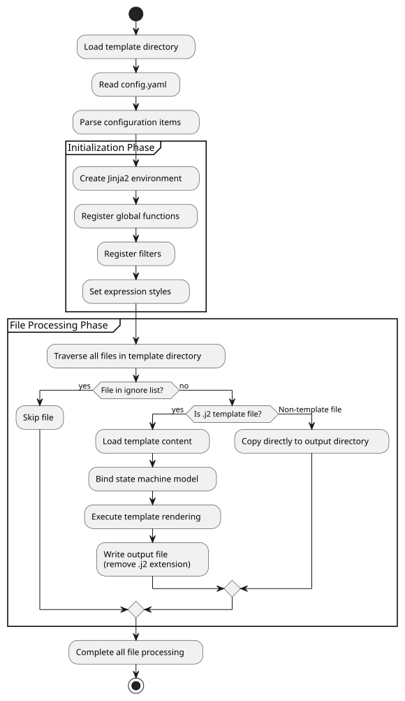
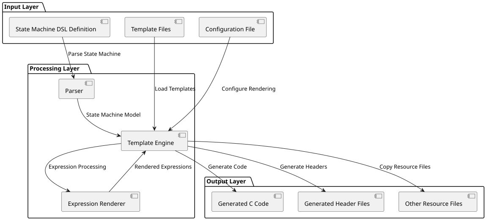
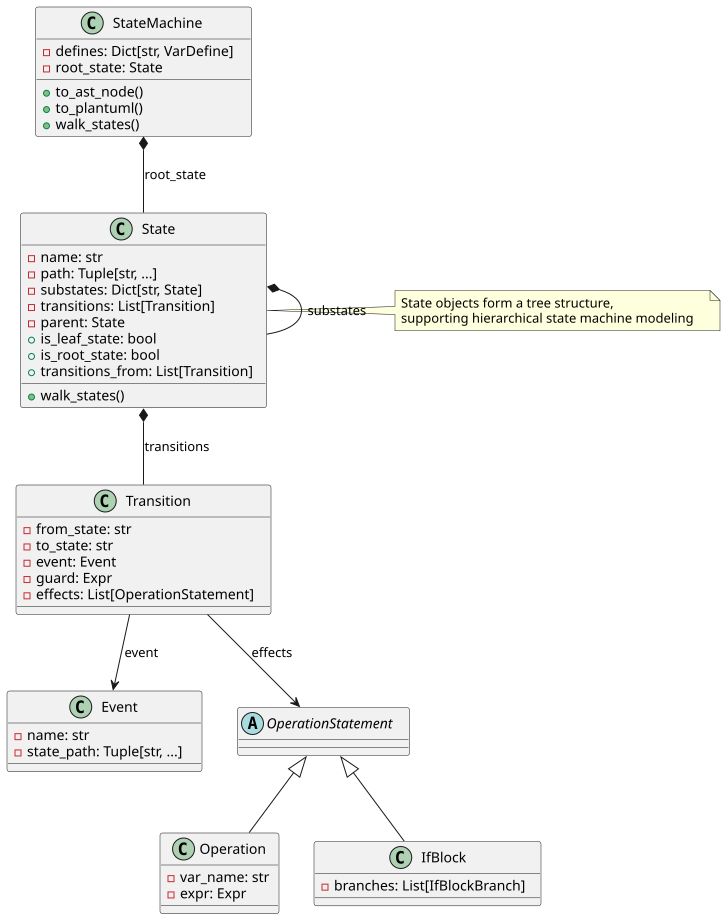
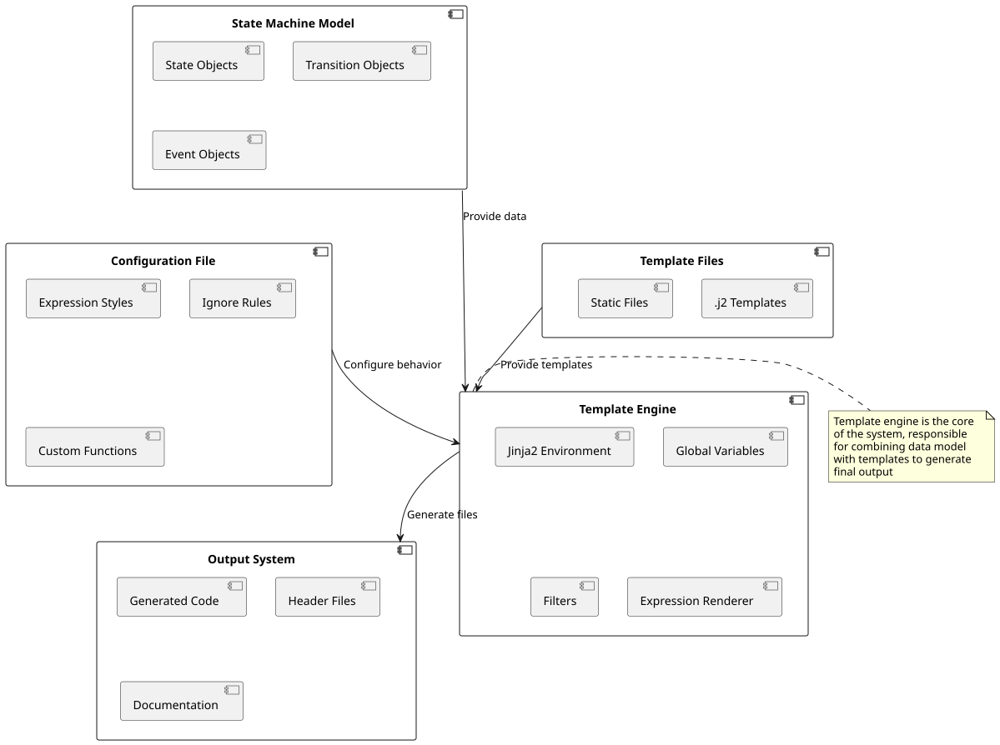

.. _sec-explanations-template-rendering:

Template rendering explanation
==============================

The renderer turns a validated state-machine model into a generated file tree.
It is intentionally a middle layer: it does not parse DSL text, it does not own
target-language runtime semantics, and it does not certify native deployment
profiles. Its job is to combine one ``StateMachine`` model with one trusted
template directory.

Two chains meet at generation time:

* the **user input chain**: FCSTM DSL text → AST → ``StateMachine`` model →
  renderer → generated files;
* the **template asset chain**: repository ``templates/`` source → packaging →
  ``pyfcstm/template/index.json`` and archives → extraction → renderer.

Those chains are separate on purpose. Built-in templates and custom templates
share the same ``StateMachineCodeRenderer`` once a normal template directory is
available, but they have different stability boundaries.

Rendering pipeline
------------------

The generation path is:

1. ``pyfcstm generate`` reads and decodes the FCSTM file.
2. The parser builds DSL AST nodes.
3. The model importer builds a validated ``StateMachine``.
4. For ``--template <name>``, ``pyfcstm.template.extract_template()`` extracts a
   packaged built-in template to a temporary directory.
5. For ``-t`` / ``--template-dir``, the user-supplied directory is used directly.
6. ``StateMachineCodeRenderer`` reads ``config.yaml``, validates the supported
   sections, and prepares a Jinja2 environment.
7. The renderer walks template files: ``*.j2`` files are rendered, other
   non-ignored files are copied, and ``config.yaml`` itself is skipped.
8. The generated directory is left for the target-language user to build,
   import, or inspect.

   Rendering flow from DSL input to generated files.

Built-in and custom template boundary
-------------------------------------

A built-in template is a packaged asset. The stable user path is
``pyfcstm generate --template python`` or another listed built-in name. The
repository ``templates/`` directory is maintainer source, not the ordinary user
entry point.

A custom template is a trusted directory supplied through ``-t`` /
``--template-dir``. It can register imports, filters, and tests through
``config.yaml``. That makes it powerful enough for project-local code
generation, but it is not an untrusted-template sandbox.

   Renderer components and their responsibility boundaries.

Renderer responsibilities and non-responsibilities
--------------------------------------------------

.. list-table:: Responsibility boundary
   :header-rows: 1

   * - Area
     - Renderer owns
     - Template or target owns
   * - File tree
     - ``.j2`` rendering, static copy, ignores, directory creation.
     - Generated file names, target build layout, generated README wording.
   * - Configuration
     - Accepted ``config.yaml`` keys, validation, helper registration.
     - Which helpers are needed for a target runtime.
   * - Expressions and statements
     - Language-neutral renderers and style extension hooks.
     - The chosen target style, scope naming, temporary declarations.
   * - Runtime API
     - No target API decision.
     - Python class, C header API, C++ wrapper, polling callbacks.
   * - Evidence
     - Rendering success and source file mapping.
     - Formatter, compiler, runtime smoke, and simulator-alignment claims.

This separation keeps the renderer small and lets templates evolve target APIs
without turning the renderer into a cross-language runtime framework.

Jinja environment
-----------------

The base environment contains convenience filters and globals such as
``normalize``, ``to_identifier``, ``indent``, selected Python builtins,
``INIT_STATE``, and ``EXIT_STATE``. The renderer then adds ``expr_render``,
``stmt_render``, and ``stmts_render`` for the configured styles. A template may
also add ``globals``, ``filters``, and ``tests`` through ``config.yaml``.

C-family helper functions are deliberately registered by the C-family templates
through ``type: import``. They are not global defaults for every template. This
keeps C naming and C runtime body generation visible in each template's own
configuration.

Expression and statement rendering
----------------------------------

   Model objects provide language-neutral input consumed by templates.

Expressions are guards, assignment values, and other expression nodes. Operation
statements are assignment and ``if`` block structures inside lifecycle actions
and transition effects. Runtime templates should render them with the target
renderers:

.. code-block:: jinja

   {{ transition.guard | expr_render(style='c_scope_expr') }}
   {{ action.operations | stmts_render(style='c_runtime') }}

The older helpers have a different purpose:

.. list-table:: Statement helper choice
   :header-rows: 1

   * - Helper
     - Output intent
     - Correct use
   * - ``stmt_render`` / ``stmts_render``
     - Target-language executable statements.
     - Runtime source generation.
   * - ``operation_stmt_render`` / ``operation_stmts_render``
     - DSL echo text.
     - Comments, debug output, and documentation snippets.

A concrete counterexample: rendering ``counter = counter + 1;`` with
``operation_stmt_render`` produces DSL-like text. That is not the Python runtime
body shape that needs ``scope['counter']`` or the C runtime body shape that needs
``scope->counter``. Use the runtime statement renderer when generating code that
will execute.

Where logic should live
-----------------------

.. list-table:: Logic placement guide
   :header-rows: 1

   * - Logic type
     - Preferred home
     - Why
   * - Target runtime behavior
     - Generated source and target-language hooks.
     - Users can inspect and test the artifact they will ship.
   * - Repeated template structure
     - Jinja macros or includes.
     - Keeps layout reuse local to the template.
   * - Naming and formatting helpers
     - Template-local globals, filters, or tests.
     - Makes target conventions explicit in ``config.yaml``.
   * - Cross-template renderer behavior
     - Production renderer code plus tests.
     - Shared behavior needs normal API review.
   * - Maintainer-only process
     - Template maintainer README files and tooling checks.
     - Keeps user output focused on integration.

   Core renderer components and extension points.

Evidence boundary
-----------------

Generation documentation should name the evidence behind each claim:

.. list-table:: Evidence boundary
   :header-rows: 1

   * - Claim
     - Evidence
     - Do not overclaim
   * - Generation works
     - Command exits successfully and files exist.
     - Runtime behavior is not proven by file creation alone.
   * - Python output works
     - Generated class imports and a cycle smoke check runs.
     - Does not cover every semantic fixture.
   * - Native output compiles
     - A specific compiler / CMake smoke check succeeds.
     - Not all industrial or embedded compilers are certified.
   * - Simulator parity
     - Alignment tests compare traces with ``SimulationRuntime``.
     - Must state fixture coverage and target-specific exclusions.
   * - Formatter-friendly output
     - The relevant formatter accepts representative output.
     - Formatting must not override semantics or compatibility.

Generated README files are part of this evidence story. Reference pages provide
general contracts; generated README files provide the machine-specific API and
build facts for one generated model.

End-to-end trace: one generation run
------------------------------------

This trace shows why generation failures should be diagnosed by layer instead of
by guessing at the final output file.

.. list-table:: Generation trace
   :header-rows: 1

   * - Step
     - Object or file
     - Owner
     - Failure class
   * - Read input bytes.
     - ``input.fcstm``.
     - CLI entry and decoder utilities.
     - File-not-found, unreadable bytes, or decoding failure.
   * - Parse DSL.
     - DSL AST nodes.
     - ``pyfcstm/dsl/``.
     - Grammar errors and source spans.
   * - Import model.
     - ``StateMachine``.
     - ``pyfcstm/model/`` and model importer code.
     - Model validation errors and semantic diagnostics.
   * - Resolve template source.
     - Extracted built-in directory or custom directory.
     - ``pyfcstm/template`` for built-ins, user project for custom templates.
     - Unknown built-in template, missing custom path, or broken package asset.
   * - Read template config.
     - ``config.yaml``.
     - Renderer validation.
     - Invalid YAML, wrong root type, invalid section shape, missing ``base_lang``.
   * - Build Jinja environment.
     - Globals, filters, tests, expression styles, statement styles.
     - Renderer plus trusted template config.
     - Helper import failure, invalid object-loading form, or missing style.
   * - Render/copy files.
     - Output tree.
     - Renderer and template files.
     - Jinja error, bad model attribute, filesystem write failure.
   * - Integrate target output.
     - Generated README, runtime source, consumer code, compiler.
     - Target-language user or template tests.
     - Runtime smoke failure, compiler error, unsupported deployment profile.

The key boundary is step 8. The renderer can prove that it produced files. It
cannot by itself prove that a target compiler, target event loop, or downstream
application integration is correct.

Built-in asset chain
--------------------

Built-in templates have a second chain before the normal renderer sees them:

.. list-table:: Built-in asset chain
   :header-rows: 1

   * - Stage
     - Source of truth
     - Reviewer question
   * - Repository source.
     - ``templates/<name>/`` and template README files.
     - Did the maintainer edit the source template, not a packaged zip by hand?
   * - Packaging.
     - ``tools/package_templates.py`` and ``make tpl``.
     - Did the packaged archive and ``pyfcstm/template/index.json`` refresh together?
   * - Package metadata.
     - ``pyfcstm/template/index.json``.
     - Does every documented template name, archive, root, language, and experimental flag match metadata?
   * - Extraction.
     - ``pyfcstm.template.extract_template()``.
     - Does ``--template`` produce an ordinary directory before rendering starts?
   * - Rendering.
     - ``StateMachineCodeRenderer``.
     - Does the extracted template follow the same ``config.yaml`` and file-mapping rules as a custom directory?

That split explains why user docs should prefer ``--template python`` while
maintainer docs may mention repository ``templates/`` source directories. The
ordinary generated-code user should not need to know where the source template
lives in a checkout.

Custom template trust boundary
------------------------------

A custom template is trusted code. The renderer uses a normal Jinja2
environment, and ``config.yaml`` can register imported Python objects through
``type: import``. Therefore the safety boundary is not "arbitrary user uploads
are safe". The boundary is "the project running generation trusts this
template directory".

.. list-table:: Trust-boundary examples
   :header-rows: 1

   * - Situation
     - Safe framing
     - Unsafe framing
   * - Team-owned template in the same repository.
     - Review it like source code and run renderer smoke checks.
     - Treat it as inert data because it is only a template.
   * - Third-party template directory.
     - Inspect ``config.yaml`` imports and Jinja files before running generation.
     - Run it in a privileged build environment without review.
   * - Environment-variable dependent template.
     - Document each variable as part of the project template contract.
     - Depend on undeclared developer shell state.

Renderer responsibility boundary
--------------------------------

The renderer owns structure, not every downstream promise. These examples are
useful when deciding where a bug belongs:

.. list-table:: Boundary examples
   :header-rows: 1

   * - Observed problem
     - Likely owner
     - Why
   * - ``*.j2`` file is rendered with the wrong output path.
     - Renderer file mapping or ignore rules.
     - The renderer decides suffix removal and static copy behavior.
   * - ``expr_render(style='go')`` emits unexpected expression syntax.
     - Expression renderer style implementation or style configuration.
     - The expression renderer owns expression textual shape.
   * - Generated C hook signature does not match generated README.
     - C template and generated README template.
     - Target API is emitted by the template, not by the generic renderer.
   * - Generated C code fails under a non-default embedded compiler.
     - Template target profile and downstream toolchain.
     - The renderer did not certify every compiler; it only emitted files.
   * - A custom imported helper performs hidden state transitions.
     - Custom template design.
     - Runtime semantics should be visible in generated source or target hooks.

Statement rendering design
--------------------------

Statement rendering exists because operation blocks are structured model nodes.
A renderer must know persistent variables, temporary variables, target assignment
syntax, and block syntax. A string echo cannot safely replace that context.

.. list-table:: Statement rendering context
   :header-rows: 1

   * - Context item
     - Why it matters
     - Example consequence
   * - Persistent state variables.
     - Assignments may need a state scope target.
     - Python runtime output uses ``scope[...]`` while C output uses a C struct pointer.
   * - Temporary variable names.
     - A variable assigned inside a block may be local after the first assignment.
     - The renderer must avoid treating every name as a persistent state variable.
   * - Temporary variable types.
     - Languages such as C need declaration text.
     - ``declare_temp`` and type aliases matter for executable output.
   * - Block structure.
     - ``if`` / ``elif`` / ``else`` syntax differs by language.
     - ``block_end`` is empty in Python-like indentation and explicit in brace languages.

This is why ``operation_stmt_render`` remains useful for DSL echo text but is not
a runtime-code shortcut.

Declaring what a template can render
------------------------------------

A template is written for one execution model. The models it was written for
have one active path of states at any time. A model with regions has several
active leaves at once, and its position is a tree, so a template that walks
``state.transitions`` and tracks a single current state would produce code that
looks plausible and behaves wrongly. The renderer does not guess. A template
says what it can render in the ``features`` list of its ``config.yaml``, and
``region`` is the one feature that exists today. The renderer refuses a model
with regions before it renders or writes anything when the template does not
declare it:

.. literalinclude:: region_plain_template/config.yaml
   :language: yaml
   :caption: region_plain_template/config.yaml

.. literalinclude:: region_declared_template/config.yaml
   :language: yaml
   :caption: region_declared_template/config.yaml

.. literalinclude:: region_template_refusal.demox.sh
   :language: bash
   :caption: region_template_refusal.demox.sh

.. literalinclude:: region_template_refusal.demox.sh.txt
   :language: text
   :caption: region_template_refusal.demox.sh.txt (exit code 1, see region_template_refusal.demox.sh.exitcode)

Read the output from the top:

1. The refused template differs from the accepted one by one line, ``features:
   [region]``. Nothing else about the template changes the verdict.
2. The command exits with ``1`` and writes a refusal for the unsupported ``region``
   feature (its diagnostic code is ``E_UNSUPPORTED_FEATURE``; the printed text does not show the code). Its first line names the template directory, so a template author
   can tell a template without the feature from a model written wrongly. The
   directory shown here is shortened by the script; the real message carries the
   path you passed. The ``(line 12)`` in the first line is the line of the model that
   declares the first region.
3. The message has two readers. The template author is told what to declare and
   when: only once the template really renders regions. The model author gets a
   list of built-in templates that support regions and a command that can be
   copied.
4. ``output directory: not created`` is the point of refusing early. A refusal
   after rendering had started could leave a half-written tree that looks like
   a result.
5. The second run declares ``region`` and succeeds. The template sees the machine
   that runs: its state list ends with the generated pseudo state
   ``__forced_gate_0``, which the forced declaration ``!Running -> Idle : /Stop``
   was expanded into. A template that declares ``region`` is expected to treat
   that machine as an ordinary one.

A model without regions never needs a feature, so a template that does not
declare ``region`` keeps rendering such models exactly as before. Declaring the
feature is a promise, not a switch: a template that declares ``region`` takes
over the whole region semantics of its target language and is expected to align
with ``SimulationRuntime`` on every shared region fixture. The built-in
``python``, ``c``, ``c_poll``, ``cpp`` and ``cpp_poll`` templates declare it.
Why the simulator is the reference is explained in
:doc:`How a cycle runs a model with regions </explanations/region_semantics/index>`.

The shape of a generated runtime for a model with regions
---------------------------------------------------------

A runtime that handles regions cannot be one fixed engine with a table of the
model next to it, because the work of a cycle (trying each region's candidates in
order, rolling the whole cycle back when no legal position exists) depends on how
many regions a model has and how they nest. The built-in templates therefore
generate the kernel for the model.

**Python.** ``machine.py`` is generated for the model: it embeds the machine
that runs (including the expansion of forced declarations), the region and state
tables, and the kernel that executes them. It needs no installed ``pyfcstm``
package, and its size grows with the model.

**C family.** ``c``, ``c_poll``, ``cpp`` and ``cpp_poll`` generate a kernel that
reserves its memory statically. The memory is part of the machine structure
(``_private[...STORAGE_BYTES]``), so nothing is allocated while a cycle runs.
Two capacities size it, and they are derived from the model:

.. literalinclude:: region_capacity.demo.sh
   :language: bash
   :caption: region_capacity.demo.sh

.. literalinclude:: region_capacity.demo.sh.txt
   :language: text
   :caption: region_capacity.demo.sh.txt

``ARENA_CAPACITY`` bounds how many configurations and pending work items one
decision of a cycle may examine, and ``TRAIL_CAPACITY`` bounds how many checks may
be nested; ``STORAGE_BYTES`` is computed from both. The plain model with one composite state needs
8 and 4. The two-region model needs 60 and 36, and the controller, which has
more states and transitions, needs 108 and 52. The numbers come from the model,
not from a fixed engine limit. They are the measured defaults for these four
models, not a formula you can rely on across template versions.

A cycle that needs more than the capacity fails with a message that names the
macro. It does not misbehave silently. To raise a capacity, define the same value
for ``machine.c`` and every file that includes ``machine.h``, because the size of
a machine depends on it. Two consequences to plan around, both stated in the
generated README: the size of one machine grows with the number of states and
regions, so a machine of a large model belongs in static storage and not on the
stack; and entering a chain of nested owners at once costs time that doubles with
every nested level on the first cycle that enters the chain.

"No heap" needs one qualification. The kernel itself needs none. The convenience
functions ``create`` and ``destroy`` use ``calloc`` and ``free`` unless
``PYFCSTM_GENERATED_NO_HEAP`` is defined, which removes them; a program that owns
its machine object, as the run below does, never needs them. The ``cpp`` and
``cpp_poll`` templates wrap the C kernel, and this page ran only ``c`` for the
evidence below.

One position vocabulary across the simulator and the generated runtimes
-----------------------------------------------------------------------

The position of a machine with regions is a tree, written as one line of text:
``Controller.Running{Safety: Watching, Motion: Off}``. Generated runtimes write
that text exactly as the simulator does and offer the same queries under
language-appropriate names:

.. list-table:: The position interface in three places
   :header-rows: 1
   :widths: 22 26 26 26

   * - Question
     - Simulator
     - Python runtime
     - C runtime
   * - Where is the machine?
     - ``runtime.configuration`` (text through ``str``)
     - ``machine.configuration``
     - ``ControllerMachine_get_configuration`` and ``..._configuration_format``
   * - Which leaves are active?
     - ``configuration.leaves``
     - ``machine.leaves``
     - ``..._configuration_leaves``
   * - Is a state in the position?
     - ``configuration.is_active(path)``
     - ``machine.is_active(path)``
     - ``..._configuration_is_active``
   * - What is a region doing?
     - ``configuration.region_status(path)``
     - ``machine.region_status(path)``
     - ``..._configuration_region_status``
   * - Start from a saved position
     - hot start with a configuration
     - ``initial_state=`` with the text
     - ``..._hot_start_at``

The status of a region is one of four words in every place: ``live`` (it holds an
active state), ``done`` (it finished), ``pending`` (its owner is active and it
has not been initialized, text ``[init]``) and ``inactive`` (its owner is not in
the position). The C runtime spells them as constants such as
``CONTROLLER_MACHINE_REGION_STATUS_LIVE``.

The two runs below drive the same six cycles of the controller (start it, run
calmly, raise a fault for two cycles, stop it) through a generated runtime and
through ``pyfcstm simulate``, and compare the text after each cycle:

.. literalinclude:: region_generated_runtime.demo.sh
   :language: bash
   :caption: region_generated_runtime.demo.sh

.. literalinclude:: region_generated_runtime.demo.sh.txt
   :language: text
   :caption: region_generated_runtime.demo.sh.txt

.. literalinclude:: region_generated_c_runtime.demo.sh
   :language: bash
   :caption: region_generated_c_runtime.demo.sh

.. literalinclude:: region_generated_c_runtime.demo.sh.txt
   :language: text
   :caption: region_generated_c_runtime.demo.sh.txt

In both runs ``diff`` finds no difference. The sequence shows the cycle-by-cycle
behavior of the controller: the fault in cycle 4 turns the motor region ``Off``
in the same cycle because ``Safety`` runs first. After ``/Stop`` the machine is
``Controller.Idle``, and the generated Python runtime reports ``is_active``
``False`` for ``Controller.Running`` and ``(('Controller', 'Idle'),)`` as its
leaves.

What this proves and what it does not. It proves that, for this model and these
six cycles, the generated Python and C runtimes and the simulator agree on the
text of the position, which is what a caller reads. It does not prove agreement
on every model. That claim rests on the shared ``regions`` fixtures that every
region-capable template must pass against ``SimulationRuntime``, and on the
random-model differential checks kept outside the unit tests; this page does
not rerun them.

Generated README as machine-specific evidence
---------------------------------------------

The generic pages cannot know every generated name because names are derived
from the model. The generated README is therefore part of the output contract.
Use this split when writing or reviewing docs:

* generic reference pages list template families, config keys, event-model
  shapes, and evidence boundaries;
* how-to pages show short commands and representative output snippets;
* the generated README lists the concrete machine class, C prefix, event ids,
  state ids, hook names, hot-start snippets, and build command for that model;
* tests and smoke demos prove selected generated README examples still execute.
