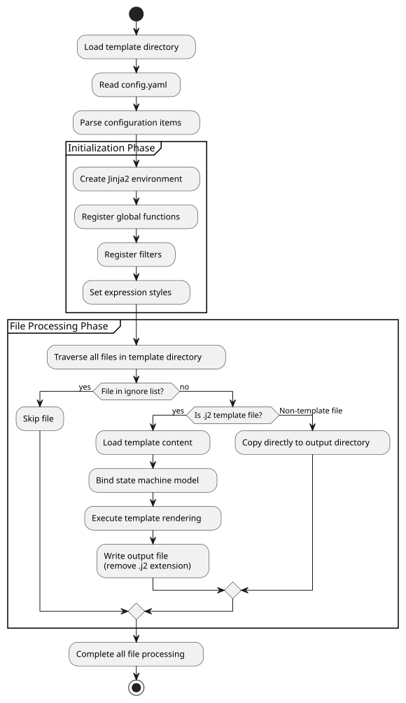
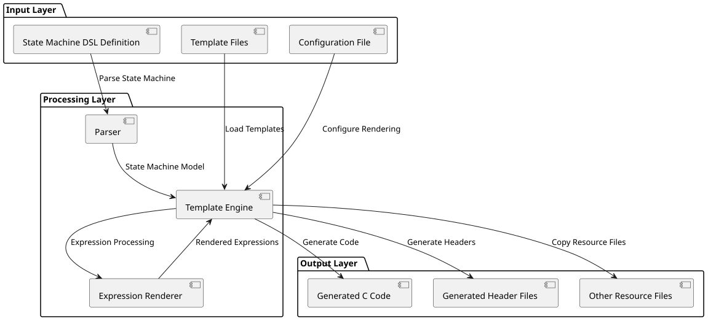
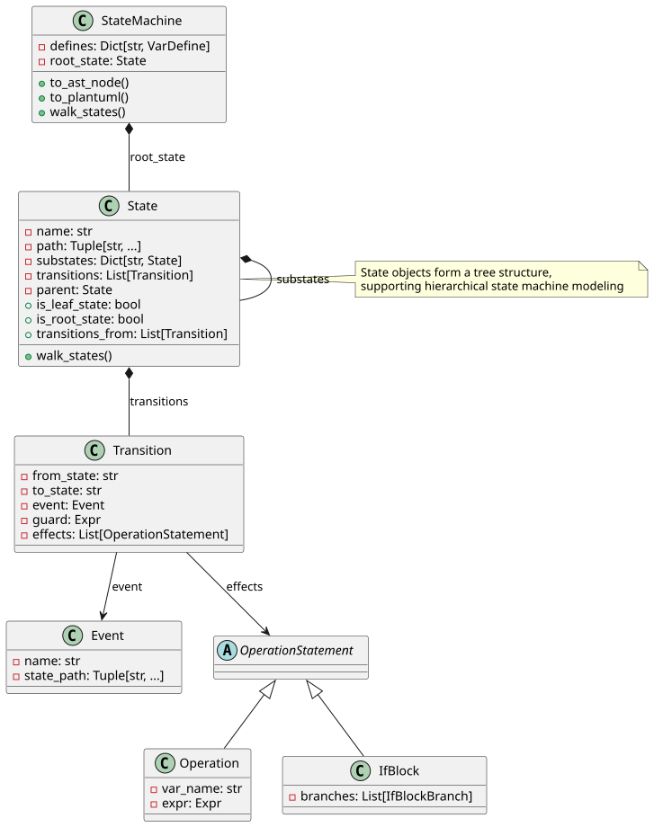
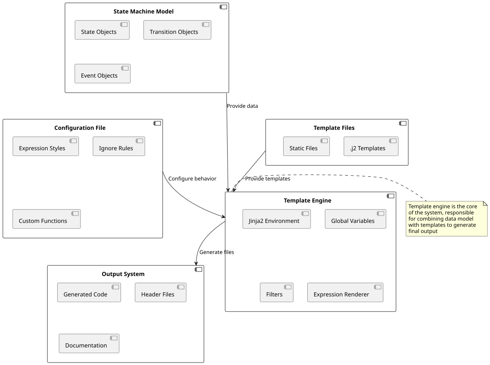

.. _sec-explanations-template-rendering-zh:

模板渲染解释
============

渲染器（renderer）把已经验证的状态机模型变成生成文件树。它刻意只是中间层：它不解析 DSL 文本，不拥有目标语言运行时语义，也不认证本机部署配置。它的职责是把一个 ``StateMachine`` 模型和一个受信任模板目录组合起来。

生成时有两条链路汇合：

* **用户输入链路**：FCSTM DSL 文本 → AST → ``StateMachine`` 模型 → 渲染器 → 生成文件；
* **模板资产链路**：仓库 ``templates/`` 源码 → 打包 → ``pyfcstm/template/index.json`` 与归档 → 解包 → 渲染器。

这两条链路故意分开。内置模板（built-in template）和自定义模板（custom template）在获得普通模板目录后会共享同一个 ``StateMachineCodeRenderer``，但它们的稳定边界不同。

渲染流程
--------

生成路径如下：

1. ``pyfcstm generate`` 读取并解码 FCSTM 文件。
2. 解析器构建 DSL AST 节点。
3. 模型导入器构建已验证的 ``StateMachine``。
4. 对 ``--template <name>``，``pyfcstm.template.extract_template()`` 会把打包内置模板解包到临时目录。
5. 对 ``-t`` / ``--template-dir``，直接使用用户提供的目录。
6. ``StateMachineCodeRenderer`` 读取 ``config.yaml``，校验受支持分节，并准备 Jinja2 环境。
7. 渲染器遍历模板文件：``*.j2`` 文件被渲染，其他未忽略文件被复制，``config.yaml`` 自身被跳过。
8. 生成目录交给目标语言用户构建、导入或检查。

   从 DSL 输入到生成文件的渲染流程。

内置模板和自定义模板边界
------------------------

内置模板是打包资产。稳定用户路径是 ``pyfcstm generate --template python`` 或其他已列出的内置名。仓库 ``templates/`` 目录是维护者源码，不是普通用户入口。

自定义模板是通过 ``-t`` / ``--template-dir`` 提供的受信任目录。它可以通过 ``config.yaml`` 注册导入、过滤器和测试器。这足以支持项目本地代码生成，但它不是不可信模板沙箱。

   渲染器组件及其责任边界。

渲染器负责什么、不负责什么
--------------------------

.. list-table:: 责任边界
   :header-rows: 1

   * - 领域
     - 渲染器负责
     - 模板或目标侧负责
   * - 文件树
     - ``.j2`` 渲染、静态复制、忽略规则、目录创建。
     - 生成文件名、目标构建布局、生成 README 文案。
   * - 配置
     - 接受的 ``config.yaml`` 键、校验、辅助对象注册。
     - 目标运行时需要哪些辅助对象。
   * - 表达式和语句
     - 语言无关渲染器和样式扩展点。
     - 选择目标样式、作用域命名和临时变量声明。
   * - 运行时应用程序接口（API）
     - 不决定目标接口。
     - Python 类、C 头文件接口、C++ 包装层、轮询回调。
   * - 证据
     - 渲染成功和源文件映射。
     - 格式化器、编译器、运行时冒烟检查和语义对齐声明。

这种分层让渲染器保持小而清晰，也让模板可以演进目标接口，而不把渲染器变成跨语言运行时框架。

Jinja 环境
----------

基础环境包含 ``normalize``、``to_identifier``、``indent``、若干 Python 内置对象（builtins）、``INIT_STATE`` 和 ``EXIT_STATE`` 等便利过滤器和全局变量。渲染器随后按配置样式加入 ``expr_render``、``stmt_render`` 和 ``stmts_render``。模板还可以通过 ``config.yaml`` 添加 ``globals``、``filters`` 和 ``tests``。

C 家族辅助函数由 C 家族模板通过 ``type: import`` 显式注册。它们不是每个模板的默认全局对象。这样 C 命名和 C 运行时代码体生成规则会保留在各模板自己的配置中。

表达式与语句渲染
----------------

   模型对象为模板提供语言无关输入。

表达式是 guard、赋值值和其他表达式节点。操作语句是生命周期动作和转换 effect 中的赋值与 ``if`` 块。运行时模板应使用目标渲染器：

.. code-block:: jinja

   {{ transition.guard | expr_render(style='c_scope_expr') }}
   {{ action.operations | stmts_render(style='c_runtime') }}

旧辅助函数用途不同：

.. list-table:: 语句辅助函数选择
   :header-rows: 1

   * - 辅助函数
     - 输出意图
     - 正确用途
   * - ``stmt_render`` / ``stmts_render``
     - 目标语言可执行语句。
     - 生成运行时源码。
   * - ``operation_stmt_render`` / ``operation_stmts_render``
     - DSL 文本回显。
     - 注释、调试输出和文档片段。

一个具体反例：用 ``operation_stmt_render`` 渲染 ``counter = counter + 1;`` 会得到 DSL 形状文本。它不是 Python 运行时代码需要的 ``scope['counter']``，也不是 C 运行时代码需要的 ``scope->counter``。生成会执行的代码时，要用运行时语句渲染器。

逻辑应该放在哪里
----------------

.. list-table:: 逻辑归位指南
   :header-rows: 1

   * - 逻辑类型
     - 推荐位置
     - 原因
   * - 目标运行时行为
     - 生成源码和目标语言钩子。
     - 用户可以检查并测试将要交付的产物。
   * - 重复模板结构
     - Jinja 宏（macro）或包含指令（include）。
     - 让布局复用留在模板内部。
   * - 命名和格式化辅助
     - 模板本地全局变量、过滤器或测试器。
     - 目标约定在 ``config.yaml`` 中可见。
   * - 跨模板渲染器行为
     - 生产渲染器代码和测试。
     - 共享行为需要正常接口评审。
   * - 维护者流程
     - 模板维护者 README 和工具检查。
     - 保持用户输出聚焦在集成上。

   核心渲染器组件和扩展点。

证据边界
--------

生成文档应说明每个声明背后的证据：

.. list-table:: 证据边界
   :header-rows: 1

   * - 声明
     - 证据
     - 不要夸大
   * - 生成可用
     - 命令成功退出且文件存在。
     - 仅创建文件不证明运行时行为。
   * - Python 输出可用
     - 生成类可导入，周期冒烟检查可运行。
     - 不覆盖每个语义样例。
   * - 本机输出可编译
     - 具体编译器 / CMake 冒烟检查成功。
     - 不是对所有工业或嵌入式编译器的认证。
   * - 模拟器等价
     - 对齐测试把追踪与 ``SimulationRuntime`` 比较。
     - 必须说明样例覆盖和目标特定排除项。
   * - 输出适合格式化
     - 相应格式化器接受代表性输出。
     - 格式化不能压过语义或兼容性。

生成 README 是这条证据链的一部分。参考页给通用契约；生成 README 给出单个模型的机器专属接口和构建事实。

端到端追踪（trace）：一次生成运行
----------------------------------

下面的追踪说明为什么生成失败要按层诊断，而不是直接猜最终输出文件哪里错了。

.. list-table:: 生成追踪
   :header-rows: 1

   * - 步骤
     - 对象或文件
     - 负责层
     - 失败类别
   * - 读取输入字节。
     - ``input.fcstm``。
     - 命令行入口（CLI）和解码工具。
     - 文件不存在、字节不可读或解码失败。
   * - 解析 DSL。
     - DSL AST 节点。
     - ``pyfcstm/dsl/``。
     - 语法错误和源码位置。
   * - 导入模型。
     - ``StateMachine``。
     - ``pyfcstm/model/`` 和模型导入代码。
     - 模型校验错误和语义诊断。
   * - 解析模板来源。
     - 解包出的内置目录或自定义目录。
     - 内置由 ``pyfcstm/template`` 负责，自定义由用户项目负责。
     - 未知内置模板、自定义路径缺失或包资产损坏。
   * - 读取模板配置。
     - ``config.yaml``。
     - 渲染器校验。
     - YAML 无效、根类型错误、分节形状无效、缺 ``base_lang``。
   * - 构建 Jinja 环境。
     - 全局变量、过滤器、测试器、表达式样式、语句样式。
     - 渲染器加受信任模板配置。
     - 辅助对象导入失败、对象加载形式错误或样式缺失。
   * - 渲染或复制文件。
     - 输出树。
     - 渲染器和模板文件。
     - Jinja 错误、模型属性错误或文件系统写入失败。
   * - 集成目标输出。
     - 生成 README、运行时源码、消费者代码、编译器。
     - 目标语言用户或模板测试。
     - 运行时冒烟失败、编译错误、部署配置不支持。

关键边界在第 8 步。渲染器能证明它产出了文件；它本身不能证明目标编译器、目标事件循环或下游应用集成都正确。

内置资产链路
------------

内置模板在普通渲染器看到之前，还有另一条链路：

.. list-table:: 内置资产链路
   :header-rows: 1

   * - 阶段
     - 事实源
     - 评审问题
   * - 仓库源码。
     - ``templates/<name>/`` 和模板 README。
     - 维护者是否编辑源码模板，而不是手工改打包 zip？
   * - 打包。
     - ``tools/package_templates.py`` 和 ``make tpl``。
     - 打包归档和 ``pyfcstm/template/index.json`` 是否一起刷新？
   * - 包元数据。
     - ``pyfcstm/template/index.json``。
     - 文档里的模板名、归档、根目录、语言和实验标记是否匹配元数据？
   * - 解包。
     - ``pyfcstm.template.extract_template()``。
     - ``--template`` 是否先得到普通目录，再进入渲染？
   * - 渲染。
     - ``StateMachineCodeRenderer``。
     - 解包模板是否和自定义目录遵守同一套 ``config.yaml`` 与文件映射规则？

这解释了为什么用户文档应优先写 ``--template python``，而维护者文档可以提仓库 ``templates/`` 源目录。普通生成代码用户不应需要知道检出中的源码模板位置。

自定义模板信任边界
------------------

自定义模板是受信任代码。渲染器使用普通 Jinja2 环境，``config.yaml`` 可以通过 ``type: import`` 注册导入的 Python 对象。因此安全边界不是“任意用户上传模板都安全”，而是“运行生成的项目信任这个模板目录”。

.. list-table:: 信任边界例子
   :header-rows: 1

   * - 场景
     - 安全表述
     - 不安全表述
   * - 同仓库团队维护的模板。
     - 像源码一样评审，并运行渲染冒烟检查。
     - 因为只是模板就当成惰性数据。
   * - 第三方模板目录。
     - 运行前检查 ``config.yaml`` 导入和 Jinja 文件。
     - 在有权限的构建环境中不经评审直接运行。
   * - 依赖环境变量的模板。
     - 把每个变量写成项目模板契约。
     - 依赖未声明的开发者 shell 状态。

渲染器责任边界
--------------

渲染器负责结构，不负责所有下游承诺。判断 bug 归属时，可用这些例子：

.. list-table:: 边界例子
   :header-rows: 1

   * - 现象
     - 常见负责层
     - 原因
   * - ``*.j2`` 文件输出路径错误。
     - 渲染器文件映射或忽略规则。
     - 后缀移除和静态复制由渲染器决定。
   * - ``expr_render(style='go')`` 表达式语法异常。
     - 表达式渲染样式实现或样式配置。
     - 表达式渲染器负责表达式文本形状。
   * - 生成 C 钩子签名与生成 README 不一致。
     - C 模板和生成 README 模板。
     - 目标应用程序接口由模板发出，不由通用渲染器发出。
   * - 生成 C 代码在非默认嵌入式编译器下失败。
     - 模板目标配置和下游工具链。
     - 渲染器没有认证所有编译器；它只发出文件。
   * - 自定义导入辅助对象隐藏状态转换。
     - 自定义模板设计。
     - 运行时语义应在生成源码或目标钩子中可见。

语句渲染设计
------------

语句渲染存在，是因为操作块是结构化模型节点。渲染器需要知道持久变量、临时变量、目标赋值语法和块语法。字符串回显不能安全替代这些上下文。

.. list-table:: 语句渲染上下文
   :header-rows: 1

   * - 上下文项
     - 为什么重要
     - 例子后果
   * - 持久状态变量。
     - 赋值可能需要状态作用域目标。
     - Python 运行时输出使用 ``scope[...]``，C 输出使用 C 结构体指针。
   * - 临时变量名。
     - 块内第一次赋值的变量可能是局部变量。
     - 渲染器不能把每个名字都当成持久状态变量。
   * - 临时变量类型。
     - C 等语言需要声明文本。
     - ``declare_temp`` 和类型别名会影响可执行输出。
   * - 块结构。
     - ``if`` / ``elif`` / ``else`` 语法因语言而异。
     - ``block_end`` 在缩进语言中可为空，在大括号语言中需要显式文本。

这就是为什么 ``operation_stmt_render`` 适合 DSL 回显文本，却不是运行时代码捷径。

声明模板能渲染什么
------------------

模板是为一种执行模型写的。它面向的模型在任一时刻只有一条活动的状态路径。含区域（region）的模型同时有多个活动叶子，位置是一棵树，所以一个只遍历 ``state.transitions`` 并只记录单个当前状态的模板，会生成看起来合理、行为却不对的代码。渲染器不去猜。模板在 ``config.yaml`` 的 ``features`` 列表里声明自己能渲染什么，目前只有 ``region`` 这一项特性。模板没有声明它时，渲染器会在渲染和写出任何文件之前拒绝含区域的模型：

.. literalinclude:: region_plain_template/config.yaml
   :language: yaml
   :caption: region_plain_template/config.yaml

.. literalinclude:: region_declared_template/config.yaml
   :language: yaml
   :caption: region_declared_template/config.yaml

.. code-block:: console

   $ pyfcstm generate -i controller.fcstm -t region_plain_template -o out
   generate with template directory '...region_plain_template' does not support region models yet. (line 12)
   The model declares 2 regions, the first is 'Controller.Running.Safety'.
   If you write this template: its config.yaml does not list `region` under `features`. List it (`features: [region]`) only once the template really renders regions, because a template written for a single active path would generate wrong code for them, which is why it is refused. See "Declaring model features" in templates/README.md.
   If you write the model: use a template that supports regions. Built-in templates that support regions: c, c_poll, cpp, cpp_poll, python.
     pyfcstm generate -i ...controller.fcstm --template c -o out
   Or take the regions out of the model.
   $ echo $?
   1
   $ test -e out || echo "output directory not created"
   output directory not created
   $ pyfcstm generate -i controller.fcstm -t region_declared_template -o declared_out
   $ cat declared_out/states.txt
   Controller
   Idle
   Running
   Watching
   Off
   On
   __forced_gate_0

从上往下读这段输出：

1. 被拒绝的模板与被接受的模板只差一行 ``features: [region]``\ ，模板的其他部分都不影响这个判定。
2. 命令以 ``1`` 退出，并输出对不支持的 ``region`` 特性的拒绝（对应的诊断码是 ``E_UNSUPPORTED_FEATURE``\ ，打印出来的文字里不含这个码）。第一行写出模板目录，所以模板作者能分清“模板缺少这项特性”和“模型写错了”。这里的目录显示为 ``...``\ ，真实消息带的是你传入的路径。第一行里的 ``(line 12)`` 是模型中声明第一个区域的行号。
3. 这条消息有两类读者。模板作者被告知该声明什么、什么时候声明：只有模板真的渲染区域时才声明。模型作者得到支持区域的内置模板列表，以及一条可以复制的命令。
4. ``test -e out`` 那一行打印 ``output directory not created``\ ，这正是提前拒绝的意义。渲染开始之后才拒绝，可能留下一棵看起来像结果的半成品目录树。
5. 第二次运行声明了 ``region`` 并且成功。模板看到的是运行的机器：状态列表末尾是生成的伪状态 ``__forced_gate_0``\ ，它来自强制声明 ``!Running -> Idle : /Stop`` 的展开。声明了 ``region`` 的模板应当把这台机器当成普通机器处理。

不含区域的模型从不需要任何特性，所以没有声明 ``region`` 的模板渲染这类模型时与以前完全一样。声明特性是一个承诺，不是一个开关：声明 ``region`` 的模板接管目标语言里全部的区域语义，并且应当在每个共享区域用例上与 ``SimulationRuntime`` 对齐。内置的 ``python``\ 、\ ``c``\ 、\ ``c_poll``\ 、\ ``cpp`` 和 ``cpp_poll`` 模板都声明了它。为什么以仿真器为基准，见\ :doc:`含区域的模型怎样执行一个周期 </explanations/region_semantics/index_zh>`\ 。

含区域的模型的生成运行时是什么形态
----------------------------------

处理区域的运行时不能是一个固定的引擎外加一张模型表，因为一个周期要做的事（按顺序尝试各区域的候选、没有合法位置时把整个周期回滚）取决于模型有多少区域、怎样嵌套。所以内置模板为每个模型生成专用的内核。

**Python。**\ ``machine.py`` 是为该模型生成的：它内嵌运行的机器（包括强制声明的展开）、区域与状态表，以及执行它们的内核。它不需要安装 ``pyfcstm`` 包，大小随模型增长。

**C 系。**\ ``c``\ 、\ ``c_poll``\ 、\ ``cpp`` 和 ``cpp_poll`` 生成一个静态预留内存的内核。内存是机器结构体的一部分（\ ``_private[...STORAGE_BYTES]``\ ），所以周期运行时不分配任何内存。两个容量决定它的大小，而它们由模型推导：

.. code-block:: console

   $ pyfcstm generate -i controller.fcstm --template c -o controller_c
   $ cat controller_c/machine.h
   ...
   #define CONTROLLER_MACHINE_ARENA_CAPACITY 108
   ...
   #define CONTROLLER_MACHINE_TRAIL_CAPACITY 52
   ...

``ARENA_CAPACITY`` 限制一个周期的一次决策最多考察多少个配置和待办项，\ ``TRAIL_CAPACITY`` 限制最多嵌套多少层检查；\ ``STORAGE_BYTES`` 由两者算出。控制联锁模型需要 108 和 52，上面的头文件里能看到。同一条命令在其他模型上得到不同的数对：没有区域、只有一条转换的 ``region_plain.fcstm`` 得到 8 和 4，两个区域的 ``region_blind_overwrite.fcstm`` 得到 60 和 36，``region_never_completes.fcstm`` 得到 84 和 44，后两个模型见\ :doc:`诊断页 </explanations/diagnostics/index_zh>`\ 。这些数字来自模型，而不是引擎的固定上限。它们是这四个模型在当前版本的模板上得到的值，不是可以跨模板版本依赖的公式。

.. literalinclude:: /_models/region_plain.fcstm
   :language: fcstm
   :caption: ``region_plain.fcstm``

.. code-block:: console

   $ pyfcstm generate -i docs/source/_models/region_plain.fcstm --template c -o plain_c
   $ cat plain_c/machine.h
   ...
   #define ROOT_MACHINE_ARENA_CAPACITY 8
   ...
   #define ROOT_MACHINE_TRAIL_CAPACITY 4
   ...
   $ pyfcstm generate -i docs/source/explanations/diagnostics/region_blind_overwrite.fcstm --template c -o blind_c
   $ cat blind_c/machine.h
   ...
   #define DRIVE_MACHINE_ARENA_CAPACITY 60
   ...
   #define DRIVE_MACHINE_TRAIL_CAPACITY 36
   ...
   $ pyfcstm generate -i docs/source/explanations/diagnostics/region_never_completes.fcstm --template c -o never_c
   $ cat never_c/machine.h
   ...
   #define LINE_MACHINE_ARENA_CAPACITY 84
   ...
   #define LINE_MACHINE_TRAIL_CAPACITY 44
   ...

周期需要的容量超过设定时，会失败并给出点明宏名的消息，不会悄悄出错。要提高容量，请为 ``machine.c`` 和每个包含 ``machine.h`` 的文件定义相同的值，因为机器的大小取决于它。两点需要据此规划，生成的 README 里都写了：一个机器的大小随状态与区域数增长，所以大模型的机器应放在静态存储里而不是栈上；同时进入一串嵌套的拥有者（owner）时，第一个进入这串嵌套的周期，耗时每多一层就翻一倍。

“没有堆”需要一个限定。内核本身不需要堆。便利函数 ``create`` 和 ``destroy`` 使用 ``calloc`` 和 ``free``\ ，除非定义 ``PYFCSTM_GENERATED_NO_HEAP`` 把它们去掉；自己持有机器对象的程序，比如下面的运行，从不需要它们。\ ``cpp`` 和 ``cpp_poll`` 模板包装的是 C 内核，本页下面的证据只运行了 ``c``\ 。

仿真器与生成运行时共用一套位置词汇
----------------------------------

含区域的机器的位置是一棵树，写成一行文本：\ ``Controller.Running{Safety: Watching, Motion: Off}``\ 。生成的运行时与仿真器逐字相同地写出这段文本，并以符合各语言习惯的名字提供同样的查询：

.. list-table:: 三个地方的位置接口
   :header-rows: 1
   :widths: 22 26 26 26

   * - 问题
     - 仿真器
     - Python 运行时
     - C 运行时
   * - 机器在哪里？
     - ``runtime.configuration``\ （经 ``str`` 得到文本）
     - ``machine.configuration``
     - ``ControllerMachine_get_configuration`` 与 ``..._configuration_format``
   * - 哪些叶子活动？
     - ``configuration.leaves``
     - ``machine.leaves``
     - ``..._configuration_leaves``
   * - 某个状态在位置里吗？
     - ``configuration.is_active(path)``
     - ``machine.is_active(path)``
     - ``..._configuration_is_active``
   * - 区域在做什么？
     - ``configuration.region_status(path)``
     - ``machine.region_status(path)``
     - ``..._configuration_region_status``
   * - 从保存的位置启动
     - 用配置做热启动
     - 用文本做 ``initial_state=``
     - ``..._hot_start_at``

区域的状态在每个地方都是四个词之一：\ ``live``\ （持有一个活动状态）、\ ``done``\ （已完成）、\ ``pending``\ （拥有者活动而它尚未初始化，文本为 ``[init]``\ ）和 ``inactive``\ （拥有者不在位置里）。C 运行时把它们写成 ``CONTROLLER_MACHINE_REGION_STATUS_LIVE`` 这样的常量。

下面的脚本让生成的 Python 运行时和仿真器驱动同样的六个周期（启动、平稳运行、连续两个周期出现故障、停止），打印每个周期之后的文本，以及两者是否一致：

.. code-block:: console

   $ pyfcstm generate -i controller.fcstm --template python -o python_out
   $ ls python_out/machine.py
   python_out/machine.py

.. testcode::

   import sys

   sys.path.insert(0, "python_out")
   from machine import ControllerMachine

   from pyfcstm.model import load_state_machine_from_text
   from pyfcstm.simulate import SimulationRuntime

   steps = [(None, 0, 0), (["/Start"], 0, 1), (None, 0, 1), (None, 1, 1), (None, 1, 1), (["/Stop"], 0, 0)]
   model = load_state_machine_from_text(open("controller.fcstm").read())
   simulator = SimulationRuntime(model, input_source={"fault": 0, "requested": 0})
   generated = ControllerMachine()
   for events, fault, requested in steps:
       inputs = {"fault": fault, "requested": requested}
       simulator.cycle(events, inputs=inputs)
       generated.cycle(events, inputs=inputs)
       print(generated.configuration, generated.configuration == str(simulator.configuration))
   print("leaves:", generated.leaves)
   print("is_active Controller.Running:", generated.is_active("Controller.Running"))

.. testoutput::

   Controller.Idle True
   Controller.Running{Safety: Watching, Motion: Off} True
   Controller.Running{Safety: Watching, Motion: On} True
   Controller.Running{Safety: Watching, Motion: Off} True
   Controller.Running{Safety: Watching, Motion: Off} True
   Controller.Idle True
   leaves: (('Controller', 'Idle'),)
   is_active Controller.Running: False

C 运行时驱动同样的六个周期。这需要 C 编译器，所以与本页其余的命令和输出不同，这段 C 程序和它的命令\ **不**\ 在文档检查里运行。后面的六行是这些命令在有 C 编译器的环境里运行一次的输出，这里没有再次核对；可以和前面经过检查的 Python 输出对照：

.. code-block:: c
   :caption: app.c

   #include <stdio.h>
   #include "machine.h"

   static void show(const ControllerMachine *machine)
   {
       ControllerMachineConfiguration configuration;
       char text[128];
       if (ControllerMachine_get_configuration(machine, &configuration) != CONTROLLER_MACHINE_SUCCESS) {
           puts("ended");
           return;
       }
       ControllerMachine_configuration_format(&configuration, text, sizeof(text));
       puts(text);
   }

   int main(void)
   {
       static ControllerMachine machine;
       ControllerMachineEventId start = CONTROLLER_MACHINE_EVENT_CONTROLLER_START;
       ControllerMachineEventId stop = CONTROLLER_MACHINE_EVENT_CONTROLLER_STOP;
       ControllerMachineInputs calm = {0, 1}, fault = {1, 1}, idle = {0, 0};

       ControllerMachine_init(&machine);
       ControllerMachine_cycle_with_inputs(&machine, NULL, 0, &idle);
       show(&machine);
       ControllerMachine_cycle_with_inputs(&machine, &start, 1, &calm);
       show(&machine);
       ControllerMachine_cycle_with_inputs(&machine, NULL, 0, &calm);
       show(&machine);
       ControllerMachine_cycle_with_inputs(&machine, NULL, 0, &fault);
       show(&machine);
       ControllerMachine_cycle_with_inputs(&machine, NULL, 0, &fault);
       show(&machine);
       ControllerMachine_cycle_with_inputs(&machine, &stop, 1, &idle);
       show(&machine);
       return 0;
   }

.. code-block:: bash

   pyfcstm generate -i controller.fcstm --template c -o controller_c
   cc -std=c99 -Wall -Wextra -pedantic -DPYFCSTM_GENERATED_NO_HEAP -Icontroller_c controller_c/machine.c app.c -lm -o app
   ./app

.. code-block:: text

   Controller.Idle
   Controller.Running{Safety: Watching, Motion: Off}
   Controller.Running{Safety: Watching, Motion: On}
   Controller.Running{Safety: Watching, Motion: Off}
   Controller.Running{Safety: Watching, Motion: Off}
   Controller.Idle

Python 运行时在每个周期都与仿真器一致，记录下来的 C 输出（未再核对）也是同样的六行。这个序列展示了控制联锁模型逐周期的行为：周期 4 的故障让 ``Motion`` 区域在同一周期里回到 ``Off``\ ，因为 ``Safety`` 先运行。\ ``/Stop`` 之后机器是 ``Controller.Idle``\ ，生成的 Python 运行时对 ``Controller.Running`` 的 ``is_active`` 报告 ``False``\ ，叶子是 ``(('Controller', 'Idle'),)``\ 。

这证明了什么，没有证明什么。它证明：对这个模型和这六个周期，生成的 Python 与 C 运行时和仿真器在位置文本上一致，而位置文本正是调用者读取的东西。它不证明对每个模型都一致。那个结论依赖每个支持区域的模板都必须对照 ``SimulationRuntime`` 通过的共享 ``regions`` 用例，以及放在单元测试之外的随机模型差分检验；本页没有重跑它们。

生成 README 作为机器专属证据
----------------------------

通用页面无法预知每个生成名称，因为名称来自模型。因此生成 README 是输出契约的一部分。撰写或评审文档时，用下面的分工：

* 通用参考页列模板家族、配置键、事件模型形状和证据边界；
* 操作指南页给短命令和代表性输出片段；
* 生成 README 列该模型的具体机器类、C 前缀、事件编号、状态编号、钩子名、热启动片段和构建命令；
* 测试和冒烟检查证明选定的生成 README 示例仍可执行。
