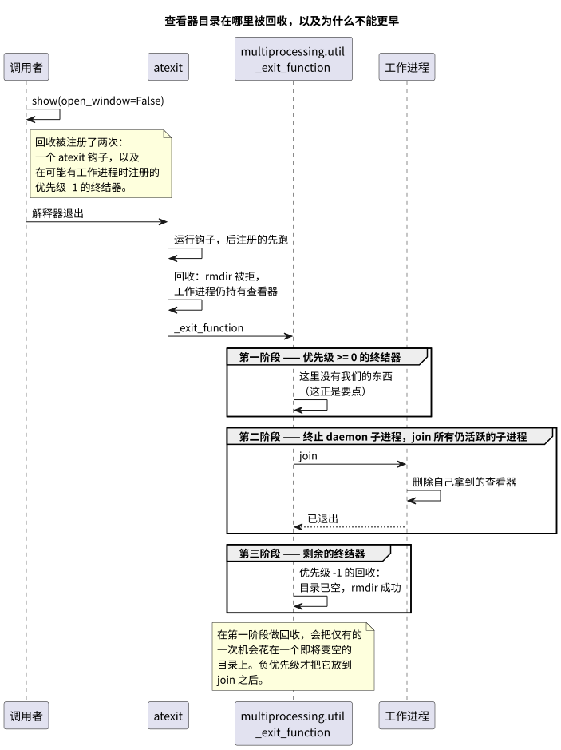

.. _sec-explanations-visualization-zh:

图查看器原理说明
================

``StateMachine.diagram()`` 回答的问题和 ``pyfcstm plantuml`` 不同。PlantUML 给的是可以纳入
版本控制的文本；图查看器给的是\ **一个文件**\ ，在没有网络、没有 PlantUML、也没有装 pyfcstm 的
机器上也能打开，并且——在模型留下了源码时——把模型自己的源码摆在图旁边。

本页解释为什么是这个形态，以及调用者必须据此规划的后果：快照与模型脱钩的是什么、为什么文档
是一个大文件、为什么 ``--open`` 会阻塞、为什么隐私边界是目录而不是文件、以及临时目录何时被回收。
它不是选项清单——精确字段见 :doc:`/reference/visualization_options/index_zh`\ ，精确命令形态见
:doc:`/reference/cli/index_zh`\ ；也不是任务配方，那些在 :doc:`/how_to/visualization/index_zh`\ 。

一次快照，两种产物
------------------

:meth:`pyfcstm.model.model.StateMachine.diagram` 返回一个
:class:`pyfcstm.diagram.api.Diagram`\ ，其余一切都由它派生：

.. list-table:: 快照能产出什么
   :header-rows: 1
   :widths: 22 30 48

   * - 接口
     - 产物
     - 用途
   * - ``to_dict`` / ``to_json``
     - 可移植描述
     - 交给别的渲染器、做差异比较、写测试。不含本机路径与编辑器选择状态，因此两台机器产出
       相同字节。
   * - ``to_html`` / ``save`` / ``show``
     - 一个自包含文档
     - 离线阅读。内嵌渲染器、布局引擎、栅格化器、字体与模型源码，因此不需要预装任何东西。
   * - ``with_options`` / ``with_view_state``
     - 另一个快照
     - 对同一份已捕获的模型换个问法。

为什么快照与模型脱钩
--------------------

快照在 ``diagram()`` 时取一次，并从模型里拷出来。此后再改模型，也不会改变一个\ **已经保存**\ 的
视图所展示的内容；对 :class:`pyfcstm.diagram.api.Diagram` 的属性赋值会被拒绝，而不是被默默接受。

另一种做法——让视图持有模型引用——的失败方式很难被发现。设想一个脚本先捕获视图、再改模型去
试变体、然后把两者都写出来：

.. code-block:: text

   view = machine.diagram()          # 本意：此刻的模型
   machine.add_state(...)            # 试一个变体
   view.save("before.html")          # 活视图在这里渲染出的会是变体

用活视图时，``before.html`` 里装的是\ **变体**\ ，而整个运行过程不会有任何提示。不可变不是洁癖，
它是让 ``before.html`` 这个名字为真的东西。

``with_options`` 与 ``with_view_state`` 返回新快照也是同一个道理：想比较两组选项的调用者拿到的
是两个对象，而不是一个带历史的对象。

为什么是一个自包含文档
----------------------

查看器约 29 MB——按本机实测，从文本加载的 ``state Root;`` 为 29,397,900 字节；确切数字随模型与
打包资产一起变——这是一个刻意的取舍：

.. list-table:: 体积换来什么、代价是什么
   :header-rows: 1
   :widths: 34 66

   * - 性质
     - 后果
   * - 永不发起网络请求
     - 文档能在物理隔离的机器上打开、能作为邮件附件打开、也能在多年后从归档里打开，
       不会有任何东西在脚下腐烂。
   * - 渲染器、布局引擎、栅格化器与中日韩字体全部内嵌
     - 图在任何地方打开都完全一致，字体也一致——这正是中文模型离开原机器后仍可读的原因。
   * - 模型源码随文档一起走——前提是模型留下了源码
     - 源码与图的对照在离线时仍然可用；也意味着这个文档和模型本身一样敏感。模型从未有过源文本
       时的边界见下一节。
   * - 每个文档一个文件，而不是每次调用一个
     - 保留下来的查看器按文档命名，因此对同一幅图问两次拿到的是同一个文件。同一个脚本跑
       三次留下的是一份 29 MB，而不是三份。

最后一行正是文件名派生自文档、而非随机命名的理由。它同时也是调用者必须小心的地方，见
`共享一个名字的代价`_ 一节。

源码那一半在什么情况下不适用
----------------------------

这种对照需要模型同时留下源码\ **和**\ 记录每个状态在哪里声明的位置区间，实际上就是指经
:func:`pyfcstm.model.load.load_state_machine_from_text` 或其文件版本加载。在 Python 里直接拼出来的
:class:`pyfcstm.model.model.StateMachine` 两样都没有，因此查看器会渲染出图、并说明另一半为什么缺失，
而不是给出一个空面板：

.. code-block:: text

   sourceAvailable: False
   sourceUnavailableReason: This model retained neither its original FCSTM source nor
     the ranges that link a state to it; load it through
     load_state_machine_from_file/text. Source text on its own is not enough, because
     the ranges come from parsing.

只传 ``source_text`` 而没有位置区间并不能换来一半的效果。位置区间来自解析，所以只有文本时没有
任何东西可以把状态连过去，查看器会把这种情况判为不可用，而不是给出一个"点了状态却毫无反应"的面板：

.. code-block:: text

   sourceAvailable: False
   sourceUnavailableReason: This model carries source text but no source ranges, so the
     diagram cannot be linked to it. Ranges come from parsing; a model built
     programmatically has none.

为什么查看器拒绝网络
--------------------

因为文档内嵌模型源码，一个能访问网络的查看器就等于给了"一幅图把模型发到别处"的途径。所以策略
不是"不用外部资源"，而是"完全不发请求"：``default-src 'none'``\ 、``connect-src 'none'``\ 、
用脚本哈希而不是仅靠 nonce 放行、``base-uri`` 与 ``form-action`` 都设为 ``'none'``\ 、并且没有
``eval`` 与 ``new Function``\ 。``wasm-unsafe-eval`` 是唯一的例外，它是内嵌栅格化器能运行的前提。

这个主张是被检查的而不是被声明的：``make diagram_csp_check`` 会验证产出文档的十六项性质，
包括字体确实内嵌、页面访问网络次数为零、以及 ``eval`` 与 ``new Function`` 都不出现。

为什么 ``--open`` 会阻塞
------------------------

带窗口的 ``show()`` 行为与 ``matplotlib.pyplot.show()`` 一致：窗口关闭时才返回。这不是需要绕开
的限制——它正是让临时文件的生命周期\ **有主**\ 的东西。

.. list-table:: 谁负责删除文档
   :header-rows: 1
   :widths: 30 34 36

   * - 调用
     - 路径
     - 删除者
   * - ``show()``
     - 每次调用一个新的临时路径
     - 本次调用，在窗口关闭时
   * - ``show(output=...)``
     - 你指定的路径
     - 没有人；它是你的
   * - ``show(open_window=False)``
     - 由文档派生的路径
     - 没有人；见下一节

一个不阻塞的 ``--open`` 会让第一行的第三列没人能回答：文档必须活过进程，因为浏览器是在调用
返回之后才读它——而每份约 29 MB，"活过进程"就等于"不断堆积"。

窗口还会拿到一份\ **私有浏览器配置目录**\ ，理由值得写明：Chromium 系浏览器会把文档交给一个已经
在运行的实例，随即退出，而不是留下来持有那个窗口。若阻塞在那个进程上就会当即返回，于是窗口还
开着文档就被删了。给它自己的配置目录，才让调用者等待的那个进程真的是持有窗口的进程。

为什么隐私边界是目录
--------------------

以 0600 写出的查看器还不够私密，原因是 ``stat`` 对它所询问的文件不需要任何权限：

.. list-table:: 另一个本地用户能知道什么、从哪知道
   :header-rows: 1
   :widths: 40 30 30

   * - 事实
     - 需要
     - 0600 能挡住吗
   * - 文档内容
     - 文件的读权限
     - 能
   * - 文档名字
     - **目录**\ 的读权限
     - 不能
   * - 文档的精确大小
     - 对文件 ``stat``
     - 不能
   * - 该目录存在
     - 父目录的 ``x`` 位
     - 连 0700 也挡不住

中间两项不是同一种泄露，而这一点值得说准，因为整个设计正建立在它之上。

由文档派生的名字是\ **强**\ 指纹：离线渲染候选模型、各算一个哈希，名字要么精确对上、要么完全对不上。

大小只是\ **粗**\ 侧信道，而且很容易碰撞。四个源文本长度相同的单状态模型产出的文档字节数完全一致
——而下面的摘要各不相同，所以它们的名字不同、大小相同：

.. code-block:: text

   29397900  sha 5ab7ea2b6fb891d8  state Root;
   29397900  sha 5c0d65bb553a9654  state Boot;
   29397900  sha 32873dcdfc7523e9  state Test;
   29397900  sha 73773c2d5eb47a00  state AAAA;

内嵌资产占据了长度的绝大部分，所以大小对上只能缩小范围、不能点出是哪个模型。但它仍然是调用者
没有选择公开的信息。

改文件名能关掉前一个泄露、留下后一个；而文件上的\ **任何**\ 权限位都关不掉它们，因为 ``stat``
不需要权限——所以边界必须是\ **目录**\ ，它把两者一起关掉。查看器被放进一个
按用户划分、权限为 0700 的目录，并且\ **每次使用前重新校验**\ 而不是记住"已校验过"：是目录而不是符号
链接、属于当前用户、对其他人关闭。当可预测的名字不可信任时，进程会另建一个自己的私有目录，并给出
一条警告。

剩下仍然可见的是：这样一个目录存在、它最后一次变更的时间、以及在目录大小随条目增长的文件系统上
大致有多少东西在里面。这些都不能识别模型，而识别模型正是那个指纹做到的事。

共享一个名字的代价
------------------

复用跟随的是\ **目录**\ ，不是进程。调用者必须据此规划两件事：

.. code-block:: text

   # 两个互不相干的进程、同一个可信目录、同一个模型：
   进程 1: .../pyfcstm-viewers-1000/kept-5ab7ea2b6fb891d8.html
   进程 2: .../pyfcstm-viewers-1000/kept-5ab7ea2b6fb891d8.html
   进程 2 删除自己拿到的返回值
   进程 1 的路径：没有那个文件

fork 出来的子进程继承已解析的目录，因此拿到的就是父进程拿到的那个路径。这是同一条规则而不是特例
——也正因如此，"每个进程各用自己的一份"是对退化目录的错误描述：单位是目录。

所以保留下来的查看器在\ **删除**\ 上也是共享的。需要一个只有你能删除的文档时，请显式指定输出路径。

临时目录何时被回收
------------------

本节讲的是进程为自己新建的那个目录，而它只在按用户划分的可预测名字不可信任时才会出现。可信的
那个目录\ **不会**\ 被回收，也不应被回收：它的名字承载复用，因此留在里面的查看器会被下一个进程
找到，而空着也不占什么、下次还会再用。下面说的是另一种。

在这样一个目录里保留了查看器、之后又把它删掉的调用者会留下一个空目录，而当初创建它的那次调用
早已不在运行、无从察觉。所以回收发生在退出时——而退出时的\ **哪个位置**\ ，正是能用与不能用的
全部差别：

这幅图要说的是：优先级不是细节。``_exit_function`` 先运行优先级大于等于零的终结器（finalizer），\ **然后**
终止 daemon 子进程并 join 掉所有仍活跃的子进程，\ **最后**\ 运行剩下的。仍然持有所拿到查看器的工作进程（worker）在第一段里还没删除它，
因此那里的回收会发现目录被占用、并把仅有的一次机会花掉。负优先级把它放进第三段，也就是 join 之后。
在 CPython 3.7 到 3.14、``fork`` / ``spawn`` / ``forkserver`` 上实测：优先级为零时工作进程尚未完成，
到最后一段时已经完成。

因此一次退出里可能有两处注册都运行，而谁先跑取决于调用者恰好是按什么顺序展示与启动的：

.. list-table:: 调用者会产生的两种顺序
   :header-rows: 1
   :widths: 30 70

   * - 顺序
     - 会发生什么
   * - 先启动工作进程再展示
     - ``multiprocessing.util`` 已经导入，所以 ``atexit`` 钩子与 finalizer 都存在。``atexit``
       先跑晚注册的那个，于是钩子遇到的是工作进程仍持有的目录；而 finalizer 在 join 之后跑，
       遇到的是空目录。
   * - 先展示再启动工作进程
     - 导入 ``multiprocessing`` 并不会导入它的 ``util``\ ，所以根本没有注册 finalizer。此时
       ``util`` 自己的钩子成了晚注册的那个、先运行，并在本包的钩子去看目录之前把工作进程 join 完。

无论哪一个成功，另一个看到的都是一个已经消失的目录，这就是 ``ENOENT`` 被判为"想要的结果"而不是
失败的原因。

任何退出钩子都到不了的情况是：进程离开时一个钩子都不跑——手工 ``os._exit``\ ，或者信号。这样的
进程会留下一个空目录，而且只在可预测的名字本来就不可信任时才会留下。这里的任何代码都无法回收它，
因为簿记是按进程的：别的进程的残留是不可见的，而按名字去扫临时目录会与一个正处在"已创建自己的
目录、尚未写入"之间的进程发生竞争。

平台在哪里限制了这个承诺
------------------------

目录校验在 POSIX 上名副其实，因为权限位和属主都可以询问。在 Windows 上它仍然会问路径是否存在、
以及 ``os.lstat`` 报告的是不是目录（而非链接或文件）——它问不到的是属主与"还有谁能看"：那里存在
属主、也能通过平台的安全接口读到，但本包使用的可移植 ``os.lstat`` 与 ``os.geteuid`` 不报告它。

``os.mkdir`` 在 Windows 上确实会为 0o700 应用限制性 ACL，自携带 CVE-2024-4030 的那批发布起——
3.8.20、3.9.20、3.10.15、3.11.10 与 3.12.4——以及 3.13 与其后每一条线（含 3.14），在那些线上它是
该线自身的发布行为而不是回移。0o700 之外的其它权限值在那里同样被忽略，而 0o700 在上述发布之前
也被忽略。那四个回移版本都发布在 python.org 停止为各自线提供 Windows 安装包之后，所以实用
结论比版本清单短得多：用 python.org 的安装包时，这道 ACL 自 3.12.4 起存在、更低则没有。
3.8.20、3.9.20、3.10.15、3.11.10 的自建或再分发解释器则有。那里的私密性依赖 ``%TEMP%`` 按账户隔离（默认如此）：若 ``TEMP`` 指向一个多用户共享的
目录，进程内部无法检测，此时无论目录还是文件上的 0600 都保护不了任何东西，因为那个权限位在
Windows 上只是只读标志。

由此得出的建议与共享那一节一致：不希望文档落在共享位置、或需要一个只有自己能删除的文档时，
请显式指定输出路径。

区域怎样绘制
------------

拥有者（owner）是带有区域（region）的状态，它按书写顺序依次推进各区域，见\ :doc:`含区域的模型怎样执行一个周期 </explanations/region_semantics/index_zh>`\ 。因此区域不是状态：它不会成为任何转换的目标，没有自己的进入和退出，也不像状态那样“处于活动”。它是拥有者的一个有名字、有顺序的部分。每种输出都这样画它：画成拥有者被分割出来的一块区域，而不是一个独立的方框。

.. list-table:: 每种输出怎样表示一个区域
   :header-rows: 1
   :widths: 26 74

   * - 输出
     - 区域的形式
   * - PlantUML（\ ``pyfcstm plantuml``\ ）
     - 并发分区：同一个拥有者的各区域用 ``--`` 分隔，每个区域以一条写着 ``region N: Name`` 的注释开头。
   * - 图快照（\ ``to_dict`` / ``to_json``\ 、\ ``pyfcstm diagram``\ ）
     - 拥有者的一个子节点，带 ``region: true`` 和 ``ordinal``\ 。
   * - HTML 查看器与 VS Code 预览
     - 各区域在拥有者外框内并排，以虚线分割线分隔，没有自己的边框，标题同样是 ``region N: Name``\ 。

.. literalinclude:: region_plantuml.demo.sh
   :language: bash
   :caption: region_plantuml.demo.sh

.. literalinclude:: region_plantuml.demo.sh.txt
   :language: text
   :caption: region_plantuml.demo.sh.txt

依次读这段输出的三个部分：

1. 第一块里 ``--`` 把 ``Safety`` 和 ``Motion`` 分开。每个区域有自己的 ``[*]`` 初始箭头和自己的转换，两个区域之间没有箭头，因为不可能有。
2. 第二块是把同样两个区域按另一种顺序书写。变化的只有编号和分区的先后：\ ``N`` 是源码里的位置，也就是区域运行的顺序。所以读图的人可以直接从图上读出执行顺序。
3. 第三块里 ``max_depth=2`` 折叠了区域内部的内容，但保留区域。区域像状态一样占一层深度。

快照把同样的事实表示成数据：

.. literalinclude:: region_snapshot.demo.sh
   :language: bash
   :caption: region_snapshot.demo.sh

.. literalinclude:: region_snapshot.demo.sh.txt
   :language: text
   :caption: region_snapshot.demo.sh.txt

``Controller.Running`` 的子节点按书写顺序出现，\ ``ordinal`` 从一开始。下面的布局步骤依赖的正是这个字段。

查看器画的是同一个结构。下面这幅示意图是手绘的，用来表现形态，不是查看器的输出：

.. code-block:: text

   Schematic, a top-to-bottom diagram:

   +-- Running ----------------------------------------------+
   |  region 1: Safety       :  region 2: Motion               |
   |                         :                                 |
   |  [*] -> (Watching)      :  [*] -> (Off) <-> (On)          |
   +----------------------------------------------------------+
                             ^ dashed divider

为什么画成分割的区域而不是状态：状态形状的方框会让人以为箭头可以指向它，或者拥有者像“处于某个状态”那样“处于”这个区域。分割线表达的恰恰相反：这些区域是同一个整体的部分，从一块到另一块没有路径，从左到右或从上到下的顺序是它们之间唯一的关系。早先的形式给每个区域画一个虚线框，分割线的形式取代了它，让各区域读起来是同一个拥有者的部分。

**不**画的，是只因降级才存在的一切。用 ``active("...")`` 写的条件保留完整路径，隐藏的标志变量和对它们的自动写入不会出现：

.. literalinclude:: region_active_display.demo.sh
   :language: bash
   :caption: region_active_display.demo.sh

.. literalinclude:: region_active_display.demo.sh.txt
   :language: text
   :caption: region_active_display.demo.sh.txt

这个模型取自\ :doc:`诊断解释 </explanations/diagnostics/index_zh>`\ 。图例和快照的变量列表里都没有 ``__active_*`` 变量，而 ``--enable-verify`` 的一条发现会点出其中一个。图展示的是书写的模型；运行的机器不是读者需要看到的东西。没有任何输出标出一次运行的当前配置：运行态叠加不在这些输出的能力之内。

顺序怎样得到保证
----------------

同一个拥有者的各区域之间没有转换，布局引擎没有任何依据让它们保持顺序。给查看器和预览做布局的 ELK 可以为减少边交叉而移动它们，实际也会这样：一个含区域 A、B、C 的模型曾被排成 C、A、B。它自己的排序选项对渲染器使用的嵌套布局要么不起作用，要么让它崩溃，所以不向引擎要求顺序，而是在布局之后恢复顺序。

.. list-table:: 区域的布局步骤
   :header-rows: 1
   :widths: 6 40 54

   * - 步骤
     - 做什么
     - 为什么安全
   * - 1
     - ELK 对整张图做布局。
     - 位置来自引擎，区域的先后是它自己选的。
   * - 2
     - 每个拥有者的各区域按 ``ordinal`` 排序，依次放回引擎给出的位置槽里，保持每个区域的大小和它们之间的间隔。
     - 区域不与自身之外的任何东西相连，横向移动它不会扰动任何边，拥有者的大小也不变。
   * - 3
     - 如果某个拥有者的各区域没有排在同一行（从左向右的图里是同一列），就在相邻区域之间加一串不可见的边，重新布局一次，把顺序固定下来。
     - 代价是图变长，而且只在这种情形下才发生。渲染器会跳过这些边（\ ``kind`` 为 ``regionOrder``\ ）。
   * - 4
     - 各区域被平铺在拥有者的主体上，相邻区域之间画一条虚线分割线。
     - 两条路径的最后一步相同，所以无论第 3 步是否执行，画面看起来一样。

顺序沿图的方向排开：自上而下的图里是同一行内从左到右，自左向右的图里是同一列内从上到下。HTML 查看器和 VS Code 预览调用同一个布局函数，所以两者不会在这一点上不一致。PlantUML 完全不用这段代码：pyfcstm 按书写顺序把分区交给它，如上面的输出所示，其余由 PlantUML 布局。

四个入口，一套约定
------------------

观看一个模型的四种方式只共享约定，不共享别的东西。

.. list-table:: 各入口及各自的限制
   :header-rows: 1
   :widths: 22 26 52

   * - 入口
     - 命令或接口
     - 它特有的
   * - PlantUML 文本
     - ``pyfcstm plantuml``
     - 可以纳入版本控制的文本。布局由 PlantUML 完成，不是 pyfcstm。PlantUML 内置的 Smetana 布局不支持并发分区，会丢掉第一个之后的所有区域；pyfcstm 不输出布局指令，所以只有强制使用那种布局时才会遇到。请使用默认的 Graphviz 布局。
   * - 图快照
     - ``StateMachine.diagram()``\ 、\ ``pyfcstm diagram``
     - 不含布局的可移植数据。它与模型脱钩，之后编辑模型不会改变它。
   * - HTML 查看器
     - ``Diagram.to_html`` / ``save`` / ``show``\ 、\ ``pyfcstm diagram -o x.html`` / ``--open``
     - 一个自包含文件，用 ELK 和上面的重排做布局；\ ``--open`` 需要 Chromium 系浏览器并且会阻塞。
   * - VS Code 预览
     - 编辑器扩展
     - 同一个布局函数，由编辑器自己对打开文档建立的模型驱动，而不是 Python 给出的快照。

共享的约定就是上面那些：\ ``region N: Name`` 的标题，\ ``N`` 是书写顺序；\ ``active("...")`` 按书写显示；不出现隐藏变量；区域在 ``max_depth`` 里占一层。它们之所以共享，是因为读者为同一个模型在这些入口之间来回切换；约定上的差异看起来就会像模型的差异。

区域外观上已知的缺口，都不改变模型的行为：

* 折叠后的区域仍保持展开时的大小，拥有者不会随之缩小。
* 除预览之外，编辑器没有区域专用的支持：大纲与面包屑把区域当成状态，详情里把它标成 ``composite``\ ，重命名状态不会更新引用它的 ``active("...")`` 字符串，悬停没有内容。
* 使用历史的模型，PlantUML 和 Python 快照按书写绘制，编辑器预览仍画展开后的机器，见 `issue #590 <https://github.com/HansBug/pyfcstm/issues/590>`_\ 。
* 标题宽度是估算的而不是测量的，所以约五十个字符的区域名可能让标题末尾压到折叠按钮上一两个像素。

下一步
------

任务见 :doc:`/how_to/visualization/index_zh`\ ；本页所推理的精确选项字段、环境变量与行为边界见
:doc:`/reference/visualization_options/index_zh`\ 。
