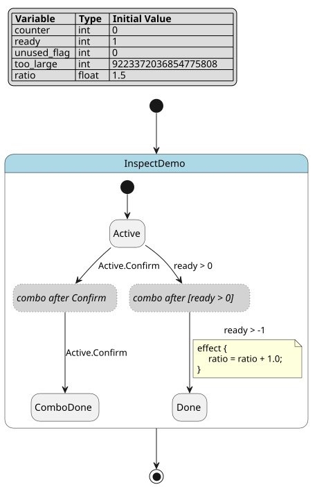

.. _sec-how-to-inspect:

Inspect tasks
=============

Use these recipes when you already know what you want ``pyfcstm inspect`` to
do. The tutorial at :doc:`../../tutorials/inspect/index` shows the walkthrough;
this page is the task desk for CI, triage, repair handoffs, suffix warnings,
and structural/SMT-local verify integration.

The recipes read ``docs/source/tutorials/inspect/inspect_diagnostics.fcstm``,
the model of the tutorial, so run them from the repository root. The model is
valid FCSTM DSL and intentionally contains suspicious but inspectable design
facts. A command failure means the input could not become a report; a successful
report can still contain warnings and infos. The commands write their files
into the current directory, and later cards read the files that earlier cards
wrote.

   The figure proves the authored machine is small but not trivial: combo
   triggers expand into pseudo relay states while diagnostics still point back
   to authored transitions and relay provenance.

Shared rules for every recipe
-----------------------------

Each card states the same six audit facts: **Input**, **Command or code**,
**Expected signal**, **File side effect**, **First failure check**, and
**Reference link**. The walkthrough with longer reports is the tutorial; this page
shows only the short excerpts that matter for each task, and ``...`` marks the
part of an output that the card leaves out.

1. Choose the report format
---------------------------

**Input.** A valid FCSTM file and a known consumer: a person, a script, or a
repair prompt.

**Command or code.** Compare the four public formats. Each report is long, so
only its first lines are shown:

.. code-block:: console

   $ pyfcstm inspect -i docs/source/tutorials/inspect/inspect_diagnostics.fcstm
   [WARN] FCSTM Inspect Report: docs/source/tutorials/inspect/inspect_diagnostics.fcstm

   Summary
     status: warning
   ...
   $ pyfcstm inspect -i docs/source/tutorials/inspect/inspect_diagnostics.fcstm --format json
   {
     "action_ref_graph": {
   ...
   $ pyfcstm inspect -i docs/source/tutorials/inspect/inspect_diagnostics.fcstm --format llm-json
   {
     "diagnostics": [
       {
         "code": "W_DURING_CONST_ASSIGN",
   ...
   $ pyfcstm inspect -i docs/source/tutorials/inspect/inspect_diagnostics.fcstm --format llm-md
   # FCSTM Inspect Report

   - Status: `warning`
   ...

**Expected signal.** ``human`` starts with a checker-style summary, ``json``
holds the full structural arrays (cards 4 and 5 read ``root_state_path`` and
``diagnostics`` from it), ``llm-json`` holds ``status``, ``summary``, and
``diagnostics``, and ``llm-md`` starts with a Markdown heading. Validate either
JSON report with the schema file shipped with the same ``pyfcstm`` release.

**File side effect.** None unless ``-o`` is used; all four commands write to
stdout by default.

**First failure check.** Run ``python -m pyfcstm inspect --help`` and confirm
that ``--format`` still lists ``human|json|llm-json|llm-md``.

**Reference link.** Format contracts live in :doc:`../../reference/inspect_report/index`.

2. Read a human report during local triage
------------------------------------------

**Input.** The diagnostic-heavy tutorial file.

**Command or code.** Disable color when the report will be pasted into an issue
or review comment:

.. code-block:: console

   $ pyfcstm inspect -i docs/source/tutorials/inspect/inspect_diagnostics.fcstm --color never
   [WARN] FCSTM Inspect Report: docs/source/tutorials/inspect/inspect_diagnostics.fcstm

   Summary
     status: warning
     root: InspectDemo
     states: 6 total / 3 leaf
     transitions: 5
     variables: 5
   ...
     diagnostics: 0 errors / 9 warnings / 4 infos
     verification: disabled

   [WARN] W_DURING_CONST_ASSIGN
     During action in 'InspectDemo.Active' assigns 'counter' to the same constant value every cycle.
   ...

**Expected signal.** The report begins with the summary above and the first
warning is ``W_DURING_CONST_ASSIGN``. Each diagnostic block also carries a
source excerpt, ``why`` text, suggested fix shapes, and ``do-not`` guidance.

**File side effect.** None; the pipeline reads one file and writes plain text to stdout.

**First failure check.** If the first line is colorized escape text, add
``--color never``. If no report appears, check stderr for read, parse, or
model-validation failure before debugging diagnostics.

**Reference link.** Diagnostic-code meaning and repair metadata live in
:doc:`../../reference/diagnostics_codes/index`.

3. Save a human report and control color
----------------------------------------

**Input.** A report you want to attach as a plain text artifact.

**Command or code.** Write the human renderer to a file:

.. code-block:: console

   $ pyfcstm inspect -i docs/source/tutorials/inspect/inspect_diagnostics.fcstm \
       --format human --color never -o inspect-human.txt
   $ head -n 5 inspect-human.txt
   [WARN] FCSTM Inspect Report: docs/source/tutorials/inspect/inspect_diagnostics.fcstm

   Summary
     status: warning
     root: InspectDemo

**Expected signal.** The file starts with ``[WARN] FCSTM Inspect Report`` and
contains no ANSI escapes. Color is always disabled for file output.

**File side effect.** ``inspect-human.txt`` is created or overwritten with
UTF-8 text.

**First failure check.** If the file is empty, check whether the output
directory exists; ``pyfcstm inspect`` reports write failures as CLI errors.

**Reference link.** Color and output-file rules are listed in :doc:`../../reference/inspect_report/index`.

4. Write full JSON for CI or tooling
------------------------------------

**Input.** A valid model and a CI job that needs exact counts or graph facts.

**Command or code.** Save the full ``ModelInspect`` payload, then read counts
from it:

.. code-block:: console

   $ pyfcstm inspect -i docs/source/tutorials/inspect/inspect_diagnostics.fcstm \
       --format json -o inspect.json

.. testcode::

   import json
   from pathlib import Path

   report = json.loads(Path('inspect.json').read_text())
   print(report['root_state_path'])
   print(len(report['states']), len(report['transitions']))
   print(len(report['diagnostics']))

.. testoutput::

   InspectDemo
   6 5
   13

**Expected signal.** The script prints ``InspectDemo``, then ``6 5``, then
``13``. The full JSON also contains ``combo_origins``, ``reachability_graph``,
``var_dataflow``, and ``metrics``.

**File side effect.** ``inspect.json`` is created or overwritten.

**First failure check.** If ``json.loads`` fails, confirm the command used
``--format json``. A human report saved with a ``.json`` suffix is still text.

**Reference link.** Full top-level and nested fields are described in
:doc:`../../reference/inspect_report/index`.

5. Fail a CI gate from JSON severity
------------------------------------

**Input.** A full JSON report generated by card 4 at ``inspect.json``.

**Command or code.** Count severities instead of matching message text:

.. testcode::

   import json
   from pathlib import Path

   report = json.loads(Path('inspect.json').read_text())
   errors = [item for item in report['diagnostics'] if item['severity'] == 'error']
   warnings = [item for item in report['diagnostics'] if item['severity'] == 'warning']
   if errors:
       raise SystemExit('inspect found blocking diagnostics')
   print('warnings:', len(warnings))

.. testoutput::

   warnings: 9

**Expected signal.** The tutorial file has zero errors and nine warnings, so a
warning-only policy prints ``warnings: 9`` and exits successfully.

**File side effect.** None; the snippet only reads the JSON file.

**First failure check.** If the gate fails on this fixture, print the offending
``code`` values first. Do not compare localized prose or source excerpts.

**Reference link.** Stable diagnostic object keys are in
:doc:`../../reference/diagnostics_codes/index`.

6. Write ``llm-json`` for an automated repair prompt
----------------------------------------------------

**Input.** A valid model and an LLM repair loop that needs a compact packet.

**Command or code.** Create the compact repair packet, then look at its first
diagnostic:

.. code-block:: console

   $ pyfcstm inspect -i docs/source/tutorials/inspect/inspect_diagnostics.fcstm \
       --format llm-json -o inspect.llm.json

.. testcode::

   import json
   from pathlib import Path

   report = json.loads(Path('inspect.llm.json').read_text())
   first = report['diagnostics'][0]
   print(report['status'])
   print(sorted(first.keys()))
   print(len(first['recommended_actions']), len(first['do_not']))

.. testoutput::

   warning
   ['code', 'do_not', 'location', 'message', 'provenance', 'recommended_actions', 'refs', 'repair_guidance', 'severity', 'source', 'source_excerpt', 'summary']
   2 1

**Expected signal.** The packet has no product-level schema version field. Its
first diagnostic includes ``source_excerpt``, ``refs``, ``recommended_actions``,
and ``do_not``; the final count line is ``2 1``. Validate it with the
``inspect_llm_report_schema.json`` shipped with the same ``pyfcstm`` release.

**File side effect.** ``inspect.llm.json`` is created or overwritten.

**First failure check.** If the packet lacks repair guidance, check whether the
``code`` exists in ``codes.yaml`` and whether the renderer can see source text.

**Reference link.** LLM report fields are listed in
:doc:`../../reference/inspect_report/index`.

7. Write ``llm-md`` for a human repair handoff
----------------------------------------------

**Input.** The same model, but the consumer wants a readable Markdown note.

**Command or code.** Export Markdown and show only the header:

.. code-block:: console

   $ pyfcstm inspect -i docs/source/tutorials/inspect/inspect_diagnostics.fcstm \
       --format llm-md -o inspect.llm.md
   $ head -n 5 inspect.llm.md
   # FCSTM Inspect Report

   - Status: `warning`
   - Input: `docs/source/tutorials/inspect/inspect_diagnostics.fcstm`
   - Diagnostics: 0 errors / 9 warnings / 4 infos

**Expected signal.** The Markdown file begins with the heading and the three
bullet lines above.

**File side effect.** ``inspect.llm.md`` is created or overwritten.

**First failure check.** If a JSON-looking file appears, confirm the command
used ``--format llm-md`` and not ``--format llm-json``.

**Reference link.** The shared LLM contract is in
:doc:`../../reference/inspect_report/index`; repair philosophy is in
:doc:`../../explanations/diagnostics/index`.

8. Navigate from a diagnostic to the source span
------------------------------------------------

**Input.** Human, full JSON, or LLM output containing a ``span`` or
``location`` object.

**Command or code.** Ask for the human report and read the block of the
duplicate combo event:

.. code-block:: console

   $ pyfcstm inspect -i docs/source/tutorials/inspect/inspect_diagnostics.fcstm --color never
   ...
   [WARN] W_COMBO_DUPLICATE_EVENT
     Combo trigger repeats event 'InspectDemo.Active.Confirm'; this is legal but usually redundant.
     --> docs/source/tutorials/inspect/inspect_diagnostics.fcstm:19:38
       |
    18 |     [*] -> Active;
    19 |     Active -> ComboDone :: Confirm + Confirm;
       |                                      ^^^^^^^
    20 |     Active -> Done : [ready > 0] + [ready > -1] effect {
       |
   ...

**Expected signal.** The ``-->`` line gives ``line:column`` (here ``19:38``) and
the caret line underlines the second ``Confirm`` term.

**File side effect.** None.

**First failure check.** If the source line is missing, confirm the report came
from the top-level source file; imported or generated spans may have less
nearby context.

**Reference link.** ``span`` and ``location`` fields are specified in
:doc:`../../reference/inspect_report/index`.

9. Understand output suffix warnings
------------------------------------

**Input.** A requested format and an output filename whose extension may imply a
different format.

**Command or code.** This command is legal but suspicious. The warning goes to
stderr, which the console record shows with the rest of the output:

.. code-block:: console

   $ pyfcstm inspect -i docs/source/tutorials/inspect/inspect_diagnostics.fcstm -o report.json
   Warning: output file 'report.json' looks like JSON, but inspect format is 'human'. Use '--format json' if you intended machine-readable JSON output.
   $ head -n 1 report.json
   [WARN] FCSTM Inspect Report: docs/source/tutorials/inspect/inspect_diagnostics.fcstm

**Expected signal.** Stderr says the file looks like JSON but the format is
``human``. The command still writes human text; explicit JSON output to a
Markdown suffix also warns about suffix-vs-format mismatch.

**File side effect.** ``report.json`` contains human text, not JSON.

**First failure check.** If downstream JSON parsing fails, inspect the first
line of the file before changing the parser.

**Reference link.** Suffix and color behavior is part of the report reference:
:doc:`../../reference/inspect_report/index`.

10. Separate invalid input from successful diagnostics
-------------------------------------------------------

**Input.** A file that may be syntactically invalid, model-invalid, or valid
with warnings.

**Command or code.** Treat non-zero exit status as a process failure, not as a
normal report. The first two files are written on the spot:

.. code-block:: console

   $ printf 'state' > bad.fcstm
   $ pyfcstm inspect -i bad.fcstm --format json
   Failed to parse input DSL file bad.fcstm: Found 1 errors during parsing:
   ...
   $ echo $?
   1
   $ printf 'state A { state X; state X; [*] -> X; }\n' > dup.fcstm
   $ pyfcstm inspect -i dup.fcstm --format json
   Invalid state machine model in dup.fcstm: Duplicate state name in namespace 'A':
   ...
   $ echo $?
   1
   $ pyfcstm inspect -i docs/source/tutorials/inspect/inspect_diagnostics.fcstm \
       --format json -o inspect-ok.json
   $ echo $?
   0

**Expected signal.** A syntax error exits with status ``1`` and writes stderr
that starts with ``Failed to parse input DSL file``. A duplicate state model
error starts with ``Invalid state machine model``. The valid tutorial model
exits with status ``0`` even though its report status is ``warning``.

**File side effect.** A failed command does not produce a successful
``diagnostics`` array. If ``-o`` was requested, do not trust a stale file from a
previous run.

**First failure check.** Print the shell exit status and stderr before opening
``diagnostics[]``. Invalid-input checks belong at the process boundary.

**Reference link.** Failure boundaries are summarized in
:doc:`../../reference/inspect_report/index` and the diagnostic explanation page
:doc:`../../explanations/diagnostics/index`.

11. Enable structural and SMT-local verify diagnostics
------------------------------------------------------

**Input.** A valid model and a reason to include inspect-eligible verification
algorithms.

**Command or code.** Opt in explicitly, then look for the two topological codes:

.. code-block:: console

   $ pyfcstm inspect -i docs/source/tutorials/inspect/inspect_diagnostics.fcstm \
       --enable-verify --format json -o inspect-verify.json

.. testcode::

   import json
   from pathlib import Path

   report = json.loads(Path('inspect-verify.json').read_text())
   codes = [item['code'] for item in report['diagnostics']]
   print('W_TOPOLOGICAL_NOEXIT' in codes)
   print('I_TOPOLOGICAL_NON_TERMINATING' in codes)

.. testoutput::

   True
   True

**Expected signal.** The tutorial model prints ``True`` for both topological
checks when verify integration is enabled.

**File side effect.** ``inspect-verify.json`` is created or overwritten.

**First failure check.** If no verify-backed codes appear, confirm
``--enable-verify`` was present. Raising ``--max-complexity-tier`` can allow
additional model-derived structural or SMT-local algorithms. It does not load
:mod:`pyfcstm.bmc` or parse a ``.fbmcq`` query.

**Reference link.** Verify tier meaning is explained in
:doc:`../../explanations/diagnostics/index`; code details are in
:doc:`../../reference/diagnostics_codes/index`.

12. Keep target and deployment warnings precise
------------------------------------------------

**Input.** The full JSON report of card 4 and a diagnostic whose message
mentions a target family or generated runtime profile.

**Command or code.** Read the numeric warning refs:

.. testcode::

   import json
   from pathlib import Path

   report = json.loads(Path('inspect.json').read_text())
   code = 'W_NUMERIC_LITERAL_OUT_OF_TARGET_RANGE'
   item = next(d for d in report['diagnostics'] if d['code'] == code)
   print(', '.join(item['refs']['target_templates']))
   print(item['refs']['runtime_note'])

.. testoutput::

   c, c_poll, cpp, cpp_poll
   C/C++ deployment profile risk: the default C-family templates use PYFCSTM_GENERATED_INT64, while Python generated runtimes may not have the same fixed-width integer carrying risk.

**Expected signal.** The target templates are ``c, c_poll, cpp, cpp_poll``.
The runtime note says the risk is tied to the C/C++ default integer profile;
Python generated runtimes may not carry the same fixed-width risk.

**File side effect.** None; the snippet reads a previously saved JSON report.

**First failure check.** If a review comment says “Python overflow”, compare it
against ``refs.target_templates`` before acting. The same diagnostic can be a
real deployment risk without applying to every target.

**Reference link.** Target-specific numeric diagnostics are cataloged in
:doc:`../../reference/diagnostics_codes/index`.

13. Read and repair ``I_REGION_BACKWARD_READ``
----------------------------------------------

**Input.** ``region_read_back.fcstm``: ``Reader`` is written before
``Writer`` and reads ``level``, which ``Writer`` assigns.  Regions run in
writing order, so ``Reader`` sees ``level`` from the previous cycle.

.. literalinclude:: region_read_back.fcstm
   :language: fcstm
   :caption: region_read_back.fcstm

**Command or code.** Download :download:`region_read_back.fcstm` and
:download:`region_read_back_fixed.fcstm` into an empty directory.  The report
is long, so the output keeps the block of the diagnostic code (and, for the
fixed model, the line that counts the diagnostics) and leaves the rest out:

.. code-block:: console

   $ pyfcstm inspect -i region_read_back.fcstm --color never
   ...
   [INFO] I_REGION_BACKWARD_READ
     Region 'Root.Reader' reads variable 'level', which is produced by the later region 'Root.Writer'; it sees the value from the previous cycle.
     --> region_read_back.fcstm:8:31
      |
    7 |         [*] -> Idle;
    8 |         state Idle { during { seen = level; } }
      |                               ^^^^^^^^^^^^^
    9 |     }
      |
      = source: inspect-static
      = why: An earlier region reads something a later region produces in the same cycle, so it sees the previous cycle's value.
      = fix: kind: confirm_order; target: region; rationale: Keep the declaration order when reading the previous cycle's value is intended.
      = fix: kind: reorder_regions; target: region; rationale: Declare the producing region before the reading region when the current cycle's value is needed.
      = do-not: Do not treat this as a defect; it is the defined behavior of ordered regions.
   $ pyfcstm inspect -i region_read_back_fixed.fcstm --color never
   ...
     diagnostics: 0 errors / 3 warnings / 0 infos
   ...

**Expected signal.** The first model gets an ``[INFO] I_REGION_BACKWARD_READ``
naming the reading region, the variable and the later region that writes it,
with the span of the read.  The second model, ``region_read_back_fixed.fcstm``,
declares ``Writer`` first and reports nothing for this code.  The message is a
note: keep the order when the previous-cycle value is what you want
(``confirm_order``), and reorder when you need this cycle's value
(``reorder_regions``).  The count line of the fixed model shows ``0 infos``,
which is where the information was before.  The same code is reported when an earlier region asks
``active()`` about a state of a later region.

**File side effect.** None; the reports go to stdout.

**First failure check.** If the code does not disappear after the reorder,
check that no other earlier region still reads a value produced by a later one.

**Reference link.** :doc:`/reference/inspect_report/index`.

14. Read and repair ``W_REGION_BLIND_OVERWRITE``
------------------------------------------------

**Input.** ``region_blind_overwrite.fcstm``: ``Early`` writes ``out = 1`` in
every cycle and ``Late`` assigns ``out = y + 2`` in every cycle without reading
``out``, so the first write is always lost.

.. literalinclude:: region_blind_overwrite.fcstm
   :language: fcstm
   :caption: region_blind_overwrite.fcstm

**Command or code.** Download :download:`region_blind_overwrite.fcstm` and
:download:`region_blind_overwrite_fixed.fcstm`.  As above, the output keeps the
block of the diagnostic code and the count line:

.. code-block:: console

   $ pyfcstm inspect -i region_blind_overwrite.fcstm --color never
   ...
   [WARN] W_REGION_BLIND_OVERWRITE
     Region 'Root.Late' overwrites variable 'out' in every cycle without using the value written by the earlier region 'Root.Early'; that earlier write is lost whenever it runs.
     --> region_blind_overwrite.fcstm:11:28
       |
    10 |         [*] -> B;
    11 |         state B { during { out = y + 2; } }
       |                            ^^^^^^^^^^^^
    12 |     }
       |
      = source: inspect-static
      = why: A later region overwrites, in every cycle and without looking at it, a variable written by an earlier region, so the earlier write has no effect.
      = fix: kind: use_previous_value; target: statement; rationale: Combine with the earlier value, for example ``x = x + y;``, when both writes are meant to count.
      = fix: kind: use_separate_variables; target: variable; rationale: Give each region its own variable when the writes are independent.
      = do-not: Do not remove the earlier write without checking that no other state of that region depends on it.
      = do-not: Do not report a default value that a later region overrides only in some states or under a condition.
   $ pyfcstm inspect -i region_blind_overwrite_fixed.fcstm --color never
   ...
     diagnostics: 0 errors / 3 warnings / 0 infos
   ...

**Expected signal.** The warning points at the overwriting statement in
``Late`` and, in the machine-readable report, ``previous_write_span`` names the
lost write.  The repair suggested by the report is either to combine the
values (``out = out + y + 2;`` in ``region_blind_overwrite_fixed.fcstm``, after
which the code is not reported) or to give each region its own variable.  The
warning is deliberately narrow: a conditional overwrite, an overwrite by only
some states, a region that can finish, an abstract action, or a read of the
variable in a region in between all silence it.

**File side effect.** None.

**First failure check.** If you expected the warning and do not get it, check
that every leaf state of the later region writes the variable at the top level
of its ``during`` and that nothing reads it first.

**Reference link.** :doc:`/reference/inspect_report/index`.

15. Understand ``owner_never_completes``
----------------------------------------

**Input.** ``region_never_completes.fcstm``: ``Job`` owns two regions.
``A`` can finish with ``Run -> [*]``; ``B`` has no ``-> [*]``.  The ordinary
transition ``Job -> Next`` runs only after every region is done.

.. literalinclude:: region_never_completes.fcstm
   :language: fcstm
   :caption: region_never_completes.fcstm

**Command or code.** Download :download:`region_never_completes.fcstm` and
:download:`region_owner_completes_fixed.fcstm`:

.. code-block:: console

   $ pyfcstm inspect -i region_never_completes.fcstm --color never
   ...
   [WARN] W_UNREACHABLE_TRANSITION
     Authored transition 'Root.Job' -> 'Root.Next' is unreachable for reasons: owner_never_completes.
     --> region_never_completes.fcstm:17:5
       |
    16 |     state Next;
    17 |     Job -> Next;
       |     ^^^^^^^^^^^^
    18 | }
       |
      = source: inspect-static
      = why: This authored transition is unreachable under the available analysis evidence. The reason list distinguishes source-state reachability, event-consumer reachability, forced expansion, guards, shadowing, and redundancy.
      = fix: kind: inspect_transition; target: transition; rationale: Check each entry in ``refs.reasons`` against the transition's source, trigger, guard, and declaration scope before changing behavior.
      = do-not: Do not remove a transition solely because this warning is present; verify that the reported reason matches the intended runtime model.
   $ pyfcstm inspect -i region_owner_completes_fixed.fcstm --color never
   ...
     diagnostics: 0 errors / 1 warnings / 1 infos
   ...

**Expected signal.** ``W_UNREACHABLE_TRANSITION`` with the reason
``owner_never_completes`` on ``Job -> Next``.  Give ``B`` a way to finish
(``region_owner_completes_fixed.fcstm``) and that warning disappears: the count
line drops from four warnings to one.  A forced transition on the owner is always reachable
and is not affected.

**File side effect.** None.

**First failure check.** List the regions in the report summary and check that
each has a ``-> [*]`` whose guard or event can happen.

**Reference link.** :doc:`/reference/inspect_report/index`.

Troubleshooting quick reference
-------------------------------

This table is supplementary; it is not one of the fifteen task cards.

.. list-table:: First checks
   :header-rows: 1
   :widths: 30 35 35

   * - Symptom
     - Likely boundary
     - First action
   * - No output file appears
     - CLI read, parse, model, policy, or write failure
     - Check exit status and stderr before reading a stale file.
   * - JSON parser sees ``[WARN]``
     - Human report was saved with a JSON-looking suffix
     - Re-run with ``--format json`` and keep the suffix warning visible.
   * - ANSI escapes appear in a paste
     - Human renderer color was enabled for stdout
     - Re-run with ``--color never`` or write to ``-o``.
   * - Verify codes are absent
     - Static inspect ran without optional verify integration
     - Add ``--enable-verify`` and keep policy limits bounded.
   * - A warning seems target-specific
     - Diagnostic refs carry deployment scope
     - Read ``refs`` before applying the finding to every generated runtime.
   * - LLM edit looks too broad
     - Repair prompt ignored diagnostic provenance
     - Use ``llm-json`` or ``llm-md`` and keep ``do_not`` rules in the prompt.

Verification evidence for this page
-----------------------------------

The documentation checks run every command and script of the cards on this page
and compare what they print with the output shown, so the excerpts change only
when the report format or the model of :doc:`../../tutorials/inspect/index`
changes. The checks run the commands from the repository root, with
``docs/source`` linked into the working directory.
