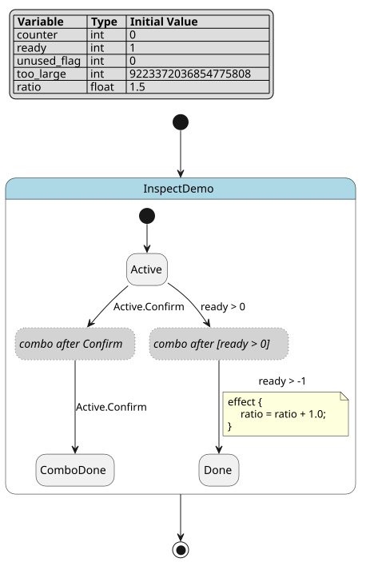

.. _sec-how-to-inspect-zh:

Inspect 任务指南
========================================

本页是 ``pyfcstm inspect`` 的任务手册。第一次学习请先看
:doc:`../../tutorials/inspect/index_zh`；需要查完整字段时再看
:doc:`../../reference/inspect_report/index_zh` 和
:doc:`../../reference/diagnostics_codes/index_zh`。这里关注的是：本地读报告、写机器报告、给大语言模型修复循环交接、处理输出后缀、区分失败边界，以及谨慎启用结构与局部 SMT 验证。

本页核心术语只在这里集中交接一次：检查（inspect）、诊断（diagnostic）、人类可读格式（human）、完整 JSON（json）、大语言模型 JSON（llm-json）、大语言模型 Markdown（llm-md）、标准输出（stdout）、标准错误（stderr）、退出状态（exit status）、副作用（side effect）、验证（verify）。后文普通叙述会尽量使用中文；命令、路径、字段、诊断码和格式名保持原样。

示例读取教程的模型 ``docs/source/tutorials/inspect/inspect_diagnostics.fcstm``\ ，所以请在仓库根目录运行。它是合法 FCSTM DSL，里面的可疑点是教学用信号。命令失败表示还没有成功报告；成功报告即使整体状态是 ``warning``\ ，仍然可以被脚本读取。命令把文件写到当前目录，后面的任务卡会读取前面任务卡写出的文件。

   这张图说明示例很小但不空洞：两个组合触发器会展开成伪中继状态；诊断既能指回作者写的转换，也能携带展开来源。

任务卡片的统一读法
----------------------------------------

下面十五个任务都按同一组字段写，方便复制到缺陷单、评审意见或持续集成说明里。

.. list-table:: 任务字段
   :header-rows: 1
   :widths: 22 78

   * - 字段
     - 含义
   * - 输入
     - 命令运行前假设的源文件、报告或消费方。
   * - 命令或代码
     - 最短可复现命令或 Python 片段。
   * - 预期信号
     - 短输出、计数、退出状态或其他可观察结果。
   * - 文件副作用
     - 会创建、覆盖或明确不会创建的文件。
   * - 首个失败检查
     - 信号不出现时先看哪里。
   * - 参考链接
     - 负责完整字段、选项或诊断码的页面。

带有更长报告的完整流程见教程；本页只展示对每项任务有意义的短摘录，输出里的 ``...`` 表示任务卡省略的部分。

1. 选择报告格式
----------------------------------------

输入。一个合法 FCSTM 文件，以及明确的消费方：人、脚本或修复提示。

命令或代码。比较四种公开格式。每份报告都很长，所以只列出开头几行：

.. code-block:: console

   $ pyfcstm inspect -i docs/source/tutorials/inspect/inspect_diagnostics.fcstm
   [WARN] FCSTM Inspect Report: docs/source/tutorials/inspect/inspect_diagnostics.fcstm

   Summary
     status: warning
   ...
   $ pyfcstm inspect -i docs/source/tutorials/inspect/inspect_diagnostics.fcstm --format json
   {
     "action_ref_graph": {
   ...
   $ pyfcstm inspect -i docs/source/tutorials/inspect/inspect_diagnostics.fcstm --format llm-json
   {
     "diagnostics": [
       {
         "code": "W_DURING_CONST_ASSIGN",
   ...
   $ pyfcstm inspect -i docs/source/tutorials/inspect/inspect_diagnostics.fcstm --format llm-md
   # FCSTM Inspect Report

   - Status: `warning`
   ...

预期信号。``human`` 以检查器风格摘要开头，``json`` 是完整的结构数组（任务 4 和 5 从中读取 ``root_state_path`` 和 ``diagnostics``），``llm-json`` 包含 ``status``、``summary`` 和 ``diagnostics``，``llm-md`` 以 Markdown 标题开头。两个 JSON 报告都应使用与当前 ``pyfcstm`` 发布版本一同提供的模式文件校验。

文件副作用。除非使用 ``-o``\ ，否则四条命令都只写标准输出。

首个失败检查。运行 ``python -m pyfcstm inspect --help``\ ，确认 ``--format`` 仍列出 ``human|json|llm-json|llm-md``\ 。

参考链接。格式契约见 :doc:`../../reference/inspect_report/index_zh`。

2. 本地阅读人类可读报告
----------------------------------------

输入。诊断较丰富的教程文件。

命令或代码。报告要粘贴到缺陷单或评审评论时关闭颜色：

.. code-block:: console

   $ pyfcstm inspect -i docs/source/tutorials/inspect/inspect_diagnostics.fcstm --color never
   [WARN] FCSTM Inspect Report: docs/source/tutorials/inspect/inspect_diagnostics.fcstm

   Summary
     status: warning
     root: InspectDemo
     states: 6 total / 3 leaf
     transitions: 5
     variables: 5
   ...
     diagnostics: 0 errors / 9 warnings / 4 infos
     verification: disabled

   [WARN] W_DURING_CONST_ASSIGN
     During action in 'InspectDemo.Active' assigns 'counter' to the same constant value every cycle.
   ...

预期信号。报告以上面的摘要开头，第一个警告是 ``W_DURING_CONST_ASSIGN``\ 。每个诊断块还带源码摘录、原因、修复形状和禁止做法。

文件副作用。无；命令读取一个文件并把纯文本写到标准输出。

首个失败检查。如果看到颜色转义字符，添加 ``--color never``\ 。如果完全没有报告，先看标准错误里的读取、解析或模型校验失败。

参考链接。诊断码含义和修复元数据见 :doc:`../../reference/diagnostics_codes/index_zh`。

3. 保存人类可读报告并控制颜色
----------------------------------------

输入。需要作为文本附件保存的报告。

命令或代码。写出到文件：

.. code-block:: console

   $ pyfcstm inspect -i docs/source/tutorials/inspect/inspect_diagnostics.fcstm \
       --format human --color never -o inspect-human.txt
   $ head -n 5 inspect-human.txt
   [WARN] FCSTM Inspect Report: docs/source/tutorials/inspect/inspect_diagnostics.fcstm

   Summary
     status: warning
     root: InspectDemo

预期信号。文件以 ``[WARN] FCSTM Inspect Report`` 开头，没有 ANSI 转义字符。写入文件时颜色始终关闭，即使命令行终端本身支持颜色。

文件副作用。``inspect-human.txt`` 会被创建或覆盖。

首个失败检查。如果文件为空，先确认输出目录存在；写入失败会作为命令行错误报告。

参考链接。颜色和输出文件规则见 :doc:`../../reference/inspect_report/index_zh`。

4. 为持续集成写出完整 JSON
----------------------------------------

输入。一个合法模型，以及需要精确计数或图结构的脚本。

命令或代码。保存完整 ``ModelInspect`` 载荷，再从中读出计数：

.. code-block:: console

   $ pyfcstm inspect -i docs/source/tutorials/inspect/inspect_diagnostics.fcstm \
       --format json -o inspect.json

.. testcode::

   import json
   from pathlib import Path

   report = json.loads(Path('inspect.json').read_text())
   print(report['root_state_path'])
   print(len(report['states']), len(report['transitions']))
   print(len(report['diagnostics']))

.. testoutput::

   InspectDemo
   6 5
   13

预期信号。脚本会打印 ``InspectDemo``\ ，然后是 ``6 5``\ ，最后是 ``13``\ 。完整 JSON 还包含 ``combo_origins``、``reachability_graph``、``var_dataflow`` 和 ``metrics``\ 。

文件副作用。``inspect.json`` 会被创建或覆盖。

首个失败检查。如果 ``json.loads`` 失败，先确认命令确实用了 ``--format json``\ 。带 ``.json`` 后缀的人类可读报告仍然不是 JSON。

参考链接。顶层字段和嵌套字段见 :doc:`../../reference/inspect_report/index_zh`。

5. 用 JSON 严重级别做门禁
----------------------------------------

输入。任务 4 写到 ``inspect.json`` 的完整 JSON 报告。

命令或代码。统计严重级别，不匹配人类可读消息：

.. testcode::

   import json
   from pathlib import Path

   report = json.loads(Path('inspect.json').read_text())
   errors = [item for item in report['diagnostics'] if item['severity'] == 'error']
   warnings = [item for item in report['diagnostics'] if item['severity'] == 'warning']
   if errors:
       raise SystemExit('inspect found blocking diagnostics')
   print('warnings:', len(warnings))

.. testoutput::

   warnings: 9

预期信号。教程文件没有错误、有九个警告，所以只阻塞错误的策略会打印 ``warnings: 9`` 并成功退出。

文件副作用。无；代码只读取 JSON 文件。

首个失败检查。如果这个夹具触发失败，先打印触发门禁的 ``code``\ ，不要比较本地化文本。

参考链接。稳定诊断字段见 :doc:`../../reference/diagnostics_codes/index_zh`。

6. 为自动修复提示写出 ``llm-json``
----------------------------------------

输入。合法模型，以及不需要完整结构清单的修复循环。

命令或代码。创建紧凑修复包，再看它的第一个诊断：

.. code-block:: console

   $ pyfcstm inspect -i docs/source/tutorials/inspect/inspect_diagnostics.fcstm \
       --format llm-json -o inspect.llm.json

.. testcode::

   import json
   from pathlib import Path

   report = json.loads(Path('inspect.llm.json').read_text())
   first = report['diagnostics'][0]
   print(report['status'])
   print(sorted(first.keys()))
   print(len(first['recommended_actions']), len(first['do_not']))

.. testoutput::

   warning
   ['code', 'do_not', 'location', 'message', 'provenance', 'recommended_actions', 'refs', 'repair_guidance', 'severity', 'source', 'source_excerpt', 'summary']
   2 1

预期信号。载荷不包含产品级 schema 版本字段。第一个诊断包含 ``source_excerpt``、``refs``、``recommended_actions`` 和 ``do_not``\ ；最后一行计数是 ``2 1``\ 。请使用与当前 ``pyfcstm`` 发布版本一同提供的 ``inspect_llm_report_schema.json`` 校验。

文件副作用。``inspect.llm.json`` 会被创建或覆盖。

首个失败检查。如果修复指导缺失，检查 ``code`` 是否在 ``codes.yaml`` 中有注册表指导，并确认渲染器能读取源码文本。

参考链接。大语言模型报告字段见 :doc:`../../reference/inspect_report/index_zh`。

7. 为人工修复交接写出 ``llm-md``
----------------------------------------

输入。同一个模型，但消费方需要可读 Markdown 说明。

命令或代码。导出并只看开头：

.. code-block:: console

   $ pyfcstm inspect -i docs/source/tutorials/inspect/inspect_diagnostics.fcstm \
       --format llm-md -o inspect.llm.md
   $ head -n 5 inspect.llm.md
   # FCSTM Inspect Report

   - Status: `warning`
   - Input: `docs/source/tutorials/inspect/inspect_diagnostics.fcstm`
   - Diagnostics: 0 errors / 9 warnings / 4 infos

预期信号。Markdown 文件以标题和上面三行列表项开头。

文件副作用。``inspect.llm.md`` 会被创建或覆盖。

首个失败检查。如果文件看起来像 JSON，确认使用的是 ``--format llm-md`` 而不是 ``--format llm-json``\ 。

参考链接。共享契约见 :doc:`../../reference/inspect_report/index_zh`；修复思路见 :doc:`../../explanations/diagnostics/index_zh`。

8. 从诊断跳回源码位置
----------------------------------------

输入。包含 ``span`` 或 ``location`` 的报告。

命令或代码。生成人类可读报告，读取重复组合事件所在的诊断块：

.. code-block:: console

   $ pyfcstm inspect -i docs/source/tutorials/inspect/inspect_diagnostics.fcstm --color never
   ...
   [WARN] W_COMBO_DUPLICATE_EVENT
     Combo trigger repeats event 'InspectDemo.Active.Confirm'; this is legal but usually redundant.
     --> docs/source/tutorials/inspect/inspect_diagnostics.fcstm:19:38
       |
    18 |     [*] -> Active;
    19 |     Active -> ComboDone :: Confirm + Confirm;
       |                                      ^^^^^^^
    20 |     Active -> Done : [ready > 0] + [ready > -1] effect {
       |
   ...

预期信号。``-->`` 行给出 ``行:列``\ （这里是 ``19:38``\ ），插入符号行标出第二个 ``Confirm``\ 。

文件副作用。无。

首个失败检查。如果缺源码行，确认报告来自顶层源文件。导入或生成对象的范围可能没有完整上下文。

参考链接。``span`` 和 ``location`` 字段见 :doc:`../../reference/inspect_report/index_zh`。

9. 理解输出后缀警告
----------------------------------------

输入。请求的格式和一个可能暗示其他格式的输出后缀。

命令或代码。下面的命令合法但可疑。警告写到标准错误，控制台记录把它和其余输出一起列出：

.. code-block:: console

   $ pyfcstm inspect -i docs/source/tutorials/inspect/inspect_diagnostics.fcstm -o report.json
   Warning: output file 'report.json' looks like JSON, but inspect format is 'human'. Use '--format json' if you intended machine-readable JSON output.
   $ head -n 1 report.json
   [WARN] FCSTM Inspect Report: docs/source/tutorials/inspect/inspect_diagnostics.fcstm

预期信号。标准错误会提示文件看起来像 JSON，但当前格式是 ``human``\ 。命令仍会写出请求的人类可读报告；反过来把显式 JSON 写到 Markdown 后缀时也会提示后缀和格式不匹配。

文件副作用。``report.json`` 含人类可读文本，不是 JSON。

首个失败检查。如果下游 JSON 解析失败，先看文件第一行，不要先改解析器。

参考链接。后缀和颜色行为见 :doc:`../../reference/inspect_report/index_zh`。

10. 区分无效输入和成功诊断
----------------------------------------

输入。一个可能语法无效、模型无效，或合法但有警告的文件。

命令或代码。把非零退出状态当作进程失败，而不是普通报告。前两个文件就地写出：

.. code-block:: console

   $ printf 'state' > bad.fcstm
   $ pyfcstm inspect -i bad.fcstm --format json
   Failed to parse input DSL file bad.fcstm: Found 1 errors during parsing:
   ...
   $ echo $?
   1
   $ printf 'state A { state X; state X; [*] -> X; }\n' > dup.fcstm
   $ pyfcstm inspect -i dup.fcstm --format json
   Invalid state machine model in dup.fcstm: Duplicate state name in namespace 'A':
   ...
   $ echo $?
   1
   $ pyfcstm inspect -i docs/source/tutorials/inspect/inspect_diagnostics.fcstm \
       --format json -o inspect-ok.json
   $ echo $?
   0

预期信号。语法错误以状态 ``1`` 退出，标准错误以 ``Failed to parse input DSL file`` 开头。重复状态这类模型错误也以状态 ``1`` 退出，并以 ``Invalid state machine model`` 开头。合法教程模型虽然报告状态是 ``warning``\ ，命令状态仍是 ``0``\ 。

文件副作用。失败命令不会产生成功的 ``diagnostics`` 数组。如果请求了 ``-o``\ ，不要信任上一次运行留下的旧文件。

首个失败检查。先打印退出状态和标准错误，再读取 ``diagnostics[]``\ 。无效输入属于进程边界。

参考链接。失败边界见 :doc:`../../reference/inspect_report/index_zh` 和 :doc:`../../explanations/diagnostics/index_zh`。

11. 启用结构与局部 SMT 验证诊断
----------------------------------------

输入。合法模型，以及确实需要验证支持事实的场景。

命令或代码。显式启用，再查找两个拓扑诊断码：

.. code-block:: console

   $ pyfcstm inspect -i docs/source/tutorials/inspect/inspect_diagnostics.fcstm \
       --enable-verify --format json -o inspect-verify.json

.. testcode::

   import json
   from pathlib import Path

   report = json.loads(Path('inspect-verify.json').read_text())
   codes = [item['code'] for item in report['diagnostics']]
   print('W_TOPOLOGICAL_NOEXIT' in codes)
   print('I_TOPOLOGICAL_NON_TERMINATING' in codes)

.. testoutput::

   True
   True

预期信号。启用验证后，教程模型会对两个拓扑检查都打印 ``True``\ 。

文件副作用。``inspect-verify.json`` 会被创建或覆盖。

首个失败检查。如果没有验证支持的诊断，确认命令里确实有 ``--enable-verify``\ 。提高 ``--max-complexity-tier`` 只能允许更多模型派生的结构或局部 SMT 算法；它不会加载 :mod:`pyfcstm.bmc`，也不会解析 ``.fbmcq`` 查询。

参考链接。验证层级见 :doc:`../../explanations/diagnostics/index_zh`；诊断码细节见 :doc:`../../reference/diagnostics_codes/index_zh`。

12. 保持目标和部署警告的范围精确
----------------------------------------

输入。任务 4 写出的完整 JSON 报告，以及消息里提到目标家族或生成运行时配置的诊断。

命令或代码。读取数值警告的结构化引用：

.. testcode::

   import json
   from pathlib import Path

   report = json.loads(Path('inspect.json').read_text())
   code = 'W_NUMERIC_LITERAL_OUT_OF_TARGET_RANGE'
   item = next(d for d in report['diagnostics'] if d['code'] == code)
   print(', '.join(item['refs']['target_templates']))
   print(item['refs']['runtime_note'])

.. testoutput::

   c, c_poll, cpp, cpp_poll
   C/C++ deployment profile risk: the default C-family templates use PYFCSTM_GENERATED_INT64, while Python generated runtimes may not have the same fixed-width integer carrying risk.

预期信号。目标模板是 ``c, c_poll, cpp, cpp_poll``\ 。运行时说明会指出风险来自 C/C++ 默认整数配置；Python 生成运行时不一定有同样的固定位宽风险。

文件副作用。无；代码只读取已有 JSON。

首个失败检查。如果评审意见写成 “Python 溢出”，先对照 ``refs.target_templates``\ 。同一个诊断可以是真实部署风险，但不一定适用于每个目标。

参考链接。目标相关数值诊断见 :doc:`../../reference/diagnostics_codes/index_zh`。

13. 读懂并修复 ``I_REGION_BACKWARD_READ``
-----------------------------------------

输入。``region_read_back.fcstm``：``Reader`` 写在 ``Writer`` 之前，并读取 ``Writer`` 赋值的 ``level``。区域按书写顺序执行，所以 ``Reader`` 读到的是上一个周期的 ``level``。

.. literalinclude:: region_read_back.fcstm
   :language: fcstm
   :caption: region_read_back.fcstm

命令或代码。请把 :download:`region_read_back.fcstm` 和 :download:`region_read_back_fixed.fcstm` 下载到一个空目录。报告很长，所以输出只保留该诊断码对应的那一块（修复后的模型则保留统计诊断数量的那一行），其余用 ``...`` 省略：

.. code-block:: console

   $ pyfcstm inspect -i region_read_back.fcstm --color never
   ...
   [INFO] I_REGION_BACKWARD_READ
     Region 'Root.Reader' reads variable 'level', which is produced by the later region 'Root.Writer'; it sees the value from the previous cycle.
     --> region_read_back.fcstm:8:31
      |
    7 |         [*] -> Idle;
    8 |         state Idle { during { seen = level; } }
      |                               ^^^^^^^^^^^^^
    9 |     }
      |
      = source: inspect-static
      = why: An earlier region reads something a later region produces in the same cycle, so it sees the previous cycle's value.
      = fix: kind: confirm_order; target: region; rationale: Keep the declaration order when reading the previous cycle's value is intended.
      = fix: kind: reorder_regions; target: region; rationale: Declare the producing region before the reading region when the current cycle's value is needed.
      = do-not: Do not treat this as a defect; it is the defined behavior of ordered regions.
   $ pyfcstm inspect -i region_read_back_fixed.fcstm --color never
   ...
     diagnostics: 0 errors / 3 warnings / 0 infos
   ...

预期信号。第一个模型得到 ``[INFO] I_REGION_BACKWARD_READ``，指出读取的区域、变量和写入它的靠后区域，并给出读取处的位置。第二个模型
``region_read_back_fixed.fcstm`` 把 ``Writer`` 声明在前，这个诊断码不再报告。这条消息是提示：想要上一个周期的值就保持顺序（``confirm_order``），需要本周期的值就调整顺序
（``reorder_regions``）。修复后模型的统计行显示 ``0 infos``，原来的提示就在那里。靠前的区域用 ``active()`` 查询靠后区域的状态时也报同一个诊断码。

文件副作用。无；报告输出到标准输出。

首个失败检查。调整顺序后诊断码仍未消失时，检查是否还有别的靠前区域在读取靠后区域产生的值。

参考链接。:doc:`/reference/inspect_report/index_zh`。

14. 读懂并修复 ``W_REGION_BLIND_OVERWRITE``
-------------------------------------------

输入。``region_blind_overwrite.fcstm``：``Early`` 每个周期写 ``out = 1``，``Late`` 每个周期赋值 ``out = y + 2`` 且不读取 ``out``，所以第一次写入必然丢失。

.. literalinclude:: region_blind_overwrite.fcstm
   :language: fcstm
   :caption: region_blind_overwrite.fcstm

命令或代码。请下载 :download:`region_blind_overwrite.fcstm` 和 :download:`region_blind_overwrite_fixed.fcstm`。和上面一样，输出只保留该诊断码对应的那一块和统计行：

.. code-block:: console

   $ pyfcstm inspect -i region_blind_overwrite.fcstm --color never
   ...
   [WARN] W_REGION_BLIND_OVERWRITE
     Region 'Root.Late' overwrites variable 'out' in every cycle without using the value written by the earlier region 'Root.Early'; that earlier write is lost whenever it runs.
     --> region_blind_overwrite.fcstm:11:28
       |
    10 |         [*] -> B;
    11 |         state B { during { out = y + 2; } }
       |                            ^^^^^^^^^^^^
    12 |     }
       |
      = source: inspect-static
      = why: A later region overwrites, in every cycle and without looking at it, a variable written by an earlier region, so the earlier write has no effect.
      = fix: kind: use_previous_value; target: statement; rationale: Combine with the earlier value, for example ``x = x + y;``, when both writes are meant to count.
      = fix: kind: use_separate_variables; target: variable; rationale: Give each region its own variable when the writes are independent.
      = do-not: Do not remove the earlier write without checking that no other state of that region depends on it.
      = do-not: Do not report a default value that a later region overrides only in some states or under a condition.
   $ pyfcstm inspect -i region_blind_overwrite_fixed.fcstm --color never
   ...
     diagnostics: 0 errors / 3 warnings / 0 infos
   ...

预期信号。警告指向 ``Late`` 里的覆盖语句；在机器可读的报告里，``previous_write_span`` 指出被丢掉的写入。报告建议的修法是合并两个值（
``region_blind_overwrite_fixed.fcstm`` 里的 ``out = out + y + 2;``，之后不再报告这个诊断码），或者给每个区域各用一个变量。这条警告刻意收得很窄：有条件的覆盖、只有部分状态执行的覆盖、
能够结束的区域、抽象动作，或者中间的区域读了该变量，都不会报告。

文件副作用。无。

首个失败检查。预期有警告却没有时，检查靠后区域的每个叶子状态是否都在 ``during`` 顶层写这个变量，以及是否有东西先读了它。

参考链接。:doc:`/reference/inspect_report/index_zh`。

15. 理解 ``owner_never_completes``
----------------------------------

输入。``region_never_completes.fcstm``：``Job`` 拥有两个区域。``A`` 可以用 ``Run -> [*]`` 结束；``B`` 没有 ``-> [*]``。普通转换 ``Job -> Next`` 只在所有区域都完成后才执行。

.. literalinclude:: region_never_completes.fcstm
   :language: fcstm
   :caption: region_never_completes.fcstm

命令或代码。请下载 :download:`region_never_completes.fcstm` 和 :download:`region_owner_completes_fixed.fcstm`：

.. code-block:: console

   $ pyfcstm inspect -i region_never_completes.fcstm --color never
   ...
   [WARN] W_UNREACHABLE_TRANSITION
     Authored transition 'Root.Job' -> 'Root.Next' is unreachable for reasons: owner_never_completes.
     --> region_never_completes.fcstm:17:5
       |
    16 |     state Next;
    17 |     Job -> Next;
       |     ^^^^^^^^^^^^
    18 | }
       |
      = source: inspect-static
      = why: This authored transition is unreachable under the available analysis evidence. The reason list distinguishes source-state reachability, event-consumer reachability, forced expansion, guards, shadowing, and redundancy.
      = fix: kind: inspect_transition; target: transition; rationale: Check each entry in ``refs.reasons`` against the transition's source, trigger, guard, and declaration scope before changing behavior.
      = do-not: Do not remove a transition solely because this warning is present; verify that the reported reason matches the intended runtime model.
   $ pyfcstm inspect -i region_owner_completes_fixed.fcstm --color never
   ...
     diagnostics: 0 errors / 1 warnings / 1 infos
   ...

预期信号。``Job -> Next`` 上出现 ``W_UNREACHABLE_TRANSITION``，原因是 ``owner_never_completes``。给 ``B`` 一条能结束的路径
（``region_owner_completes_fixed.fcstm``）后，这条警告消失：统计行里的警告数从四条降到一条。拥有者（owner）上的强制转换（forced transition）总是可达，不受影响。

文件副作用。无。

首个失败检查。在报告摘要里列出各区域，检查每个区域是否都有条件或事件可能发生的 ``-> [*]``。

参考链接。:doc:`/reference/inspect_report/index_zh`。

故障速查
----------------------------------------

下表是补充材料，不计入十五个任务卡片。

.. list-table:: 首个检查动作
   :header-rows: 1
   :widths: 30 35 35

   * - 现象
     - 可能边界
     - 首个动作
   * - 没有输出文件
     - 读取、解析、模型、策略或写入失败
     - 先看退出状态和标准错误，避免读取旧文件。
   * - JSON 解析器看到 ``[WARN]``
     - 人类可读报告被保存成 JSON 后缀
     - 重新运行 ``--format json``\ ，保留后缀警告。
   * - 粘贴文本里有 ANSI 转义
     - 人类可读输出启用了颜色
     - 使用 ``--color never`` 或写入 ``-o``\ 。
   * - 没有验证支持的诊断
     - 默认静态检查未启用验证
     - 添加 ``--enable-verify`` 并保持策略有界。
   * - 警告看起来只适用于某些目标
     - 结构化引用携带部署范围
     - 先读 ``refs``\ ，再决定是否适用于所有生成运行时。
   * - 修复补丁改得太大
     - 修复提示忽略了来源信息
     - 使用 ``llm-json`` 或 ``llm-md``\ ，并保留 ``do_not`` 规则。

本页验证来源
----------------------------------------

文档检查会运行本页各任务卡里的每条命令和脚本，并把它们打印的内容与页面所示输出核对；所以只有报告格式或 :doc:`../../tutorials/inspect/index_zh` 的模型改变时，摘录才会变。检查在仓库根目录运行命令，并把 ``docs/source`` 链接到工作目录里。
