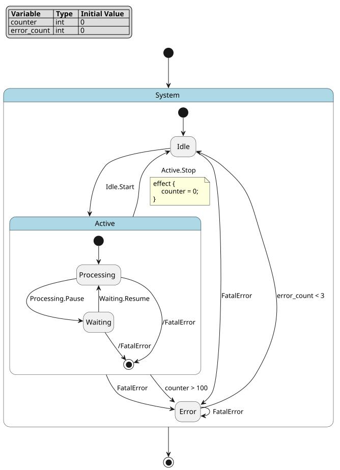
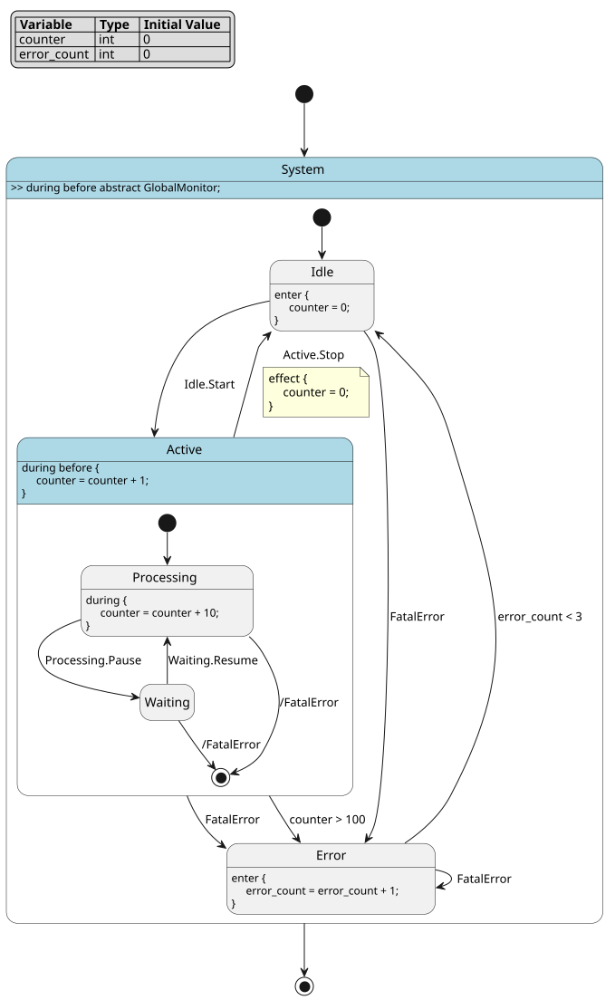

.. _sec-how-to-visualization:

Visualization tasks
===================

Use this guide when you need diagram source or rendered diagram files. For the
complete option table, see :doc:`/reference/visualization_options/index`. For a
first diagram walkthrough, see :doc:`/tutorials/visualization/index`.

Concrete input and visual evidence
----------------------------------

The concrete examples below use
``docs/source/tutorials/visualization/example.fcstm``, so run them from the
repository root. The visualization tutorial shows the drawings of that source at
three detail levels (``output_minimal.puml.svg``, ``output_normal.puml.svg`` and
``output_full.puml.svg``, drawn from the ``.puml`` files committed next to it),
so this how-to can point to real rendered artifacts instead of asking readers to
trust option names.

Before comparing rendered images, export PlantUML source:

.. code-block:: console

   $ pyfcstm plantuml -i docs/source/tutorials/visualization/example.fcstm -o example.puml
   $ head -n 2 example.puml
   @startuml
   hide empty description

Success means ``example.puml`` exists, starts with ``@startuml``, and
contains the expected state names. If source export fails, fix DSL/model errors
before changing renderer settings. Rendering options cannot repair invalid
PlantUML source.

Choose source or rendered output
--------------------------------

.. list-table:: Output choice
   :header-rows: 1

   * - Need
     - Use
     - Why
   * - Reviewable diagram source
     - ``pyfcstm plantuml``
     - Produces deterministic ``.puml`` text and needs no renderer.
   * - Image or PDF artifact
     - ``pyfcstm visualize``
     - Builds the same PlantUML source and renders ``png``, ``svg``, or ``pdf``.
   * - CI without GUI
     - ``visualize --no-open``
     - Avoids desktop viewer dependence.
   * - Private diagrams
     - ``visualize --renderer local``
     - Avoids sending PlantUML source to a remote service.

Visualization task acceptance cards
-----------------------------------

Use these cards when deciding whether a diagram step is ready for a tutorial,
review note, or CI job.

.. list-table:: Visualization task evidence
   :header-rows: 1

   * - Task
     - Command
     - Success signal
     - Side effect
     - First troubleshooting step
   * - Review diagram source.
     - ``pyfcstm plantuml -i docs/source/tutorials/visualization/example.fcstm -o example.puml``
     - ``example.puml`` starts with ``@startuml`` and is diffable text.
     - Writes only the requested source file.
     - Run ``inspect`` on the same input if PlantUML export fails.
   * - Compare detail presets.
     - ``pyfcstm plantuml -i docs/source/tutorials/visualization/example.fcstm -l full -o example.full.puml``
     - The full source includes lifecycle/action details that the minimal preset hides.
     - Writes a second source file for review.
     - Check :doc:`/reference/visualization_options/index` before mixing preset and ``-c`` overrides.
   * - Check renderer availability.
     - ``pyfcstm visualize --check --renderer auto``
     - Reports either a usable local/remote backend or a concrete backend error.
     - No diagram file is written.
     - Decide whether privacy requires ``--renderer local`` before accepting remote fallback.
   * - Render without GUI dependence.
     - ``pyfcstm visualize -i docs/source/tutorials/visualization/example.fcstm -t svg -o example.svg --no-open``
     - ``example.svg`` exists and is visually readable in the docs/review context.
     - Writes the rendered file and may populate renderer cache.
     - If the file is missing but the backend reported success, treat that as a renderer failure, not a DSL failure.
   * - Verify a documented figure.
     - Build HTML after regenerating the source diagram.
     - The figure is legible at the documented width and its caption states the claim it proves.
     - Updates generated image files when diagram sources changed.
     - Inspect the rendered HTML; source reST alone does not prove visual quality.

Export PlantUML source
----------------------

PlantUML source is the safest first artifact because it is text, deterministic,
and easy to diff:

.. code-block:: bash

   pyfcstm plantuml -i machine.fcstm -o machine.puml

Use a detail preset before adding individual overrides:

.. code-block:: bash

   pyfcstm plantuml -i machine.fcstm -l full -o machine.full.puml

Add repeated ``-c key=value`` only for a specific reading goal:

.. code-block:: bash

   pyfcstm plantuml -i machine.fcstm \
     -c show_events=true \
     -c max_depth=2 \
     -o machine.events-depth2.puml

Compare detail preset outputs
-----------------------------

The same model can be shown with different detail levels for different readers.
The figures below are the drawings that the visualization tutorial renders from
its ``example.fcstm``, with the commands in the last column.

.. list-table:: Detail preset comparison
   :header-rows: 1

   * - Preset
     - Intended reader
     - What is hidden first
     - Command
   * - ``minimal``
     - Architecture discussion and non-implementation readers.
     - Lifecycle actions and pseudo-state styling.
     - ``pyfcstm plantuml -i example.fcstm -l minimal -o output_minimal.puml``
   * - ``normal``
     - General documentation and code review.
     - Lifecycle action bodies.
     - ``pyfcstm plantuml -i example.fcstm -l normal -o output_normal.puml``
   * - ``full``
     - Debugging, semantic review, and implementation discussion.
     - Nothing from the preset-level switches.
     - ``pyfcstm plantuml -i example.fcstm -l full -o output_full.puml``

   ``minimal`` keeps the shape readable when the audience only needs structure.

.. figure:: ../../tutorials/visualization/output_normal.puml.svg
   :alt: Normal detail preset output
   :align: center
   :width: 70%

   ``normal`` is the default compromise for documentation and review.

   ``full`` is useful when action and transition details are part of the review.

Focus a large model
-------------------

For large machines, reduce the question before adding visual detail. Good
focused diagrams usually answer one of these questions:

* What is the state hierarchy?
* Which events move the model?
* Which guards and effects control a transition family?
* Which lifecycle hooks are integration points?
* Which subtree should be discussed in this review?

Useful command patterns:

.. code-block:: bash

   # Limit hierarchy depth.
   pyfcstm plantuml -i machine.fcstm -c max_depth=2 -o machine.depth2.puml

   # Hide event names when structure is the main topic.
   pyfcstm plantuml -i machine.fcstm -c show_events=false -o machine.structure.puml

   # Show event grouping when event flow is the topic.
   pyfcstm plantuml -i machine.fcstm \
     -c event_visualization_mode=both \
     -o machine.events.puml

   # Show only a compact implementation view.
   pyfcstm plantuml -i machine.fcstm \
     -l full \
     -c max_action_lines=3 \
     -c transition_effect_mode=inline \
     -o machine.compact-full.puml

Render a final file directly
----------------------------

Use ``visualize`` after deciding that the environment should own rendering:

.. code-block:: bash

   pyfcstm visualize -i machine.fcstm -t svg -o machine.svg --no-open

Check renderer availability without reading a DSL file:

.. code-block:: bash

   pyfcstm visualize --check --renderer auto

Choose a renderer mode deliberately:

.. list-table:: Renderer choice
   :header-rows: 1

   * - Mode
     - Command shape
     - Use when
   * - ``auto``
     - ``pyfcstm visualize --check --renderer auto``
     - Local development where either local or remote rendering is acceptable.
   * - ``local``
     - ``pyfcstm visualize -i machine.fcstm --renderer local -p ./plantuml.jar --no-open``
     - Diagrams are private or builds must avoid network dependence.
   * - ``remote``
     - ``pyfcstm visualize -i machine.fcstm --renderer remote --no-open``
     - A configured PlantUML service is allowed and easier than local Java setup.

Keep CI diagram jobs stable
---------------------------

A CI diagram job should not depend on a desktop viewer:

.. code-block:: bash

   pyfcstm plantuml -i machines/main.fcstm -o build/main.puml
   pyfcstm visualize -i machines/main.fcstm -t svg -o build/main.svg --no-open

If rendering is optional in CI, split source export from rendered export. Source
export proves pyfcstm can parse and emit PlantUML; rendered export additionally
proves the renderer backend works.

Use Python API when CLI values are not enough
---------------------------------------------

The CLI supports scalar and tuple values. Use the Python API for object-valued
configuration such as event color dictionaries:

.. code-block:: python

   from pyfcstm.model.plantuml import PlantUMLOptions

   options = PlantUMLOptions(
       event_visualization_mode='color',
       custom_colors={'System.Start': '#00AA00'},
   )
   plantuml_text = model.to_plantuml(options)

The same call works on a model you load from a file.  This program uses the
interlock controller (:download:`controller.fcstm </_models/controller.fcstm>`)
and prints the first and last line of the exported source:

.. testcode::

   from pyfcstm.model import load_state_machine_from_file
   from pyfcstm.model.plantuml import PlantUMLOptions

   model = load_state_machine_from_file("controller.fcstm")
   text = model.to_plantuml(PlantUMLOptions(detail_level="minimal"))
   print(text.splitlines()[0])
   print(text.splitlines()[-1])

.. testoutput::

   @startuml
   @enduml

Concrete visualization recipes
------------------------------

Each recipe below names the reader goal first. Start with source export when
reviewability matters, then render only when an image artifact is required.

.. list-table:: Focused visualization recipes
   :header-rows: 1

   * - Reader goal
     - Command
     - Expected artifact
     - Boundary
   * - Review hierarchy only.
     - ``pyfcstm plantuml -i machine.fcstm -l minimal -o machine.structure.puml``
     - Compact ``.puml`` source with implementation details hidden.
     - Does not check any renderer.
   * - Review state/event flow.
     - ``pyfcstm plantuml -i machine.fcstm -c event_visualization_mode=both -o machine.events.puml``
     - Source contains event-oriented labels/legend/color facts.
     - Event coloring can make large diagrams visually dense.
   * - Review lifecycle hooks.
     - ``pyfcstm plantuml -i machine.fcstm -l full -c show_concrete_actions=false -o machine.hooks.puml``
     - Abstract hooks remain visible while concrete bodies are hidden.
     - Good for integration discussions, not for operation-body audits.
   * - Review a large subtree.
     - ``pyfcstm plantuml -i machine.fcstm -c max_depth=2 -o machine.depth2.puml``
     - Deep descendants are collapsed after depth 2.
     - Hidden descendants still exist in the model.
   * - Produce an image in CI.
     - ``pyfcstm visualize -i machine.fcstm -t svg -o build/machine.svg --no-open``
     - SVG file appears at the requested path.
     - Requires a configured local or remote renderer.
   * - Check renderer before rendering.
     - ``pyfcstm visualize --check --renderer auto``
     - Backend availability report.
     - Does not parse the DSL and does not prove diagram content.

Visual review checklist
~~~~~~~~~~~~~~~~~~~~~~~

Before accepting a new or changed diagram in documentation, inspect the rendered
HTML and ask these questions:

* Are labels readable at the configured width?
* Does the caption state what the figure proves?
* Is the diagram source traceable to ``.fcstm`` or ``.puml`` input?
* Is a dense ``full`` view really needed, or would ``normal`` plus one override be clearer?
* If remote rendering was used, is it acceptable that PlantUML source left the local machine?

Worked task cards
-----------------

The recipes above are short command choices. The cards below expand each common
task into the full how-to contract: starting input, command, expected signal,
side effect, and first repair step. Keep new visualization tasks at this level
of specificity instead of adding bare command lists.

.. list-table:: Task cards
   :header-rows: 1

   * - Task
     - Start from
     - Command
     - Expected signal and side effect
     - First repair if it fails
   * - Review the hierarchy only
     - ``docs/source/tutorials/quick_start/traffic_light.fcstm`` or another small source file.
     - ``pyfcstm plantuml -i traffic_light.fcstm -l minimal -o traffic_light.minimal.puml``.
     - Text file starts with ``@startuml`` and contains a compact state hierarchy; no renderer is required.
     - If the command fails before writing, run ``pyfcstm inspect -i traffic_light.fcstm`` to locate parse/model errors.
   * - Explain events and guards
     - A model whose transitions use events or guards.
     - ``pyfcstm plantuml -i machine.fcstm -l normal -c show_events=true -c show_transition_guards=true -o machine.events.puml``.
     - Source labels should show the event names and guard conditions used by the transition family.
     - If labels are missing, confirm the transition syntax actually contains events/guards and that no override hides them.
   * - Show integration hooks
     - A model with abstract lifecycle actions.
     - ``pyfcstm plantuml -i machine.fcstm -l full -c show_concrete_actions=false -o machine.hooks.puml``.
     - The source emphasizes abstract hooks while suppressing implementation bodies.
     - If the diagram is still too dense, add ``-c max_action_lines=2`` or split by ``max_depth``.
   * - Produce a CI SVG artifact
     - A CI job with pyfcstm and an approved PlantUML backend.
     - ``pyfcstm visualize -i machine.fcstm -t svg -o artifacts/machine.svg --no-open``.
     - The SVG file exists; stdout reports the renderer and output path; no desktop viewer is required.
     - If renderer discovery fails, run ``pyfcstm visualize --check --renderer auto`` and decide whether local or remote rendering is allowed.
   * - Keep a private diagram local
     - A confidential model and a local PlantUML jar.
     - ``pyfcstm visualize -i private.fcstm --renderer local -p ./plantuml.jar -t png -o private.png --no-open``.
     - The PNG is written without sending PlantUML source to a remote service.
     - If local rendering fails, fix Java/JAR paths; do not switch to ``auto`` unless remote fallback is acceptable.
   * - Diagnose an option parse error
     - A command using ``-c`` overrides.
     - ``pyfcstm plantuml -i machine.fcstm -c max_depth=abc`` as a deliberate failing probe.
     - The command should name the invalid key/value instead of writing misleading source.
     - Replace the value with an integer or remove the override.

Visual acceptance examples
~~~~~~~~~~~~~~~~~~~~~~~~~~

After producing a diagram, review the actual rendered HTML or image, not only
the source command. Use this short acceptance rubric:

1. The caption states the question answered by the diagram.
2. The selected preset matches that question: ``minimal`` for hierarchy,
   ``normal`` for transitions, ``full`` only when lifecycle/action detail is
   the point.
3. Text is readable at the documentation width. If not, reduce detail before
   increasing image size.
4. The rendering path is acceptable for the data: local for private models,
   remote only when source text may leave the machine.
5. The page links to :doc:`/reference/visualization_options/index` for every
   option that is not self-evident.

Use the Python Diagram viewer
-----------------------------

Use this path when the requested artifact is an offline HTML viewer rather than
PlantUML source or a PlantUML-rendered file.

.. list-table:: Python Diagram task cards
   :header-rows: 1

   * - Task
     - Start from
     - Command or code
     - Expected signal and side effect
     - First repair if it fails
   * - Write portable JSON
     - A parsed ``StateMachine``.
     - ``model.diagram().save("machine.json")`` or ``pyfcstm diagram -i machine.fcstm -o machine.json``.
     - The file is deterministic JSON and contains no local source paths or ranges.
     - Run ``pyfcstm inspect -i machine.fcstm`` to separate DSL/model errors from serialization errors.
   * - Write a self-contained viewer
     - A parsed ``StateMachine`` or an FCSTM file.
     - ``model.diagram().save("machine.html")`` or ``pyfcstm diagram -i machine.fcstm -o machine.html``.
     - The file contains the viewer, renderer, WASM, and the selected locale fonts; no network request is needed.
     - Check the packaged assets with ``make diagram_assets_check`` in a development checkout.
   * - Open a desktop viewer
     - A generated HTML path and a Chromium-family browser.
     - ``model.show()`` or ``pyfcstm diagram -i machine.fcstm --open``.
     - A browser app window opens and the method returns the generated HTML path.
     - Use ``open_window=False`` or omit ``--open`` on machines without a browser.
   * - Download SVG/PNG/PDF
     - A generated HTML viewer opened in a browser.
     - Use the viewer's export menu.
     - SVG, PNG, and vector PDF are downloaded from the same rendered diagram; the PDF contains no image object.
     - If an export fails, keep the browser error message and inspect the asset/runtime error before changing the model.

The ``show`` method writes the HTML file before attempting to open a window.
Missing Chromium is a typed capability error, not a model or asset error. The
Python synchronous ``to_svg()``, ``to_png()``, and ``to_pdf()`` methods remain
unavailable until the headless delivery stage; do not use those methods as a
browser export fallback.

Troubleshoot visualization
--------------------------

.. list-table:: Visualization troubleshooting
   :header-rows: 1

   * - Symptom
     - Check
     - Likely fix
   * - ``plantuml`` fails
     - ``pyfcstm inspect -i machine.fcstm``
     - Fix DSL syntax or model diagnostics before diagram export.
   * - ``visualize`` fails before rendering
     - Output suffix and ``--type``
     - Align suffix and type, or omit suffix and let pyfcstm add it.
   * - Local rendering fails
     - ``pyfcstm visualize --check --renderer local``
     - Configure Java and ``PLANTUML_JAR`` or pass ``-p``.
   * - Remote rendering fails
     - ``pyfcstm visualize --check --renderer remote``
     - Check network, proxy, or ``PLANTUML_HOST``.
   * - Viewer launch is skipped
     - ``PYFCSTM_NO_GUI``, ``CI``, display variables
     - Use ``--no-open`` in scripts; reserve ``--strict-open`` for desktop-only tasks.
   * - Diagram is too dense
     - Detail level and visibility options
     - Start with ``minimal`` or ``normal``, then add only the facts needed for the current audience.

Why the viewer behaves this way
-------------------------------

:doc:`/explanations/visualization/index` covers the reasoning behind the tasks above:
what the snapshot is detached from, why one document carries everything, why ``--open``
blocks until its window closes, why the privacy boundary is a directory rather than a
file, and when a temporary directory is reclaimed.

Tasks for models with regions
-----------------------------

A region is drawn as a concurrent partition, not as a state.  The cards below
use :download:`controller.fcstm </_models/controller.fcstm>` (the interlock controller of
:doc:`/tutorials/regions/index`) and state the same six facts: **Input**,
**Command or code**, **Expected signal**, **File side effect**, **First
failure check** and **Reference link**.  The four places that draw regions
(PlantUML export, ``pyfcstm diagram``, the HTML viewer and the VS Code preview)
follow the same conventions; each has its own entry point and limits, described
below.  The modeling tasks are on :doc:`/how_to/regions/index`.

Export PlantUML for a model with regions and render it
~~~~~~~~~~~~~~~~~~~~~~~~~~~~~~~~~~~~~~~~~~~~~~~~~~~~~~

**Input.** ``controller.fcstm``, and :download:`region_events.fcstm` for the legend.  Download them into an empty directory and run the commands there.  The export separates the regions of
an owner with ``--`` and starts each partition with a note
``region N: Name``, where ``N`` is the writing order, which is also the
execution order.  ``max_depth`` counts a region as one level.  Event paths pass
through the region (``/Left.Ping``).  ``region_events.fcstm`` declares a
``Ping`` event in each of two regions.

**Command or code.**

The output is the whole exported source, so only the lines that matter are kept
and the rest is left out as ``...``:

.. code-block:: console

   $ pyfcstm plantuml -i controller.fcstm
   ...
               **region 1: Safety**
   ...
           --
   ...
               **region 2: Motion**
   ...
   $ pyfcstm plantuml -i controller.fcstm -c max_depth=2
   ...
               **region 1: Safety**
   ...
           state "..." as controller__running__safety___collapsed_
           --
   ...
               **region 2: Motion**
   ...
           state "..." as controller__running__motion___collapsed_
   ...
   $ pyfcstm plantuml -i controller.fcstm -c max_depth=1
   ...
           state "..." as controller__running___collapsed_
   ...
   $ pyfcstm plantuml -i region_events.fcstm -c show_events=true -c event_visualization_mode=legend
   ...
   legend right
   **Event Scoping**
   ----
   <color:#000000>■</color> **Ping** (1 transitions)
     <size:10><color:gray>/Left.Ping</color></size>
   <color:#000000>■</color> **Ping** (1 transitions)
     <size:10><color:gray>/Right.Ping</color></size>
   endlegend
   ...

**Expected signal.** The default export has one ``--`` and two
``region N:`` notes, in writing order.  ``max_depth=2`` keeps the two partitions but collapses their states into
``...``; ``max_depth=1`` collapses the whole owner.  The legend shows the two
``Ping`` events as different events with their own root-based paths.  Render the
source with any PlantUML setup; the default Graphviz layout is the one this
page assumes:

.. figure:: /_models/controller.fcstm.puml.svg
   :alt: PlantUML drawing of the interlock controller with two concurrent partitions in Running
   :width: 80%

   ``Running`` is drawn as two partitions, ``region 1: Safety`` and ``region 2:
   Motion``, separated by a dashed line.

**File side effect.** ``pyfcstm plantuml -o`` writes only the named file; the
commands above print to standard output and write no file.

**First failure check.** If a partition is missing from the picture, open the
``.puml`` file and count the ``--`` lines (one fewer than the regions of the
owner); the next card covers the one known renderer limit.

**Reference link.** :doc:`/reference/visualization_options/index`.

See regions in the HTML viewer and the VS Code preview
~~~~~~~~~~~~~~~~~~~~~~~~~~~~~~~~~~~~~~~~~~~~~~~~~~~~~~

**Input.** ``controller.fcstm``.  ``pyfcstm diagram`` writes portable
JSON or a self-contained HTML viewer.  In the viewer, the regions of one owner
sit side by side inside the owner's frame: equal height in a top-to-bottom
layout and equal width in a left-to-right layout, separated by dashed dividers,
with no frame of their own and the title ``region N: Name``.  The order follows
the direction of the diagram: left to right in a top-to-bottom layout and top
to bottom in a left-to-right one.  Collapsing, details and export work on a
region like on a state.  The viewer does not highlight the current
configuration.

**Command or code.** The portable JSON carries each region as a node with
``region: true`` and its writing order in ``ordinal``:

.. code-block:: console

   $ pyfcstm diagram -i controller.fcstm -o machine.json
   machine.json

.. testcode::

   import json

   data = json.load(open("machine.json", encoding="utf-8"))
   running = [c for c in data["rootState"]["children"] if c["name"] == "Running"][0]
   for region in running["children"]:
       print(region["qualifiedName"], region["region"], region["ordinal"])
   print(data["summary"])

.. testoutput::

   Controller.Running.Safety True 1
   Controller.Running.Motion True 2
   {'actions': 4, 'events': 2, 'states': 6, 'transitions': 7, 'variables': 4}

The viewer needs the packaged viewer assets (a development checkout builds them
with ``make build_assets``) and the editor preview needs a desktop editor, so
these commands are shown without being run in the documentation checks.

.. code-block:: bash

   pyfcstm diagram -i controller.fcstm -o viewer.html
   pyfcstm diagram -i controller.fcstm --open

In VS Code, open the ``.fcstm`` file and run ``Open Preview to the Side`` (the
command ``fcstm.preview.open``) from the command palette.  The preview follows
the same conventions as the viewer.

**Expected signal.** The JSON shows ``Running`` with two children marked
``region``, ordinals 1 and 2, in writing order.  ``viewer.html`` is a
self-contained file that opens offline and shows the two partitions side by
side; ``--open`` opens it in a Chromium-family app window.

**File side effect.** ``-o`` writes the named file.  ``--open`` also writes
the HTML first and then opens a window.

**First failure check.** If ``pyfcstm diagram`` reports a missing packaged
resource, you are in a development checkout: run ``make build_assets``.  If
no browser opens, use the file and omit ``--open``.

**Reference link.** :doc:`/reference/visualization_options/index`.

Avoid the Smetana layout for models with regions
~~~~~~~~~~~~~~~~~~~~~~~~~~~~~~~~~~~~~~~~~~~~~~~~

**Input.** A PlantUML pipeline.  PlantUML's built-in Smetana layout does not
support concurrent partitions and drops every region after the first.
``pyfcstm`` never writes a layout directive, so you meet this only if you or
your tooling force it (for example with ``!pragma layout smetana``).  This
limit comes from PlantUML itself.

**Command or code.** Check that the exported source carries no layout
directive (the first line prints whether the text ``pragma layout`` occurs, the
second counts the ``--`` separators), and render with the default Graphviz layout:

.. testcode::

   from pyfcstm.model import load_state_machine_from_file

   text = load_state_machine_from_file("controller.fcstm").to_plantuml()
   print("pragma layout" in text)
   print(sum(line.strip() == "--" for line in text.splitlines()))

.. testoutput::

   False
   1

**Expected signal.** ``False`` for the layout directive, and ``1`` for the ``--`` between the two
partitions.  If your pipeline injected a directive, remove it and render
again; every partition comes back.

**File side effect.** None.

**First failure check.** If only the first partition is drawn, search the
source that was rendered (not the one exported) for ``pragma layout``, and
check that Graphviz is the layout in use.

**Reference link.** :doc:`/reference/visualization_options/index`.
