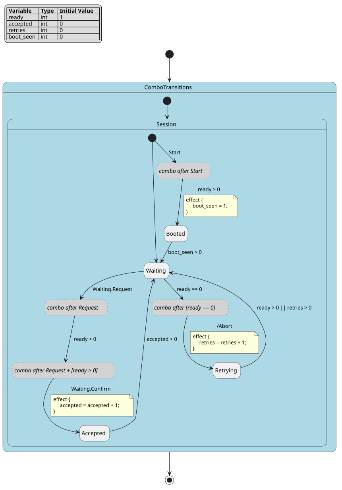
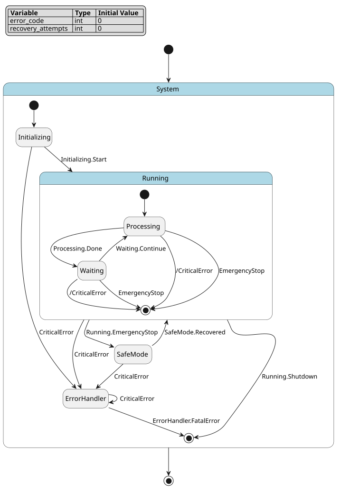

.. _sec-reference-dsl:

DSL reference
=============

.. contents:: Reference map
   :local:
   :depth: 2

Scope
-----

This is the fact-oriented FCSTM DSL reference. It is checked against the current
split grammar files, especially ``pyfcstm/dsl/grammar/GrammarParser.g4`` and
``pyfcstm/dsl/grammar/GrammarLexer.g4``. Use it for exact forms and boundaries.
Use :doc:`../../tutorials/dsl/index` for a learning path,
:doc:`../../how_to/dsl/index` for task recipes, and
:doc:`../../explanations/dsl_semantics/index` for semantic background.

.. _dsl-syntax-quick-index:

Syntax quick index
------------------

Start here when you need to find the exact form. Examples in this reference are
fragments unless they are introduced as checked files under
``docs/source/tutorials/dsl``. The task guide links each major form to a complete
example and verification command.

.. list-table:: Syntax families
   :header-rows: 1
   :widths: 24 38 38

   * - Family
     - Main forms
     - Details
   * - Program boundary
     - ``def int x = 0;`` / one root ``state``
     - :ref:`dsl-top-level-forms`
   * - States
     - ``state A;`` / ``state A { ... }`` / ``pseudo state P;``
     - :ref:`dsl-state-forms`
   * - Regions
     - ``region Name { ... }`` inside a state; ``active("Path")``
     - :ref:`dsl-region-forms`, :ref:`dsl-region-active`
   * - Transitions
     - plain, event, guard, guard+effect, combo, forced, entry, exit
     - :ref:`dsl-transition-forms`
   * - Events
     - ``:: Local`` / ``: Chain`` / ``: /RootEvent``
     - :ref:`dsl-events-scopes`
   * - Operation blocks
     - assignment, block-local temporary, ``if`` / ``else if`` / ``else``, empty statement
     - :ref:`dsl-operation-blocks`
   * - Expressions
     - init, numeric, condition, ternary, operator precedence
     - :ref:`dsl-expression-reference`
   * - Lifecycle and aspects
     - ``enter`` / ``during`` / ``exit``; ``abstract``; ``ref``; ``>> during``
     - :ref:`dsl-lifecycle-forms`, :ref:`dsl-aspect-forms`
   * - Imports
     - ``import "path" as Alias`` and mapping block
     - :ref:`dsl-import-forms`
   * - Diagnostics wording
     - target-specific warnings, especially C/C++ deployment-profile risks
     - :ref:`dsl-diagnostics-risk`

.. _dsl-lexical-forms:

Lexical and comment forms
-------------------------

.. list-table:: Lexical forms
   :header-rows: 1

   * - Form
     - Syntax / tokens
     - Notes
   * - Identifier
     - ``[a-zA-Z_][a-zA-Z0-9_]*``
     - Used for variables, states, events, action names, aliases, and path parts.
   * - String
     - Single or double quoted strings
     - Import paths and ``named`` labels use strings; common escape sequences are lexed.
   * - Comments
     - ``/* ... */``, ``// ...``, ``# ...``
     - A multiline block immediately before a supported declaration is its documentation; line comments remain comments.
   * - Keywords
     - ``def``, ``state``, ``region``, ``active``, ``pseudo``, ``event``, ``import``, ``enter``, ``during``, ``exit``, ``abstract``, ``ref``
     - Keywords are reserved by lexer rules.
   * - Compact import tokens
     - selector patterns and target templates
     - Compact forms are tokenized in import-specific lexer modes and are whitespace-sensitive.

Identifiers are case-sensitive. Reserved words, including ``region`` and
``active``, cannot be used as names or path components, including in import
aliases, exact mapping selectors, and exact mapping targets. For example,
``Active``, ``region_count``, and ``active_flag`` remain valid names. Rename older
identifiers that exactly match a reserved word and update their references.
Strings and comments retain their literal content.

Compact import patterns and target templates may contain keyword text, such as
``prefix_* -> $1``. The expanded target must still be a valid identifier; an
expansion to ``active`` or ``region`` is rejected during import assembly.

.. _dsl-documentation-forms:

Declaration documentation
--------------------------

FCSTM supports one opaque documentation value on each persistent variable
definition, state (including the root and pseudo states), event, transition,
and lifecycle action. A block comment immediately before the declaration is
owned by that declaration and does not become part of its name or source span.
Import declarations and import mapping entries are not documentation owners.

The source spelling is a multiline block comment. The canonical DSL exporter
normalizes every non-``None`` value to a block with a star margin, while
preserving ``None``, the empty string, and the literal ``*`` as distinct values:

.. code-block:: fcstm

   /* Number of retries allowed before entering the fault state. */
   def int retry_limit = 3;

   /* The module's top-level state. */
   state Controller {
       [*] -> Ready;

       /* A request has been accepted and is being processed. */
       state Ready;

       /* Raised by the external supervisor. */
       event Reset;

       /* Return to the idle state after a reset. */
       Ready -> Idle :: Reset;

       /* Called by the generated runtime on entry. */
       enter abstract OnReady;
   }

The existing trailing spelling for an abstract lifecycle action remains valid:
``enter abstract OnReady /* Called by the generated runtime on entry. */;``.
Leading and trailing documentation normalize to the same owner field; using
both spellings for one action is rejected. Documentation is metadata: it is
included in canonical DSL and generated README/source exports, but does not
change runtime behavior, transition priority, simulation, verification,
PlantUML, inspect schemas, or hover text.

Documentation blocks are intentionally opaque. They are not Markdown, do not
define tags or locales, and do not attach to operation statements, guards,
trigger terms, effect blocks, or individual import mappings. An unterminated
block at end of file is diagnosed. The parser's deterministic behavior for a
terminator inside a line comment or string, and for non-EOF import-mode
swallowing, is not a supported documentation contract.

.. _dsl-top-level-forms:

Top-level program forms
-----------------------

A normal DSL entry has zero or more variable declarations followed by
one root state:

Fragment::

   def int counter = 0;
   def float threshold = 3.5;

   state Root {
       [*] -> Idle;
       state Idle;
   }

Facts:

* Persistent variable types are ``int`` and ``float``.
* Declarations must appear before the single root ``state``.
* Initializers use ``init_expression``. This subset accepts literals, math
  constants, arithmetic, bitwise operators, and unary math functions, but it
  does not accept runtime variable references or C-style ternary expressions.
* The root may be leaf or composite, but practical models usually use composite
  root state.

Variable roles
~~~~~~~~~~~~~~

.. list-table:: Declarations and ownership
   :header-rows: 1

   * - Declaration
     - ``role``
     - Initialization and model assignments
   * - ``control int count = 0;`` / ``def int count = 0;``
     - ``control``
     - Initializer required; model reads and writes allowed.
   * - ``input float pressure;``
     - ``input``
     - Initializer forbidden; model reads only.
   * - ``param int limit = 2;``
     - ``param``
     - Default required; model reads only.
   * - ``output int command = 0;``
     - ``output``
     - Initializer required; model reads and writes allowed, including multiple writers.

``control``, ``input``, ``param``, and ``output`` are
reserved keywords, unavailable as variable, state, event, or action names.
``dynamic`` and ``static`` are ordinary identifiers; the former long input
declarations are not accepted. All declarations share one namespace. Initializers cannot reference variables.
Input/parameter writes are rejected during model construction, including writes
in lifecycle actions, aspects, effects, and nested conditionals.

AST exports preserve declaration spelling. ``pyfcstm.model.VariableRole`` exposes
``CONTROL``, ``INPUT``, ``PARAM``, and ``OUTPUT``; ``VarDefine.init`` is ``None`` only for inputs in valid
models. ``StateMachine.control_variables``, ``inputs``, ``parameters``,
``output_variables``, and ``persistent_variables`` return read-only mappings in
global declaration order. The last preserves control/output interleaving; values
are the same objects held in ``defines``. Inspect JSON variable entries require
``role``; read-only inputs/parameters and write-only outputs do not receive
ordinary control-variable dead-use warnings.

This section defines the syntax/model contract. Runtime input sources,
role-aware import merging, BMC input symbols, and generated runtime interfaces
are documented in the simulation, BMC, and template guides.

.. _dsl-import-preamble-forms:

Import preamble forms
---------------------

The import assembly pipeline also parses a preamble entry point:

.. list-table:: Preamble forms
   :header-rows: 1

   * - Rule
     - Syntax
     - Meaning
   * - ``constant_definition``
     - ``name = init_expression;``
     - Defines a constant-like preamble value for import assembly.
   * - ``initial_assignment``
     - ``name := init_expression;``
     - Provides an initial assignment in the import preamble context.

These forms are not ordinary top-level ``def`` declarations. They exist so
imported modules can expose assembly-time constants or initial values before the
model is rewritten into the host.

Minimal parser-helper verification:

.. code-block:: python

   from pyfcstm.dsl.parse import parse_preamble

   print(parse_preamble("limit = 3;"))
   print(parse_preamble("speed := 5;"))

This is a parser-helper fact, not a normal user entry point for complete
``.fcstm`` files. User-facing import examples should still use concrete import
files such as ``import "./line/main.fcstm" as Line;``.

.. _dsl-state-forms:

State forms
-----------

.. list-table:: State forms
   :header-rows: 1

   * - Form
     - Syntax
     - Boundary
   * - Leaf state
     - ``state Name;``
     - Stoppable runtime state.
   * - Named leaf state
     - ``state Name named "Label";``
     - Adds display metadata.
   * - Composite state
     - ``state Name { ... }``
     - Owns child declarations; must choose an initial child.
   * - Pseudo state
     - ``pseudo state Name;``
     - Routing helper; should be leaf-like and action-free for combo relay use.
   * - Pseudo composite syntax
     - ``pseudo state Name { ... }``
     - Parser shape exists, but model validation rejects non-leaf pseudo states with ``E_PSEUDO_NOT_LEAF``.
   * - Owner of regions
     - ``state Name { region A { ... } region B { ... } }``
     - Owns regions instead of child states; see :ref:`dsl-region-forms`.

Some path-bearing forms use dotted identifiers through ``chain_id``, for
example event scopes, import mappings, or action references. Transition
``from_state`` and ``to_state`` endpoints are different: they are plain
identifiers resolved in the owning state scope, not dotted paths. To reach a
nested leaf, put the transition inside the composite that owns that leaf, or
transition to the composite and let its initial transition select the child.
The history target ``Owner.[H]`` / ``Owner.[H*]`` is not a dotted path either:
``Owner`` is a plain sibling identifier and the marker selects how it is
entered. Only a history declaration's default (``[H*] -> Wash.Fill;``) is a
dotted path, resolved relative to the owner.

.. _dsl-region-forms:

Region forms
------------

A region is a named, ordered container of states inside one owner state. The
regions of one owner run in the order they are written, in the same cycle. This
section lists the exact forms; :doc:`../../explanations/region_semantics/index`
explains how a cycle runs them, and :doc:`../region_model/index` lists the Python
objects and position values. The grammar rules are:

.. code-block:: text

   composite state   : ... STATE ID (NAMED STRING)? LBRACE
                         state_owner_statement*
                         ( state_child_statement state_inner_statement*
                         | region_definition (state_owner_statement | region_definition)* )?
                       RBRACE
   region_definition : MULTILINE_COMMENT? REGION ID LBRACE region_inner_statement* RBRACE
   region_inner_statement : state_definition | transition_definition
                          | transition_force_definition | during_aspect_definition
                          | event_definition | SEMI
   state_owner_statement  : enter_definition | during_definition | exit_definition
                          | during_aspect_definition | event_definition | SEMI

.. list-table:: Region syntax forms
   :header-rows: 1
   :widths: 24 34 42

   * - Form
     - Syntax
     - Boundary
   * - Owner state
     - ``state Owner { region A { ... } region B { ... } }``
     - The first declaration that is not an owner statement decides what the
       state owns. After a ``region`` only more regions and owner statements may
       follow; a plain child state, a transition, a forced transition, an import
       or a history in the same state is a syntax error.
   * - Region
     - ``region Name { ... }``
     - ``Name`` is an identifier; a block comment right before ``region`` is the
       region's documentation. The body must contain a state and an initial
       transition ``[*] -> State;``.
   * - Single region
     - ``state Owner { region A { ... } }``
     - Legal, and not a warning. An owner with one region behaves like an
       ordinary composite state.
   * - Owner statements
     - ``enter``, ``exit``, ``during before``, ``during after``,
       ``>> during before``, ``>> during after``, ``event``, ``;``
     - Allowed before, between and after the regions. A plain ``during`` on a
       composite owner is rejected with ``E_DURING_ASPECT_INVALID`` like on every
       composite state. See :ref:`dsl-region-owner-actions`.
   * - Nesting
     - ``state Cell { region X { ... } }`` inside a region
     - Parallel structure nests through a state. A ``region`` directly inside a
       ``region`` is a syntax error.
   * - Order
     - The written order of the regions
     - The written order is the execution order and part of the semantics.
       Reordering regions can change results (see the tutorial model and its
       swapped variant in :doc:`../../tutorials/regions/index`).
   * - Reserved words
     - ``region``, ``active``
     - Lexer keywords, not usable as variable, state, event, action, region or
       alias names. ``Active``, ``Region`` and ``region_count`` are ordinary names.

Legal forms
~~~~~~~~~~~

The smallest model has one region. ``Active`` and ``region_count`` are legal
names because only the lower-case words are reserved:

.. literalinclude:: region_single.fcstm
   :language: fcstm

.. code-block:: console

   $ pyfcstm simulate -i region_single.fcstm --no-color -e "cycle"
   ...
   Cycle: 1
   Current State: Root{Active: region_count}

A controller with two regions, and an owner whose own scope holds the event and
the forced transition (the model of the tutorial):

.. literalinclude:: /_models/controller.fcstm
   :language: fcstm

A region that contains a state with regions (nesting through ``Cell``), a
region-local forced transition, a history in an ordinary state inside a region,
and an activity query that names a path through two region segments:

.. literalinclude:: region_nested_active.fcstm
   :language: fcstm

.. testcode::

   from pyfcstm.model import load_state_machine_from_text

   with open('region_nested_active.fcstm') as stream:
       model = load_state_machine_from_text(stream.read())
   print(list(model.defines))
   for query in model.active_queries:
       print('.'.join(query.state_path), '->', query.variable_name)

.. testoutput::

   ['__hist_goto', '__hist_Job_Panel_On', '__active_Plant_Job_Line_Cell_Feed_Busy', '__forced_0']
   Plant.Job.Line.Cell.Feed.Busy -> __active_Plant_Job_Line_Cell_Feed_Busy

.. testcode::

   from pyfcstm.model import load_state_machine_from_text
   from pyfcstm.simulate import SimulationRuntime

   with open('region_nested_active.fcstm') as stream:
       runtime = SimulationRuntime(load_state_machine_from_text(stream.read()))
   runtime.cycle()
   print(runtime.cycle_count, runtime.configuration)
   for event in ['/Go', '/Trip', '/Stop', '/Resume']:
       runtime.cycle(event)
       print(runtime.cycle_count, event, runtime.configuration)

.. testoutput::

   1 Plant.Job{Line: Cell{Feed: Idle, Check: Watch}, Panel: On.Quiet}
   2 /Go Plant.Job{Line: Cell{Feed: Busy, Check: Alarm}, Panel: On.Quiet}
   3 /Trip Plant.Job{Line: Cell{Feed: Busy, Check: Alarm}, Panel: On.Loud}
   4 /Stop Plant.Job{Line: Cell{Feed: Busy, Check: Alarm}, Panel: Off}
   5 /Resume Plant.Job{Line: Cell{Feed: Busy, Check: Alarm}, Panel: On.Loud}

The output shows the configuration text of every cycle: a region block lists
its regions in written order, and ``Cell{Feed: Busy, Check: Alarm}`` is a
nested owner. ``Check`` reads ``Feed`` in the same cycle it changes because
``Feed`` is written first; swap them and ``Check`` sees the change one cycle
later. The hidden variables in the first line of the output are explained in
:ref:`dsl-region-active`.

Region body
~~~~~~~~~~~

.. list-table:: What a region may contain
   :header-rows: 1
   :widths: 30 30 40

   * - Statement in a region body
     - Allowed
     - Result when it is not
   * - ``[*] -> State;``
     - Required, at least one
     - A region without it reports ``E_INITIAL_TRANSITION_INVALID`` with
       ``reason: missing_entry``.
   * - ``state``, ``pseudo state``
     - Yes; at least one state
     - A region without a state reports ``E_REGION_STRUCTURE``
       (``empty_region``).
   * - Plain, event, guard and combo transitions, ``State -> [*]``
     - Yes; endpoints are names in the region
     - ``State -> [*];`` marks the region Done (see
       :doc:`../../explanations/region_semantics/index`).
   * - ``!State -> Target ...;``, ``!* -> Target ...;``
     - Yes
     - See :ref:`dsl-region-forced`.
   * - ``event Name;``
     - Yes; the event belongs to the region
     - See :ref:`dsl-region-events`.
   * - ``>> during before`` / ``>> during after``
     - Yes; acts on this region only
     - See :ref:`dsl-region-owner-actions`.
   * - ``enter``, ``during``, ``exit``
     - No
     - Syntax error. Put the action on the owner or on a state of the region.
   * - ``def`` / ``input`` / ``param`` / ``output`` declarations
     - No
     - Syntax error. Declare variables before the root state.
   * - ``import``
     - No
     - Syntax error. Import inside an ordinary state of the region.
   * - ``[H] -> Child;`` / ``[H*] -> ...;``
     - No, directly
     - Syntax error. A state inside the region may own a history.
   * - A region as transition source or target
     - No
     - ``Run.A -> Idle;`` is a syntax error; ``Idle -> A;`` reports
       ``E_DANGLING_TRANSITION``.

Names, paths and the borders of a region
~~~~~~~~~~~~~~~~~~~~~~~~~~~~~~~~~~~~~~~~

A region is a named namespace between its owner and its states. Every state
path and event path passes through the region name, so
``Controller.Running.Motion.On`` is the state ``On`` of the region ``Motion`` of
``Running``. Different regions may contain states with the same name:
``Root.A.Idle`` and ``Root.B.Idle`` are two states.

Transition endpoints are plain identifiers resolved in the scope that holds the
transition. Inside a region that scope is the region. The consequences are the
borders of a region:

* a transition inside a region reaches only states of that region (no jump into
  another region);
* a transition of the owner's parent scope reaches the owner, never a state
  inside one of its regions, and the owner enters all regions in written order;
* a region cannot be written as an endpoint.

All of these are errors; the report below gives the exact text. The
cross-region form ``L -> M;`` and the plain-name form from outside
``Idle -> Leaf;`` both report ``E_DANGLING_TRANSITION`` with ``reason:
tgt_not_found``, because the name does not exist in the scope that holds the
transition. The dotted forms ``Idle -> Run.A.Leaf;`` and ``Run.A -> Idle;`` are
syntax errors: endpoints are never dotted paths.

.. _dsl-region-events:

Event ownership
~~~~~~~~~~~~~~~

A region owns the events written inside it. The event of a ``: Name`` transition
belongs to the region that holds the transition; there is no search through the
owner or the ancestors for an event with the same name.

.. list-table:: Event forms inside a region
   :header-rows: 1
   :widths: 24 28 48

   * - Written in a region
     - Event it uses
     - Boundary
   * - ``event Go;``
     - ``Plant.Job.Left.Go`` (the region's event)
     - The same name in another region declares another event.
   * - ``: Go``
     - ``Plant.Job.Left.Go`` when written in region ``Left``
     - Created on first use when not declared. It does not find an event
       ``Go`` declared on the owner.
   * - ``:: Back``
     - ``Plant.Job.Left.L2.Back`` when written on a transition leaving ``L2``
     - The event belongs to the source state.
   * - ``: /Job.Left.Go``
     - ``Plant.Job.Left.Go``, from any region
     - The only way to share one event between regions: every region writes the
       same path that starts at the root.
   * - ``: /Job.Abort``
     - ``Plant.Job.Abort`` (declared on the owner)
     - The only way a region uses the owner's event.
   * - ``: Job.Abort``
     - none
     - A chain path starts at the region, so ``Job`` is looked up as a state of
       the region and ``E_MISSING_STATE`` is reported
       (``reason: event_path_not_found``).

.. literalinclude:: region_events.fcstm
   :language: fcstm

.. testcode::

   from pyfcstm.model import load_state_machine_from_text

   with open('region_events.fcstm') as stream:
       model = load_state_machine_from_text(stream.read())
   for state in model.walk_states():
       for event in state.events.values():
           print('state', event.path_name)
   for region in model.walk_regions():
       for event in region.events.values():
           print('region', event.path_name)

.. testoutput::

   state Plant.Reset
   state Plant.Job.Abort
   state Plant.Job.Left.L2.Back
   region Plant.Job.Left.Go
   region Plant.Job.Right.Go

.. testcode::

   from pyfcstm.model import load_state_machine_from_text
   from pyfcstm.simulate import SimulationRuntime

   with open('region_events.fcstm') as stream:
       runtime = SimulationRuntime(load_state_machine_from_text(stream.read()))
   runtime.cycle()
   print(runtime.configuration)
   for event in ['/Job.Left.Go', 'Plant.Job.Right.Go', 'Plant.Job.Abort', '/Job.Abort']:
       result = runtime.cycle(event)
       print(event, runtime.configuration, list(result.consumed_events))

.. testoutput::

   Plant.Job{Left: L1, Right: R1}
   /Job.Left.Go Plant.Job{Left: L2, Right: R2} ['Plant.Job.Left.Go', 'Plant.Job.Left.Go']
   Plant.Job.Right.Go Plant.Job{Left: L2, Right: R1} ['Plant.Job.Right.Go']
   Plant.Job.Abort Plant.Job{Left: L2, Right: R2} ['Plant.Job.Abort']
   /Job.Abort Plant.Job{Left: L2, Right: R2} []

The first script shows the namespace that owns each event: ``Left`` and
``Right`` each own a ``Go``. In the cycles of the second script,
``/Job.Left.Go`` moves both regions, because ``R1 -> R2`` in ``Right`` is
written as a root path and so uses ``Left``'s event, and it is listed twice in
``consumed_events`` (once per region that used it); ``Plant.Job.Right.Go`` moves
only ``Right``, and ``/Job.Abort`` consumes nothing because ``R2`` has no
transition on it. This establishes which events exist and who consumes them; it
does not show the order in which regions run, which
:doc:`../../explanations/region_semantics/index` covers.

.. _dsl-region-owner-actions:

Owner actions and aspects
~~~~~~~~~~~~~~~~~~~~~~~~~

The owner keeps its own lifecycle actions. A region has no lifecycle actions of
its own, only aspects.

.. list-table:: Where the actions of an owner and its regions run
   :header-rows: 1
   :widths: 28 72

   * - Action
     - When it runs
   * - Owner ``enter`` / ``exit``
     - Once for each actual entry into and exit from the owner, not once per
       region. Re-entering the owner starts every region again; persistent
       variables keep their values.
   * - Owner ``during before``
     - Once, tied to the initialization of the group of regions: after the owner
       ``enter`` and before the first non-pseudo state of any region is entered.
   * - Owner ``during after``
     - Once, on the committed path on which the group hands control back to the
       owner (all regions Done and the owner continues).
   * - ``>> during before`` / ``>> during after`` on the owner or an ancestor
     - Once per cycle around the whole group, not once per active leaf.
   * - ``>> during before`` / ``>> during after`` on a region
     - Only for that region, and only in cycles in which something below the
       region does ``during`` work.
   * - Position of an aspect
     - The ``before`` aspect of a state or region runs just before the first
       ``during`` work below it in the cycle, after the transition conditions of
       its branch were evaluated; the ``after`` aspect runs after the last
       ``during`` work below it. A cycle without ``during`` work below runs
       neither. ``before`` and ``after`` nest in pairs.

.. literalinclude:: region_owner_actions.fcstm
   :language: fcstm

The model assigns a code to every action, so the codes printed for one cycle
are the order in which its actions ran.

.. list-table:: Action codes of ``region_owner_actions.fcstm``
   :header-rows: 1
   :widths: 12 38 12 38

   * - Code
     - Action
     - Code
     - Action
   * - ``10``
     - ``Job`` ``enter``
     - ``32``
     - ``A1`` ``enter``
   * - ``11``
     - ``Job`` ``during before``
     - ``33``
     - ``A1`` ``during``
   * - ``12``
     - ``Job`` ``during after``
     - ``34``
     - ``A1`` ``exit``
   * - ``13``
     - ``Job`` ``exit``
     - ``42``
     - ``B1`` ``enter``
   * - ``20``
     - ``Job`` ``>> during before``
     - ``43``
     - ``B1`` ``during``
   * - ``21``
     - ``Job`` ``>> during after``
     - ``44``
     - ``B1`` ``exit``
   * - ``30``
     - ``A`` ``>> during before``
     - ``90``
     - ``Done`` ``enter``
   * - ``31``
     - ``A`` ``>> during after``
     -
     -

.. testcode::

   import textwrap

   from pyfcstm.model import load_state_machine_from_text
   from pyfcstm.simulate import SimulationRuntime

   with open('region_owner_actions.fcstm') as stream:
       runtime = SimulationRuntime(load_state_machine_from_text(stream.read()))
   for event in [None, None, '/Fin']:
       runtime.vars['seq'] = 0
       runtime.cycle(event)
       print(runtime.configuration, ' '.join(textwrap.wrap(str(runtime.vars['seq']), 2)))

.. testoutput::

   Root.Job{A: A1, B: B1} 10 11 32 20 30 33 31 42 43 21
   Root.Job{A: A1, B: B1} 20 30 33 31 43 21
   Root.Done 34 44 12 13 90

The script prints, for each cycle, the configuration and the codes of the
actions that ran in it. Cycle 1 enters the owner (``10``), runs its plain ``during before`` (``11``) and
enters ``A1`` (``32``); then region ``A`` does its work wrapped by the owner's
aspect (``20``, ``21``) and its own (``30``, ``31``), and region ``B`` follows
in the same cycle. ``B`` has no aspect, so ``43`` is bare. Cycle 2 shows the
steady state: the owner's aspect appears once around the whole group, not once
per leaf. Cycle 3 shows the exit: both regions finish by ``/Fin``, ``A1`` and
``B1`` exit in written order (``34``, ``44``), the owner's plain ``during
after`` runs once as the group hands back control (``12``), then the owner exits
(``13``) and ``Done`` is entered (``90``). No aspect runs in cycle 3 because no
``during`` work happened below the owner. The trace does not show a transition
that is rejected during the speculative check; rejected candidates leave no
trace.

.. _dsl-region-active:

Activity queries
~~~~~~~~~~~~~~~~

``active("Path")`` is a condition that is true while the named state is in the
current configuration. It is accepted wherever a condition can be written: guards,
``if`` conditions in effects, lifecycle actions and aspects. It is not a
persistent initializer.

.. list-table:: Activity query paths
   :header-rows: 1
   :widths: 34 30 36

   * - Written
     - Meaning
     - Result
   * - ``active("Plant.Job.Line.Cell.Feed.Busy")``
     - Full path: root state name, then every namespace including each region.
     - Accepted.
   * - ``active("/Job.Line.Cell.Feed.Busy")``
     - Root-relative: ``/`` stands for the root state.
     - Accepted; same state as the full path.
   * - ``active("Plant.Job")``
     - Any non-pseudo state, including composite owners.
     - Accepted; true while the owner is part of the configuration.
   * - ``active("Root.A")`` where ``A`` is a region
     - A region is not a state.
     - ``E_ACTIVE_QUERY_TARGET``, ``reason: region``.
   * - ``active("Root.Leaf")`` skipping the region segment
     - Paths must include the region.
     - ``E_ACTIVE_QUERY_TARGET``, ``reason: not_found``.
   * - ``active("Root.A.Relay")`` naming a pseudo state
     - Pseudo states are not resting positions.
     - ``E_ACTIVE_QUERY_TARGET``, ``reason: pseudo``.
   * - ``active("A.Leaf")``
     - A path that neither starts with the root name nor with ``/``.
     - ``E_ACTIVE_QUERY_TARGET``, ``reason: invalid_path``.

Model construction turns each distinct queried state into a hidden ``int``
variable ``__active_<path joined with _>``. The flag is set first in the state's
``enter`` and cleared last in its ``exit``. It is an ordinary variable in the
simulator, the generated code and BMC, and the model's
``StateMachine.active_variables(config)`` computes its value for a position
(see :doc:`../simulation/index`). The queries are listed by
``StateMachine.active_queries``. A query written in an earlier region about a
state of a later region reads the value of the previous cycle; the inspect code
``I_REGION_BACKWARD_READ`` reports that pattern.

.. _dsl-region-diagnostics:

Region diagnostics
~~~~~~~~~~~~~~~~~~

.. list-table:: Region diagnostics
   :header-rows: 1
   :widths: 30 12 58

   * - Code
     - Severity
     - When
   * - ``E_REGION_STRUCTURE``
     - error
     - Refs ``namespace_path`` and ``reason``: ``empty_region`` (a region
       without a state) and ``history_boundary`` (a state that owns a history has
       regions anywhere in its subtree). ``mixed_children`` (states and regions
       in one state) and ``owner_statements`` (an owner with its own transitions,
       imports or histories) are checked on hand-built syntax trees; the grammar
       already rejects them as syntax errors.
   * - ``E_DUPLICATE_REGION``
     - error
     - Two regions with the same name in one owner. Refs ``region_name``,
       ``owner_path`` and ``previous_span``.
   * - ``E_ACTIVE_QUERY_TARGET``
     - error
     - Refs ``state_path`` and ``reason``: ``invalid_path``, ``not_found``,
       ``region``, ``pseudo`` (and ``initializer`` for a query in a persistent
       initializer, which the grammar cannot express).
   * - ``E_DANGLING_TRANSITION``
     - error
     - A transition endpoint is not a name in the scope that holds it (see the
       borders of a region).
   * - ``E_MISSING_STATE``
     - error
     - A chain event path starts with a name that is not a state of the scope.
   * - ``E_INITIAL_TRANSITION_INVALID``
     - error
     - A region without an initial transition.

The script below loads the cases of the table, one for each code, and a few more
that show the borders of a region from the previous section, with
``load_state_machine_from_text`` and prints what it reports. A syntax error is
reported alone and hides every model error of the same text. Every case is a
complete model text, and each result is one line: the diagnostic code with its
``reason`` ref, or the first syntax error.

.. testcode::

   from pyfcstm.dsl.error import GrammarParseError
   from pyfcstm.model import load_state_machine_from_text
   from pyfcstm.utils.validate import ModelValidationError

   outside = 'state Root { [*] -> Idle; state Idle; state Run { region A { state Leaf; [*] -> Leaf; } } %s }'
   cases = {
       'empty_region': 'state Root { region Empty { } }',
       'duplicate_region': 'state Root { region A { state Leaf; [*] -> Leaf; } region A { state Leaf; [*] -> Leaf; } }',
       'active_region': 'state Root { during before { if [active("Root.A")] { } } region A { state Leaf; [*] -> Leaf; } }',
       'across_regions': 'state Root { region A { state L; [*] -> L; L -> M; } region B { state M; [*] -> M; } }',
       'plain_name_from_outside': outside % 'Idle -> Leaf;',
       'event_of_owner_by_bare_name': 'state Root { [*] -> Job; state Job { event Abort; region A { [*] -> L1; state L1; state L2; L1 -> L2 : Job.Abort; } } }',
       'region_without_initial': 'state Root { region A { state Leaf; } }',
       'region_inside_region': 'state Root { region A { region B { state Leaf; [*] -> Leaf; } } }',
       'dotted_into_region': outside % 'Idle -> Run.A.Leaf;',
       'dotted_out_of_region': outside % 'Run.A -> Idle;',
   }
   for name, text in cases.items():
       try:
           load_state_machine_from_text(text)
       except GrammarParseError as error:
           print(name, '-> GrammarParseError:', error.errors[0])
       except ModelValidationError as error:
           for item in error.diagnostics:
               print(name, '->', item.code, item.refs.get('reason'))

.. testoutput::

   empty_region -> E_REGION_STRUCTURE empty_region
   duplicate_region -> E_DUPLICATE_REGION None
   active_region -> E_ACTIVE_QUERY_TARGET region
   across_regions -> E_DANGLING_TRANSITION tgt_not_found
   plain_name_from_outside -> E_DANGLING_TRANSITION tgt_not_found
   event_of_owner_by_bare_name -> E_MISSING_STATE event_path_not_found
   region_without_initial -> E_INITIAL_TRANSITION_INVALID missing_entry
   region_inside_region -> GrammarParseError: Syntax error at line 1, column 24, near 'region': Unexpected token 'region'
   dotted_into_region -> GrammarParseError: Syntax error at line 1, column 102, near 'A': Unexpected token 'A'
   dotted_out_of_region -> GrammarParseError: Syntax error at line 1, column 93, near '.': Invalid syntax - check for missing semicolons, braces, or operators

The command line prints the same message without the code: ``pyfcstm inspect
-i`` with an invalid model exits with status 1 and a message that starts with
``Invalid state machine model in <file>:`` and can span several lines; add ``--collect-errors`` to report every model error instead of stopping at
the first one.
Use :doc:`../diagnostics_codes/index` for the registry entry of each code.

.. _dsl-transition-forms:

Transition forms
----------------

The Python model fields ``Transition.event`` and ``Transition.guard`` are mutually
exclusive. The same applies to ``event_id`` and ``condition_expr`` on ordinary and
forced AST transitions. Construction or assignment raises ``ValueError`` if both
would be non-``None``; rejected assignments leave the object unchanged. Clear the
existing field before setting the other. Both may be ``None`` for an unconditional
edge. Sequential combo terms still expand into separate model edges.

.. list-table:: Transition families
   :header-rows: 1

   * - Family
     - Syntax shape
     - Effect allowed?
     - Notes
   * - Initial transition
     - ``[*] -> Target;`` or with entry combo trigger
     - Yes
     - Selects initial child for a composite.
   * - Normal transition
     - ``Source -> Target;``
     - Yes
     - Source and target resolve in owner scope.
   * - Exit transition
     - ``Source -> [*];``
     - Yes
     - Leaves through the composite exit marker.
   * - Event transition
     - ``Source -> Target :: Local;`` or ``: EventPath``
     - Yes
     - Ordinary event form without guard syntax.
   * - Guard transition
     - ``Source -> Target : if [condition];``
     - Yes
     - Guard expression is condition-only.
   * - Guard plus effect
     - ``Source -> Target : if [condition] effect { ... }``
     - Yes
     - Event syntax is not part of this ordinary form.
   * - Combo trigger
     - ``[guard]`` alias or ``Event + [guard]`` terms through combo rules
     - Yes for normal/entry combo expansion
     - Used for explicit event-plus-guard, guard alias, or multiple-term triggers.
   * - Forced transition
     - ``!State -> Target ...;`` or ``!* -> Target ...;``
     - No
     - Expands over selected sources.
   * - Forced exit transition
     - ``!State -> [*] ...;`` or ``!* -> [*] ...;``
     - No
     - Forced form targeting exit marker.
   * - History declaration
     - ``[H] -> Child;`` or ``[H*] -> Child.Leaf;`` inside a composite state
     - No
     - Declares shallow or deep history of the enclosing composite; the right-hand side is the default while there is no record. See :ref:`dsl-history-reference`.
   * - History target
     - ``... -> Owner.[H] ...;`` or ``... -> Owner.[H*] ...;``
     - Yes, except forced forms
     - Accepted on normal, initial and forced (``!State`` / ``!*``) transitions, with every trigger form; enters ``Owner`` through its history.

Inside a region the owner scope of these forms is the region: initial,
normal, exit and forced transitions of a region name only states of that
region, and ``State -> [*];`` marks the region Done (:ref:`dsl-region-forms`).

Combo details:

* Local combo uses ``::`` and local event terms.
* Chain/root combo uses ``:`` and ``chain_id`` event terms.
* Entry combo triggers are accepted on initial transitions.
* ``: [condition]`` is the combo guard alias for a single guard trigger;
  ``: if [condition]`` is the ordinary guard spelling.
* Leading guard combo terms such as ``: [enabled] + Start`` are accepted.
* Duplicate event terms and constant guards are diagnostics targets.
* Combo pseudo relay states are generated routing helpers. They must not be
  treated as business states or aspect-action execution points.

Forced transition details:

* ``!State`` expands from a named source state.
* ``!*`` expands from all applicable source states in the owner scope.
* Forced forms can carry one local, chain/root, or guard trigger.
* Forced forms cannot carry combo ``+`` trigger chains.
* Forced forms cannot have ``effect`` blocks; put side effects on explicit normal
  transitions if needed.

.. _dsl-combo-expansion-reference:

Combo expansion quasi-spec
--------------------------

Combo transitions represent an ordered trigger chain in one cycle. They are not
ordinary event suffixes glued to ordinary guard suffixes; model construction
expands them into pseudo relay states.

Author-written example from ``combo_transitions.fcstm``:

.. code-block:: fcstm

   Waiting -> Accepted :: Request + [ready > 0] + Confirm effect {
       accepted = accepted + 1;
   }

Conceptually, that shape expands like this. Real generated names use the
reserved ``__combo_`` prefix plus a hash; the names below are explanatory only
and must not be hand-written into business models.

.. code-block:: fcstm

   Waiting -> __combo_waiting_request :: Request;
   __combo_waiting_request -> __combo_waiting_ready : if [ready > 0];
   __combo_waiting_ready -> Accepted :: Confirm effect {
       accepted = accepted + 1;
   }

   ``Waiting``, ``Accepted``, ``Retrying``, and ``Booted`` are authored
   business states. Nodes with the ``__combo_`` prefix are generated pseudo
   relay states. The authored business intent from ``Waiting`` to ``Accepted``
   becomes three hops: consume ``Request``, test ``ready > 0``, then consume
   ``Confirm`` and run the original effect.

.. list-table:: Combo expansion assertions
   :header-rows: 1
   :widths: 24 36 40

   * - Authored trigger term
     - Expanded edge
     - Assertion
   * - ``Request``
     - ``Waiting -> __combo_* :: Request``
     - The first hop consumes the event and does not run the original effect.
   * - ``[ready > 0]``
     - ``__combo_* -> __combo_* : if [ready > 0]``
     - The guard term becomes a relay-edge guard; if it fails, the chain does not advance.
   * - ``Confirm``
     - ``__combo_* -> Accepted :: Confirm effect { ... }``
     - The final hop reaches the target state and is the only hop carrying the original effect.
   * - Pseudo relay state
     - ``state.name`` starts with ``__combo_``
     - The node must remain pure routing: pseudo, action-free, and not an aspect execution point.
   * - Provenance fields
     - ``combo_origins`` / ``combo_transitions``
     - Diagnostics can point back to authored trigger terms instead of only to generated nodes.

Verify with:

.. code-block:: bash

   pyfcstm inspect -i docs/source/tutorials/dsl/combo_transitions.fcstm --format json

Expected facts:

* ``states`` contains ``is_pseudo=true`` states whose names start with ``__combo_``;
* ``combo_origins[].terms`` records the authored ``Request``, ``[ready > 0]``, and ``Confirm`` terms with source spans;
* prefix ``combo_transitions`` entries have empty ``effect``; the final hop has ``accepted = accepted + 1;``;
* the generated relay names do not appear in authored source and should not be depended on.

Common error:

.. code-block:: fcstm

   // Bad ordinary syntax: an event suffix followed by an ordinary guard suffix.
   Waiting -> Accepted :: Request if [ready > 0];

   // Good combo syntax: use a guard term in the combo trigger.
   Waiting -> Accepted :: Request + [ready > 0];

.. _dsl-forced-expansion-reference:

Forced expansion quasi-spec
---------------------------

Forced transitions expand over a source set. They are not combo chains. One
declaration is copied into multiple ordinary transitions, which is useful for
modeling many states reacting to the same emergency event or guard.

Author-written example from ``forced_transitions.fcstm``:

.. code-block:: fcstm

   !* -> ErrorHandler :: CriticalError;
   !Running -> SafeMode :: EmergencyStop;

   ``System`` directly owns ``Initializing``, ``Running``, ``SafeMode``, and
   ``ErrorHandler``. ``!*`` expands in that owner scope; ``!Running`` also
   contributes exits from the ``Running`` boundary and related child paths. The
   inspected model therefore contains more ordinary edges than the two authored
   forced declarations.

.. list-table:: Forced expansion assertions
   :header-rows: 1
   :widths: 22 30 48

   * - Authored form
     - Expansion meaning
     - Inspect assertion
   * - ``!* -> ErrorHandler :: CriticalError;``
     - Expand from all applicable sources in the current owner scope.
     - ``forced_transitions[].from_path`` is ``*`` and ``expansion_count`` gives the number of generated edges.
   * - ``!Running -> SafeMode :: EmergencyStop;``
     - Expand from the ``Running`` boundary and related child exits.
     - Expanded edges keep ``forced_origin`` so diagnostics and diagrams can trace back to the declaration.
   * - No effect block
     - Forced declarations cannot write ``effect``.
     - Expanded edges have empty ``effect``; shared behavior belongs in target ``enter`` or explicit normal edges.
   * - No combo chain
     - Forced declarations cannot use ``+``.
     - Use explicit normal combo transitions when a source needs ordered trigger terms.

Verify with:

.. code-block:: bash

   pyfcstm inspect -i docs/source/tutorials/dsl/forced_transitions.fcstm --format json

The JSON report should contain a ``forced_transitions`` summary and multiple
expanded edges with ``forced_origin``. Once expanded, those edges are ordinary
transitions for lifecycle ordering: source ``exit`` and target ``enter`` still
run according to runtime semantics.

.. _dsl-region-forced:

Forced transitions that reach regions
~~~~~~~~~~~~~~~~~~~~~~~~~~~~~~~~~~~~~

A forced transition whose source owns regions is expanded with the notation the
language already has: every region is finished by ordinary ``State -> [*]``
transitions, and the owner then continues through an ordinary transition. There
is no whole-group takeover and no owner-level special case. The exported text of
a model (``StateMachine.to_ast_node()``) shows the machine that runs, so it is
the written form to expanded form comparison; ``forced_transitions`` keeps one
record per written declaration.

.. list-table:: Written form and expanded form
   :header-rows: 1
   :widths: 30 70

   * - Written
     - Expanded (from the output below)
   * - ``!Running -> Idle : /Stop;`` with ``Running`` owning ``Safety`` and
       ``Motion``
     - In every state that can be rested in below a region, a follower
       ``Watching -> [*] : if [__forced_0 == 1];`` and a starter
       ``Watching -> [*] : /Stop effect { __forced_0 = 1; }``; in the owner's
       scope ``Running -> Idle : if [__forced_0 == 1] effect { __forced_0 = 0; }``
       that continues once the last region is done, and
       ``Running -> __forced_gate_0 : Stop;`` followed by
       ``__forced_gate_0 -> Idle : if [__forced_0 == 0];``.
   * - ``!* -> Safe : /Fault;`` in an owner scope with a plain state, an owner
       of regions and the target itself
     - One expansion per source: ``Idle -> Safe : Fault;``,
       ``Safe -> Safe : Fault;`` and the group expansion of ``Run`` as above.
   * - ``!On -> Off : /Stop;`` written inside a region, ``On`` an ordinary
       composite state
     - ``Quiet -> [*] : /Stop effect { __forced_0 = 1; }`` for each leaf of
       ``On`` and, in the region, ``On -> Off : if [__forced_0 == 1] ...``
       with a gate state; the other regions are not touched.

The hidden variable ``__forced_<n>`` is an ``int`` that is ``0`` at every point
where a run rests; a name the model already uses is skipped, and
``StateMachine.forced_variables`` lists the names. The gate states
``__forced_gate_<n>`` appear in ``walk_states()``. Like ``__hist_*`` and
``__active_*`` they are ordinary variables and states in the simulator, the
generated code and BMC; a hot start has to supply the variable.

What follows from this notation:

* The event and the condition of the declaration are checked in each region at
  the turn of that region, once, at the state the machine rests in; nothing on
  the way up asks again.
* The regions leave in written order; the exit actions of the first region run
  first, a nested owner leaves after its own regions, and the owner exits last.
* A condition that becomes true while the regions work finishes the regions that
  run after the region that made it true in the same cycle, and the regions
  before it in the next cycle.
* When the target cannot be entered, the regions that finished stay finished, the
  last region keeps working with the variable raised, and the group leaves in
  the first cycle in which the target can be entered.
* Two declarations of one owner compete for the group: the one that raised its
  variable first holds the group, and the second is not tried meanwhile. A
  model without regions tries the next declaration instead (the difference is
  recorded in `issue #591 <https://github.com/HansBug/pyfcstm/issues/591>`_).
  The other transitions of a leaf inside a region keep working while the
  variable is raised; only the states on the declaration's own level, the
  composite states between and the owner's outgoing transitions give way.
* A forced declaration cannot carry ``effect`` and cannot use combo ``+``
  triggers.

.. literalinclude:: region_forced_wildcard.fcstm
   :language: fcstm

.. literalinclude:: region_forced_in_region.fcstm
   :language: fcstm

.. testcode::

   from pyfcstm.model import load_state_machine_from_text

   with open('controller.fcstm') as stream:
       model = load_state_machine_from_text(stream.read())
   print(model.forced_transitions[0]['expansion_count'], list(model.forced_variables))
   print(model.to_ast_node())

.. testoutput::

   1 ['__forced_0']
   ...
           region Safety {
   ...
               Watching -> [*] : if [__forced_0 == 1];
               Watching -> [*] : /Stop effect {
                   __forced_0 = 1;
               }
   ...
           region Motion {
   ...
               Off -> [*] : if [__forced_0 == 1];
               Off -> [*] : /Stop effect {
                   __forced_0 = 1;
               }
   ...
       pseudo state __forced_gate_0;
   ...
       Running -> Idle : if [__forced_0 == 1] effect {
           __forced_0 = 0;
       }
       Running -> __forced_gate_0 : Stop;
   ...
       __forced_gate_0 -> Idle : if [__forced_0 == 0];
   }

.. testcode::

   from pyfcstm.model import load_state_machine_from_text

   with open('region_forced_wildcard.fcstm') as stream:
       model = load_state_machine_from_text(stream.read())
   print(model.forced_transitions[0]['expansion_count'])
   print(model.to_ast_node())

.. testoutput::

   3
   def int __forced_0 = 0;
   state Plant {
       state Idle;
       state Run {
           region A {
               state A1;
               A1 -> [*] : if [__forced_0 == 1];
               A1 -> [*] : /Fault effect {
                   __forced_0 = 1;
               }
               [*] -> A1;
           }
           region B {
               state B1;
               state B2;
               B1 -> [*] : if [__forced_0 == 1];
               B1 -> [*] : /Fault effect {
                   __forced_0 = 1;
               }
               B2 -> [*] : if [__forced_0 == 1];
               B2 -> [*] : /Fault effect {
                   __forced_0 = 1;
               }
               [*] -> B1;
               B1 -> B2 : /Next;
           }
       }
       state Safe;
       pseudo state __forced_gate_0;
       event Fault;
       event Next;
       event Go;
       Idle -> Safe : Fault;
       Run -> Safe : if [__forced_0 == 1] effect {
           __forced_0 = 0;
       }
       Run -> __forced_gate_0 : Fault;
       Safe -> Safe : Fault;
       [*] -> Idle;
       Idle -> Run : Go;
       __forced_gate_0 -> Safe : if [__forced_0 == 0];
   }

.. testcode::

   from pyfcstm.model import load_state_machine_from_text

   with open('region_forced_in_region.fcstm') as stream:
       model = load_state_machine_from_text(stream.read())
   print(model.forced_transitions[0]['expansion_count'])
   print(model.to_ast_node())

.. testoutput::

   1
   def int __forced_0 = 0;
   state Plant {
       state Job {
           region Panel {
               state On {
                   state Quiet;
                   state Loud;
                   Quiet -> [*] : /Stop effect {
                       __forced_0 = 1;
                   }
                   Loud -> [*] : /Stop effect {
                       __forced_0 = 1;
                   }
                   [*] -> Quiet;
                   Quiet -> Loud : /Trip;
               }
               state Off;
               pseudo state __forced_gate_0;
               On -> Off : if [__forced_0 == 1] effect {
                   __forced_0 = 0;
               }
               On -> __forced_gate_0 : /Stop;
               [*] -> On;
               __forced_gate_0 -> Off : if [__forced_0 == 0];
           }
   ...

.. code-block:: console

   $ pyfcstm simulate -i controller.fcstm --no-color -e "\
   cycle --input fault=0 --input requested=1; \
   cycle /Start --input fault=0 --input requested=1; \
   cycle --input fault=0 --input requested=1; \
   cycle /Stop --input fault=0 --input requested=1"
   ...
   Cycle: 3
   Current State: Controller.Running{Safety: Watching, Motion: On}
   Variables:
     __forced_0 = 0
   ...
   Cycle: 4
   Current State: Controller.Idle
   Variables:
     __forced_0 = 0
   ...

The first script expands the controller of the tutorial
(:download:`controller.fcstm </_models/controller.fcstm>`), where the two regions are
``Safety`` and ``Motion``: both regions get follower and starter transitions; the
parts of the export that the table above quotes are shown, and the terminal
record at the end shows that ``/Stop`` finishes both regions and leaves
``Running`` in one cycle with ``__forced_0`` back at ``0``. The second script is
the ``!*`` model above, in which ``!*`` expands to three transitions
(``expansion_count`` is 3). The third expands a declaration written inside a
region. The output establishes the expansion; it does not show the order in
which exits run, which the semantic fixtures
``region_forced_transition_of_an_owner_takes_the_outermost_group_and_the_nested_one_in_declaration_order``
and ``region_group_preemption_skips_exit_of_finished_region`` pin.

PlantUML, the diagram viewer and ``pyfcstm inspect`` keep drawing and reporting
a forced declaration as one transition per state it applies to, from the model as
written.

.. _dsl-history-reference:

History expansion quasi-spec
----------------------------

History restores the configuration a composite state had when it was last
left. Like forced and combo transitions it is syntactic sugar: model conversion
lowers it into ordinary variables, exit actions and initial transitions, and
every consumer (simulator, generated templates, BMC, inspect, PlantUML) sees
only the lowered machine. Why the rules below hold is explained in
:ref:`dsl-history-semantics`; the task walkthrough is :ref:`dsl-history-task`.

Declarations
~~~~~~~~~~~~

.. list-table:: History declaration rules
   :header-rows: 1
   :widths: 30 34 36

   * - Form
     - Rule
     - Violation
   * - ``[H] -> Child;``
     - Shallow history of the enclosing composite (the *owner*). ``Child`` is a
       direct, non-pseudo child; it is where the history goes while the owner
       has no record.
     - ``[H] -> W.W1;`` reports ``E_HISTORY_DECLARATION_INVALID`` with
       ``reason: default_not_direct_child``.
   * - ``[H*] -> A.B.C;``
     - Deep history. The default is any existing non-pseudo descendant path,
       written relative to the owner. A composite default continues with its
       own initial transition.
     - Missing state: ``default_not_found``; pseudo state: ``default_pseudo``.
   * - One ``[H]`` and one ``[H*]`` per owner
     - Both kinds share one record.
     - A second ``[H]`` in the same owner: ``duplicate``.
   * - Owner is a composite other than the root
     - The root is never left and re-entered, and a leaf has nothing to
       remember. A module's root is no longer the root once imported: a history
       it declares belongs to the importing state and is entered as
       ``Alias.[H]``, while the module file on its own still reports
       ``root_owner``.
     - ``[H]`` in the root: ``root_owner``; in a leaf such as
       ``state L { [H] -> L; }``: ``leaf_owner``.
   * - Declared kind is used
     - A kind no ``Owner.[H]`` / ``Owner.[H*]`` target enters adds nothing.
     - ``W_HISTORY_UNUSED`` (warning); no record or route is generated.

Legal declarations:

.. code-block:: fcstm

   state Program {
       state Idle;
       state Wash { state Fill; state Agitate; [*] -> Fill; }
       [*] -> Idle;
       [H] -> Idle;         // shallow default: direct child
       [H*] -> Wash.Fill;   // deep default: descendant path
   }

   state Owner { state A; state K { state K1; [*] -> K1; } [*] -> A; [H*] -> K; }  // composite default
   state Owner2 { state A; [*] -> A; [H] -> A; [H*] -> A; }                       // both kinds, same default

Illegal declarations (syntax errors, not diagnostics):

.. code-block:: fcstm

   [H] -> A effect { x = 1; }   // a history default has no effect
   [H] -> A :: Go;              // ... and no trigger
   [ H ] -> A;                  // markers are compact tokens: [H] and [H*]

Targets
~~~~~~~

``Owner.[H]`` and ``Owner.[H*]`` name a sibling ``Owner`` in the current scope,
exactly like an ordinary target, followed by the marker. The owner must declare
that kind, otherwise ``E_HISTORY_TARGET_UNDECLARED`` is reported; history is
never provided implicitly.

.. list-table:: History target forms
   :header-rows: 1
   :widths: 44 56

   * - Legal form
     - Notes
   * - ``Paused -> Program.[H] :: Shallow;``
     - Local event trigger.
   * - ``Paused -> Program.[H*] : if [ready > 0] effect { n = n + 1; }``
     - Guard and effect; the effect runs before the restore target is chosen.
   * - ``Offline -> Session.[H*] :: Resume + [online > 0];``
     - Combo trigger; only the final hop into ``Session`` carries the history entry.
   * - ``[*] -> Program.[H*];``
     - A parent's initial transition may enter a child's history.
   * - ``!Running -> Program.[H] :: Back;`` and ``!* -> Program.[H];``
     - Forced forms; every expanded edge enters the history.
   * - ``!Program -> Program.[H*] :: Reenter;``
     - External self transition: the owner is exited and restored.

Illegal targets:

.. code-block:: fcstm

   A -> P.O.[H];      // only a sibling of the source can be the owner
   A -> [*].[H];      // the exit marker has no history
   A -> O.[H].X;      // nothing may follow the marker

Lowered names
~~~~~~~~~~~~~

.. list-table:: What lowering adds
   :header-rows: 1
   :widths: 28 72

   * - Name
     - Meaning
   * - ``__hist_goto``
     - One ``int`` per machine: id of the state a restore in progress is heading
       for. It is ``0`` at every stable point.
   * - ``__hist_<owner>``
     - One ``int`` per owner whose history is used: id of the last stoppable
       leaf exited below the owner. While the owner is inactive this is its
       record; ``0`` means no record. ``<owner>`` joins the owner path below the
       root with ``_`` (``Washer.Program.Wash`` gives ``__hist_Program_Wash``);
       a tag that would collide after underscore collapsing gets ``_2``,
       ``_3``, ... and ``goto`` is reserved.
   * - ``__hist_gate_<n>``
     - A pseudo state that gates an owner's evented initial transition.
   * - Leaf ``exit`` actions, route initials, gated initials
     - Appended to the stoppable leaves below each owner and to the composites a
       restore passes through; see :ref:`dsl-history-semantics`.

Reserved names: in a model that uses history, a variable, state or block-local
temporary whose name matches ``_+hist_`` (``__hist_x`` or ``_hist_x``) reports
``E_HISTORY_RESERVED_PREFIX``, because target languages collapse repeated
underscores. Without history syntax, only the ``__hist_`` prefix is reported,
as ``W_HISTORY_RESERVED_PREFIX``; this is what re-reading exported DSL shows.

Diagnostics
~~~~~~~~~~~

.. list-table:: History diagnostics
   :header-rows: 1
   :widths: 30 12 58

   * - Code
     - Severity
     - When and refs
   * - ``E_HISTORY_DECLARATION_INVALID``
     - error
     - Malformed declaration. Refs ``owner_path``, ``kind``, ``default``,
       ``reason`` (``root_owner``, ``leaf_owner``, ``duplicate``,
       ``default_not_direct_child``, ``default_not_found``, ``default_pseudo``).
       The targets of an invalid declaration are not reported again as
       undeclared.
   * - ``E_HISTORY_TARGET_UNDECLARED``
     - error
     - ``Owner.[H]`` / ``Owner.[H*]`` without the matching declaration, or on a
       leaf. Refs ``owner_path``, ``kind``.
   * - ``E_HISTORY_RESERVED_PREFIX``
     - error
     - A name collides with the lowered names. Refs ``identifier``,
       ``identifier_kind`` (``variable``, ``state``, ``temporary``).
   * - ``W_HISTORY_RESERVED_PREFIX``
     - warning
     - A ``__hist_`` name in a model without history. Same refs.
   * - ``W_HISTORY_UNUSED``
     - warning
     - A declared kind is never entered. Refs ``owner_path``, ``kind``.

Consumers of the lowered machine
~~~~~~~~~~~~~~~~~~~~~~~~~~~~~~~~

.. list-table:: How each surface treats history
   :header-rows: 1
   :widths: 24 76

   * - Surface
     - Behavior
   * - Model API
     - ``StateMachine.history_owners`` lists each lowered owner
       (:class:`pyfcstm.model.history.HistoryOwner`: owner path, record and
       goto variable names, defaults, record value of every leaf).
       ``history_variables({"Owner.Path": "Leaf.Path"})`` computes the lowered
       variables for a hot start; ``history_record(vars, "Owner.Path")`` decodes a
       record.
   * - Simulator
     - Executes the lowered machine unchanged. A hot start supplies the lowered
       variables like any persistent variable; ``__hist_goto`` other than ``0``,
       or a record naming no stoppable leaf of its owner, raises ``ValueError``
       listing the valid ids. The same applies to ``pyfcstm simulate``'s
       ``init`` command.
   * - Export
     - ``to_ast_node()`` and ``pyfcstm`` DSL export write the lowered, plain
       FCSTM. Re-reading it gives the same behavior but carries no history
       metadata, so inspect then judges the lowered machine: the lowered names
       report ``W_HISTORY_RESERVED_PREFIX``, a composite whose initials all
       became guarded reports ``W_INITIAL_UNCONDITIONAL_MISSING``, and a finding
       about an author's guard that lowering extended, such as
       ``W_GUARD_CONST_FALSE``, no longer appears.
   * - Inspect
     - Judges the model as written. Model conversion can also build the machine
       before lowering, and ``pyfcstm inspect`` -- including ``--enable-verify`` -- and
       the jsfcstm editor report that machine: it contains no lowered variable,
       gate state, route or record-writing exit, a history entry is an ordinary
       transition to the owner marked with ``target_history``, and no
       ``transition_index`` numbers a lowered transition. Every finding,
       statistic and metric is therefore that of the same model written without
       history, except reachability: a history entry reaches its owner as an
       ordinary entry does and, as ordinary targets, every state on the default
       path of the kind it names. A state reachable only as a default is
       therefore not reported unreachable. The rule over-approximates what a
       restore reaches, so it never reports a reachable state, though a state a
       deep default skips over is not reported either.
       Besides, a history entry reaches what a restore can re-enter (for
       ``[H*]`` every root-reachable leaf of the owner, for ``[H]`` every direct
       child with one), which adds no reachable state but completes the
       ``reachability_graph`` rows and closes cycles that pass through a
       restore. The topology checks of ``--enable-verify`` and the functions of
       :mod:`pyfcstm.verify.topology` -- also on a lowered machine -- use the
       same rule; because it over-approximates, a topology warning can concern
       a state or cycle only the approximation produces. The other
       :mod:`pyfcstm.verify` functions, called directly, analyse the machine
       they are given. The editor does not assemble imports, so it leaves a
       default that continues into an imported module to pyfcstm.
   * - BMC
     - Checks the lowered machine. Queries may read ``var("__hist_goto")`` and
       ``var("__hist_<owner>")``. A havocked history variable is constrained to
       the values an execution holds (goto ``0``; a record ``0`` or a leaf id of
       its owner), so ``havoc *`` starts from any valid record and every witness
       replays.
   * - Templates and PlantUML
     - Consume the lowered machine: generated code carries the lowered
       variables (a generated hot start supplies them as well), and diagrams show
       the lowered routes with ``__`` escaped.

Verify with:

.. code-block:: bash

   pyfcstm inspect -i docs/source/tutorials/dsl/history_washer.fcstm --format json

In the JSON report, no name starts with ``__hist_``, and the transitions
entering ``Program.[H]`` and ``Program.[H*]`` carry ``target_history``
(``shallow`` and ``deep``) with ``to_path`` ``Washer.Program``.

.. _dsl-history-regions:

History and regions
~~~~~~~~~~~~~~~~~~~

A history remembers one leaf below its owner, so it cannot describe a position
that spreads over several regions.

.. list-table:: History near regions
   :header-rows: 1
   :widths: 40 20 40

   * - Form
     - Result
     - Notes
   * - A state with ``[H]`` / ``[H*]`` whose subtree has no region, inside a
       region (``On`` in ``region_nested_active.fcstm``)
     - Legal
     - Enter it with ``On.[H]`` from a sibling in the same region; the record
       variable ``__hist_<owner>`` is an ordinary variable.
   * - A state that owns a history and has an owner of regions anywhere in its
       subtree
     - ``E_REGION_STRUCTURE``, ``reason: history_boundary``
     - Reported on the history owner; the script of
       :ref:`region-limits-run` prints it.
   * - ``[H] -> Child;`` written directly in a region body
     - Syntax error
     - A region is not a history owner; wrap the states in an ordinary state.

The history inside a region is lowered like any other history, to plain
variables, leaf ``exit`` actions and guarded initial transitions of its owner
(see the lowered names above). The model of ``region_nested_active.fcstm`` and
the model loaded from its ``to_ast_node()`` text produce the same
configurations and variables over the events of the run above followed by a
second trip, stop and resume.

.. _dsl-events-scopes:

Events and scopes
-----------------

.. list-table:: Event scope forms
   :header-rows: 1

   * - Form
     - Syntax
     - Meaning
   * - Event declaration
     - ``event Name;`` or ``event Name named "Label";``
     - Declares an event owned by the containing state.
   * - Source-local event
     - ``:: Name``
     - Event in the source state's local namespace.
   * - Chain event
     - ``: Name`` or ``: Parent.Event``
     - Event path relative to an owning scope.
   * - Root event
     - ``: /Name`` or ``: /Path.Event``
     - Absolute event path from root.
   * - Region event
     - ``event Name;`` or ``: Name`` inside a ``region``
     - Belongs to the region; the same name in another region is another event.
       Share an event between regions with a root path. See :ref:`dsl-region-events`.

``chain_id`` is ``/`` optional followed by one or more dotted identifiers. Use
local events for source-private signals, chain paths for containing protocols,
and root paths for globally owned events. A bare name never looks
into the enclosing scopes: inside a region ``: Abort`` creates ``Region.Abort``
instead of finding an ``Abort`` declared on the owner.

.. _dsl-operation-blocks:

Operation blocks
----------------

Operation blocks appear in effects and lifecycle bodies.

.. list-table:: Operation statements
   :header-rows: 1

   * - Statement
     - Syntax
     - Notes
   * - Assignment
     - ``name = num_expression;``
     - Updates a persistent variable or introduces a block-local temporary.
   * - Conditional block
     - ``if [condition] { ... } else if [condition] { ... } else { ... }``
     - Conditions use ``cond_expression``.
   * - Empty statement
     - ``;``
     - Accepted as a no-op statement.

A block-local temporary is local to the current operation block and can only be
read after assignment in that block. Persistent variables must be declared in the
top-level ``def`` list.

.. _dsl-expression-reference:

Expression reference
--------------------

.. list-table:: Numeric expression facts
   :header-rows: 1

   * - Category
     - Forms
     - Notes
   * - Literals
     - decimal integer, hexadecimal integer, float
     - Float tokens support decimal/exponent forms.
   * - Constants
     - ``pi``, ``E``, ``tau``
     - Math constants for initializers and numeric expressions.
   * - Variables
     - ``ID``
     - Runtime numeric variable or block-local temporary.
   * - Unary
     - ``+x``, ``-x``
     - Prefix numeric sign.
   * - Power
     - ``x ** y``
     - Right associative.
   * - Multiplicative
     - ``*``, ``/``, ``%``
     - Numeric arithmetic.
   * - Additive
     - ``+``, ``-``
     - Numeric arithmetic.
   * - Shift / bitwise
     - ``<<``, ``>>``, ``&``, ``^``, ``|``
     - Numeric bitwise operators; target warnings may apply for C/C++ profiles.
   * - Function call
     - ``sin(x)``, ``sqrt(x)``, ``abs(x)``, ``sign(x)``, and lexer-listed math functions
     - Unary math functions only.
   * - C-style ternary
     - ``(cond) ? num_expr : num_expr``
     - Condition must be parenthesized before ``?``.

.. list-table:: Condition expression facts
   :header-rows: 1

   * - Category
     - Forms
     - Notes
   * - Boolean literals
     - ``true`` / ``false`` variants
     - Lexer accepts common case variants.
   * - Not
     - ``!cond`` or ``not cond``
     - Prefix condition negation.
   * - Numeric comparison
     - ``<``, ``>``, ``<=``, ``>=``, ``==``, ``!=``
     - Bridges numeric expressions into conditions.
   * - Condition equality
     - ``cond == cond``, ``cond != cond``, ``cond iff cond``
     - Condition-level equality and equivalence.
   * - Boolean composition
     - ``&&`` / ``and``, ``||`` / ``or``, ``xor``
     - Do not use ``^`` for boolean xor; ``^`` is numeric bitwise xor.
   * - Implication
     - ``=>`` or ``implies``
     - Right associative; do not use ``->`` as implication.
   * - C-style ternary
     - ``(cond) ? cond : cond``
     - Condition result ternary.

Operator precedence follows the grammar rule order from tight to loose:
parentheses/literals/functions, unary signs, power, multiplicative, additive,
shift, bitwise ``&`` / ``^`` / ``|``, comparisons, condition equality/``iff``,
``and``, ``xor``, ``or``, implication, and ternary forms.

Evaluation semantics
~~~~~~~~~~~~~~~~~~~~

Every consumer -- the simulator, the generated runtimes, ``inspect``, the
verifier and BMC -- evaluates an operation the same way, from one operator
catalog (:mod:`pyfcstm.semantics.catalog`).  An operation that the runtime
rejects raises an error of the listed kind, and each consumer handles that
error in its own way: the simulator and the generated runtimes raise
``SimulationRuntimeExpressionError``, the verifier treats the operation's
definedness as a constraint, and ``pyfcstm bmc`` reports a reachable error as
``runtime_error`` before it evaluates the property.

.. list-table:: Evaluation and runtime errors
   :header-rows: 1
   :widths: 22 48 30

   * - Operation
     - Result
     - Error kind
   * - ``a / b``
     - True division; the result is always a float, so ``7 / 2`` is ``3.5``.
     - ``division_by_zero`` when ``b`` is zero.
   * - ``a % b``
     - Floored modulo: the result takes the sign of ``b``, so ``-7 % 2`` is
       ``1`` and ``7 % -2`` is ``-1``.
     - ``modulo_by_zero`` when ``b`` is zero.
   * - ``a ** b``
     - An int for an int base and a non-negative int exponent, a float
       otherwise.  ``-2`` is a signed literal, so ``-2 ** 2`` is ``4``.
     - ``zero_negative_power`` for zero raised to a negative power;
       ``complex_result`` for a negative base raised to a non-integral power.
   * - ``<<``, ``>>``, ``&``, ``^``, ``|``
     - Integer operations.
     - ``invalid_operand`` for a float operand; ``negative_shift_count``.
   * - ``&&``, ``||``, ``=>``
     - Short-circuit: the right side is evaluated only when it decides the
       result, so ``d != 0 => 10 / d > 1`` never divides by zero.
     - Only from the side that is evaluated.
   * - ``xor``, ``iff``, comparisons
     - Both sides are evaluated.
     - From either side.
   * - ``(c) ? a : b``
     - Only the selected branch is evaluated.
     - Only from the condition and the selected branch.
   * - ``sqrt``, ``log``, ``log10``, ``log2``, ``log1p``, ``asin``, ``acos``,
       ``acosh``, ``atanh``, ``sin``, ``cos``, ``tan``
     - Real-valued math functions.
     - ``math_domain`` outside the function's domain, for example
       ``sqrt(-1)`` or ``log(0)``.
   * - ``cbrt``
     - The real cube root: exact on perfect cubes and sign-preserving, so
       ``cbrt(1000)`` is ``10.0`` and ``cbrt(-8)`` is ``-2.0``.
     - --
   * - ``floor``, ``ceil``, ``trunc``, ``round``, ``sign``
     - Integers.  ``round`` breaks ties to even (``round(2.5)`` is ``2``);
       ``sign`` is ``-1``, ``0`` or ``1``, and ``-1`` for NaN.
     - --
   * - Writing a variable at the end of a block
     - An ``int`` variable keeps an integral float as an int (``x = 6 / 2``
       stores ``3``).
     - ``writeback_non_integral`` for a non-integral value of an ``int``
       variable; ``writeback_non_finite`` for an infinite or NaN value.

Inputs and parameters follow the same rule as variables: an ``int`` input or
parameter accepts an integral float and stores it as an int.  Floats follow the
host's IEEE 754 double arithmetic; generated runtimes and the generic render
styles may differ in the last bits of transcendental functions.

.. _dsl-lifecycle-forms:

Lifecycle forms
---------------

.. list-table:: Lifecycle action forms
   :header-rows: 1

   * - Stage
     - Concrete
     - Named concrete
     - Abstract
     - Doc-comment abstract
     - Ref
   * - ``enter``
     - ``enter { ... }``
     - ``enter Name { ... }``
     - ``enter abstract Name;``
     - ``enter abstract Name /* doc */`` or ``enter abstract /* doc */``
     - ``enter ref Path;`` or ``enter Name ref Path;``
   * - ``during``
     - ``during { ... }``
     - ``during Name { ... }``
     - ``during abstract Name;``
     - ``during abstract Name /* doc */`` or ``during abstract /* doc */``
     - ``during ref Path;`` or ``during Name ref Path;``
   * - ``during before``
     - ``during before { ... }``
     - ``during before Name { ... }``
     - ``during before abstract Name;``
     - ``during before abstract Name /* doc */`` or ``during before abstract /* doc */``
     - ``during before ref Path;`` or ``during before Name ref Path;``
   * - ``during after``
     - ``during after { ... }``
     - ``during after Name { ... }``
     - ``during after abstract Name;``
     - ``during after abstract Name /* doc */`` or ``during after abstract /* doc */``
     - ``during after ref Path;`` or ``during after Name ref Path;``
   * - ``exit``
     - ``exit { ... }``
     - ``exit Name { ... }``
     - ``exit abstract Name;``
     - ``exit abstract Name /* doc */`` or ``exit abstract /* doc */``
     - ``exit ref Path;`` or ``exit Name ref Path;``

A ``ref`` points to a named lifecycle action path, not to a state or event.
Doc-comment abstract forms use the multiline comment as documentation metadata;
the optional ``Name`` shown above is prose notation, not a literal ``Name?``
token.

.. _dsl-aspect-forms:

Aspect forms
------------

Aspect actions are written with ``>> during before`` or ``>> during after``.
They support the same concrete, named, abstract, doc-comment abstract, and ref
families as lifecycle ``during before/after`` forms.

.. list-table:: Aspect facts
   :header-rows: 1

   * - Form
     - Example shape
     - Boundary
   * - Concrete aspect
     - ``>> during before { ... }``
     - Runs for descendant leaf-state active cycles.
   * - Named aspect
     - ``>> during after Trace { ... }``
     - Gives generated hooks a stable name.
   * - Abstract aspect
     - ``>> during before abstract Trace;``
     - Generated code calls user-provided behavior.
   * - Ref aspect
     - ``>> during after ref Path;``
     - Reuses a named action.
   * - Aspect on an owner of regions or an ancestor
     - ``>> during before { ... }`` on the owner
     - Runs once per cycle around the whole group, not once per active leaf.
   * - Aspect on a region
     - ``>> during after { ... }`` inside ``region A``
     - Runs only for that region and only in cycles in which something below it
       does ``during`` work. See :ref:`dsl-region-owner-actions`.
   * - Combo pseudo relay
     - N/A
     - Aspect actions do not execute inside combo pseudo relay chains.

.. _dsl-import-forms:

Import forms
------------

.. list-table:: Import syntax facts
   :header-rows: 1

   * - Form
     - Syntax
     - Notes
   * - Basic import
     - ``import "file.fcstm" as Alias;``
     - Adds imported root as child ``Alias``.
   * - Named import
     - ``import "file.fcstm" as Alias named "Label";``
     - Adds display metadata.
   * - Import block
     - ``import "file.fcstm" as Alias { ... }``
     - Contains mapping statements.
   * - Variable fallback selector
     - ``var * -> target;``
     - Fallback variable mapping.
   * - Variable set selector
     - ``var {a, b} -> target;``
     - Maps a set of variables.
   * - Variable pattern selector
     - ``var sensor_* -> sensor_$1;``
     - Pattern selector is compact and whitespace-sensitive; ``$1`` is the first wildcard capture.
   * - Variable exact selector
     - ``var value -> renamed;``
     - Maps one variable.
   * - Target template
     - ``ID``, compact template, or ``*``
     - ``$0`` / ``${0}`` mean the full imported name; ``$1`` / ``${1}`` mean the first wildcard capture. Bare ``*`` keeps the imported name.
   * - Event mapping
     - ``event Source.Path -> Target.Path;``
     - May include ``named "Label"``.
   * - Directory entry
     - ``import "./dir/main.fcstm" as Subsystem;``
     - Use an explicit file; bare directory import is unsupported.

``var`` is the canonical mapping keyword; ``def`` is also accepted explicitly. Rows below are child source roles and columns are explicitly declared parent target roles. Each permitted cell specifies the final assembled role. Numeric types must match exactly; ``int`` and ``float`` are not implicitly converted.

.. list-table:: Final role after binding
   :header-rows: 1

   * - Child / parent
     - ``param``
     - ``input``
     - ``control``
     - ``output``
   * - ``param``
     - ``param``
     - Forbidden
     - Forbidden
     - Forbidden
   * - ``input``
     - ``param``
     - ``input``
     - ``control``
     - ``output``
   * - ``control``
     - Forbidden
     - Forbidden
     - ``control``
     - ``output``
   * - ``output``
     - Forbidden
     - Forbidden
     - ``control``
     - ``output``

The parent declaration determines storage, time behavior and the external interface. A child ``input`` bound to a parent ``param`` needs construction parameters rather than an input reader; child ``control`` bound to parent ``output`` becomes a system output; child ``output`` bound to parent ``control`` remains writable but is no longer a system output. Model partitions, inspect reports, simulation, BMC and generated interfaces all use the final role.

Validate the source module against its own roles first. Any source ``input`` or ``param`` assignment raises ``E_INPUT_WRITE`` or ``E_PARAM_WRITE``, including unreachable conditional branches; mapping cannot grant write permission. Child ``param`` to parent ``input`` and child ``output`` to parent ``param`` are rejected with ``E_IMPORT_DUPLICATE_MAPPING``.

Cross-role binding requires an explicit parent declaration. An absent target is created with the child role, type and default; a target introduced by another import is not an explicit parent declaration and cannot be retyped by import order. Explicit parent defaults win; implicit same-role sharing still requires equal defaults, and shared ``input`` requires a parent declaration. Validate every nested boundary: after child ``input`` binds to an intermediate ``param``, that intermediate variable cannot bind to outer ``control``.

A binding has one actual variable and introduces no cache, copy or one-cycle delay. Child ``input`` bound to parent ``control/output`` reads the current value at each execution position: if ``A.exit`` reads 1 and the parent transition ``effect`` then writes 2, ``B.enter`` must read 2. Only final ``input`` environment interfaces have frozen cycle snapshots; ``param`` is fixed across the run and unwritten ``control/output`` holds its value. Properties relying on standalone child input stability must be reverified on the assembled model.

File resolution, recursive loading, conflict detection, mapping precedence, and model assembly happen after parsing. See :ref:`dsl-import-task` for a complete two-file example.

.. _dsl-diagnostics-risk:

Diagnostics and target-risk wording
-----------------------------------

Diagnostics come from syntax parsing, model validation, inspect analyzers, and
optional verification phases. User-facing DSL docs must preserve the target
scope of each diagnostic.

.. list-table:: Diagnostics wording facts
   :header-rows: 1

   * - Area
     - Codes / source
     - Wording rule
   * - Combo expansion
     - ``W_COMBO_*``, ``I_COMBO_PSEUDO_NAME_EXTENDED``, ``E_COMBO_PSEUDO_NAME_COLLISION``
     - Explain pseudo relay purity and name-extension behavior without implying aspects run inside relays.
   * - Pseudo state shape
     - ``E_PSEUDO_NOT_LEAF``
     - Parser shape is not the same as model validity.
   * - Regions and activity queries
     - ``E_REGION_STRUCTURE``, ``E_DUPLICATE_REGION``, ``E_ACTIVE_QUERY_TARGET``
     - Name the rule that failed with its ``reason``; see :ref:`dsl-region-diagnostics`.
   * - Numeric literal / operation risk
     - ``W_NUMERIC_*`` and numeric analyzer
     - Describe as C/C++ deployment-profile risk for ``c``, ``c_poll``, ``cpp``, and ``cpp_poll`` unless another target has its own evidence.
   * - Python generated runtime
     - No generic carry-over from C/C++ warnings
     - Do not claim Python generated code has the same fixed-width or undefined-behavior risk unless a Python-specific diagnostic says so.

Use :doc:`../../reference/diagnostics_codes/index` for code-level wording.

Coverage appendix
-----------------

The next matrix is for maintainers and reviewers. It is intentionally placed
after the user-facing syntax facts so normal readers can look up DSL forms
without first crossing a migration audit table.

.. _dsl-coverage-matrix:

DSL coverage matrix
-------------------

``N/A`` means that the page type intentionally does not own that leaf ability.
Every row still has a reference or explanation landing point.

.. list-table:: DSL capability coverage
   :header-rows: 1
   :widths: 16 13 22 18 18 18 18 24 14

   * - feature_id
     - Family
     - Fact source
     - Tutorial coverage
     - How-to coverage
     - Reference coverage
     - Explanation coverage
     - Example / verification
     - EN/ZH
   * - ``dsl-lexical-comments``
     - lexical
     - ``GrammarLexer.g4`` comments / strings / IDs
     - N/A: tutorial hides token table
     - N/A: task pages use snippets
     - :ref:`dsl-lexical-forms`
     - N/A: syntax token facts
     - reference table review
     - synced
   * - ``dsl-top-level-root``
     - top-level
     - ``state_machine_dsl`` / root ``state_definition``
     - :ref:`sec-tutorials-dsl`
     - :ref:`dsl-small-valid-model-task`
     - :ref:`dsl-top-level-forms`
     - :ref:`dsl-root-design`
     - ``first_thermostat.fcstm`` inspect
     - synced
   * - ``dsl-top-level-def``
     - top-level
     - ``def_assignment`` / ``init_expression``
     - :ref:`sec-tutorials-dsl`
     - :ref:`dsl-expression-safety-task`
     - :ref:`dsl-top-level-forms`
     - :ref:`dsl-expression-separation`
     - ``first_thermostat.fcstm`` inspect
     - synced
   * - ``dsl-import-preamble``
     - import
     - ``preamble_program`` / ``constant_definition`` / ``initial_assignment``
     - N/A: tutorial skips imports
     - :ref:`dsl-import-task`
     - :ref:`dsl-import-preamble-forms`
     - :ref:`dsl-import-assembly-semantics`
     - ``parse_preamble("limit = 3;")`` / parser-helper only
     - synced
   * - ``dsl-state-leaf-composite``
     - state
     - ``state_definition`` leaf/composite branches
     - :ref:`sec-tutorials-dsl`
     - :ref:`dsl-state-target-task`
     - :ref:`dsl-state-forms`
     - :ref:`dsl-ownership-name-resolution`
     - ``first_thermostat.fcstm`` inspect
     - synced
   * - ``dsl-state-pseudo``
     - state
     - ``PSEUDO STATE`` / ``E_PSEUDO_NOT_LEAF``
     - N/A: tutorial links advanced routing
     - :ref:`dsl-state-target-task`
     - :ref:`dsl-state-forms`
     - :ref:`dsl-combo-relay-semantics`
     - ``pseudo_state_demo.fcstm`` inspect
     - synced
   * - ``dsl-state-target-resolution``
     - state
     - model state lookup / transition ownership
     - :ref:`sec-tutorials-dsl`
     - :ref:`dsl-state-target-task`
     - :ref:`dsl-state-forms`
     - :ref:`dsl-ownership-name-resolution`
     - scope snippets / model validation
     - synced
   * - ``dsl-transition-initial``
     - transition
     - ``entryTransitionDefinition``
     - :ref:`sec-tutorials-dsl`
     - :ref:`dsl-small-valid-model-task`
     - :ref:`dsl-transition-forms`
     - :ref:`dsl-composite-entry-semantics`
     - ``first_thermostat.fcstm`` inspect
     - synced
   * - ``dsl-transition-plain-event``
     - transition
     - ``normalTransitionDefinition`` / event terms
     - :ref:`sec-tutorials-dsl`
     - :ref:`dsl-guards-effects-task` / :ref:`dsl-event-scopes-task`
     - :ref:`dsl-transition-forms`
     - :ref:`dsl-event-ownership-signal`
     - ``event_scoping_complete.fcstm`` inspect
     - synced
   * - ``dsl-transition-guard-effect``
     - transition
     - ``COLON IF`` / ``EFFECT`` operation block
     - :ref:`sec-tutorials-dsl`
     - :ref:`dsl-guards-effects-task`
     - :ref:`dsl-transition-forms`
     - :ref:`dsl-expression-separation`
     - ``operation_blocks_complete.fcstm`` inspect
     - synced
   * - ``dsl-transition-combo``
     - transition
     - ``combo_transition_trigger`` / ``entry_combo_transition_trigger``
     - N/A: tutorial links advanced transition
     - :ref:`dsl-combo-transition-task`
     - :ref:`dsl-transition-forms` / :ref:`dsl-combo-expansion-reference`
     - :ref:`dsl-combo-relay-semantics`
     - ``combo_transitions.fcstm`` inspect
     - synced
   * - ``dsl-transition-forced``
     - transition
     - ``transition_force_definition``
     - N/A: tutorial links advanced transition
     - :ref:`dsl-forced-transition-task`
     - :ref:`dsl-transition-forms` / :ref:`dsl-forced-expansion-reference`
     - :ref:`dsl-forced-transition-expansion`
     - ``forced_transitions.fcstm`` inspect
     - synced
   * - ``dsl-event-scopes``
     - event
     - ``event_definition`` / ``chain_id``
     - :ref:`sec-tutorials-dsl`
     - :ref:`dsl-event-scopes-task`
     - :ref:`dsl-events-scopes`
     - :ref:`dsl-event-ownership-signal`
     - ``event_scoping_complete.fcstm`` inspect
     - synced
   * - ``dsl-operation-assignment-temp``
     - operation
     - ``operation_assignment`` / local temp tracking
     - :ref:`sec-tutorials-dsl`
     - :ref:`dsl-guards-effects-task`
     - :ref:`dsl-operation-blocks`
     - :ref:`dsl-expression-separation`
     - ``operation_blocks_complete.fcstm`` inspect
     - synced
   * - ``dsl-operation-conditionals``
     - operation
     - ``if_statement`` / empty statement
     - N/A: tutorial keeps blocks small
     - :ref:`dsl-guards-effects-task`
     - :ref:`dsl-operation-blocks`
     - :ref:`dsl-expression-separation`
     - ``operation_blocks_complete.fcstm`` inspect
     - synced
   * - ``dsl-expression-init``
     - expression
     - ``init_expression``
     - :ref:`sec-tutorials-dsl`
     - :ref:`dsl-expression-safety-task`
     - :ref:`dsl-expression-reference`
     - :ref:`dsl-expression-separation`
     - top-level initializer snippets
     - synced
   * - ``dsl-expression-runtime``
     - expression
     - ``num_expression`` / math functions / bitwise
     - :ref:`sec-tutorials-dsl`
     - :ref:`dsl-expression-safety-task`
     - :ref:`dsl-expression-reference`
     - :ref:`dsl-expression-separation`
     - ``expression_condition_ternary.fcstm`` inspect
     - synced
   * - ``dsl-expression-condition``
     - expression
     - ``cond_expression`` / comparison / boolean ops
     - :ref:`sec-tutorials-dsl`
     - :ref:`dsl-expression-safety-task`
     - :ref:`dsl-expression-reference`
     - :ref:`dsl-expression-separation`
     - ``expression_condition_ternary.fcstm`` inspect
     - synced
   * - ``dsl-expression-ternary``
     - expression
     - ``conditionalCStyleExprNum`` / ``conditionalCStyleCondNum``
     - N/A: tutorial keeps arithmetic simple
     - :ref:`dsl-expression-safety-task`
     - :ref:`dsl-expression-reference`
     - :ref:`dsl-expression-separation`
     - ``expression_condition_ternary.fcstm`` inspect
     - synced
   * - ``dsl-lifecycle-concrete``
     - lifecycle
     - ``enter`` / ``during`` / ``exit`` operation forms
     - :ref:`sec-tutorials-dsl`
     - :ref:`dsl-lifecycle-task`
     - :ref:`dsl-lifecycle-forms`
     - :ref:`dsl-lifecycle-hooks-semantics`
     - ``first_thermostat.fcstm`` inspect
     - synced
   * - ``dsl-lifecycle-named-abstract-ref``
     - lifecycle
     - named / ``abstract`` / doc-comment / ``ref`` branches
     - N/A: tutorial links advanced hooks
     - :ref:`dsl-lifecycle-task`
     - :ref:`dsl-lifecycle-forms`
     - :ref:`dsl-lifecycle-hooks-semantics`
     - ``abstract_reference_demo.fcstm`` inspect
     - synced
   * - ``dsl-aspect-forms``
     - aspect
     - ``during_aspect_definition``
     - N/A: tutorial only links
     - :ref:`dsl-aspect-task`
     - :ref:`dsl-aspect-forms`
     - :ref:`dsl-during-aspect-semantics`
     - ``hierarchy_execution.fcstm`` inspect
     - synced
   * - ``dsl-import-basic-alias``
     - import
     - ``import_statement`` header
     - N/A: tutorial skips imports
     - :ref:`dsl-import-task`
     - :ref:`dsl-import-forms`
     - :ref:`dsl-import-assembly-semantics`
     - ``import_host_basic.fcstm`` inspect
     - synced
   * - ``dsl-import-mapping``
     - import
     - ``import_variable_mapping`` / ``import_event_mapping``
     - N/A: tutorial skips imports
     - :ref:`dsl-import-task`
     - :ref:`dsl-import-forms`
     - :ref:`dsl-import-assembly-semantics`
     - ``import_host_mapped.fcstm`` inspect
     - synced
   * - ``dsl-import-directory-boundary``
     - import
     - import path resolution in ``model/imports.py``
     - N/A: tutorial skips imports
     - :ref:`dsl-import-task`
     - :ref:`dsl-import-forms`
     - :ref:`dsl-import-assembly-semantics`
     - ``import_host_directory.fcstm`` inspect
     - synced
   * - ``dsl-diagnostics-target-risk``
     - diagnostics
     - ``pyfcstm/diagnostics/codes.yaml`` / analyzers
     - :ref:`sec-tutorials-dsl`
     - :ref:`dsl-diagnostics-task`
     - :ref:`dsl-diagnostics-risk`
     - :ref:`dsl-expression-separation`
     - risk wording line audit
     - synced
   * - ``dsl-region-forms``
     - region
     - ``region_definition`` / ``state_owner_statement``
     - :doc:`/tutorials/regions/index`
     - :doc:`/how_to/regions/index`
     - :ref:`dsl-region-forms`
     - :doc:`/explanations/region_semantics/index`
     - ``region_single.fcstm`` simulate
     - synced
   * - ``dsl-region-body-borders``
     - region
     - ``region_inner_statement`` / ``validate_region_structure``
     - :doc:`/tutorials/regions/index`
     - :doc:`/how_to/regions/index`
     - :ref:`dsl-region-forms`
     - :doc:`/explanations/region_semantics/index`
     - the output of the region diagnostics script
     - synced
   * - ``dsl-region-events``
     - region
     - event resolution in ``pyfcstm/model/model.py``
     - N/A: tutorial uses one event path
     - :doc:`/how_to/regions/index`
     - :ref:`dsl-region-events`
     - :doc:`/explanations/region_semantics/index`
     - ``region_events.fcstm`` event table and cycles
     - synced
   * - ``dsl-region-owner-actions``
     - region
     - owner lifecycle and aspect execution in ``pyfcstm/simulate/runtime.py``
     - N/A: tutorial keeps actions minimal
     - :doc:`/how_to/regions/index`
     - :ref:`dsl-region-owner-actions`
     - :doc:`/explanations/region_semantics/index`
     - ``region_owner_actions.fcstm`` decoded trace
     - synced
   * - ``dsl-region-active``
     - region
     - ``activeExprCond`` / ``ActiveStateQuery``
     - N/A: tutorial skips activity queries
     - :doc:`/how_to/regions/index`
     - :ref:`dsl-region-active`
     - :doc:`/explanations/region_semantics/index`
     - ``region_nested_active.fcstm`` hidden variables
     - synced
   * - ``dsl-region-forced``
     - region
     - forced expansion in ``pyfcstm/model/model.py``
     - :doc:`/tutorials/regions/index`
     - :doc:`/how_to/regions/index`
     - :ref:`dsl-region-forced`
     - :doc:`/explanations/region_semantics/index`
     - the exported text printed under :ref:`dsl-region-forced`
     - synced
   * - ``dsl-region-history``
     - region
     - history lowering and ``history_boundary``
     - N/A: tutorial skips history
     - :doc:`/how_to/regions/index`
     - :ref:`dsl-history-regions`
     - :ref:`dsl-history-semantics`
     - ``region_nested_active.fcstm`` run and the history script of :ref:`region-limits-run`
     - synced
   * - ``dsl-region-diagnostics``
     - diagnostics
     - ``pyfcstm/diagnostics/codes.yaml`` entries of region codes
     - N/A: tutorial shows no error codes
     - :doc:`/how_to/regions/index`
     - :ref:`dsl-region-diagnostics`
     - :doc:`/explanations/region_semantics/index`
     - the loader report printed under :ref:`dsl-region-diagnostics`
     - synced

.. _dsl-fact-check-notes:

Fact-check notes
----------------

* Grammar facts come from ``GrammarParser.g4`` and ``GrammarLexer.g4``.
* AST shape and export details come from ``pyfcstm/dsl/node.py`` and
  ``pyfcstm/dsl/listener.py``.
* Import assembly facts come from ``pyfcstm/model/imports.py``.
* Target-risk diagnostics come from ``pyfcstm/diagnostics/codes.yaml`` and
  ``pyfcstm/diagnostics/analyzers/``.
* Region syntax comes from ``region_definition`` and ``state_owner_statement`` in
  ``GrammarParser.g4``; region structure checks from
  ``pyfcstm/model/region.py`` (``validate_region_structure``); the examples under
  :ref:`dsl-region-forms` and the later region sections are run against this
  checkout, and their outputs are included verbatim.
* Forced and history expansion text comes from ``StateMachine.to_ast_node()``;
  the hidden-variable names come from ``forced_variables``, ``active_queries``
  and ``history_owners``.
* LLM-facing syntax guidance is in ``pyfcstm/llm/fcstm_grammar_guide.md``. This
  page does not modify that packaged guide.
