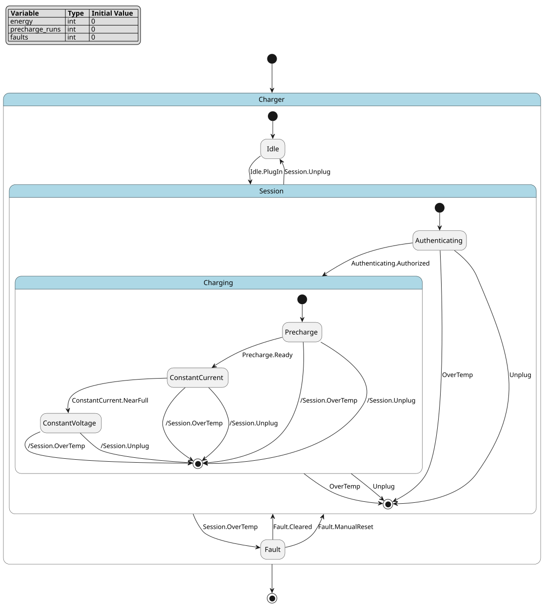
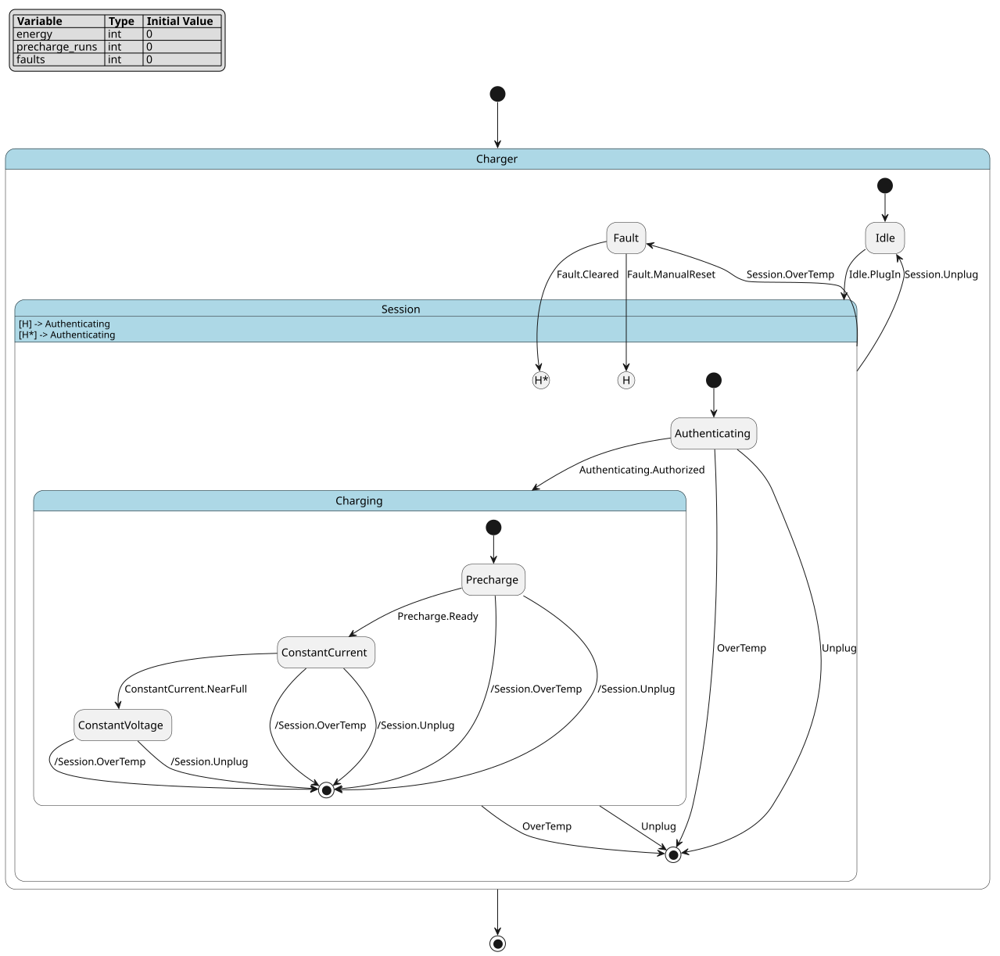

Resume an Interrupted Session with History
==========================================

This tutorial adds history to one existing model. You should already be able
to read an FCSTM model (:doc:`../dsl/index`) and run a batch simulation
(:doc:`../simulation/index`); step 6 also uses an inspect report
(:doc:`../inspect/index`). You will see why a fault recovery that enters a
composite state normally starts over, add history so that the recovery
continues where the interruption happened, and check the result with the
simulator, inspect and a Python hot start.

The model is a DC charger. A charging session authenticates the driver, then
charges in three phases: ``Precharge``, ``ConstantCurrent`` and
``ConstantVoltage``. Every precharge repeats an insulation test, so the model
counts precharges in ``precharge_runs``. An over-temperature fault can
interrupt any phase of the session.

Words used on this page:

* the **owner** is the composite state that remembers where it was left, here
  ``Session``;
* the **record** is what the owner remembers: the leaf state that was active
  when the owner was left;
* **deep history**, written ``[H*]``, restores the recorded leaf itself;
* **shallow history**, written ``[H]``, restores only the owner's direct child
  on the way to that leaf, and that child then runs its own initial
  transition;
* the **default target** is where history goes while the owner has no record.

1. Start from a model that forgets
----------------------------------

The first version recovers from a fault with ordinary transitions:

.. literalinclude:: charger_restart.fcstm
   :language: fcstm
   :caption: ``charger_restart.fcstm``; expected diagnostics: three ``W_UNREFERENCED_VAR`` warnings, one per variable, because no guard reads them.

   ``Session`` holds ``Authenticating`` and ``Charging``, which holds the
   three charging phases. The
   ``OverTemp`` and ``Unplug`` arrows from every phase are the expansion of the
   two forced transitions. ``Cleared`` and ``ManualReset`` both point at the
   ``Session`` box, which means an ordinary entry.

``!Session -> Fault :: OverTemp;`` is a forced transition: it leaves
``Session`` from every phase (see :ref:`dsl-forced-transition-task`). Run a
session into ``ConstantVoltage``, overheat it and let the fault clear:

.. code-block:: console

   $ pyfcstm simulate -i charger_restart.fcstm --no-color -e "\
   cycle; \
   cycle Charger.Idle.PlugIn; \
   cycle Charger.Session.Authenticating.Authorized; \
   cycle Charger.Session.Charging.Precharge.Ready; \
   cycle Charger.Session.Charging.ConstantCurrent.NearFull; \
   current"
   ...
   >>> current
   ────────────────────────────────────────────────────────────
   Cycle: 5
   Current State: Charger.Session.Charging.ConstantVoltage
   Variables:
     __forced_0 = 0
     __forced_1 = 0
     energy = 7
     faults = 0
     precharge_runs = 1
   $ pyfcstm simulate -i charger_restart.fcstm --no-color -e "\
   cycle; \
   cycle Charger.Idle.PlugIn; \
   cycle Charger.Session.Authenticating.Authorized; \
   cycle Charger.Session.Charging.Precharge.Ready; \
   cycle Charger.Session.Charging.ConstantCurrent.NearFull; \
   cycle Charger.Session.OverTemp; \
   cycle Charger.Fault.Cleared; \
   current"
   ...
   >>> current
   ────────────────────────────────────────────────────────────
   Cycle: 7
   Current State: Charger.Session.Authenticating
   Variables:
     __forced_0 = 0
     __forced_1 = 0
     energy = 7
     faults = 1
     precharge_runs = 1

Each run prints a report for every cycle; the ``...`` leaves out all of them but the final ``current`` report.

The two ``__forced_*`` variables are not yours. Model conversion carries each
forced transition out with one hidden variable, which is raised only inside the
cycle that takes ``Session`` away, so every report shows 0. Step 8 shows where
they are used.

The second report shows the problem. An ordinary entry runs ``Session``'s
initial transition, so the charger is back in ``Authenticating``. The driver
must authenticate again, and the next ``Authorized`` runs ``Precharge`` and its
insulation test a second time. ``ManualReset`` behaves the same way in this
model. ``energy`` keeps its value and ``faults`` counts the fault, because
leaving and entering states never resets variables.

2. Declare history inside the owner
-----------------------------------

The composite state that should remember declares its history next to its
ordinary initial transition:

.. code-block:: fcstm

   state Session {
       // ... child states as before ...
       [*] -> Authenticating;
       [H] -> Authenticating;   // shallow history
       [H*] -> Authenticating;  // deep history
       Authenticating -> Charging :: Authorized;
   }

The right-hand side is the default target, used only while ``Session`` has no
record yet; step 7 reaches that case after a power loss. A shallow default must
be a direct child of the owner. A deep default may be any descendant path
written relative to the owner, such as ``Charging.Precharge``.

A declaration alone changes no behavior. Ordinary entries such as
``Idle -> Session :: PlugIn`` still run ``[*] -> Authenticating``.

3. Enter the owner through its history
--------------------------------------

A transition uses history by naming the owner plus a marker as its target. The
transition sits in the owner's parent scope, here ``Charger``, exactly where
the ordinary recovery transitions were:

.. code-block:: fcstm

   Fault -> Session.[H*] :: Cleared;     // resume the exact phase
   Fault -> Session.[H] :: ManualReset;  // resume Charging, then precharge again

The complete model differs from ``charger_restart.fcstm`` only in the header
comment and the highlighted lines:

.. literalinclude:: charger.fcstm
   :language: fcstm
   :emphasize-lines: 28,29,38,39
   :caption: ``charger.fcstm``; expected diagnostics: the same three ``W_UNREFERENCED_VAR`` warnings as ``charger_restart.fcstm``.

4. Run the same session again
-----------------------------

The commands below run the same session as step 1, interrupts it in
``ConstantVoltage`` and recovers once through each kind of history:

.. code-block:: console

   $ pyfcstm simulate -i charger.fcstm --no-color -e "\
   cycle; \
   cycle Charger.Idle.PlugIn; \
   cycle Charger.Session.Authenticating.Authorized; \
   cycle Charger.Session.Charging.Precharge.Ready; \
   cycle Charger.Session.Charging.ConstantCurrent.NearFull; \
   cycle Charger.Session.OverTemp; \
   cycle Charger.Fault.Cleared; \
   current"
   ...
   >>> current
   ────────────────────────────────────────────────────────────
   Cycle: 7
   Current State: Charger.Session.Charging.ConstantVoltage
   Variables:
     __forced_0 = 0
     __forced_1 = 0
     __hist_Session = 8
     __hist_goto = 0
     energy = 9
     faults = 1
     precharge_runs = 1
   $ pyfcstm simulate -i charger.fcstm --no-color -e "\
   cycle; \
   cycle Charger.Idle.PlugIn; \
   cycle Charger.Session.Authenticating.Authorized; \
   cycle Charger.Session.Charging.Precharge.Ready; \
   cycle Charger.Session.Charging.ConstantCurrent.NearFull; \
   cycle Charger.Session.OverTemp; \
   cycle Charger.Fault.ManualReset; \
   current"
   ...
   >>> current
   ────────────────────────────────────────────────────────────
   Cycle: 7
   Current State: Charger.Session.Charging.Precharge
   Variables:
     __forced_0 = 0
     __forced_1 = 0
     __hist_Session = 8
     __hist_goto = 0
     energy = 7
     faults = 1
     precharge_runs = 2

Each run prints a report for every cycle; the ``...`` leaves out all of them but the final ``current`` report.

**Deep history** resumes ``Charging.ConstantVoltage``. The restore skips the
initial transitions on its path, both ``[*] -> Authenticating`` in ``Session``
and ``[*] -> Precharge`` in ``Charging``, so ``precharge_runs`` stays 1.
``energy`` grows from 7 to 9 because the restored leaf runs its ``during`` in
the cycle that enters it, as every entered leaf does.

**Shallow history** reads the same record but restores only the direct child
of ``Session`` that leads to the recorded leaf, which is ``Charging``. The
output still shows ``__hist_Session = 8``, the full leaf. ``Charging`` is entered and runs
its own initial transition, so the charger is in ``Precharge`` and
``precharge_runs`` becomes 2. The operator's reset repeats the insulation test
but skips authentication.

The two ``__hist_*`` variables appear because the simulator runs the model
after model conversion has turned history into ordinary variables and
transitions. Step 8 shows that form; for now, read them as the storage behind
the record.

5. Watch when the record changes
--------------------------------

This Python loop prints the record after every cycle.
:meth:`~pyfcstm.model.model.StateMachine.history_record` decodes the record
into a leaf path relative to ``Session``. The record describes the last exit
only while ``Session`` is inactive, so the script prints ``(Session active)``
otherwise.

.. testcode::

   from pyfcstm.model import load_state_machine_from_text
   from pyfcstm.simulate import SimulationRuntime

   with open("charger.fcstm") as f:
       machine = load_state_machine_from_text(f.read())
   runtime = SimulationRuntime(machine)

   # One event per cycle; None runs a cycle without an event.
   events = [
       None,
       "Idle.PlugIn",
       "Session.Authenticating.Authorized",
       "Session.Charging.Precharge.Ready",
       "Session.Charging.ConstantCurrent.NearFull",
       "Session.OverTemp",
       "Fault.Cleared",
       "Session.OverTemp",
       "Fault.ManualReset",
       "Session.Charging.Precharge.Ready",
       "Session.Unplug",
       "Idle.PlugIn",
   ]

   row = "{:>2}  {:<12} {:<15} {:>9} {:>6}  {}"
   print(row.format("#", "event", "active leaf", "precharge", "energy", "Session record"))
   for step, event in enumerate(events):
       runtime.cycle(["Charger." + event] if event else [])
       path = runtime.current_state.path
       if path[1] == "Session":
           record = "(Session active)"
       else:
           record = machine.history_record(runtime.vars, "Charger.Session") or "none"
       print(
           row.format(
               step,
               event.split(".")[-1] if event else "-",
               path[-1],
               runtime.vars["precharge_runs"],
               runtime.vars["energy"],
               record,
           )
       )

.. testoutput::

    #  event        active leaf     precharge energy  Session record
    0  -            Idle                    0      0  none
    1  PlugIn       Authenticating          0      0  (Session active)
    2  Authorized   Precharge               1      0  (Session active)
    3  Ready        ConstantCurrent         1      5  (Session active)
    4  NearFull     ConstantVoltage         1      7  (Session active)
    5  OverTemp     Fault                   1      7  Charging.ConstantVoltage
    6  Cleared      ConstantVoltage         1      9  (Session active)
    7  OverTemp     Fault                   1      9  Charging.ConstantVoltage
    8  ManualReset  Precharge               2      9  (Session active)
    9  Ready        ConstantCurrent         2     14  (Session active)
   10  Unplug       Idle                    2     14  Charging.ConstantCurrent
   11  PlugIn       Authenticating          2     14  (Session active)

Read the table from top to bottom:

* Rows 5 and 7: leaving ``Session`` through ``OverTemp`` records the active
  leaf, ``Charging.ConstantVoltage``.
* Rows 6 and 8: both recoveries read the same record. They differ only in how
  deep they restore, so only row 8 increments ``precharge``.
* Row 10: ``Unplug`` also leaves ``Session``, so it records
  ``Charging.ConstantCurrent``. Every exit from the owner updates the record,
  not only faults.
* Row 11: ``PlugIn`` is an ordinary entry. The new session starts in
  ``Authenticating`` although a record exists; only ``Session.[H]`` and
  ``Session.[H*]`` targets read the record.
* The ``precharge`` and ``energy`` columns never jump back. History restores
  states, not variable values.

6. Check the model and repair one mistake
-----------------------------------------

Inspect judges the model as you wrote it, before conversion. The commands below
inspect ``charger.fcstm``, then a copy without the ``[H*]`` declaration.

.. code-block:: console

   $ pyfcstm inspect -i charger.fcstm --format human --color never
   [WARN] FCSTM Inspect Report: charger.fcstm

   Summary
     status: warning
     root: Charger
     states: 9 total / 6 leaf
     transitions: 21
     variables: 3
       energy: control; external supply: none
       precharge_runs: control; external supply: none
       faults: control; external supply: none
   ...
     diagnostics: 0 errors / 3 warnings / 0 infos
   ...
   [WARN] W_UNREFERENCED_VAR
     Variable 'energy' does not affect any transition guard.
   ...
   [WARN] W_UNREFERENCED_VAR
     Variable 'precharge_runs' does not affect any transition guard.
   ...
   [WARN] W_UNREFERENCED_VAR
     Variable 'faults' does not affect any transition guard.
   ...

The report is cut down to its summary and the three warnings; ``...`` leaves out the rest. Now make a copy without the ``[H*]`` declaration, which removes one line of ``Session``:

.. testcode::

   text = open("charger.fcstm").read()
   deep = "        [H*] -> Authenticating;  // deep history, used while no record exists\n"
   open("forgot_deep.fcstm", "w").write(text.replace(deep, ""))

Inspect the copy twice. Without ``--collect-errors``, inspect stops at the first
model error with a one-line message and no diagnostic code. With it, inspect
collects the errors into the report; only its summary line and the error block
are kept here. Both runs fail, so each is followed by ``$ echo $?``:

.. code-block:: console

   $ pyfcstm inspect -i forgot_deep.fcstm --format human --color never
   Invalid state machine model in forgot_deep.fcstm: Charger.Session does not declare deep history ([H*] -> ...;), so it cannot be entered through Session.[H*]. (line 37)
   $ echo $?
   1
   $ pyfcstm inspect -i forgot_deep.fcstm --collect-errors --format human --color never
   [ERROR] FCSTM Inspect Report: forgot_deep.fcstm
   ...
     diagnostics: 1 errors / 3 warnings / 0 infos
   ...
   [ERROR] E_HISTORY_TARGET_UNDECLARED
     Charger.Session does not declare deep history ([H*] -> ...;), so it cannot be entered through Session.[H*].
     --> forgot_deep.fcstm:37:5
   ...
   $ echo $?
   1

The first report has the same three warnings as ``charger_restart.fcstm``, so
history added no finding. It lists the three variables you declared and no
``__hist_*`` variable.

The copy is the mistake to recognize. ``Session.[H*]`` asks for deep
history, but ``Session`` no longer declares it, so inspect reports
``E_HISTORY_TARGET_UNDECLARED`` at the transition and exits with status 1.
``pyfcstm simulate``, ``pyfcstm generate`` and ``pyfcstm bmc`` refuse the same
model, because history is never provided implicitly. Repair it in one of two
ways:

* put ``[H*] -> Authenticating;`` back into ``Session`` when the recovery
  should resume the exact phase;
* write ``Fault -> Session :: Cleared;`` when the recovery should start over.

7. Persist the record across a power loss
-----------------------------------------

A charger that loses power while in ``Fault`` must restore the session record
when it restarts. A hot start supplies every variable, including the
``__hist_*`` ones, so the controller has to store the record somewhere. The
``__forced_*`` variables are ordinary variables too: they read 0 at every
checkpoint and are saved and supplied with the others. Store
the source-level record, not the numbers: the numbers are state ids that change
when the model is edited.
:meth:`~pyfcstm.model.model.StateMachine.history_variables` turns a saved
record back into those variables. The hot start itself works as described in
the "Hot start at a state" section of :doc:`/how_to/simulation/index`.

The controller saves its record before the power goes. This script ends the charge in ``Fault`` and writes what a controller would put in non-volatile storage, here a JSON file:

.. testcode::

   import json

   from pyfcstm.model import load_state_machine_from_file
   from pyfcstm.simulate import SimulationRuntime

   OWNER = "Charger.Session"
   machine = load_state_machine_from_file("charger.fcstm")

   # Charge into ConstantCurrent, then overheat.
   runtime = SimulationRuntime(machine)
   for event in [
       None,
       "Idle.PlugIn",
       "Session.Authenticating.Authorized",
       "Session.Charging.Precharge.Ready",
       "Session.OverTemp",
   ]:
       runtime.cycle(["Charger." + event] if event else [])

   # What goes to non-volatile storage: the state, the model's own variables and
   # the source-level record, but no generated __hist_* number.
   saved = {
       "state": ".".join(runtime.current_state.path),
       "record": machine.history_record(runtime.vars, OWNER),
       "vars": {k: v for k, v in runtime.vars.items() if not k.startswith("__hist_")},
   }
   with open("saved.json", "w") as f:
       json.dump(saved, f)
   print("saved state: ", saved["state"])
   print("saved record:", saved["record"])
   print("saved vars:  ", saved["vars"])

.. testoutput::

   saved state:  Charger.Fault
   saved record: Charging.ConstantCurrent
   saved vars:   {'energy': 5, 'precharge_runs': 1, 'faults': 1, '__forced_0': 0, '__forced_1': 0}

After the restart, a second script reads the file and hot starts twice, once with the saved record and once without it. Each restored machine then receives ``Cleared``:

.. testcode::

   import json

   from pyfcstm.model import load_state_machine_from_file
   from pyfcstm.simulate import SimulationRuntime

   OWNER = "Charger.Session"
   machine = load_state_machine_from_file("charger.fcstm")
   with open("saved.json") as f:
       saved = json.load(f)

   cases = [("with the saved record", saved["record"]), ("without a record", None)]
   for label, record in cases:
       hidden = machine.history_variables({OWNER: record} if record else None)
       initial_vars = dict(saved["vars"])
       initial_vars.update(hidden)
       runtime = SimulationRuntime(
           machine, initial_state=saved["state"], initial_vars=initial_vars
       )
       runtime.cycle(["Charger.Fault.Cleared"])
       print("After the power loss,", label)
       print("  history variables:", hidden)
       print("  after Cleared:    ", ".".join(runtime.current_state.path))
       print("  precharge_runs:   ", runtime.vars["precharge_runs"])
       print()

.. testoutput::

   After the power loss, with the saved record
     history variables: {'__hist_goto': 0, '__hist_Session': 7}
     after Cleared:     Charger.Session.Charging.ConstantCurrent
     precharge_runs:    1

   After the power loss, without a record
     history variables: {'__hist_goto': 0, '__hist_Session': 0}
     after Cleared:     Charger.Session.Authenticating
     precharge_runs:    1

With the saved record, ``Cleared`` resumes ``ConstantCurrent`` after the
restart, exactly as it would have without the power loss, and does not repeat
the precharge. Without a record, the deep history uses its default target and
the session starts in ``Authenticating``.

8. Optional: look at what model conversion produced
---------------------------------------------------

The simulator, the generated code and BMC never see ``[H]`` or ``[H*]``. Model
conversion rewrites them into ordinary FCSTM before any of them runs. Printing
the converted model shows that rewritten form:

.. testcode::

   from pyfcstm.model import load_state_machine_from_text

   with open("charger.fcstm") as f:
       machine = load_state_machine_from_text(f.read())
   print(str(machine.to_ast_node()))

.. testoutput::

   def int energy = 0;
   def int precharge_runs = 0;
   def int faults = 0;
   def int __hist_goto = 0;
   def int __hist_Session = 0;
   def int __forced_0 = 0;
   def int __forced_1 = 0;
   state Charger {
       state Idle {
           event PlugIn;
       }
       state Session {
           state Authenticating {
               exit {
                   __hist_Session = 4;
               }
               event Authorized;
           }
           state Charging {
               state Precharge {
                   enter {
                       precharge_runs = precharge_runs + 1;
                   }
                   exit {
                       __hist_Session = 6;
                   }
                   event Ready;
               }
               state ConstantCurrent {
                   during {
                       energy = energy + 5;
                   }
                   exit {
                       __hist_Session = 7;
                   }
                   event NearFull;
               }
               state ConstantVoltage {
                   during {
                       energy = energy + 2;
                   }
                   exit {
                       __hist_Session = 8;
                   }
               }
               [*] -> ConstantCurrent : if [__hist_goto == 7] effect {
                   __hist_goto = 0;
               }
               [*] -> ConstantVoltage : if [__hist_goto == 8] effect {
                   __hist_goto = 0;
               }
               Precharge -> [*] : /Session.OverTemp effect {
                   __forced_0 = 1;
               }
               Precharge -> [*] : /Session.Unplug effect {
                   __forced_1 = 1;
               }
               ConstantCurrent -> [*] : /Session.OverTemp effect {
                   __forced_0 = 1;
               }
               ConstantCurrent -> [*] : /Session.Unplug effect {
                   __forced_1 = 1;
               }
               ConstantVoltage -> [*] : /Session.OverTemp effect {
                   __forced_0 = 1;
               }
               ConstantVoltage -> [*] : /Session.Unplug effect {
                   __forced_1 = 1;
               }
               [*] -> Precharge : if [__hist_goto == 0 || __hist_goto == 5 || __hist_goto == 6] effect {
                   __hist_goto = 0;
               }
               Precharge -> ConstantCurrent :: Ready;
               ConstantCurrent -> ConstantVoltage :: NearFull;
           }
           event OverTemp;
           event Unplug;
           [*] -> Charging : if [__hist_goto >= 5 && __hist_goto <= 8];
           Authenticating -> [*] : OverTemp effect {
               __forced_0 = 1;
           }
           Authenticating -> [*] : Unplug effect {
               __forced_1 = 1;
           }
           Charging -> [*] : if [__forced_0 == 1 && __forced_1 == 0];
           Charging -> [*] : if [__forced_1 == 1 && __forced_0 == 0];
           [*] -> Authenticating : if [__hist_goto == 0 || __hist_goto == 4] effect {
               __hist_goto = 0;
           }
           Authenticating -> Charging :: Authorized;
       }
       state Fault {
           enter {
               faults = faults + 1;
           }
           event Cleared;
           event ManualReset;
       }
       pseudo state __forced_gate_0;
       pseudo state __forced_gate_1;
       Session -> Fault : if [__forced_0 == 1 && __forced_1 == 0] effect {
           __forced_0 = 0;
       }
       Session -> __forced_gate_0 :: OverTemp;
       Session -> Idle : if [__forced_1 == 1 && __forced_0 == 0] effect {
           __forced_1 = 0;
       }
       Session -> __forced_gate_1 :: Unplug;
       [*] -> Idle;
       Idle -> Session :: PlugIn;
       Fault -> Session :: Cleared effect {
           __hist_goto = (__hist_Session != 0) ? __hist_Session : 4;
       }
       Fault -> Session :: ManualReset effect {
           __hist_goto = (__hist_Session == 4) ? 4 : ((__hist_Session >= 6 && __hist_Session <= 8) ? 5 : 4);
       }
       __forced_gate_0 -> Fault : if [__forced_0 == 0 && __forced_1 == 0];
       __forced_gate_1 -> Idle : if [__forced_0 == 0 && __forced_1 == 0];
   }

Use the output to check what the earlier steps observed:

* Four new ``int`` variables follow your own. Two belong to history:
  ``__hist_Session`` holds the record and ``__hist_goto`` holds the restore in
  progress, which is 0 whenever the machine is stable. The other two,
  ``__forced_0`` and ``__forced_1``, belong to the forced transitions and are
  explained in the last item.
* Every leaf below ``Session`` has an ``exit`` action that writes its id into
  ``__hist_Session``: 4 for ``Authenticating``, 6 to 8 for the three charging
  phases. That is how row 5 of step 5 recorded ``Charging.ConstantVoltage``,
  id 8, and why the record changes on every exit from the owner.
* ``Fault -> Session.[H*] :: Cleared`` became an ordinary entry whose effect
  sets ``__hist_goto`` to the record, or to 4, the id of the default target
  ``Authenticating``, when no record exists.
* ``Fault -> Session.[H] :: ManualReset`` maps a record inside ``Charging``
  (ids 6 to 8) to 5, the id of ``Charging`` itself.
* The initial transitions of ``Session`` and ``Charging`` are guarded by
  ``__hist_goto``. 0 selects the ordinary initial child, other values route
  the entry towards the restore target, and the transition that reaches the
  target resets ``__hist_goto`` to 0. A restore heading for 5 ends at
  ``[*] -> Precharge`` in ``Charging``, which is why the shallow restore
  repeats the precharge.
* The rest is how the two forced transitions are carried out, and has nothing
  to do with history. Each phase gets a ``-> [*]`` transition that keeps the
  event and sets ``__forced_0`` or ``__forced_1``; ``Charging`` and ``Session``
  pass the exit on while that variable is 1; the transition that finally leaves
  ``Session`` sets it back to 0. The two ``__forced_gate_*`` pseudo states
  belong to the transitions written on ``Session`` itself: each of them is
  split in two there, so that it waits while one of the variables is 1.

   The charger as ``pyfcstm plantuml -i charger.fcstm`` draws it. A drawing
   shows the model as written, not what conversion produced: a transition that
   enters a history names it as ``Session[H]`` or ``Session[H*]``, and the
   default of each history is the ``[H]`` or ``[H*]`` line in the description
   of the owner. Each forced
   transition is one arrow per phase. The variables, guarded initial transitions
   and relays above are not drawn.
   The labels are code identifiers only, so one figure serves both languages.

Where to go next
----------------

This tutorial covered one owner, entered from its parent through both kinds of
history. Leave it when your question changes:

.. list-table::
   :header-rows: 1
   :widths: 40 60

   * - Question
     - Page
   * - How do I add history to my own model, and what do the common errors mean?
     - :ref:`dsl-history-task`, a task recipe with a troubleshooting table.
   * - Which forms are legal? History can also be entered from an initial
       transition, a forced transition or an external self transition.
     - :ref:`dsl-history-reference`, with every form, diagnostic and generated
       name.
   * - Why is the record not cleared when the owner ends, and what happens
       when a restore is blocked by a false guard?
     - :ref:`dsl-history-semantics`. A blocked restore rejects the whole
       transition instead of falling back to an ordinary entry.
   * - How do BMC queries treat the ``__hist_*`` variables?
     - :doc:`/reference/bmc_query/index`, section "Initial frame: ``init``,
       ``havoc``, and ``where``".
