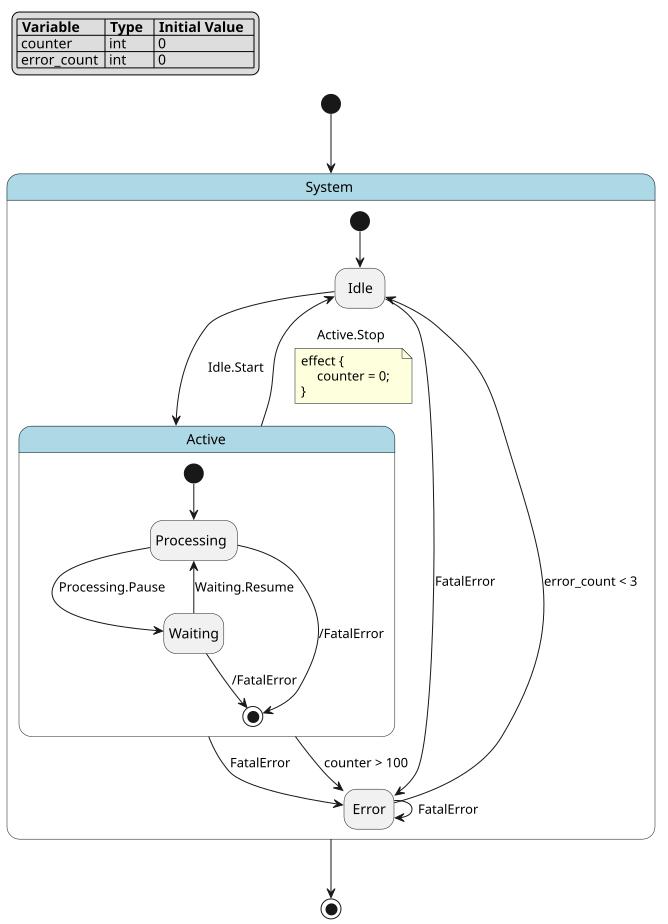

First diagram
=============

This tutorial shows the shortest path from an FCSTM model to a PlantUML diagram
source file and rendered example. For export recipes, see
:doc:`/how_to/visualization/index`; for option facts, see
:doc:`/reference/visualization_options/index`.

Example state machine
---------------------

.. literalinclude:: example.fcstm
   :language: fcstm
   :caption: example.fcstm

Generate PlantUML source
------------------------

Use ``plantuml`` when you want deterministic text output:

.. code-block:: console

   $ pyfcstm plantuml -i example.fcstm -o output_cli_basic.puml
   $ cat output_cli_basic.puml
   @startuml
   hide empty description
   ...
   @enduml

The command prints nothing when it writes a file. The file starts with ``@startuml`` and ends with ``@enduml``, so it is PlantUML source.

Rendered example
----------------

The ``output_cli_basic.puml`` shipped with this page is the file the command above
writes, and the documentation resource build renders it into an SVG artifact:

   PlantUML diagram generated with CLI default settings.

Try detail presets
------------------

Use ``-l`` for the built-in detail presets:

.. code-block:: console

   $ pyfcstm plantuml -i example.fcstm -l minimal -o output_minimal.puml
   $ pyfcstm plantuml -i example.fcstm -l normal -o output_normal.puml
   $ pyfcstm plantuml -i example.fcstm -l full -o output_full.puml
   $ diff output_minimal.puml output_normal.puml
   $ diff output_normal.puml output_full.puml
   18a19
   >     system__idle : enter {\n    counter = 0;\n}
   20a22
   >         system__active__processing : during {\n    counter = counter + 10;\n}
   27a30
   >     system__active : during before {\n    counter = counter + 1;\n}
   28a32
   >     system__error : enter {\n    error_count = error_count + 1;\n}
   42a47
   > system : >> during before abstract GlobalMonitor;
   $ echo $?
   1

The ``diff`` commands compare the three files. For this model ``minimal`` and
``normal`` write the same text, so the first ``diff`` prints nothing. ``full``
adds the five lines shown: the ``enter``, ``during`` and aspect action bodies of
the states. ``diff`` ends with status 1 whenever the files differ. The option
reference explains which facts each preset affects for other models.

Open the offline Python viewer
------------------------------

The Python ``Diagram`` facade is the browser-based path when you want a
self-contained HTML file with source/diagram comparison and browser-side SVG,
PNG, and vector PDF downloads. It does not require PlantUML or Node at runtime.

.. testcode::

   from pyfcstm.model import load_state_machine_from_text

   model = load_state_machine_from_text("state Root { state Idle; [*] -> Idle; }")
   diagram = model.diagram(direction="LR", cjk_locale="sc")
   data = diagram.to_dict()
   print(data["kind"], data["machineName"])
   print(data["summary"])

.. testoutput::

   diagram Root
   {'actions': 0, 'events': 0, 'states': 2, 'transitions': 1, 'variables': 0}

``to_dict()`` returns portable data, summarized above. The next two calls give the
complete HTML text and a generated ``.html`` path:

.. code-block:: python

   html = diagram.to_html()
   output = diagram.show(open_window=False)

The documentation checks do not run these two calls, because they need the
packaged viewer assets, which a source checkout builds with ``make build_assets``.
The HTML file contains the viewer, renderer,
WASM, and selected fonts, so it remains usable without a network connection.
Use ``open_window=True`` (the default) only when a Chromium-family browser is
available. It blocks until you close the window, the way
``matplotlib.pyplot.show`` does, and then removes the temporary file it wrote —
pass a path to keep one. Without a browser, or on a machine with no display,
``show`` raises ``DiagramUnavailableError``; use ``open_window=False`` to create
the file without opening a window.

The synchronous ``to_svg()``, ``to_png()``, and ``to_pdf()`` methods are typed
capability probes in this stage and raise ``DiagramUnavailableError``. The
browser export buttons in the generated HTML are the available three-format
export path; the optional headless Python runtime is owned by the later delivery
stage.

Where to go next
----------------

* :doc:`/how_to/visualization/index` shows PlantUML source export and direct
  rendered-file export tasks, plus the Python Diagram viewer workflow.
* :doc:`/reference/visualization_options/index` lists ``PlantUMLOptions`` and
  CLI ``-c`` facts and the Python Diagram option/value contracts.
* :doc:`/tutorials/quick_start/index` includes visualization in the shortest
  end-to-end path.
* :doc:`/explanations/visualization/index` explains why the viewer is one
  self-contained document, why ``--open`` blocks, and who removes what.
* :doc:`/tutorials/regions/index` shows how regions appear in the PlantUML text
  and in the viewer.
