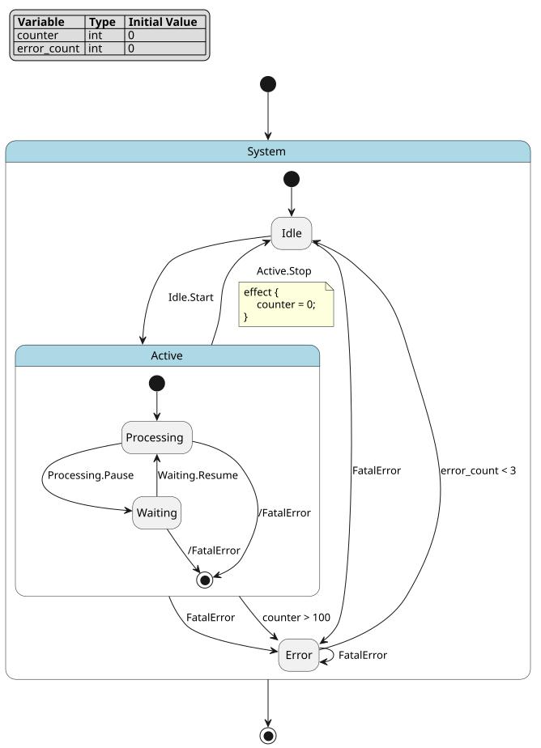

第一张图
========

本教程展示从 FCSTM 模型生成 PlantUML 图源码和渲染示例的最短路径。导出任务配方请见 :doc:`/how_to/visualization/index_zh`；选项事实请见 :doc:`/reference/visualization_options/index_zh`。

术语说明：图源文件（diagram source）、渲染后端（rendering backend）和本地渲染（local rendering）在本页首次交接后，后文只使用中文术语。

示例状态机
----------

.. literalinclude:: example.fcstm
   :language: fcstm
   :caption: example.fcstm

生成 PlantUML 源码
------------------

需要确定性的文本输出时，使用 ``plantuml``：

.. code-block:: console

   $ pyfcstm plantuml -i example.fcstm -o output_cli_basic.puml
   $ cat output_cli_basic.puml
   @startuml
   hide empty description
   ...
   @enduml

写文件时命令本身不打印任何内容；文件以 ``@startuml`` 开头、以 ``@enduml`` 结尾，说明它是 PlantUML 源码。

渲染示例
--------

本页附带的 ``output_cli_basic.puml`` 就是上面命令写出的文件，文档资源构建会把它渲染为 SVG 产物：

   使用 CLI 默认设置生成的 PlantUML 图表。

尝试详细级别预设
----------------

用 ``-l`` 选择内置详细级别预设：

.. code-block:: console

   $ pyfcstm plantuml -i example.fcstm -l minimal -o output_minimal.puml
   $ pyfcstm plantuml -i example.fcstm -l normal -o output_normal.puml
   $ pyfcstm plantuml -i example.fcstm -l full -o output_full.puml
   $ diff output_minimal.puml output_normal.puml
   $ diff output_normal.puml output_full.puml
   18a19
   >     system__idle : enter {\n    counter = 0;\n}
   20a22
   >         system__active__processing : during {\n    counter = counter + 10;\n}
   27a30
   >     system__active : during before {\n    counter = counter + 1;\n}
   28a32
   >     system__error : enter {\n    error_count = error_count + 1;\n}
   42a47
   > system : >> during before abstract GlobalMonitor;
   $ echo $?
   1

``diff`` 命令比较这三个文件。对这个模型，\ ``minimal``\ 和 ``normal`` 写出相同的文本，所以第一条 ``diff`` 什么也不打印；\ ``full``\ 多出所示的五行：各状态的 ``enter``\ 、\ ``during``\ 和切面动作的正文。文件不同时 ``diff`` 以状态 1 结束。对其他模型各预设影响哪些事实，见选项参考。

打开离线 Python 查看器
-----------------------

如果需要一个包含源码/图形对比、并能在浏览器中下载 SVG、PNG 和矢量 PDF
的自包含 HTML 文件，可以使用 Python ``Diagram`` 接口。运行时不需要
PlantUML 或 Node。

.. testcode::

   from pyfcstm.model import load_state_machine_from_text

   model = load_state_machine_from_text("state Root { state Idle; [*] -> Idle; }")
   diagram = model.diagram(direction="LR", cjk_locale="sc")
   data = diagram.to_dict()
   print(data["kind"], data["machineName"])
   print(data["summary"])

.. testoutput::

   diagram Root
   {'actions': 0, 'events': 0, 'states': 2, 'transitions': 1, 'variables': 0}

``to_dict()`` 返回可移植数据，上面打印了它的概要。接下来两个调用给出完整 HTML 文本和生成的 ``.html`` 路径：

.. code-block:: python

   html = diagram.to_html()
   output = diagram.show(open_window=False)

文档检查不运行这两个调用，因为它们需要打包好的查看器资源，源码检出要用 ``make build_assets`` 构建。
HTML 内嵌查看器、渲染器、WASM 和选定字体，因此不依赖网络。只有在存在
Chromium 系浏览器时才使用默认的 ``open_window=True``：它会像
``matplotlib.pyplot.show`` 那样阻塞到你关闭窗口，随后删除自己写出的临时文件——
想保留请显式传入路径。没有浏览器、或机器上没有显示环境时，``show`` 会抛出
``DiagramUnavailableError``；只想生成文件时使用 ``open_window=False``。

本阶段的同步 ``to_svg()``、``to_png()`` 和 ``to_pdf()`` 只是类型化能力探针，
会抛出 ``DiagramUnavailableError``。生成的 HTML 中的浏览器导出按钮才是
当前可用的三格式导出路径；可选的 Python 无头运行时归后续交付阶段负责。

下一步
------

* :doc:`/how_to/visualization/index_zh` 展示 PlantUML 源码导出和直接渲染文件导出任务。
  该页还包含 Python Diagram 查看器任务。
* :doc:`/reference/visualization_options/index_zh` 列出 ``PlantUMLOptions``、CLI ``-c``
  以及 Python Diagram 选项/取值合同。
* :doc:`/tutorials/quick_start/index_zh` 在最短端到端路径中包含可视化。
* :doc:`/explanations/visualization/index_zh` 解释查看器为何是一个自包含文档、
  ``--open`` 为何阻塞、以及谁负责删除什么。
* 区域在 PlantUML 文本和查看器里的样子见 :doc:`/tutorials/regions/index_zh`。
